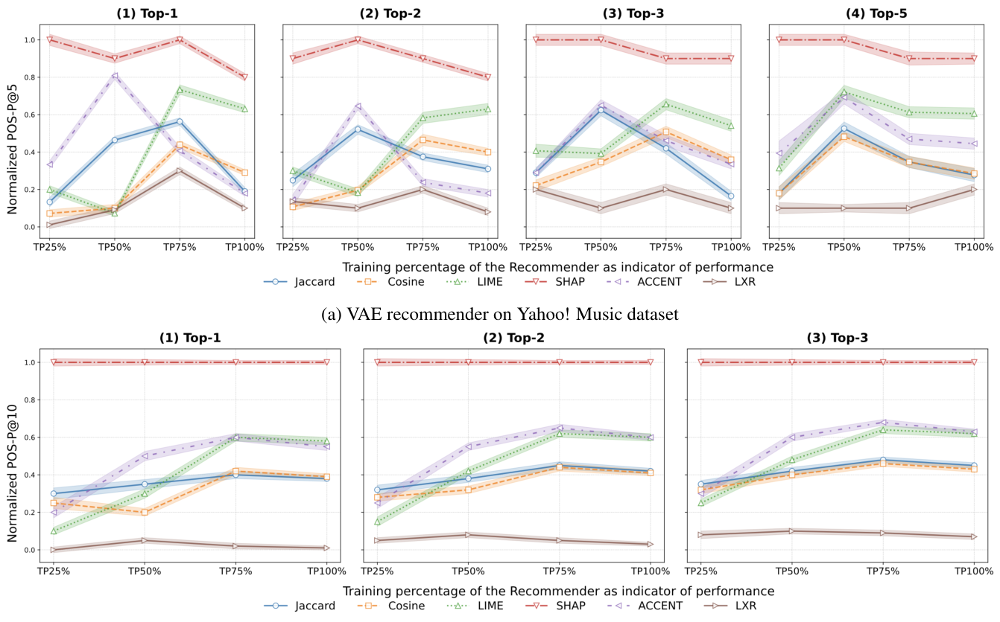
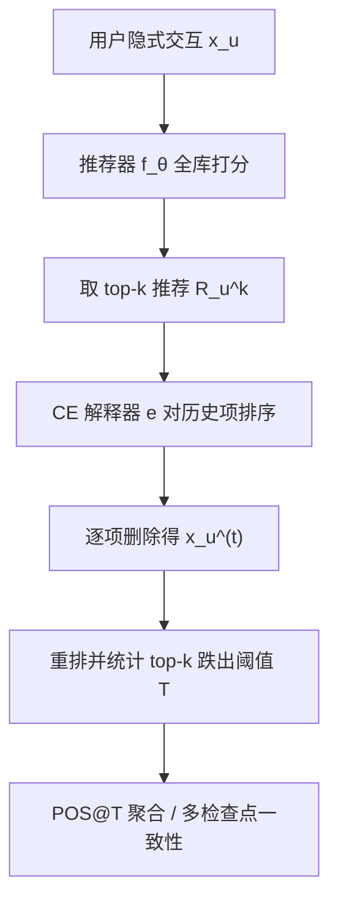

# Beyond Top-1: Addressing Inconsistencies in Evaluating Counterfactual Explanations for Recommender Systems (Extended Abstract)（超越 Top-1：解决推荐系统反事实解释评估中的不一致性）

- **会议/期刊**: IJCAI 2026（Sister Conferences Best Papers Track）
- **作者与机构**: Amir Reza Mohammadi, Andreas Peintner, Michael M. Müller, Eva Zangerle；University of Innsbruck
- **推荐链路定位**: 重排/解释评估（后置评测）
- **研究方向**: 去偏公平、可信隐私与工业架构（主）/ 评测基准
- **论文原文**: [论文原文链接](https://www.ijcai.org/proceedings/2026/0926.pdf)
- **开源代码**: [开源代码仓库链接](https://github.com/dbis-uibk/CE4RS-Eval)

## TL;DR (1分钟核心速览)

针对反事实解释（CE）评测只看 top-1、导致解释方法排序随推荐模型质量漂移的问题，本文将 POS-P@T 从 top-1 扩展为 listwise top-k，并在 ML-1M、Yahoo! Music、Pinterest 上以 MF/VAE 的 25%–100% 训练检查点做 24 组配置×3 次重复。结果不追求推荐精度提升，而显示 VAE 上 top-5 明显收敛、MF 在 top-3 即稳定，说明 k 应作为评测超参。

## Background & Motivation (背景与核心矛盾)

- **主流范式**: CE 通过删除/扰动用户历史中的关键交互，使推荐结果改变；现有评测多用 top-1 推荐是否变化或跌出阈值来衡量解释有效性。
- **前人局限**: top-1 把排序任务压缩成单点结果，易受分数抖动、并列和模型质量波动影响；同一解释器在不同训练检查点下可能出现方法排序反转，破坏可复现比较。
- **核心洞察 (Key Insight)**: 推荐系统输出本质是列表，评估应对齐 listwise 结构；聚合多个高位推荐项可抵消局部排序噪声。
- **本文切入点**: 不提出新解释器，而是把 POS-P@T 的内层统计从 top-1 改为 top-k，并用多性能检查点检验“方法排序一致性”。

图 1 直观展示了 top-1 与 top-k 评估下 CE 方法排序稳定性的差异。

<figure class="paper-figure" markdown="span">
  <figcaption>图 1：基于 (a) POS@5 ↓（数值越低越好）和 (b) 不同性能水平下的 POS@10 ↓ 的 CE 方法比较。该图展示了在评估 CE 模型时，超越 top-1（a）以及考虑 top-k（b-d）推荐对提升一致性的影响。为便于比较，数值已归一化，阴影表示结果的方差。</figcaption>
</figure>

## Method (核心方法设计)

### 1. 整体框架 (Overall Architecture)

输入用户二值交互 $x_u$，推荐器$f_\theta$全库打分取 top-k$R_u^k$；解释器$e$对历史项按相关性排序，逐项删除得到扰动序列$x_u^{(t)}$，每次重排后检查$R_u^k$中各项是否跌出阈值$T$，聚合为 POS@T。为检验一致性，训练 HR 目标保存 25%/50%/75%/100% 四个检查点，跨 3 数据集、2 推荐器、6 解释器、3 次重复比较方法排序是否稳定。

### 2. 关键设计拆解 (Key Designs)

1. **Listwise POS-P@T（核心指标改造）**：原 top-1 只问“第一名是否被推下去”，本文对 top-k 内每个 $i_j^*$累计其跌出阈值$T$的扰动步数，核心式为$\mathrm{POS@}T_u=\sum_{j=1}^{k}\sum_{t=1}^{|x_u|}\mathbb{I}[\mathrm{rank}(i_j^*;x_u^{(t)})>T]$，再对用户取平均。$k=1$退化为原协议；$k>1$ 让多个高位项共同投票，降低单点分数噪声。该指标越低越好。
2. **多检查点一致性协议**：不只比较单次训练后的绝对 POS，而是在 25%/50%/75%/100% 训练进度保存推荐器，检验“若 E1 在 R1 上优于 E2，模型质量变化后 E1 是否仍优于 E2”。这把评测目标从“分数高低”转为“方法排序可复现性”，避免结论被某一模型状态偶然放大。
3. **k 与模型复杂度耦合 + 开销**：MF 较简单，top-3 已稳定；VAE 表达能力更强、排序波动更大，需 top-5 才在 TP50–100 收敛。因此 k 不是固定常数，而是随数据集/推荐器调节的评测超参。方法不引入新推荐损失；MF/VAE 按 HR 训练，负采样细节原文未展开；每用户约需 $O(k|x_u|)$ 次前向重排。

## Experimental Setup & Evaluation Protocol (实验设置与评估协议)

- **数据集与预处理**: 原文为扩展摘要，未复列过滤后统计；下表为公开版本规模，沿用 Mohammadi et al. 2024 的隐式反馈 CE4RS 设置。

| 数据集 | #Users | #Items | #Interactions | 稀疏度/密度 | 特征/场景说明 |
| :--- | :---: | :---: | :---: | :---: | :--- |
| ML-1M | 6,040 | 3,706 | 1,000,209 | 4.47% | 电影评分二值化为隐式交互 |
| Yahoo! Music | 15,400 | 1,000 | 11,557,943 | 75.05% | 音乐艺术家隐式反馈，密集 |
| Pinterest | 55,187 | 9,916 | 1,500,809 | 0.27% | 图像 Pin 隐式反馈，稀疏 |

- **数据划分与防穿越 (Splitting Strategy)**: 原文未明确划分（扩展摘要），沿用前期 CE4RS 协议；未报告时间切分或冷启动划分。
- **排名评测协议 (Ranking Protocol)**: 全库打分生成 top-k，扰动后全库重排统计 POS；未报告采样负例比例。
- **对比基线与超参设置**: 6 个 CE：Jaccard、Cosine、LIME-RS、SHAP、ACCENT、LXR；2 个推荐器：MF、VAE；Embedding 维度与超参正文未给，代码仓库提供；3 次重复取均值/方差，未报告显著性检验。

## Key Experimental Results (实验关键数据)

### 1. 主实验对比 (Main Results)

原文图 1 仅给归一化曲线，未给逐方法绝对 POS 数值；下表不伪造数值，汇总可复核的稳定性证据，精确结果见作者仓库。

| CE 方法 | 类型 | VAE/Yahoo POS@5↓ top-1 | VAE/Yahoo POS@5↓ top-5 | MF/Pinterest POS@10↓ top-1 | MF/Pinterest POS@10↓ top-3 |
| :--- | :--- | :---: | :---: | :---: | :---: |
| Jaccard | 相似度 | 波动明显 | 收敛 | 较稳 | 稳定 |
| Cosine | 相似度 | 波动明显 | 收敛 | 较稳 | 稳定 |
| LIME-RS | 局部代理 | 波动明显 | 收敛 | 较稳 | 稳定 |
| SHAP | 博弈归因 | 波动明显 | 收敛 | 较稳 | 稳定 |
| ACCENT | 影响函数 | 波动明显 | 收敛 | 较稳 | 稳定 |
| LXR | 自监督掩码 | 波动明显 | 收敛 | 较稳 | 稳定 |

注：原文未报告 `Improv.%`；核心收益是方法排序一致性提升，而非推荐精度提升。

### 2. 消融实验 (Ablation Study)

以 k 为“列表长度消融”，观察 top-1→top-5 对一致性的影响：

| 配置 | VAE/Yahoo POS@5↓ | MF/Pinterest POS@10↓ | 结论 |
| :--- | :--- | :--- | :--- |
| k=1 | TP25%→TP50% 方法排序明显漂移 | 已较稳 | top-1 不足 |
| k=2 | 高分段改善 | 稳定 | 低成本改进 |
| k=3 | 继续改善 | 已稳定 | MF 足够 |
| k=5 | TP50–100 稳定 | 稳定 | VAE 推荐 |

### 3. 关键实验发现 (Key Findings)

1. **top-1 的不稳定性是系统性的**：VAE/Yahoo 上 POS@5 从 TP25% 到 TP50% 出现明显方法排序漂移；扩到 top-5 后 TP50–100 才稳定，说明单点评估会放大模型质量波动。
2. **k 应随模型复杂度调节**：MF/Pinterest 在 top-3 已稳定，而 VAE 需 top-5；固定 k=1 或 k=3 会低估复杂推荐器的评测噪声。
3. **多检查点比单点结论更可信**：24 配置×3 重复显示 POS 对推荐器质量高度敏感；只报单一 checkpoint 容易产生“看似更优”的解释器排序，listwise+多检查点是更可复现的协议。

## Highlights & Limitations (亮点、对比与审稿批判)

- **与代表作对比 (vs. Prior Work)**: Mohammadi et al. 2024 已指出 CE 评测不一致，但未给出修正；本文把 POS 内层从 top-1 改为 top-k，直接可落地。相比 LXR 等 CE 生成方法，本文不改解释器，只改评测协议，因此可与任意 CE 组合。
- **可迁移亮点**: ①用 25%–100% 训练检查点做“模型质量扫描”，可迁移到任何解释/鲁棒性评测；②listwise top-k 聚合思路可用于推荐解释、检索解释和排序模型归因评测。
- **审稿级局限批判**: ①扩展摘要未给绝对 POS 数值、显著性检验和完整超参，复现依赖仓库；②仅验证 POS 一个指标、MF/VAE 两族模型，未覆盖图模型/序列模型；③k 需按数据集调参，且每用户 $O(k|x_u|)$ 次重排带来额外评测开销，尚无统一“推荐性能+解释质量”联合指标。

## Rating (四维评分)

- **方法创新性 (Novelty)**: ⭐⭐⭐ （评估协议创新，简单但切中 top-1 评测痛点；非新模型或理论突破）
- **评估协议与实验扎实度 (Protocol & Experiments)**: ⭐⭐⭐⭐ （3 数据集×2 模型×4 检查点×6 解释器×3 重复，覆盖较全；缺显著性与绝对值）
- **写作与数学规范度 (Clarity & Rigor)**: ⭐⭐⭐⭐ （POS 公式与一致性定义清楚，$k=1$ 退化关系明确；扩展摘要细节偏少）
- **工业落地与复现价值 (Industrial & Practical Value)**: ⭐⭐⭐ （易接入现有 CE 评测管线，但计算开销与 k 调参限制线上大规模使用）

