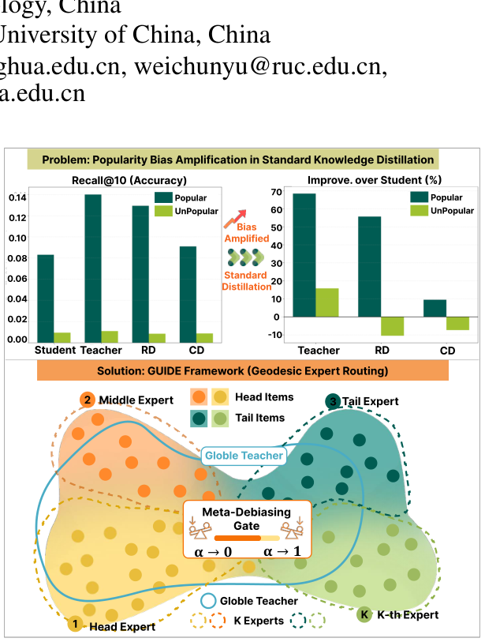
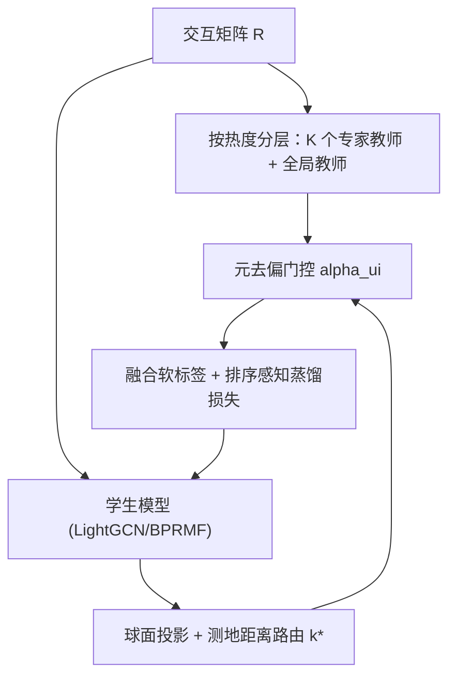
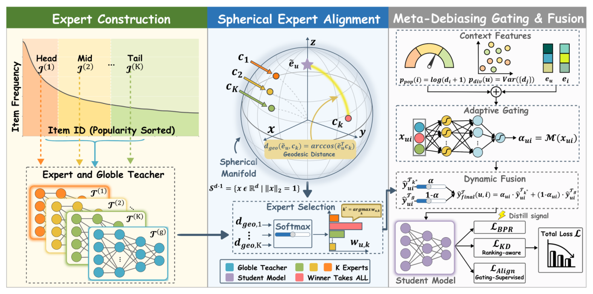

# Geodesic Expert Routing for Unbiased Knowledge Distillation in Recommendation (球面测地专家路由的无偏推荐知识蒸馏)

- **会议/期刊**: IJCAI 2026
- **作者与机构**: Xuan Zhang, Rongchuan Wei, Chunyu Wei, Hongxing Yuan, Yushun Fan（清华大学自动化系 / 中国人民大学信息学院）
- **推荐链路定位**: 召回/精排模型压缩与部署（学生模型在线推理）
- **研究方向**: 去偏公平、可信隐私与工业架构（主）/ 协同过滤与双塔召回（次）
- **论文原文**: [论文原文链接](https://www.ijcai.org/proceedings/2026/0361.pdf)
- **开源代码**: [GUIDE](https://github.com/zx19971219/GUIDE) （论文声明开源）

## TL;DR (1分钟核心速览)

本文首次系统指出：推荐系统中的知识蒸馏并非"中性压缩"，而是**系统性放大流行度偏差**——学生模型模仿在长尾分布上训练的全局教师，等价于继承并强化热门捷径。作者提出 GUIDE：按物品热度分层训练 $K$ 个专家教师，在单位球面上用**测地距离**把用户路由到语义最匹配的专家（消除模长=热度的混淆），再用**元去偏门控**按上下文动态融合专家与全局教师标签。在 CiteULike / Amazon-Movie / Amazon-Game（≥20 交互、8:1:1 划分）上，以 LightGCN 为学生，R@10 相对最强基线提升 4.3% / 7.4% / 11.5%，同时 Gini 由 0.968 降至 0.924、Item Coverage 翻倍。

## Background & Motivation (背景与核心矛盾)

- **主流范式**: KD4Rec 通过排序对齐（RD）、协作相似度（CD）、结构/拓扑蒸馏（HTD、DE-RRD）、分层去偏蒸馏（UNKD）把大教师的能力迁移到轻量学生，以换取低延迟部署。
- **前人局限**: ① 所有方法默认"单一全局教师"是知识上界，但该教师本身在热门物品主导的隐式反馈上训练，其软标签已编码流行度捷径；② 一旦学生复制软标签，热门物品的梯度优势被进一步放大，长尾物品的召回与曝光多样性随之塌陷（图 1 显示 KD 的 Recall@10 增益几乎全部来自 Head，Tail 反而负增长）。
- **核心洞察 (Key Insight)**: 偏差放大的根源是**知识源的单一性**，而非蒸馏损失本身；因此"多教师"不是简单的 ensemble，而是要构造**反事实的知识源**——只在某个流行度区间内训练、天然看不到热门捷径的专家。
- **本文切入点**: 把"专家选择"建模为球面流形上的几何匹配问题，把"教师-专家权重"建模为依赖上下文的元学习门控，从而在保精度的同时做定向纠偏。

<figure class="paper-figure" markdown="span">
  <figcaption>图1：（上）热门/冷门物品上的 Recall@10 比较。相对于基础 Student（直接从数据学习）的相对提升表明，标准蒸馏会放大流行度偏差。（下）提出的 GUIDE 动态融合全局教师与专家教师的知识，以平衡准确性与公平性。</figcaption>
</figure>

## Method (核心方法设计)

### 1. 整体框架 (Overall Architecture)

输入用户-物品交互；先按物品交互频次 $d_i$排序切成$K$个等规模热度层，每层独立训练一个专家教师$T^{(k)}$（层内 BPR + 层内负采样），同时保留全量数据训练的全局教师$T^{(g)}$。蒸馏阶段：学生（LightGCN/BPRMF）的用户向量与各专家质心投影到$\mathcal{S}^{d-1}$，用测地距离计算亲和度并以 winner-takes-all 选出专家$k^{*}$；元去偏门控读取"物品热度分位 + 用户历史多样性 + 双端 embedding"输出$\alpha_{ui}$，将专家软标签与全局软标签凸组合成最终蒸馏目标，与 BPR、门控对齐损失联合优化。推理时专家、投影、门控全部丢弃，仅部署学生，延迟与基座模型完全一致。

<figure class="paper-figure" markdown="span">
  <figcaption>图2：GUIDE 框架整体架构。它包括三个关键部分：（1）专家构建，在基于流行度的数据划分上训练专门的教师；（2）球面专家对齐，通过球面流形上的测地距离将用户路由到专家，以消除模长偏差；（3）元去偏门控与融合，基于交互上下文自适应融合专家与全局知识，用于个性化蒸馏。</figcaption>
</figure>

### 2. 关键设计拆解 (Key Designs)

1. **球面专家对齐（Spherical Expert Alignment）**：欧氏内积/余弦路由会被 embedding 模长污染——热门物品梯度更新更频繁、模长更大，学生会"被高模长专家吸引"而非语义匹配。作者把专家质心与用户向量都做 $\ell_2$投影到球面$\tilde{\boldsymbol{e}}_u=\boldsymbol{e}_u/\|\boldsymbol{e}_u\|_2$，$\boldsymbol{c}_k=\pi(\frac{1}{|\mathcal{I}^{(k)}|}\sum_{i\in\mathcal{I}^{(k)}}\boldsymbol{e}_i)$，并以测地距离匹配$d_{geo}(\tilde{\boldsymbol{e}}_u,\boldsymbol{c}_k)=\arccos(\tilde{\boldsymbol{e}}_u^{\top}\boldsymbol{c}_k)$，软路由权重$w_{u,k}=\mathrm{softmax}_k(-\tau d_{geo})$。关键论证：余弦梯度按$\sin\theta$衰减、在$\theta\to0$时消失，而测地梯度含$1/\sin\theta$项恰好抵消投影衰减，梯度与$\theta$ 线性相关，路由在"已对齐"时仍可稳定学习。
2. **元去偏门控（Meta-Debiasing Gate）**：静态融合权重无法适配异构上下文。门控输入 $\boldsymbol{x}_{ui}=[\boldsymbol{e}_u\oplus\boldsymbol{e}_i\oplus \log(d_i+1)\oplus \mathrm{Var}(\{d_j\}_{j\in\mathcal{I}_u^+})]$，经单隐层 MLP 输出$\alpha_{ui}=\sigma(\mathbf{W}_2\mathrm{ReLU}(\mathbf{W}_1\boldsymbol{x}_{ui}+\mathbf{b}_1)+\mathbf{b}_2)$，融合标签$\hat{y}^T_{ui}=\alpha_{ui}\hat{y}^{T_{k^*}}_{ui}+(1-\alpha_{ui})\hat{y}^{T_g}_{ui}$。物理直觉：长尾候选、兴趣分散用户应加大专家权重（$\alpha\to1$），热门候选则由全局教师兜底（$\alpha\to0$），把"去偏强度"变成逐样本可学习量。
3. **训练目标、负采样与推理效率**：总损失 $\mathcal{L}=\mathcal{L}_{BPR}+\lambda_{KD}\mathcal{L}_{KD}+\lambda_{Align}\mathcal{L}_{Align}+\lambda_{Reg}\|\Theta\|_2^2$，其中蒸馏项是排序感知的边际对齐$\mathcal{L}_{KD}=\sum_{(u,i,j)}(\Delta p^S_{uij}-\Delta p^T_{uij})^2$，$\Delta p=\sigma(\hat{y}_i)-\sigma(\hat{y}_j)$；门控对齐项为$\mathcal{L}_{Align}=-\sum[t_i\ln\alpha_{ui}+(1-t_i)\ln(1-\alpha_{ui})]$，$t_i=\mathbb{I}(i\in\mathcal{I}_{tail})$，防止$\alpha$塌缩到平凡解。负采样沿用 BPR 均匀负采样（专家在各自层内采负样本）。训练复杂度$O(Bd+BKd+Bd^2)$，$K\le5$ 且仅激活一个专家；推理零额外开销。

## Experimental Setup & Evaluation Protocol (实验设置与评估协议)

- **数据集与预处理**: 保留交互数 ≥ 20 的用户；论文未使用 5-core 物品过滤。

| 数据集 | #Users | #Items | #Interactions | 稀疏度 | 场景说明 |
| :--- | :---: | :---: | :---: | :---: | :--- |
| CiteULike | 5,219 | 25,181 | 125,580 | 99.90% | 学术文献收藏 |
| Amazon-Movie | 123,960 | 50,052 | 1,697,533 | 99.97% | 电商影音 |
| Amazon-Game | 24,303 | 10,672 | 231,780 | 99.91% | 电商游戏（最稀疏，主实验/消融场） |

- **数据划分与防穿越 (Splitting Strategy)**: 随机 `比例划分` 8:1:1（train/valid/test），超参在验证集 NDCG@20 上选择；未采用时间戳切分，存在轻度信息穿越风险。
- **排名评测协议 (Ranking Protocol)**: 报告 R@{10,20}、N@10/20，论文未显式说明候选集构造，从 LightGCN 基座推断为 `Full-Ranking`（全库未交互物品排序），但缺少显式声明与负采样比例说明（见局限）。
- **对比基线与超参设置**: 5 个 SOTA——RD（排序对齐）、CD、DE-RRD、HTD、UNKD（偏差感知）；教师为 3 层 LightGCN，学生为 2 层 GCN 与 BPRMF；$d$未单独披露，lr∈{2e-4,1e-3,5e-3,1e-2}，默认$K=5$、$\lambda_{KD}=0.8$、$\lambda_{Align}=0.01$；5 次随机种子取均值±方差。

## Key Experimental Results (实验关键数据)

### 1. 主实验对比 (Main Results)

| 数据集 | 指标 | Teacher | RD | CD | DE-RRD | HTD | UNKD | **GUIDE** | Improv. |
| :--- | :--- | :---: | :---: | :---: | :---: | :---: | :---: | :---: | :---: |
| CiteULike | R@10 | 0.0964 | 0.062 | 0.086 | 0.062 | 0.089 | 0.093 | **0.097** | +4.3% |
| CiteULike | R@20 | 0.1456 | 0.085 | 0.129 | 0.092 | 0.140 | 0.132 | **0.145** | +3.6% |
| CiteULike | N@20 | 0.0937 | 0.058 | 0.087 | 0.060 | 0.091 | 0.089 | **0.094** | +3.3% |
| Amazon-Movie | R@10 | 0.0284 | 0.020 | 0.025 | 0.022 | 0.027 | 0.027 | **0.029** | +7.4% |
| Amazon-Movie | R@20 | 0.0487 | 0.033 | 0.044 | 0.037 | 0.045 | 0.046 | **0.049** | +6.5% |
| Amazon-Movie | N@20 | 0.0394 | 0.028 | 0.036 | 0.030 | 0.037 | 0.037 | **0.039** | +5.4% |
| Amazon-Game | R@10 | 0.0282 | 0.018 | 0.025 | 0.020 | 0.026 | 0.025 | **0.029** | +11.5% |
| Amazon-Game | R@20 | 0.0460 | 0.028 | 0.043 | 0.028 | 0.040 | 0.041 | **0.046** | +6.9% |
| Amazon-Game | N@10 | 0.0232 | 0.016 | 0.020 | 0.017 | 0.021 | 0.021 | **0.023** | +9.5% |
| Amazon-Game | N@20 | 0.0299 | 0.020 | 0.027 | 0.022 | 0.026 | 0.027 | **0.029** | +7.4% |

### 2. 消融实验 (Ablation Study)

| 变体 (Amazon-Game) | R@10 | R@20 | N@10 | N@20 |
| :--- | :---: | :---: | :---: | :---: |
| w/o Spherical（改用欧氏距离路由） | 0.0259 | 0.0422 | 0.0206 | 0.0266 |
| w/o Meta-Gate（固定 $\alpha=0.5$） | 0.0259 | 0.0419 | 0.0209 | 0.0270 |
| w/o Ranking KD（改 pointwise MSE） | 0.0258 | 0.0420 | 0.0206 | 0.0267 |
| w/o Alignment（去掉 $\mathcal{L}_{Align}$） | 0.0261 | 0.0419 | 0.0210 | 0.0270 |
| **GUIDE (Full)** | **0.0288** | **0.0465** | **0.0230** | **0.0299** |

### 3. 关键实验发现 (Key Findings)

1. **球面几何是最大贡献项而非"锦上添花"**：去掉球面路由后 R@10 从 0.0288 掉到 0.0259（-10.1%），跌幅超过任一其他组件，且四类消融变体聚集在 0.0258–0.0261 的窄带内，说明一旦路由被模长污染，专家知识的增益几乎被抵消——偏差不是靠"多教师"自动解决的，路由几何才是开关。
2. **精度与公平同时改善，且学生反超教师**：Amazon-Game 上 Head +2.75%、Tail +6.21%（0.00177→0.00188），CiteULike 上 Gini 0.9679→0.9239、Coverage 0.1234→0.2521（翻倍）、Tail Ratio 0.0845→0.0876、R@20 0.1331→0.1447；同时 GUIDE 的 R@10（0.029）已超过 Teacher（0.0282），表明滤除流行度噪声本身就是一种正则化，而非纯粹的精度让渡。
3. **门控确实学到了"按热度切换知识源"的策略**：门控系数随物品热度排名单调地从 $\alpha\to0$（Head，信任全局教师）过渡到$\alpha\to1$（Tail，信任专家）；冷启动案例中（User #8137 × Item #10872，教师 Rank>200）GUIDE 给出 Rank 1 且$\alpha_{ui}=0.84$，说明门控在高稀疏场景自动切换到专家分支，具备 zero-shot 冷启动补偿能力。

## Highlights & Limitations (亮点、对比与审稿批判)

- **与代表作对比 (vs. Prior Work)**: 与 UNKD 同为"偏差感知蒸馏"，但 UNKD 仍以单一教师在分层数据上做重加权，本质是**修正损失**；GUIDE 则**修正知识源**（多专家）+ **修正路由几何**（球面测地）。相对 CD/HTD 只蒸馏协作相似度或拓扑结构，本文额外引入了"热度分层反事实教师"这一结构先验，因而在 Tail 上取得正增益而非零和。
- **可迁移亮点**: ① 用测地距离替代余弦做 embedding 匹配，可平移至双塔召回、多兴趣路由、MoE 门控等任何"模长混杂热度"的场景；② 用"物品热度分位 + 用户历史热度方差"作为门控输入，是极低成本、可解释的去偏强度控制变量。
- **审稿级局限批判**: ① **评估协议披露不足**——未明确 Full-Ranking 还是采样排序，也未给出候选集大小与负采样比例，跨方法比较的可复现性打了折扣；② **专家构造本身有监督泄漏风险**：专家按测试集同一热度统计分层，且 $K$个专家各需独立训练，工业上等于$K+2$次训练成本（虽推理零开销），此外门控对齐损失直接用 Tail 标签$t_i$监督$\alpha$，公平性提升部分来自"被告知谁是长尾"，对热度定义敏感、超参$\lambda_{Align}$与$K$需逐数据集调（$K=5$、$\lambda_{KD}=0.8$、$\lambda_{Align}=0.01$）。

## Rating (四维评分)

- **方法创新性 (Novelty)**: ⭐⭐⭐⭐ （把"蒸馏放大偏差"这一被忽视现象明确化，并用球面测地路由给出有梯度分析的几何解，专家分层本身较朴素）
- **评估协议与实验扎实度 (Protocol & Experiments)**: ⭐⭐⭐ （三数据集 + 5 基线 + 消融/敏感性/公平性/案例齐全，但划分方式与候选打分协议说明不充分，Table 3 与 Table 2 同配置数字存在细微不一致）
- **写作与数学规范度 (Clarity & Rigor)**: ⭐⭐⭐⭐ （路由梯度 $\nabla\mathcal{L}\propto 2\theta$ 的推导清晰，复杂度分析到位；部分符号与实验细节略简）
- **工业落地与复现价值 (Industrial & Practical Value)**: ⭐⭐⭐⭐ （推理与基座同延迟、门控仅单隐层 MLP、代码已开源，训练需 $K$ 个专家是主要落地成本）

