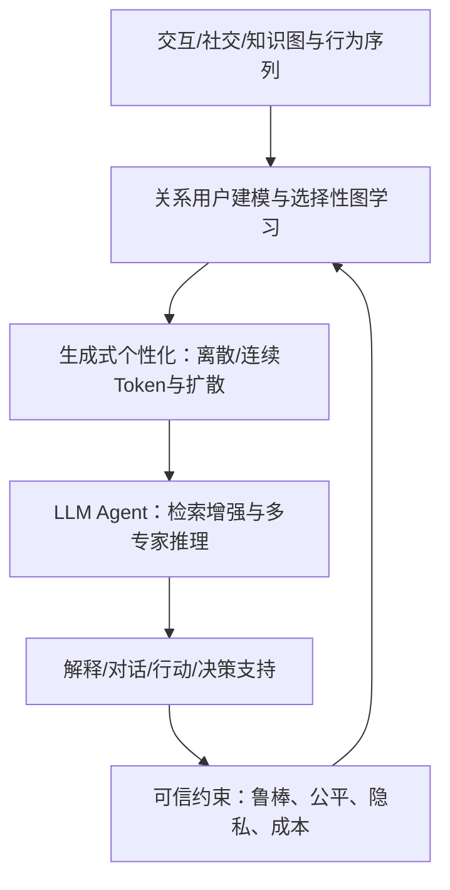

# Toward Trustworthy Recommender Systems in the Era of Agentic AI: From Relational User Modeling to Generative Personalization (迈向智能体AI时代的可信推荐系统：从关系用户建模到生成式个性化)

- **会议/期刊**: IJCAI 2026, Early Career Spotlight Track
- **作者与机构**: Wenqi Fan, The Hong Kong Polytechnic University
- **推荐链路定位**: 端到端生成式 / 智能体决策支持（从排序走向检索—推理—行动）
- **研究方向**: 去偏公平、可信隐私与工业架构 / LLM推荐、对话与智能体推荐
- **论文原文**: [论文原文链接](https://www.ijcai.org/proceedings/2026/0905.pdf)
- **开源代码**: 暂未开源

## TL;DR (1分钟核心速览)

本文是 IJCAI-26 Early Career Spotlight 的研究议程，而非提出单一模型并做统一实验的论文。它针对传统推荐“关系异质却共享粗放、只给排序分不建模理据、可信风险后置”三大痛点，提出关系用户建模→生成式/智能体个性化→可信基础的三层路线，串联 GraphRec/DASO、SGSR/CDRec、TokenRec/ReRec、KG-RAG/MixRAGRec、CopyAttack/BadRec 等证据。原文未提供统一数据集、划分、Full-Ranking 协议或数值提升，故本笔记不伪造实验表，只审计其论证链与落地缺口。

## Background & Motivation (背景与核心矛盾)

- **主流范式**: 用 GNN 融合交互、社交与知识关系进行用户建模，并用 LLM/生成模型增强语义理解、解释、对话与决策支持。
- **前人局限**: 其一，用户行为跨 item/social/knowledge 域异质，强行统一表征会传播弱关系与曝光噪声；其二，排序分数不刻画偏好分布、不确定性或决策理据，难以支撑解释与多步行动。可信风险——投毒、偏见、隐私、幻觉、推理成本——通常在部署后才补救。
- **核心洞察 (Key Insight)**: 推荐系统不应只是 ranking machine，而是“关系建模—证据检索—意图推理—个性化行动”的智能体系统；可信性须与架构、检索源和计算预算共同设计。
- **本文切入点**: 以三层研究组件组织已有工作，并把“计算成本”提升为可信推荐的一等风险与约束。

## Method (核心方法设计)

### 1. 整体框架 (Overall Architecture)

全文不是单一网络，而是一个研究栈：底层以交互图、社交图、知识图谱和序列行为构建关系用户建模；中层用扩散/离散 token/连续 token 将推荐从打分转为分布生成与证据推理；上层由 LLM Agent 完成检索增强、解释、对话和多步行动；可信层对鲁棒、公平、隐私、可解释与成本施加约束，并反向约束图学习与推理。可形式化为带可信预算的决策问题：$\max_{\pi}\mathbb{E}_{u,c}[\mathrm{Util}(\pi(u,c);u)]-\lambda\mathrm{Risk}(\pi)$，受公平、隐私与 token/时延预算约束。原文未给出统一训练损失与解码协议，以下公式为笔记层形式化。

### 2. 关键设计拆解 (Key Designs)

1. **关系用户建模：选择性共享而非全图混合**：痛点是社交边弱、噪声大且与 item 域不可互换。GraphRec 联合建模交互、opinion 与 user-user 关系；DASO 用域特定表征与双向对抗映射，仅在信息有效时迁移；后续用解耦对比、图趋势滤波和图缩减提升鲁棒与可扩展性。概念打分可写为 $s(u,i)=f_\theta(\mathbf{h}_u,\mathbf{h}_i,\mathcal{G}_{\mathrm{int}},\mathcal{G}_{\mathrm{soc}},\mathcal{G}_{\mathrm{kg}})$，关键是让不同关系子图“可共享、可分离、可审计”。

2. **生成式个性化：从偏好强度到分布与理据**：扩散模型以加噪—去噪建模输出分布；SGSR 将原始社交关系视为不完美信号，用随机微分方程 score 模型生成与协同行为对齐的社交用户表征；CDRec 针对连续扩散与离散交互失配，构建连续时间离散扩散、masking 转移与 popularity-aware 噪声调度，并用一致性参数化加速采样。TokenRec 将 masked 用户/物品表征量化为离散 token，以生成式检索避免 top-K 的昂贵自回归解码；连续 token 扩散进一步把推荐建模为连续 item-token 空间生成。离散生成可概括为 $p_\theta(z_{1:K}\mid u)=\prod_{k=1}^{K}p_\theta(z_k\mid z_{<k},u)$。

3. **可信基础与推理效率**：攻击面从跨域可迁移画像 CopyAttack、知识图谱增强的 KGAttack，到标题触发器后门 BadRec 与 P-Scanner 防御；公平侧包括 fairness reprogramming、对话系统性别差异与公平自适应负采样。智能体/RAG 又引入“成本攻击”： poisoned retrieval 或 adversarial webpage prompt 诱导超长推理。工程折中如 AIR 将昂贵 LLM 推理离线化、在线组合紧凑意图表征。统一目标可概念化为 $\mathcal{L}=\mathcal{L}_{\mathrm{rec}}+\alpha\mathcal{L}_{\mathrm{rob}}+\beta\mathcal{L}_{\mathrm{fair}}+\gamma\mathcal{L}_{\mathrm{cost}}$。原文未给统一负采样策略与推理开销数值。

## Experimental Setup & Evaluation Protocol (实验设置与评估协议)

- **数据集与预处理**: 原文为研究议程/spotlight，未报告数据集统计、`5-core` 过滤或特征场景，无法列出 #Users/#Items/#Interactions 表。
- **数据划分与防穿越**: 未给出 `Leave-One-Out`、比例划分、全局时间戳切分或冷启动划分。
- **排名评测协议**: 未声明 `Full-Ranking` 或 `Sampled Ranking`，也未给正负采样比。
- **对比基线与超参**: 无统一 baseline、Embedding 维度 $d$、显著性检验（如$p<0.05$）或消融实验；其“对比”是文献论证而非受控实验。

| 审计项 | 原文情况 | 复现影响 |
| :--- | :--- | :--- |
| 数据集/过滤 | 未报告统一数据集与预处理 | 无法复现统计与稀疏度 |
| 划分协议 | 未报告 | 无法判断时间穿越与冷启动 |
| 打分协议 | 未报告 Full/Sampled | 无法横向比较指标 |
| 负采样/损失 | 未给统一定义 | 无法审计训练公平性 |
| 超参与显著性 | 未报告 | 结论只能作定性证据 |

## Key Experimental Results (实验关键数据)

### 1. 主实验对比 (Main Results)

原文无统一主实验表与数值指标。下表仅整理其代表性证据链，**不可视为同一 benchmark 上的 baseline 对比**；“最优”与 `Improv.%` 均不可计算。

| 代表工作 | 子方向 | 核心机制 | 证据形态 | 可比性 |
| :--- | :--- | :--- | :--- | :---: |
| GraphRec | 社交推荐 | 联合交互、opinion 与社交图 | 方法论证 | 非同协议 |
| DASO | 域异质建模 | 域特定表征 + 双向对抗映射 | 方法论证 | 非同协议 |
| SGSR | 扩散社交推荐 | SDE score 生成社交表征 + 课程训练 | 方法论证 | 非同协议 |
| CDRec | 离散扩散推荐 | 连续时间离散扩散 + 流行度噪声 | 方法论证 | 非同协议 |
| TokenRec | 生成式检索 | ID 表征量化 + 离散 token 生成检索 | 方法论证 | 非同协议 |
| ReRec | 推理型助手 | 双图奖励 + 推理感知优势 + 课程调度 | 方法论证 | 非同协议 |
| KG-RAG | 知识增强 | 检索知识子图降低幻觉 | 方法论证 | 非同协议 |
| MixRAGRec | 多专家 RAG | 多粒度图检索专家 + 多智能体对齐 | 方法论证 | 非同协议 |
| CopyAttack/BadRec | 可信安全 | 跨域迁移攻击 / 标题触发器后门 | 风险证据 | 非同协议 |

### 2. 消融实验 (Ablation Study)

原文无模型级消融。下表为“论证链审计”，不是实验消融：

| 移除组件 | 预期失效 | 原文支撑 |
| :--- | :--- | :--- |
| 关系选择性建模 | 社交噪声与曝光偏差沿图传播 | GraphRec/DASO/趋势滤波 |
| 生成式分布建模 | 仅输出排序分，缺不确定性与理据 | SGSR/CDRec/TokenRec |
| 检索增强与证据溯源 | LLM 幻觉、知识过时、解释不可信 | KG-RAG/MixRAGRec |
| 可信与成本约束 | 投毒、公平放大、RAG 成本攻击 | CopyAttack/BadRec/成本攻击 |
| 离线推理与在线意图 | 在线 LLM 时延不可承受 | AIR 工程折中 |

### 3. 关键实验发现 (Key Findings)

- **关系建模的增量不在“加图”，而在“选择性共享”**：GraphRec 与 DASO 的例子表明，交互域和社交域既要迁移共性又要保留域内行为；否则弱社交边和曝光噪声会在反馈回路中被放大。
- **生成式推荐的价值是输出分布与证据，不是简单替代排序**：TokenRec 用离散 token + 生成检索降低 top-K 自回归解码成本，CDRec 用 popularity-aware 噪声与一致性采样缓解离散交互扩散失配；但原文未给提升百分比，不能量化归因。
- **可信与效率是同一攻击面**：CopyAttack、KGAttack、BadRec 说明操纵发生在数据、知识源与生成接口；RAG/WebAgent 成本攻击进一步说明 token 与时延预算也需防御。AIR 的“离线重推理、在线轻意图”是可迁移折中，但无线上 A/B 数字。

## Highlights & Limitations (亮点、对比与审稿批判)

- **与代表作对比 (vs. Prior Work)**: 相比 GraphRec/DASO 的单点关系建模，本文把关系、生成与可信放入统一议程；相比 TokenRec/ReRec 的单点生成或助手能力，本文强调 RAG 证据溯源与成本约束；相比纯可信推荐综述，本文把“计算成本攻击”纳入可信维度。
- **可迁移亮点**: 将 token/时延预算作为一等约束与攻击面；采用“离线 LLM 推理 + 在线紧凑意图表征”的工业折中；把图缩减、可审计性与遗忘/更新需求联动，而非只谈加速。
- **审稿级局限批判**: 其一，本文是 position/spotlight，无统一 benchmark、形式化定义、定理或受控实验，难以验证各组件真实增益；其二，议题覆盖过宽，公平、隐私、可解释与智能体安全均停留在方向列举，缺少失败模式、延迟/成本测量与评估协议。若作为研究路线图有价值，作为“可信推荐方法论文”证据强度不足。

## Rating (四维评分)

- **方法创新性 (Novelty)**: ⭐⭐⭐ （以“关系—生成—智能体—可信”统一议程整合分散工作，成本攻击视角有新意，但非单点算法突破）
- **评估协议与实验扎实度 (Protocol & Experiments)**: ⭐ （原文无数据集、划分、Full-Ranking 协议、基线数值与消融，无法进行复现级评估）
- **写作与数学规范度 (Clarity & Rigor)**: ⭐⭐⭐ （结构清晰、术语连贯，但公式与形式化定义稀少，可信约束多为概念表述）
- **工业落地与复现价值 (Industrial & Practical Value)**: ⭐⭐⭐ （AIR 式离线/在线拆分与成本防御有落地启发，但缺开源代码、开销测量与部署细节）

