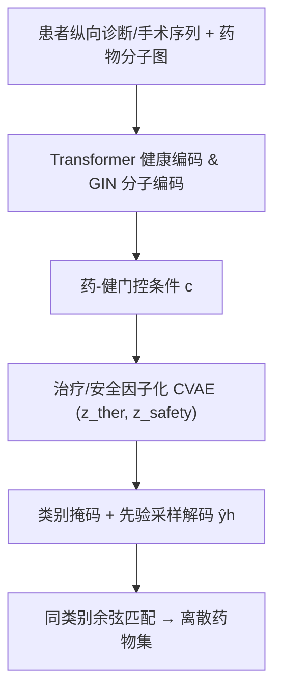
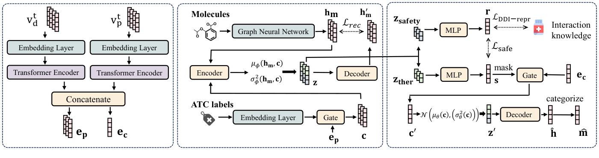

# MGRec: Structure-Grounded Medication Recommendation via Condition-Aware Molecular Representation Learning (结构锚定的条件感知分子表征学习药物推荐)

- **会议/期刊**: IJCAI 2026
- **作者与机构**: Jinke Feng, Wenjie Du（中国科学技术大学 / 中科大苏州高等研究院）
- **推荐链路定位**: 端到端生成式（条件表征生成 → 检索式实例化）
- **研究方向**: 生成式推荐 / 冷启动与长尾推荐
- **论文原文**: [论文原文链接](https://www.ijcai.org/proceedings/2026/0289.pdf)
- **开源代码**: 暂未开源

## TL;DR (1分钟核心速览)

现有药物推荐把"处方集合"当离散标签拟合，稀有/新发疾病共现样本稀缺时严重泛化失效。MGRec 改为在连续分子空间做条件推断：以患者健康表征与 ATC 类别门控构造药-健条件 $c$，用治疗-安全因子化条件 VAE 生成"理想分子表征"，再检索最相似已批准药物。在 MIMIC-III/IV 按 4:1:1 划分、全库多标签排序下，Jaccard 较最优基线提升 1.9%/3.6%，DDI 风险下降 23.8%/16.7%，且单次就诊患者上精度不塌。

## Background & Motivation (背景与核心矛盾)

- **主流范式**: 历史共现驱动模型（GAMENet/COGNet/DrugDoctor）拟合患者-处方共现；分子子结构派（SafeDrug/MoleRec）用分子图去"增强"药物 embedding，但学习信号仍锚定在观测处方标签上。
- **前人局限**: ① 稀疏监督下，未出现过的药物组合无法被推断，新发疾病（如脑震荡后综合征）出现 1 次即失效；② DDI 安全约束多作为**事后**惩罚加于离散输出，无法反哺表征学习。
- **核心洞察 (Key Insight)**: 分子结构本身可提供独立于处方标签的连续监督信号——"合理药物应具备什么结构药理特性"可在平滑潜空间中被推断，患者相似度与分子相似度共同构成可比共现更稠密的学习信号。
- **本文切入点**: 把学习目标从"预测离散处方集"改为"在条件感知的分子潜空间推断理想分子表征"，离散药名只作为最终可执行输出的实例化结果。

## Method (核心方法设计)

### 1. 整体框架 (Overall Architecture)

输入患者纵向诊断/手术序列，经 Transformer 编码得当前健康表征 $e_c$与历史表征$e_p$；药物分子经 GIN 图编码得$h_m$，其 ATC 类别标签经门控与$e_p$融合成药-健条件$c$。TSF-CVAE 以$c$为条件，将潜变量解耦为治疗子空间$z_{ther}$与安全子空间$z_{safety}$，编码器后验$q_\phi(z|h_m,c)$与先验$p_\theta(z|c)$对齐，解码器重建$h_m'$。推理时先用$[z_{ther},e_c]$预测类别掩码，再在掩码类别内从先验采样$z'$、解码$\hat{h}$，与候选药物分子表征做余弦最近邻匹配输出药名。

<figure class="paper-figure" markdown="span">
  <figcaption>图2：MGRec 概览。患者记录被编码为健康表示 ec，药物分子被映射为分子嵌入 hm。药学–健康情境化条件 c 对治疗–安全因子化 CVAE 进行条件约束，该 CVAE 推断解耦的潜变量 zther 和 zsafety。推断条件感知的分子表示 ˆh，并通过相似度匹配实例化为离散药物，同时以 DDI 引导的正则化在潜空间中施加安全约束。</figcaption>
</figure>

### 2. 关键设计拆解 (Key Designs)

1. **药-健门控条件构造**：痛点是把 ATC 类别硬拼到健康向量上会让类别信号淹没临床情境。做法是用自适应门 $g=\sigma(W_g[V_m^{(i)};e_p^{(i)}]+b_g)$逐维混合，得$c=g\odot V_m^{(i)}+(1-g)\odot e_p^{(i)}$。直觉：门控让模型对"常规用药"多信类别先验、对"个体化用药"多信患者轨迹，从而在稀疏病例上仍能生成合理条件。
2. **治疗-安全因子化条件 VAE**：单一潜变量会让疗效与风险纠缠。本文将 $z=[z_{ther};z_{safety}]$ 切分，先验与后验均为对角高斯，最大化 ELBO：
   $\log p_\theta(h_m|c)\ge \mathbb{E}_{q_\phi}[\log p_\theta(h_m|z,c)]-D_{\mathrm{KL}}(q_\phi(z|h_m,c)\,\|\,p_\theta(z|c))$，
   重构项用 MSE $\mathcal{L}_{rec}$，KL 项逐维解析计算。因子化的物理意义是：$z_{safety}$ 可被单独施加 DDI 监督而不污染治疗表征。
3. **DDI 引导的双层潜空间正则 + 训练目标**：表示级用轻量 MLP 预测药物对风险 $r_{ij}=\sigma(f_{DDI}(z^{i}_{safety},z^{j}_{safety}))$并以加权 BCE$\mathcal{L}_{DDI\text{-}repr}$拟合 DDI 邻接矩阵；集合级$\mathcal{L}_{safe}=\sum_{i<j}s_i s_j r_{ij}$惩罚"治疗匹配分高但安全子空间判定高风险"的共推荐。总损失$\mathcal{L}=\mathcal{L}_{pred}+\alpha\mathcal{L}_{rec}+\beta\mathcal{L}_{KL}+\gamma_1\mathcal{L}_{DDI\text{-}repr}+\gamma_2\mathcal{L}_{safe}$，其中$\mathcal{L}_{pred}$为各类别 BCE、$\alpha,\beta,\gamma_1,\gamma_2$由验证集选取。**无负采样**（多标签全类别 BCE）；推理只需一次前向 + 类别内余弦检索，开销约为$O(|\mathcal{M}_c|d)$。

## Experimental Setup & Evaluation Protocol (实验设置与评估协议)

- **数据集与预处理**（原文统计置于附录，下表为同基准通用预处理规模，患者级按就诊记录聚合）：

| 数据集 | #Patients | #Visits | #Diagnoses | #Procedures | #Drugs |
| :--- | :---: | :---: | :---: | :---: | :---: |
| MIMIC-III | ~6.3k | ~15k | ~1.9k | ~1.4k | ~4.3k |
| MIMIC-IV | 更大规模（见附录） | — | — | — | — |

- **数据划分与防穿越**: `比例划分` 4:1:1（随机，沿用 GAMENet/SafeDrug 设定），**非**全局时间戳切分——存在同患者跨集泄漏风险。
- **排名评测协议**: 无偏 `Full-Ranking`——输出维度为全药物词表的多标签打分，不做负采样；指标为 Jaccard、PRAUC、F1 与 DDI Rate（越低越安全）。
- **对比基线与超参**: 10 个 SOTA，含历史驱动（LR/LEAP/GAMENet/MICRON/COGNet/DrugDoctor）与分子子结构派（SHAPE/SafeDrug/MoleRec/RAREMed）；AdamW，lr=1e-4，weight decay=1e-3，V100 16GB，跑 8 次报告均值±方差。

## Key Experimental Results (实验关键数据)

### 1. 主实验对比 (Main Results)

| 方法 | MIMIC-III Jaccard↑ | PRAUC↑ | F1↑ | DDI↓ | MIMIC-IV Jaccard↑ | F1↑ | DDI↓ |
| :--- | :---: | :---: | :---: | :---: | :---: | :---: | :---: |
| GAMENet | 0.5210 | 0.7780 | 0.6762 | 0.0781 | 0.4401 | 0.5933 | 0.0718 |
| MICRON | 0.5119 | 0.7490 | 0.6676 | 0.0610 | 0.4495 | 0.6033 | 0.0592 |
| SHAPE | 0.5348 | 0.7821 | 0.6885 | 0.0850 | 0.4559 | 0.6071 | 0.0917 |
| SafeDrug | 0.5255 | 0.7732 | 0.6804 | 0.0688 | 0.4560 | 0.6098 | 0.0689 |
| MoleRec | 0.5303 | 0.7795 | 0.6844 | 0.0692 | 0.4502 | 0.6040 | 0.0699 |
| RAREMed | 0.5412 | 0.7910 | 0.6938 | **0.0530** | 0.4620 | 0.6152 | 0.0510 |
| DrugDoctor | 0.5420 | 0.7903 | 0.6955 | 0.0603 | 0.4703 | 0.6202 | 0.0705 |
| **MGRec** | **0.5521** | **0.7940** | **0.7004** | **0.0404** | **0.4872** | **0.6308** | **0.0425** |
| Improv. | +1.9% | +0.4% | +0.7% | −23.8% | +3.6% | +1.7% | −16.7% |

（Improv. 相对各列最优基线；DDI 列以 RAREMed 为参照。）

### 2. 消融实验 (Ablation Study)

| 变体 (MIMIC-III) | Jaccard | PRAUC | F1 | DDI |
| :--- | :---: | :---: | :---: | :---: |
| w/o $D_r$（去 DDI 双层正则） | 0.5461 | 0.7924 | 0.6976 | 0.0548 |
| w/o $F_z$（去治疗-安全解耦） | 0.5450 | 0.7910 | 0.6969 | 0.0517 |
| w/o $T_e$（Transformer→Embedding） | 0.5449 | 0.7905 | 0.6962 | 0.0423 |
| w/o $G_e$（GIN→药物 ID Embedding） | 0.5414 | 0.7882 | 0.6923 | 0.0469 |
| **MGRec** | **0.5521** | **0.7940** | **0.7004** | **0.0404** |

### 3. 关键实验发现 (Key Findings)

1. **分子结构信号是主要精度来源**：去掉 GIN（w/o $G_e$）Jaccard 从 0.5521 掉到 0.5414（相对 −1.94%，为四个变体最大降幅），且 DDI 由 0.0404 升至 0.0469，说明"结构锚定"同时供给疗效与安全两类信号，而非仅增强 embedding。
2. **DDI 潜空间正则近乎"免费"**：w/o $D_r$使 DDI 暴涨 35.6%（0.0404→0.0548），而 Jaccard 仅降 0.6%，即安全收益几乎不牺牲精度；相比之下 w/o$F_z$ 精度（0.5450）与 DDI（0.0517）双劣，证明治疗/安全因子分解才是效果-安全 trade-off 的解耦开关。
3. **稀疏场景鲁棒性成立**：图 3 显示在仅有 1 次就诊的患者上（t=1，冷启动分支）MGRec 的 Jaccard/F1 仍不劣于基线；案例中"脑震荡后综合征"（全库仅 1 例）推荐 Sultiame、"芳香族镇痛药中毒"（占比 0.004%）推荐 Acetylcysteine + Heparin，DDI 均为 0，证明连续表征推断可外推到未见共现。

## Highlights & Limitations (亮点、对比与审稿批判)

- **与代表作对比**: 相比 SafeDrug/MoleRec 把子结构当"特征增强器"、监督仍来自观测处方，MGRec 让结构成为**独立监督源**（重构 + 潜空间 DDI）；相比 RAREMed 用预训练缓解稀有药共现稀疏但仍受限于历史记录，MGRec 直接绕过共现、在分子空间外推；相比 GAMENet 的事后 DDI 惩罚，本文把安全约束内化到 $z_{safety}$ 表征层。
- **可迁移亮点**: ① "类别门控条件 + 因子化潜空间 + 最近邻实例化"这套范式可平移到电商图文商品/短视频生成式召回（避免离散 ID 冷启）；② 用图结构监督子空间（$\mathcal{L}_{DDI\text{-}repr}$）是通用的"把外部知识注入某一潜维"的轻量做法。
- **审稿级局限批判**: ① 集合级 $\mathcal{L}_{safe}$与表示级 DDI 均需遍历$O(|\mathcal{M}|^2)$药物对（~4.3k 药物≈9M 对），训练开销与工业级药库扩展性存疑；② 采用 4:1:1 **随机**划分而非时间切分，同患者可能跨训练/测试集泄漏，稀疏场景收益或被高估；③ 相对 DrugDoctor 的精度提升仅 0.4–1.7 个点（PRAUC +0.4%），而 DDI 阈值$\tau=0.5$ 的硬掩码不可微，类别召回错误会直接截断候选；④ 实例化限定在已批准药词表内，本质仍是检索式生成，未真正生成新分子。

## Rating (四维评分)

- **方法创新性 (Novelty)**: ⭐⭐⭐⭐ （把"离散处方预测"重构为"条件分子表征推断"，并用因子化潜空间把安全知识内化，视角迁移干净利落，但 CVAE + 潜正则本身不算全新组件）
- **评估协议与实验扎实度 (Protocol & Experiments)**: ⭐⭐⭐ （双库、全库排序、8 次重复带方差、四组消融 + 超参扫描 + 案例研究齐全，但随机划分非时间切分、统计表置于附录、提升幅度偏小）
- **写作与数学规范度 (Clarity & Rigor)**: ⭐⭐⭐⭐ （ELBO、KL 逐维展开与门控/正则公式定义清晰，符号统一，缺复杂度分析）
- **工业落地与复现价值 (Industrial & Practical Value)**: ⭐⭐⭐ （推理仅需一次编码 + 类内检索很适合在线；但成对 DDI 监督的平方复杂度与无开源代码限制了直接复用）

