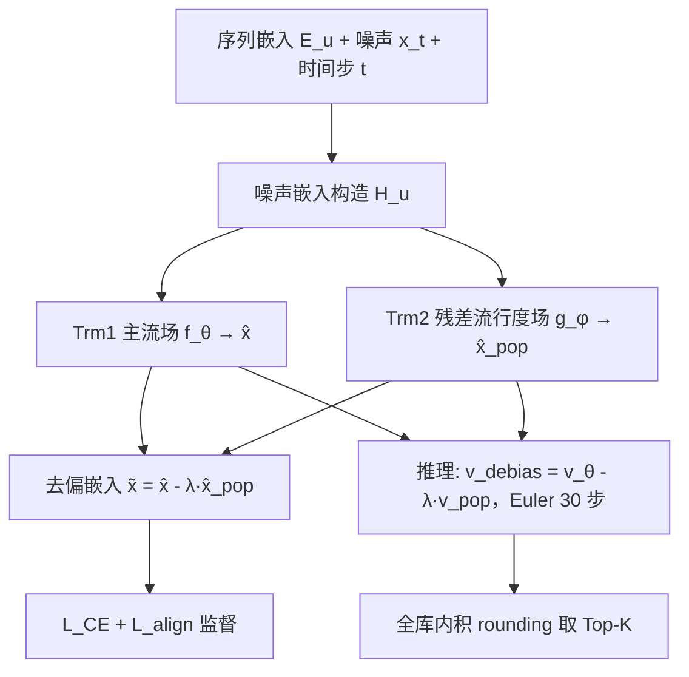
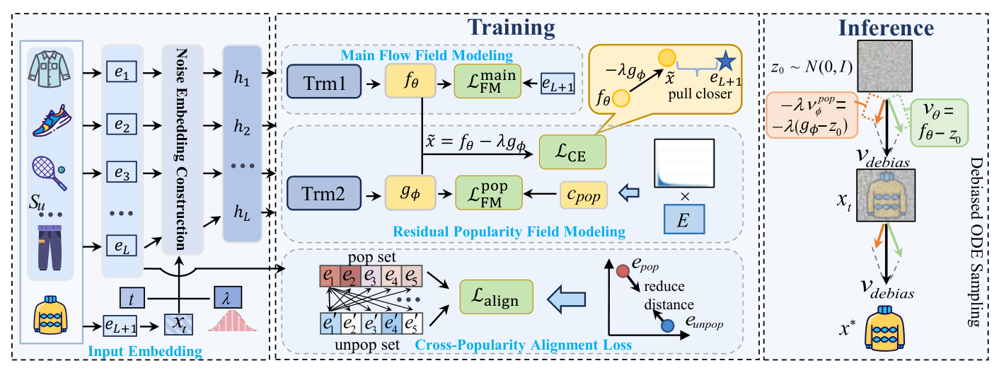

# PDFlow: Popularity-Debiased Flow Matching for Sequential Recommendation (流行度去偏的流匹配序列推荐)

- **会议/期刊**: IJCAI 2026
- **作者与机构**: Zican Yang, Zeyu Li, Cong He, Xiaotao Wu, Guanfeng Liu, Pengpeng Zhao（苏州大学、麦考瑞大学）
- **推荐链路定位**: 生成式端到端召回（连续表征生成 + 全库内积 rounding 检索）
- **研究方向**: 生成式推荐与离散语义 ID / 序列与会话推荐
- **论文原文**: [https://www.ijcai.org/proceedings/2026/0353.pdf](https://www.ijcai.org/proceedings/2026/0353.pdf)
- **开源代码**: [https://github.com/eqmll/PDFlow](https://github.com/eqmll/PDFlow)

## TL;DR (1分钟核心速览)

生成式序列推荐（Diffusion / Flow Matching）在长尾数据上会沿 ODE 轨迹逐步向热门物品稠密区漂移，"富者愈富"使尾部物品几乎不可召回；已有的 IPS 重加权与 logit 后处理只作用于最终打分，无法干预多步生成。PDFlow 在流匹配框架上增加一个以全局流行度中心为回归目标的**残差流行度向量场**，训练与推理时都按 $v_{debias}=v_\theta-\lambda v^{pop}_\phi$ 逐步扣减漂移分量，并辅以**跨流行度对齐损失**缝合热门/长尾表征鸿沟。在 4 个数据集、leave-one-out + 全库排序协议下，Beauty/Toys 的 HR@20 分别相对提升 11.34%/15.73%。

## Background & Motivation (背景与核心矛盾)

- **主流范式**: DiffuRec、DreamRec 用扩散迭代去噪建模 next-item 分布，FMRec、GMFlowRec 用流匹配构建确定性 ODE 轨迹以降低采样步数，二者均以"生成连续表征 $\to$ 内积 rounding 取 top-k"完成推荐。
- **前人局限**: 其一，生成目标直接拟合观测交互频率，长尾分布下模型过度记忆热门模式；曝光偏差使每步微小偏差沿轨迹累乘放大，最终必然落入热门簇。
- **前人局限（二）**: IPS 权重的静态标量只作用于最终目标，缺乏时序粒度去校正中间步，且步数变化时难以保持一致的约束强度；logit 重加权属事后补丁，无法修复 rounding 阶段把生成向量拉向稠密热门嵌入的表征分层。
- **核心洞察 (Key Insight)**: 作者在 Beauty 上对 FMRec 做 PCA，发现嵌入按流行度而非语义裂成"热/冷"两簇，且尾部物品的生成轨迹被系统性拽向热门高密度区（图 1）。
- **本文切入点**: 既然漂移是"向量场"层面的问题，就在向量场层面做减法——把流行度偏差建模成一个可预测、可逐步扣减的残差场。

<figure class="paper-figure" markdown="span">
  ![图1：Amazon上流行度偏差的视觉分析 \[Ni et al., 2019\]。(a) 物品流行度呈现长尾分布。(b) FMRec \[Liu et al., 2025\] 嵌入的PCA可视化，嵌入聚为两组。圆点表示实际位置，红色叉号和蓝色星号分别表示前20个热门（红色）和长尾（蓝色）物品的预测位置。](../../../../assets/papers/pdflow_popularity_debiased_flow_matching_for_sequential_recommendation/figure_1.png)<figcaption>图1：Amazon上流行度偏差的视觉分析 [Ni et al., 2019]。(a) 物品流行度呈现长尾分布。(b) FMRec [Liu et al., 2025] 嵌入的PCA可视化，嵌入聚为两组。圆点表示实际位置，红色叉号和蓝色星号分别表示前20个热门（红色）和长尾（蓝色）物品的预测位置。</figcaption>
</figure>

## Method (核心方法设计)

### 1. 整体框架 (Overall Architecture)

输入用户序列 $S_u=[i_1,\dots,i_L]$的嵌入矩阵$E_u$，目标物品嵌入$e_{L+1}$与高斯噪声$z_0$做线性插值得$x_t=(1-t)e_{L+1}+tz_0$，并按$h_\ell=e_\ell+\lambda_\ell\odot(x_t+\mathrm{emb}(t))$注入噪声后送入两个共享结构的 Transformer：Trm1 预测主流兴趣$\hat{x}$，Trm2 预测流行度驱动嵌入$\hat{x}_{pop}$。训练用$\mathcal{L}_{FM}$（分别回归$e_{L+1}$与全局流行度中心$c_{pop}$）、$\mathcal{L}_{CE}$与跨流行度对齐损失联合优化；推理时以 Euler 法求解去偏 ODE，每一步都从主流向量场中减去$\lambda$倍的流行度向量场，得到$x^{*}$ 后与全库嵌入内积取 top-k。

<figure class="paper-figure" markdown="span">
  <figcaption>图2：PDFlow框架概览。训练时，噪声增强的序列嵌入由基于Transformer的编码器Trm1和Trm2处理，以预测主流嵌入和流行度嵌入，并通过LFM、LCE和跨流行度对齐损失Lalign进行优化。推理时，去偏ODE通过在每个步骤中减去流行度分量来防止轨迹漂移。</figcaption>
</figure>

### 2. 关键设计拆解 (Key Designs)

1. **残差流行度向量场（Residual Popularity Field）**：前人把偏差当"分数问题"，本文把它当"动力学问题"。先定义流行度权重 $p(i)=\mathrm{cnt}(i)/\sum_j \mathrm{cnt}(j)$与全局流行度中心$c_{pop}=\sum_{i\in\mathcal{I}}p(i)e_i$（偏差的最坏终点的语义质心），再用独立 Trm2 显式回归该中心：$\mathcal{L}^{pop}_{FM}=\mathbb{E}\|\hat{x}_{pop}-c_{pop}\|_2^2$，训练侧的扣减为$\tilde{x}=\hat{x}-\lambda\hat{x}_{pop}$。由于$c_{pop}$ 是所有轨迹的共同吸引子，减去它等价于消去向量场中的"公共引力项"，而用户个性化分量被保留——这是"分解-相减"而非"重加权"的关键差异。

2. **去偏 ODE 采样（Debiased ODE Sampling）**：推理时向量场为 $v_\theta=f_\theta-z_0$、$v^{pop}_\phi=g_\phi-z_0$，实际积分的是$v_{debias}=v_\theta-\lambda v^{pop}_\phi$，Euler 更新$x_{t+\Delta t}=x_t+\Delta t\cdot v_{debias}$。因为$\lambda$ 在训练与推理共用同一取值，去偏强度在整条轨迹上保持一致，避免静态权重在不同时间步"过校正/欠校正"；逐步减法还阻断了曝光偏差沿步数的累乘放大。

3. **跨流行度对齐损失（Cross-Popularity Alignment）**：以全局中位数 $\tau=\mathrm{median}(\{p(i)\})$把序列内物品切成$P^{pop}_u$与$P^{unpop}_u$，强制同序列内共现的热门-长尾对在隐空间靠近：$\mathcal{L}_{align}=\mathbb{E}\big[\frac{1}{|P^{pop}_u||P^{unpop}_u|}\sum_{i\in P^{pop}_u}\sum_{j\in P^{unpop}_u}\|e_i-e_j\|_2^2\big]$。总目标$\mathcal{L}=\mathcal{L}_{FM}+\alpha\mathcal{L}_{CE}+\beta\mathcal{L}_{align}$（$\alpha=0.2,\beta$稳健,$\lambda=0.05$）；该方法**无显式负采样**（$\mathcal{L}_{CE}$分母为全库 softmax），每序列对齐开销$O(L^2d)$，推理为$N=30$步 ODE，复杂度$O(N(L^2d+Ld^2)+|\mathcal{I}|d)$。

## Experimental Setup & Evaluation Protocol (实验设置与评估协议)

- **数据集与预处理**: 全部按隐式反馈处理，按时间戳排序成行为序列，未额外丢弃物品（原始长尾分布保留）：

| 数据集 | #Users | #Items | #Interactions | 稀疏度/密度 | 特征/场景说明 |
| :--- | :---: | :---: | :---: | :---: | :--- |
| Beauty | 22,363 | 12,101 | 198,502 | 密度 0.073% | 亚马逊美妆，平均序列长 8.88，长尾极重 |
| Toys | 19,412 | 11,924 | 167,597 | 密度 0.072% | 亚马逊玩具，平均长 8.63 |
| ML-100K | 943 | 1,682 | 100,000 | 密度 6.31% | 电影，平均长 106.04，序列长且稠密 |
| LastFM | 1,090 | 3,646 | 52,551 | 密度 1.32% | 音乐艺人，平均长 48.21 |

- **数据划分与防穿越 (Splitting Strategy)**: `Leave-One-Out` —— 每用户最后一条交互作测试、倒数第二条作验证、其余作训练，严格按时间序，无未来信息泄漏。
- **排名评测协议 (Ranking Protocol)**: 无偏 `Full-Ranking`，候选项为**全部物品集**（非采样排序），指标 HR@K / NDCG@K，$K\in\{5,10,20\}$；训练侧不使用负采样，$\mathcal{L}_{CE}$ 直接对全库 softmax。
- **对比基线与超参设置**: 覆盖 RNN（GRU4Rec）、Transformer（SASRec/BERT4Rec/STOSA/DIN）、对比学习（DuoRec/CL4SRec）与生成式（DreamRec/DiffuRec/DiQDiff）四类；嵌入维度 $d=128$、最大序列长 50、batch 512、lr$1\times10^{-3}$、ODE 步数$N=30$，验证集早停（patience=5）；改进幅度基于未取整数值计算。

## Key Experimental Results (实验关键数据)

### 1. 主实验对比 (Main Results)

| 数据集 / 指标 | SASRec | DIN | BERT4Rec | DuoRec | CL4SRec | DreamRec | DiffuRec | DiQDiff | **PDFlow** | Improv. |
| :--- | :---: | :---: | :---: | :---: | :---: | :---: | :---: | :---: | :---: | :---: |
| Beauty HR@20 | 8.99 | 8.64 | 5.87 | 10.78 | 10.58 | 10.73 | 11.01 | 10.05 | **12.25** | +11.34% |
| Beauty NDCG@20 | 3.75 | 4.57 | 2.44 | 5.02 | 4.85 | 5.07 | 5.43 | 5.20 | **5.86** | +8.01% |
| Toys HR@20 | 9.42 | 8.61 | 4.68 | 9.86 | 10.09 | 9.75 | 9.85 | 10.11 | **11.70** | +15.73% |
| Toys NDCG@20 | 4.73 | 5.03 | 1.95 | 4.78 | 5.08 | 5.26 | 5.45 | 5.42 | **6.10** | +12.04% |
| ML-100K HR@20 | 22.69 | 15.38 | 16.86 | 21.42 | 11.45 | 20.90 | 19.41 | 21.63 | **23.52** | +3.66% |
| ML-100K NDCG@20 | 8.63 | 5.49 | 6.34 | 8.23 | 4.61 | 7.89 | 8.05 | 9.06 | **9.59** | +5.85% |
| LastFM HR@20 | 9.27 | 9.09 | 5.96 | 10.94 | 9.04 | 9.83 | 10.12 | 9.67 | **12.02** | +9.84% |
| LastFM NDCG@20 | 4.29 | 4.19 | 2.86 | 4.81 | 3.78 | 4.89 | 4.96 | 4.87 | **5.41** | +9.08% |

（Beauty HR@5: 5.94 vs DiffuRec 5.41；ML-100K HR@5: 9.63 vs DiQDiff 7.95，提升 20.22%。）

### 2. 消融实验 (Ablation Study)

| 数据集 | 变体 | HR@5 | HR@10 | HR@20 | NDCG@10 | NDCG@20 |
| :--- | :--- | :---: | :---: | :---: | :---: | :---: |
| Beauty | w/o $\mathcal{L}_{align}$ | 5.85 | 8.40 | 11.85 | 4.97 | 5.83 |
| Beauty | w/o $v^{pop}_\phi$($\lambda{=}0$) | 5.93 | 8.50 | 12.05 | 4.87 | 5.76 |
| Beauty | **PDFlow** | **5.94** | **8.70** | **12.25** | **4.97** | **5.86** |
| Toys | w/o $\mathcal{L}_{align}$ | 6.20 | 8.44 | 11.41 | 5.26 | 6.01 |
| Toys | w/o $v^{pop}_\phi$ | 6.18 | **8.64** | 11.57 | **5.35** | 6.09 |
| Toys | **PDFlow** | **6.24** | 8.57 | **11.70** | 5.31 | **6.10** |
| ML-100K | w/o $\mathcal{L}_{align}$ | 7.70 | 14.03 | 22.39 | 7.18 | 9.28 |
| ML-100K | w/o $v^{pop}_\phi$ | 7.93 | 13.94 | 21.82 | 6.99 | 8.96 |
| ML-100K | **PDFlow** | **9.63** | **14.50** | **23.52** | **7.35** | **9.59** |
| LastFM | w/o $\mathcal{L}_{align}$ | 4.82 | 7.26 | 11.01 | 3.64 | 4.55 |
| LastFM | w/o $v^{pop}_\phi$ | 3.61 | 6.12 | 10.29 | 3.56 | 4.64 |
| LastFM | **PDFlow** | **5.06** | **7.64** | **12.02** | **4.31** | **5.41** |

### 3. 关键实验发现 (Key Findings)

1. **越长尾、增益越大，且提升在头部截断更显著**：Beauty/Toys 的 HR@20 相对提升 11.34%/15.73%，远高于稠密的 ML-100K（3.66%），说明逐步减法主要修复的是"多步累积漂移 + 尾部不可达"，而非普适精度；ML-100K 上 HR@5 从 7.93（w/o $v^{pop}_\phi$）跃至 9.63（+21.44%），表明残差场还能实质改变早期 top-K 排序行为。
2. **两大组件互补而非冗余，且残差场在稀疏长序列数据上更关键**：LastFM 上移除任一组件都显著掉点（HR@20 从 12.02 降至 11.01 / 10.29），而 Beauty/Toys 上两变体彼此接近——说明长尾越重、序列越短时，$\mathcal{L}_{align}$与$v^{pop}_\phi$ 的边际贡献会被数据本身的稀疏噪声稀释。
3. **去偏强度存在最优点，非"越大越好"**：图 3 显示 $\alpha=0.2$、$\lambda=0.05$处 HR@K 达峰，$\beta>0.1$ 后略降；即过度扣减流行度分量会连带抹除真实的主流兴趣信号，验证了"公共引力项"与"个性化分量"必须解耦而不能整体压制。

## Highlights & Limitations (亮点、对比与审稿批判)

- **与代表作对比 (vs. Prior Work)**: 与 DiffuRec/DiQDiff 相比，本文不改变生成骨架而只改造**向量场**，因而可插拔；与 FMRec 相比多了一条显式的残差场支路与对齐正则；与 IPS / 因果去偏（Schnabel 2016、Ning 2024）相比，从"标量重加权/后验校正"升级为"逐步动力学干预 + 隐空间对齐"。
- **可迁移亮点**: ①"把某种偏差建模成一个可回归的公共吸引子 $c_{pop}$，再在推理每步相减"这套范式可平移到位置偏差、曝光偏差、模态偏差；②用同一序列内共现关系构造流行度分位对齐对，是一种零额外标注的隐空间正则。
- **审稿级局限批判**: ①推理需 $N=30$步 ODE 且每步跑两个 Transformer，参数量与延迟约为单塔的 2 倍、FM 的 30 倍，论文未给实时性/吞吐对比；②全局流行度中心$c_{pop}$假设所有用户的偏差方向一致，对"局部热门"或个性化跟风场景可能过度扣减，且$\lambda$ 需逐数据集调；③去偏评估只有 Top-20 流行度分箱与 PCA 定性可视化，缺少长尾覆盖率（Coverage）、Gini 或公平性指标，也未做线上 A/B。

## Rating (四维评分)

- **方法创新性 (Novelty)**: ⭐⭐⭐⭐ （将流行度偏差重构为向量场中的公共吸引子并逐步相减，视角新颖，但"双塔 + 相减"结构本身较工程化）
- **评估协议与实验扎实度 (Protocol & Experiments)**: ⭐⭐⭐⭐ （4 数据集 + 全库排序 + leave-one-out + 10 个基线 + 消融与超参敏感性齐全，缺显著性检验与长尾公平指标）
- **写作与数学规范度 (Clarity & Rigor)**: ⭐⭐⭐⭐ （流匹配前向/反向、训练-推理一致性推导完整，复杂度分析清晰；但式 (23) 中 $v_\theta$与$f_\theta$ 符号混用，部分符号略含混）
- **工业落地与复现价值 (Industrial & Practical Value)**: ⭐⭐⭐ （代码已开源、可插拔于任意 FM 推荐器；但双 Transformer + 30 步 ODE 的在线开销对高 QPS 场景是硬门槛）

