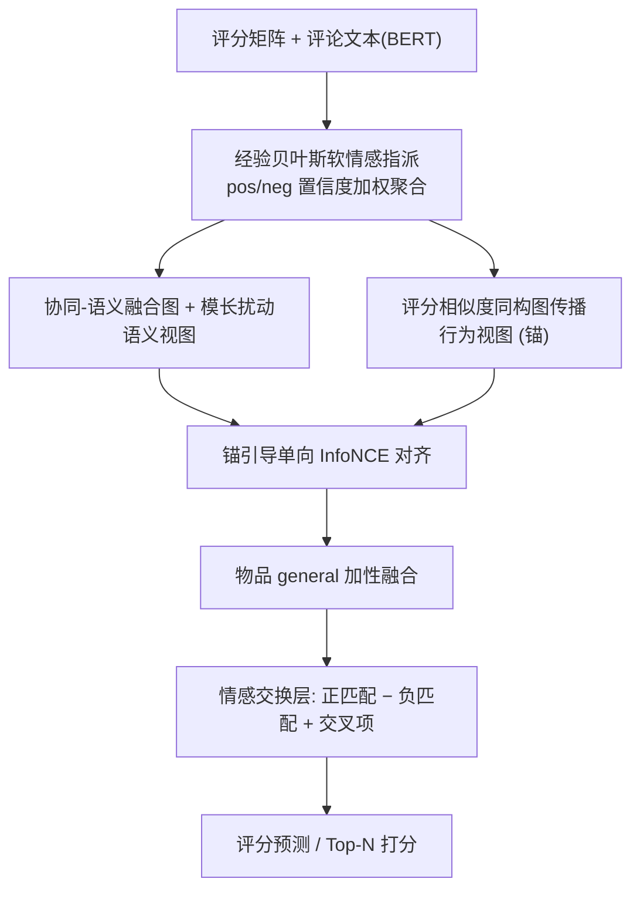
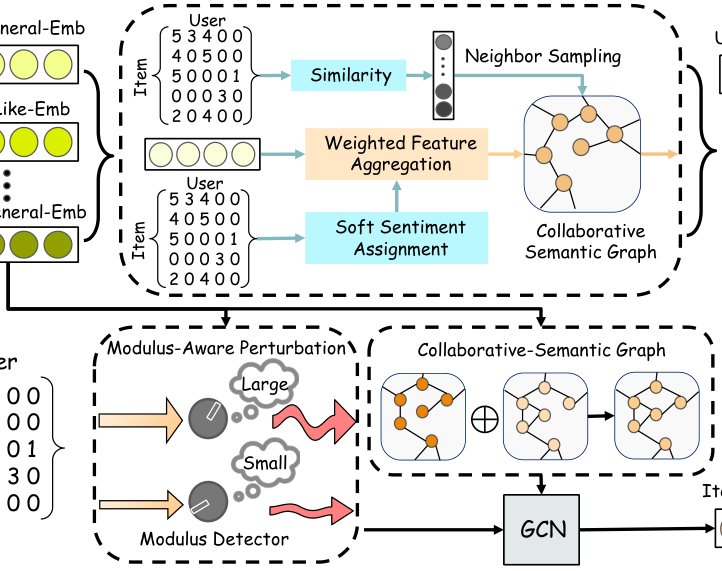

# Sentiment-aware Rating-based Recommendation via Semantic-enhanced Item Alignment (语义增强物品对齐的情感感知评分推荐)

- **会议/期刊**: IJCAI 2026
- **作者与机构**: Yingjie Chen, Xiang Li, Dongliang Chen, Guoqing Chao, Zhongying Zhao, Yanwei Yu（中国海洋大学 / 哈工大 / 山东科技大学）
- **推荐链路定位**: 精排（评分预测 + Top-N 排序打分）
- **研究方向**: 图神经网络与知识图谱推荐 / 自监督对比学习与交互去噪
- **论文原文**: [论文原文链接](https://www.ijcai.org/proceedings/2026/0281.pdf)
- **开源代码**: [https://github.com/yingjie160/SENSE](https://github.com/yingjie160/SENSE)

## TL;DR (1分钟核心速览)

评论增强推荐长期受三重困扰：隐因子被当作并行通道简单相加、情感极性靠固定阈值切分、稠密文本特征淹没稀疏协同信号。SENSE 用经验贝叶斯收缩为每个用户估计个性化阈值与不确定度，把评分转为软正/负置信度；再用协同信号校准语义近邻构图、以行为视图为锚做**单向**对齐；最后用"正匹配 − 负匹配 + 交叉项"的显式情感对冲式打分。四数据集全库排序下 MSE 相对降 23.08%、NDCG@10 升 21.51%。

## Background & Motivation (背景与核心矛盾)

- **主流范式**: 评论感知 GNN（RGCL/RMCL/ReHCL）把评论文本编码为节点特征或边权，在交互图上做消息传递；新近的 SGDN、LETTER 试图解耦隐因子或拆分 "Likes/Dislikes" 两个通道。
- **前人局限一**: 解耦方法把各隐因子当作**并行通道做加法聚合**，丢失了"优点激励"与"缺点阻力"之间的**对冲/抵消**关系——评分本质是用户权衡后的净差值，而非各因子之和。
- **前人局限二**: 情感极性靠**固定硬阈值**（如评分 ≥ 4 为正）二分类，忽略用户主观打分偏置与评论中的混合情感，直接引入标签噪声；且只做"极性分类"，不建模极性强弱。
- **核心洞察 (Key Insight)**: 稠密文本特征（噪声大、维度饱满）与稀疏交互特征（准确但稀疏）在**密度与可靠性上双重不对称**，对称式对比学习会让语义噪声反噬协同拓扑；因此应当让**可靠的行为视图当"锚"、语义视图单向服从**。
- **本文切入点**: 用统计收缩把"硬标签"变成"带置信度的软标签"，用协同比校准语义构图与对齐方向，再用显式减法项刻画正负情感对冲。

## Method (核心方法设计)

### 1. 整体框架 (Overall Architecture)

输入为评分矩阵 $\mathbf{R}$与评论集$\mathcal{D}$：BERT 离线编码评论得$\boldsymbol{e}_{ui}$，经经验贝叶斯软指派得到正/负两套用户与物品情感初表征；随后在评分相似度同构图上做残差传播得到**行为视图**$\mathcal{E}^{beh}$（general / pos / neg 三通道），在协同-语义融合图上经模长扰动与 GCN 得到**语义视图**$\boldsymbol{e}^{sem}_i$；用行为视图作锚的单向 InfoNCE 把语义流形拉正，仅在物品 general 维度做加性融合，最后经情感交换层输出$\hat{r}_{ui}$。评分任务用 MSE、排序任务用 BPR 联合训练。

<figure class="paper-figure" markdown="span">
  <figcaption>图1：所提出的SENSE的整体框架。</figcaption>
</figure>

### 2. 关键设计拆解 (Key Designs)

**1) 置信度感知的软情感指派**：硬阈值把 $\ge 4$判为正，对打分偏严的用户几乎全负、对偏松用户几乎全正。本文用经验贝叶斯收缩估计个性化阈值与不确定度：$w_u=\frac{n_u\delta^2}{n_u\delta^2+\sigma^2}$，$T_u=\mu+w_u(\bar r_u-\mu)$，$s_u=\sqrt{\sigma^2/n_u}$，再取$l_{ui}=\sigma\!\left(\frac{r_{ui}-T_u}{s_u}\right)$作正极性置信度，$w^{pos}_{ui}=l_{ui},\ w^{neg}_{ui}=1-l_{ui}$作双视图门控权重。**直觉**：冷启动用户$w_u\to 0$，阈值自动退回全局均值；活跃用户$w_u\to 1$，阈值贴合自身历史；$s_u$ 随交互数增大而收缩，使"软边界"随证据增多而变陡——一条混合情感的评论可以同时以不同强度贡献正负两视图，从源头消解标签噪声。

**2) 协同-语义融合图 + 模长感知扰动 + 锚引导单向对齐**：纯文本相似度构图会连入"措辞相近但类目不同"的噪声物品，纯交互图在冷启动下又过稀。本文先对评分向量相似度 $\mathbf{S}^{col}$与 BERT 相似度$\mathbf{S}^{sem}$各做 top-$K$掩码，再以平衡系数$\beta$软校准：$A^{fused}_{ij}=\mathrm{Softmax}\big(\beta\hat{S}^{col}_{ij}+(1-\beta)\hat{S}^{sem}_{ij}\big)$，协同信号充足时图由行为主导，稀疏时语义补位。扰动强度按特征模长自适应：$p_i=\frac{\lVert \boldsymbol{h}_i\rVert_2^2}{\max_j\lVert \boldsymbol{h}_j\rVert_2^2+\xi}$，$\boldsymbol{h}'_i=\boldsymbol{h}_i+\epsilon p_i\,\mathrm{sign}(\boldsymbol{h}_i)\odot\boldsymbol{\delta}$，对大模长主特征强正则、对脆弱小模长特征几乎不加噪。对齐损失**去掉对称性**：$\mathcal{L}_{Align}=-\sum_{i\in\mathcal{B}}\log\frac{\exp(\mathrm{sim}(\boldsymbol{e}^{beh}_i,\boldsymbol{e}^{sem}_i)/\tau)}{\sum_{j\in\mathcal{B}}\exp(\mathrm{sim}(\boldsymbol{e}^{beh}_i,\boldsymbol{e}^{sem}_j)/\tau)}$。**为什么有效**：行为图忠实反映真实偏好拓扑，梯度只从行为流向语义，等价于给语义流形施加"以交互拓扑为参考系"的分布约束，语义只能被校准、不能反向污染协同信号——这正是对"密度不对称"的显式回应，而非像 SimGCL 那样两视图对称互拉。

**3) 情感交换层与多任务目标**：把打分写成可解释的四段式而非 MLP 拼接：
$\hat r_{ui}=\underbrace{\boldsymbol{e}^{beh\top}_u\boldsymbol{e}^{fused}_i}_{general}+\underbrace{\boldsymbol{e}^{pos\top}_u\boldsymbol{e}^{pos}_i}_{正激励}-\underbrace{\boldsymbol{e}^{neg\top}_u\boldsymbol{e}^{neg}_i}_{负阻力}+\underbrace{\boldsymbol{e}^{pos\top}_u\boldsymbol{e}^{fused}_i-\boldsymbol{e}^{neg\top}_u\boldsymbol{e}^{fused}_i}_{跨维交互}+b_u+b_i+\mu$。
负项带负号即"缺点扣分"，交叉项刻画"用户喜欢点 × 物品综合面"的一致性；注意语义增强**只注入物品 general 通道**，正/负情感通道保留纯行为信号以维持极性判别力。总损失 $\mathcal{L}=\mathcal{L}_{Main}+\lambda_1\mathcal{L}_{Align}+\lambda_2\lVert\Theta\rVert_2^2$，$\mathcal{L}_{Main}$在评分任务取 MSE、排序任务取 BPR（负样本为未交互物品，批内负采样 + 对齐损失共享批内负例，**无需额外难负样本挖掘**）。训练复杂度$O\big((|\mathcal{O}|+|\mathcal{I}|K)d\big)$、空间$O\big((|\mathcal{U}|+|\mathcal{I}|)d+|\mathcal{O}|+|\mathcal{I}|K\big)$，随规模线性增长；BERT 编码完全离线，在线仅需图聚合与内积。

## Experimental Setup & Evaluation Protocol (实验设置与评估协议)

- **数据集与预处理**: 四个 Amazon `5-core` 子集，评论经预训练 BERT 编码为 $d$ 维向量。

| 数据集 | #Users | #Items | #Interactions | 密度 | 特征/场景说明 |
| :--- | :---: | :---: | :---: | :---: | :--- |
| Toys & Games (TG) | 19,412 | 11,924 | 167,597 | 0.072% | 玩具，长尾明显 |
| Video Games (VG) | 24,303 | 10,672 | 231,780 | 0.089% | 最稠密，极性评论多 |
| Sports & Outdoors (SO) | 35,598 | 18,357 | 296,337 | 0.045% | 交互最多，用户量大 |
| Clothing (CL) | 39,387 | 23,033 | 278,677 | 0.031% | 最稀疏，主观打分偏置强 |

- **数据划分与防穿越**: 原文仅说明采用 `5-core` 过滤，**未显式披露划分方式**（未标注 Leave-One-Out / 比例划分 / 全局时间戳切分），此为可复现性缺口，需以开源代码核实。
- **排名评测协议**: Top-N 明确为无偏 **Full-Ranking（全库未交互物品排序）**，报告 Recall@10 与 NDCG@10；评分任务报告 MAE/MSE/RMSE。
- **对比基线与超参设置**: 三类基线共 12 个——评论表征类（DeepCoNN / NARRE / RMG / AHN）、图对比类（LightGCN / RGCL / RMCL / MAGCL / ReHCL / HGCL / MHCL）、解耦类（SGDN / APH / LETTER）。最优超参 $\beta=0.5$（协同-语义等权）、$\lambda_1=0.05$；$\beta$与$\lambda_1$均在$[0.1,0.9]$/$\{0.01,\dots,0.2\}$上呈**钟形**响应，过大$\lambda_1$ 属过正则、干扰主任务。

## Key Experimental Results (实验关键数据)

### 1. 主实验对比 (Main Results)

评分预测（MSE，越低越好；节选 8 个代表性基线）：

| Model | TG | VG | CL | SO | 类型 |
| :--- | :---: | :---: | :---: | :---: | :--- |
| NARRE | 0.7961 | 1.0916 | 1.1064 | 0.8821 | 评论 CNN+Attention |
| RMG | 0.7901 | 1.1138 | 1.1064 | 0.9032 | 多视角评论融合 |
| RGCL | 0.7771 | 1.0615 | 1.0858 | 0.8446 | 评论图对比 |
| RMCL | 0.7491 | 1.0274 | 1.0286 | 0.7685 | 多视图互信息 |
| SGDN | 0.7603 | 1.0112 | 1.0466 | 0.7791 | 语义引导解耦图 |
| HGCL | 0.7125 | 1.0292 | 0.9614 | 0.7703 | 超图对比 |
| MHCL | 0.7616 | 1.0432 | 1.0582 | 0.8329 | 多视图层级对比 |
| LETTER | 0.6364 | 0.9623 | 0.7771 | 0.6675 | 正负情感拆分（最强基线） |
| **SENSE** | **0.4895** | **0.7962** | **0.6331** | **0.5463** | 本文 |
| **Improv.** | **23.08%** | **17.26%** | **18.53%** | **18.16%** | vs. LETTER |

Top-N 推荐（Full-Ranking，Recall@10 / NDCG@10）：

| Model | TG | VG | CL | SO |
| :--- | :---: | :---: | :---: | :---: |
| LightGCN | .0725/.0391 | .1138/.0711 | .0316/.0194 | .0552/.0341 |
| HGCL | .0792/.0492 | .1157/.0700 | .0446/.0259 | .0740/.0457 |
| MHCL | .0919/.0545 | .1275/.0785 | .0521/.0312 | .0851/.0515 |
| LETTER | .1062/.0637 | .0990/.0571 | .0699/.0411 | .1049/.0632 |
| **SENSE** | **.1306/.0774** | **.1487/.0911** | **.0779/.0448** | **.1117/.0664** |
| **Improv.** | **22.98%/21.51%** | **16.65%/16.07%** | **11.44%/9.00%** | **6.48%/5.06%** |

### 2. 消融实验 (Ablation Study)

原文在 TG 与 CL 上给出四组变体（结果以图 2 呈现，正文未列具体数值，下表为趋势归纳）：

| 变体 | 替换内容 | MSE 趋势 | NDCG@10 趋势 |
| :--- | :--- | :---: | :---: |
| w/o Exchange | 显式情感对冲 → MLP 拼接 | 显著劣化 | **崩塌式下降（最严重）** |
| w/o Soft | 软指派 → 固定阈值 4 分 | 明显劣化 | 中等劣化 |
| w/o Anchor | 单向锚引导 → 双向对称 CL | 中等劣化 | 中等劣化 |
| w/o CoSeG | 融合图 → 纯语义构图 | 中等劣化 | 中等劣化 |

### 3. 关键实验发现 (Key Findings)

1. **显式情感对冲是排序能力的主开关，而非锦上添花**：`w/o Exchange` 在 MSE 与 NDCG 上呈**非对称劣化**——评分误差上升有限，但 NDCG@10 直接崩塌。说明稠密语义空间中的"头部物品细粒度区分"高度依赖正负项在向量空间内的减法张力，把公式 (14) 换成 MLP 拼接后模型只会做平滑拟合，丧失排序分辨力。
2. **软标签的收益随数据集主观性放大**：最稀疏的 CL（密度 0.031%）与 SO 上 MSE 相对降幅均超 18%，且 CL 的 Recall@10 绝对增益（.0699→.0779）反而低于 TG（.1062→.1306），说明软指派主要缓解"打分偏置导致的极性误判"，在用户打分分布差异大的域收益最大；而 `w/o Soft` 的 MSE 劣化直接量化了硬阈值引入的标签噪声代价。
3. **"语义一定有用"是伪命题，对齐方向决定正负**：部分评论模型（RGCL、LETTER 在 VG 上 Recall@10 仅 .0955 / .0990）在 Full-Ranking 下**不如纯交互的 LightGCN（.1138）**，即未对齐的语义实为噪声；而 SENSE 通过锚引导把 VG 拉到 .1487（+16.65%），从反面验证了"语义必须单向服从协同拓扑"的必要性。

## Highlights & Limitations (亮点、对比与审稿批判)

- **与代表作对比**: 相比 **LETTER**——同样拆分 Likes/Dislikes，但仍以硬阈值定极性、以并行走廊相加聚合——本文把"极性"变成带方差的连续置信度、把"聚合"变成带负号的减式对冲；相比 **RGCL/RMCL** 的对称互信息最大化，本文的关键差异是**单向 InfoNCE**（行为固定为锚），把对比学习从"两视图互相迁就"改造为"语义单向接受校准"；相比 **SGDN** 的语义引导图解耦，本文不分解图为多个因子图，而是在同一图上用 $\beta$ 软门控协同/语义两种近邻来源，参数更少、冷启动下更稳。
- **可迁移亮点**: (1) 用经验贝叶斯收缩把任意"阈值型二值标签"（如点击、正负反馈、留存与否）转成个性化软置信度并作双视图门控权重，几乎零成本地可移植到 CTR/转化等任务；(2) 模长感知扰动 $p_i\propto\lVert h_i\rVert_2^2$ 作为通用正则器，可直接替换 SimGCL 的均匀噪声，用于任何图对比推荐主干。
- **审稿级局限批判**: (1) **评估协议披露不足**——划分方式未明示，且 Full-Ranking 下 Top-N 结果的显著性检验（$p$值）缺失，与 LETTER 在 SO 上仅 5.06% 的 NDCG 增益是否稳健存疑；(2) **语义增强只作用于物品 general 通道**，用户侧与情感通道未获语义补充，冷启动**用户**的收益无法解释，且模长扰动需逐 batch 求最大模长，图重构与 GCN 开销$O(|\mathcal{I}|Kd)$ 在十亿级物品库下的增量成本、以及 BERT 特征的时效性漂移均未讨论。

## Rating (四维评分)

- **方法创新性 (Novelty)**: ⭐⭐⭐⭐ （软情感指派 + 带负号的"情感对冲"打分式 + 单向锚引导对齐三点组合新颖，且给出"密度不对称"这一清晰物理解释；但各组件均为已有范式的有针对性改造，缺少理论/谱分析支撑）
- **评估协议与实验扎实度 (Protocol & Experiments)**: ⭐⭐⭐⭐ （四域 Amazon 5-core、12 个跨类别基线、评分与全库排序双任务、超参钟形曲线完整；扣分在于划分策略未披露、消融仅以图示未给出数值与方差/显著性检验）
- **写作与数学规范度 (Clarity & Rigor)**: ⭐⭐⭐⭐ （公式 (3)–(14) 与动机一一对应、符号自洽、复杂度分析到位；不足是 $\mathcal{L}_{Align}$ 处 batched 负例与 Eq.14 各项的梯度交互讨论略浅，数据集表格缺少评论数统计）
- **工业落地与复现价值 (Industrial & Practical Value)**: ⭐⭐⭐⭐ （代码已开源，BERT 离线编码 + 线性复杂度前向，工程友好；但需维护两套图（评分同构图 + 融合图）与三通道表征，内存与在线打分链路改造成本中等，且依赖评论文本限制其在纯隐式反馈场景的适用性）

