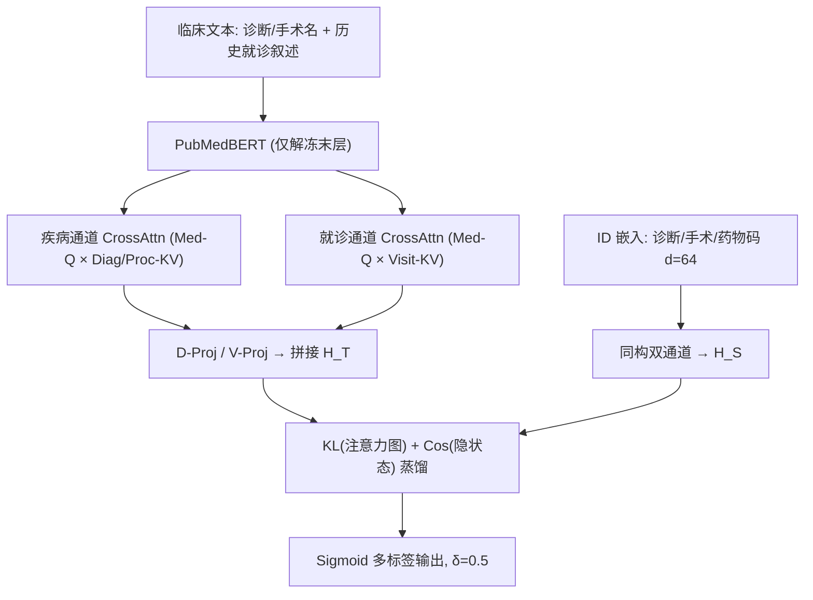
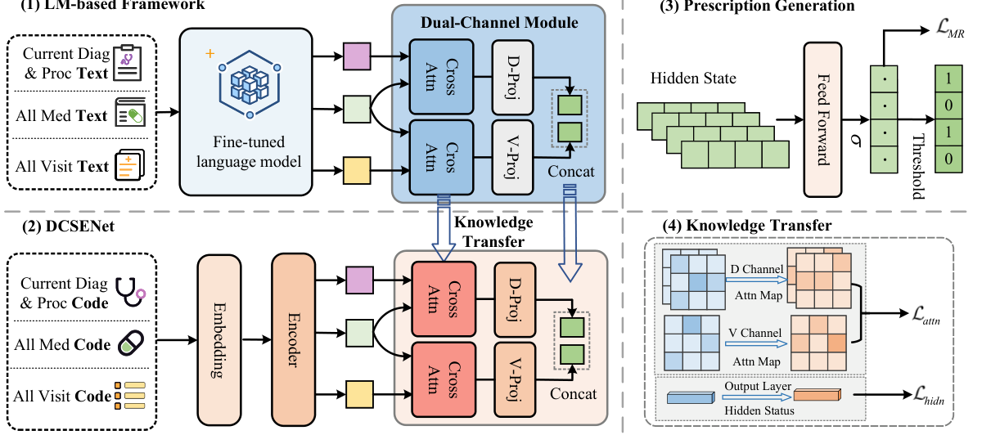
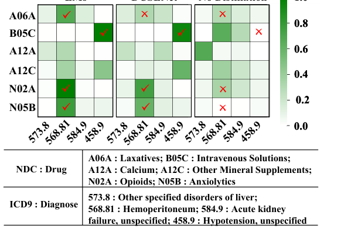

# Dual-Channel Semantic-Enhanced Combinatorial Medication Recommendation via Knowledge Distillation (双通道语义增强的药物组合推荐：基于知识蒸馏)

- **会议/期刊**: IJCAI 2026（Special Track on AI and Health）
- **作者与机构**: Jiawei Wen, Jiabao Guo, Zhaohai Bai, Kaishun Wu, Ma Lin, Haodi Zhang（深圳大学、中科院遗传发育所、港科大广州、南京大学）
- **推荐链路定位**: 精排（多标签药物集合预测）
- **研究方向**: 大语言模型推荐 (LLM4Rec) / 语义知识蒸馏
- **论文原文**: [论文原文链接](https://www.ijcai.org/proceedings/2026/0772.pdf)
- **开源代码**: [开源代码仓库链接](https://github.com/ResearchGroupHdZhang/DCSENet)

## TL;DR (1分钟核心速览)

针对 ID-based 药物组合推荐“只会查离散编码、看不懂临床叙述语义”的痛点，本文先用领域适配 LM（PubMedBERT）抽取诊断/手术/就诊文本语义，构建**疾病级 + 就诊级双通道交叉注意力**显式刻画“药物—疾病”与“药物—个人病史”关联；再通过**注意力图 KL + 输出层隐状态余弦**双重蒸馏，把这份语义迁移进 64 维 ID 模型。在 MIMIC-III/IV 的 4:1:1 全药库多标签评测上，Jaccard 相比最强基线分别提升 3.74% / 2.27%，且推理阶段完全摆脱 LM，参数量与延迟大幅下降。

## Background & Motivation (背景与核心矛盾)

- **主流范式**: 药物推荐被建模为多标签分类或序列决策，代表工作分三支——纯 ID 架构（GAMENet / COGNet / VITA）、结构化外部知识（SafeDrug 的分子图、MoleRec 的子结构、MR-DTR 的临床实体）、以及用 LM 编码文本（NLA-MMR、LEADER、KEDRec-LM）。
- **前人局限**: ①纯 ID 与结构化知识方法丢弃了临床叙述里“急性腹膜炎 → 泻药+阿片+抗焦虑”这类真实处方逻辑，泛化与可解释性双差；②LM 类方法只做**表层句向量编码**，把长文本压成一个向量后直接送分类头，未显式建模“药物文本 ↔ 健康状态文本”的细粒度对应关系，且 500MB 级参数与数百秒推理无法在临床部署。
- **核心洞察**: 注意力权重本身携带丰富的语言学知识（Clark et al., 2019），而药物-疾病关联恰好是一种**词级对齐关系**——因此注意力图可以作为“文本语义 → 离散 ID”的知识桥梁，比只在隐状态上做回归对齐更精准。
- **本文切入点**: 用双通道交叉注意力把“药物 query”与“疾病/手术/就诊 key-value”对齐，再把这个对齐结构蒸馏给 ID 模型。

## Method (核心方法设计)

### 1. 整体框架 (Overall Architecture)

框架分两阶段串行：**阶段一（教师）** 用仅解冻末层的 PubMedBERT 分别编码疾病级文本（当前诊断名 + 手术名）与就诊级文本（历史所有就诊的诊断/手术/用药拼接），药物文本作为共享 Query，经疾病通道与就诊通道两路交叉注意力 + 两个独立投影（D-Proj / V-Proj）映射到同一空间后拼接得到 $H_T$，经 Sigmoid 输出多标签处方。**阶段二（学生）** 用 64 维 ID 嵌入表重放同一套双通道结构得到$H_S$，同时对$H_T$ 做隐状态余弦对齐、对交叉注意力图做 KL 对齐。推理时只保留 DCSENet，完全不需要 LM。

<figure class="paper-figure" markdown="span">
  <figcaption>图2：DCSENet 概览：(1) 微调后的语言模型从患者健康和用药文本中提取深层语义信息，随后由双通道模块在疾病级和就诊级两种粒度上对该信息建模。(2) DCSENet 以患者健康和用药编码为输入，对其进行编码，并使用相同的双通道模块进行推理。语义知识通过注意力图和输出层隐藏状态迁移到 DCSENet。</figcaption>
</figure>

### 2. 关键设计拆解 (Key Designs)

1. **疾病级/就诊级解耦双通道（防知识冲突）**: 疾病级文本承载 DrugCentral 中的通用“药物-适应症/禁忌症”先验，就诊级文本承载个人化病史，二者直接拼接会互相污染。作者用共享药物 Query 的两路独立交叉注意力分别抽取，再用**两个不共享投影**消解分布差异后拼接：
$Z_{dise}=\mathrm{TransEnc}(E_{m};\{E_{d},E_{p}\}),\quad Z_{visit}=\mathrm{TransEnc}(E_{m};E_{v}),\quad H_T=[\mathrm{D\text{-}Proj}(Z_{dise});\mathrm{V\text{-}Proj}(Z_{visit})]$
分通道投影是保证后续注意力图可分别蒸馏的前提——否则 KL 对齐的“药物-疾病注意力”与“药物-就诊注意力”会被混为一谈。

2. **注意力图蒸馏（跨特征空间对齐）**: 教师特征空间为 768 维文本语义、学生为 64 维离散嵌入，仅对齐输出隐状态会因空间错位而失效。于是把知识拆成“结构化关联（注意力图）”与“语义摘要（隐状态）”两份：
$\mathcal{L}_{attn}=\sum_{c\in\{d,p,v\}}\frac{1}{n}\sum_{i=1}^{n}\mathrm{KL}\left(A_i^{S}\,\|\,A_i^{T}\right),\qquad \mathcal{L}_{hidn}=\mathrm{Cos}(H_S W_h,\,H_T)$其中$n$为注意力头数，$W_h$ 是维度对齐矩阵。注意力图蒸馏相当于把“哪一味药该看哪个诊断”的决策路径显式抄给学生，这也是消融中移除蒸馏后 Jaccard 从 0.5632 掉到 0.5277 的根本原因。

3. **训练目标与推理效率**: 学生模型沿用多标签 BCE + 多标签 pairwise hinge 的经典组合 $\mathcal{L}_{MR}=\alpha\mathcal{L}_{bec}+(1-\alpha)\mathcal{L}_{multi}$（$\alpha=0.95$），总目标为$\mathcal{L}=(1-\beta)\mathcal{L}_{MR}+\beta\mathcal{L}_{KD}$，$\mathcal{L}_{KD}$由上述两项构成（$\beta=0.9$）。负样本直接取多标签中的未处方药位，无需额外采样器。部署端参数从教师的 510.22 MB 压缩到 ID 模型量级，嵌入维度仅 64，推理时零文本编码开销。

## Experimental Setup & Evaluation Protocol (实验设置与评估协议)

- **数据集与预处理**:

| 数据集 | 划分比例 | 评测药物库 | 说明 |
| :--- | :---: | :---: | :--- |
| MIMIC-III | 训练/验证/测试 = 4:1:1 | 全药集多标签 | ICD-9 诊断/手术码 + NDC 药物码，配套文本叙述；平均处方约 16–29 味 |
| MIMIC-IV | 4:1:1 | 全药集多标签 | 同上，处方更稀疏（基线 Avg.#Med 约 8–18） |

- **数据划分与防穿越**: 采用 `比例划分`（4:1:1），**非**按患者时间戳切分——同一患者的历史就诊与目标就诊可能跨集合，存在未来信息泄漏风险，这是本文协议上的主要疑点。
- **排名评测协议**: 属于 `Full-Label Ranking`（对全部药物做多标签 Sigmoid 打分，阈值 $\delta=0.5$ 截断），非采样负例排序；同时报告 DDI（药物相互作用率，越低越好）与平均处方数 Avg.#Med 作为安全/合理性约束。
- **对比基线与超参设置**: 8 个基线覆盖经典（LR、ECC）、纯 ID（GAMENet、COGNet、VITA）、外部知识（SafeDrug、MoleRec、MR-DTR）、LM 增强（NLA-MMR）。教师维度 768、学生维度 64，$\alpha=0.95,\beta=0.9,\delta=0.5$，Adam 学习率$1\times10^{-4}$。

## Key Experimental Results (实验关键数据)

### 1. 主实验对比 (Main Results)

| Model | MIMIC-III Jaccard↑ | F1↑ | PRAUC↑ | DDI↓ | MIMIC-IV Jaccard↑ | F1↑ | PRAUC↑ | DDI↓ |
| :--- | :---: | :---: | :---: | :---: | :---: | :---: | :---: | :---: |
| LR | 0.4920 | 0.6491 | 0.7552 | 0.0784 | 0.4395 | 0.5850 | 0.7224 | 0.0764 |
| GAMENet | 0.5160 | 0.6713 | 0.7642 | 0.0796 | 0.4480 | 0.5995 | 0.7099 | 0.0838 |
| COGNet | 0.5308 | 0.6842 | 0.7699 | 0.0840 | 0.4682 | 0.6165 | 0.6883 | 0.0713 |
| VITA | 0.5263 | 0.6786 | 0.7623 | 0.0765 | 0.4716 | 0.6139 | 0.6792 | 0.0796 |
| SafeDrug | 0.5120 | 0.6685 | 0.7640 | 0.0619 | 0.4457 | 0.5972 | 0.6917 | **0.0504** |
| MoleRec | 0.5296 | 0.6837 | 0.7767 | 0.0726 | 0.4562 | 0.6065 | 0.6929 | 0.0687 |
| MR-DTR | 0.5414 | 0.6942 | **0.7922** | **0.0529** | 0.4625 | 0.6158 | 0.7008 | 0.0508 |
| NLA-MMR | 0.5429 | 0.6958 | 0.7890 | 0.0835 | 0.4491 | 0.6051 | 0.6921 | 0.0785 |
| **DCSENet** | **0.5632** | **0.7120** | **0.8048** | 0.0796 | **0.4823** | **0.6319** | **0.7389** | 0.0846 |
| **Improv.%** | **+3.74%** | **+2.33%** | **+1.59%** | — | **+2.27%** | **+2.50%** | **+2.28%** | — |

### 2. 消融实验 (Ablation Study, MIMIC-III)

| 变体 | Jaccard | F1 | PRAUC | Δ Jaccard |
| :--- | :---: | :---: | :---: | :---: |
| w/o Diag（去诊断文本） | 0.5174 | 0.6724 | 0.7675 | -0.0458 |
| w/o Proc（去手术文本） | 0.5386 | 0.6912 | 0.7886 | -0.0246 |
| w/o Disease-channel | 0.4938 | 0.6432 | 0.7422 | **-0.0694** |
| w/o Visit-channel | 0.5413 | 0.6939 | 0.7819 | -0.0219 |
| w/o Distillation（整体） | 0.5277 | 0.6822 | 0.7747 | -0.0355 |
| w/o $\mathcal{L}_{attn}$ | 0.5444 | 0.6965 | 0.7920 | -0.0188 |
| w/o $\mathcal{L}_{hidn}$ | 0.5411 | 0.6933 | 0.7878 | -0.0221 |
| **DCSENet** | **0.5632** | **0.7120** | **0.8048** | — |

教师 LM 替换实验（表 3）: NoLM 0.5277 → BERT-base 0.5451 → ClinicalBERT 0.5463 → BioBERT 0.5555 → **PubMedBERT 0.5632**。

<figure class="paper-figure" markdown="span">
  <figcaption>图4：注意力图的可视化。横轴显示 ICD-9 诊断编码，纵轴显示 NDC 药物编码，对勾表示正确推荐，叉号表示错误推荐。</figcaption>
</figure>

### 3. 关键实验发现 (Key Findings)

1. **疾病通道是性能主引擎，而非病史**: 移除疾病通道 Jaccard 暴跌 0.0694（0.5632→0.4938），远超移除就诊通道的 0.0219，甚至大于整块蒸馏损失的 0.0355。这说明当前处方主要取决于本次诊断/手术，历史就诊只提供边际修正——与“多标签分类”这一任务形式本身强相关。
2. **注意力图与隐状态蒸馏是互补而非冗余**: 单独去掉 $\mathcal{L}_{attn}$掉 0.0188，单独去掉$\mathcal{L}_{hidn}$ 掉 0.0221，二者之和（0.0409）大于整块去掉蒸馏的 0.0355，说明两者覆盖了部分重叠但均有独立贡献的语义信息；图 4 的注意力可视化也佐证：蒸馏后学生对“急性腹膜炎 568.81 → 泻药/阿片/抗焦虑”的注意力分布与教师高度一致，无蒸馏版本则显著发散。
3. **领域预训练远比模型规模重要，且精度-成本比占优**: 通用 BERT-base 与临床语料 ClinicalBERT 均不及生物医学文献预训练的 PubMedBERT（0.5555/0.5632），说明处方语义更依赖广谱生物医学知识而非病历文体；而 NLA-MMR 虽然也用 LM（Jaccard 0.5429），却需承担 LM 在线推理开销，DCSENet 以 ID 模型推理取得更高精度，是本次对比中最优的性价比点。

## Highlights & Limitations (亮点、对比与审稿批判)

- **与代表作对比**: ①相对 NLA-MMR：同用 LM，但 NLA-MMR 只做句级语义编码，本文用交叉注意力显式建模药物-诊断对齐并将结构蒸馏出来；②相对 LEADER / KEDRec-LM：它们只蒸馏隐状态，本文额外加入注意力图 KL，解决 768→64 维空间错位；③相对 MR-DTR：MR-DTR 依赖人工构造的临床实体图，本文直接从自由文本中学习关联，知识来源更宽但可控性更弱。
- **可迁移亮点**: ①“注意力图 KL + 隐状态余弦”这一双路蒸馏范式可直接迁移到 LLM 召回/精排向轻量双塔的压缩中（尤其当教师输出维度与学生相差一个量级时）；②用疾病级/就诊级分通道 + 独立投影来隔离“通用先验”与“个体历史”的思路，可类比用于跨域推荐中的域共享/域私有表征解耦。
- **审稿级局限批判**: ①**安全性未占优**：Jaccard/F1 领先，但 DDI 在 MIMIC-III 为 0.0796（MR-DTR 0.0529、SafeDrug 0.0619）、MIMIC-IV 为 0.0846（全场最差之一），论文未讨论精度-安全权衡，也未在损失中引入 DDI 约束；②**划分协议存疑**：4:1:1 随机划分而非按患者/时间切分，同一患者的历史与目标就诊可能跨集合，指标可能被乐观高估，缺少严格时间切分的对照实验；③双通道结构在教师与学生两端重复实现，蒸馏收益与结构收益的耦合较强，w/o Disease-channel 的巨大降幅也可能部分来自结构本身而非语义迁移。

## Rating (四维评分)

- **方法创新性 (Novelty)**: ⭐⭐⭐⭐ （双通道解耦 + 注意力图蒸馏的组合在药物推荐中较新，但注意力蒸馏本身在 TinyBERT 等工作中已有原型，属稳健迁移而非原理突破）
- **评估协议与实验扎实度 (Protocol & Experiments)**: ⭐⭐⭐ （双数据集 + 7 项消融 + 6 种 LM 对比较完整，但随机划分未防穿越、DDI 安全性未被正面优化、缺少显著性检验）
- **写作与数学规范度 (Clarity & Rigor)**: ⭐⭐⭐⭐ （双通道公式与蒸馏损失定义清晰，符号统一；但 Eq.15 的 hinge 项下标存在笔误，数据集统计表被推到附录）
- **工业落地与复现价值 (Industrial & Practical Value)**: ⭐⭐⭐⭐ （代码已开源，蒸馏后推理完全摆脱 LM、嵌入仅 64 维，部署成本与 NLA-MMR 相比优势明显，唯 DDI 风险需上线前额外加约束）

