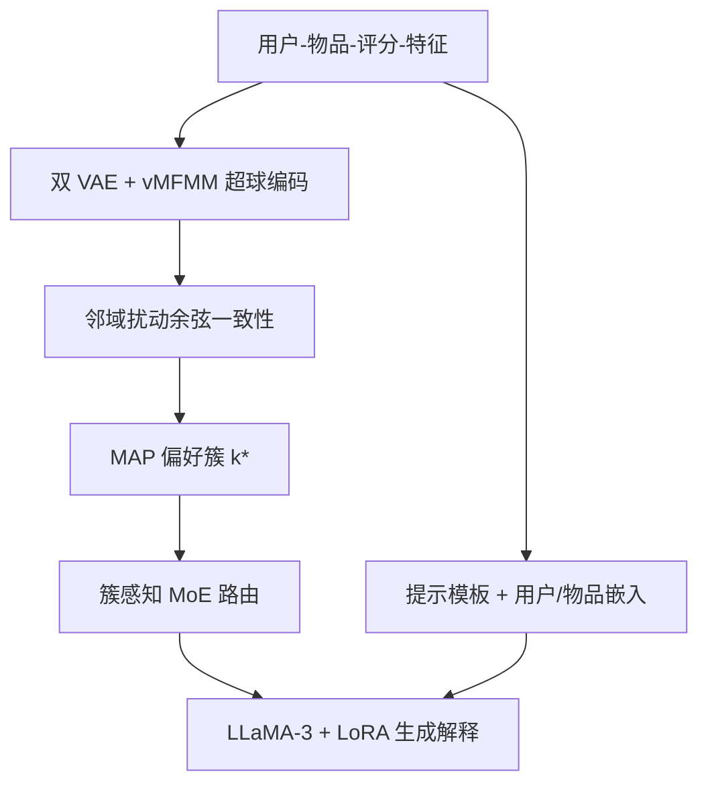
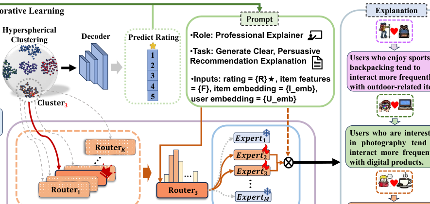

# HyperXRec: Unifying Preference Clusters and LLM Experts for Robust Explainable Recommendations (统一偏好簇与 LLM 专家的鲁棒可解释推荐)

- **会议/期刊**: IJCAI 2026
- **作者与机构**: Xue Han, Zhiwen Luo, Zhixiang Li, Nizar Bouguila, Weifeng Su, Wentao Fan；北师香港浸会大学、康考迪亚大学
- **推荐链路定位**: 端到端生成式（解释生成，非 Top-N 排序）
- **研究方向**: 大语言模型推荐 / 冷启动与长尾推荐
- **论文原文**: [论文原文链接](https://www.ijcai.org/proceedings/2026/0295.pdf)
- **开源代码**: 暂未开源

## TL;DR (1分钟核心速览)

HyperXRec 针对 LLM 可解释推荐中协同信号仅作浅层提示、稀疏交互下 MoE 路由退化并生成泛化解释的问题，提出双 VAE + vMF 混合先验学习超球偏好簇，并用簇后验引导 LLM 的 MoE 专家路由。Amazon/TripAdvisor/Yelp 上 BERT-F 达 0.819/0.833/0.545，较 XRec 分别 +0.418/+0.449/+0.172，GPTScore 88.69/80.43/83.25。

## Background & Motivation (背景与核心矛盾)

- **主流范式**: LLM 可解释推荐多通过 prompt、adapter 或 MoE 注入协同过滤信号，让生成解释兼顾流畅性与个性化。
- **前人局限**: 浅层条件难以进入 LLM 内部推理路径；稀疏/冷启动下 CF 嵌入高方差、簇重叠，Top-m 路由退化为近均匀专家激活，解释趋于模板化。
- **核心洞察 (Key Insight)**: 用户偏好更适合建模为单位超球上的方向性簇；稳定的簇分配可作为专家路由的显式语义先验。
- **本文切入点**: 用 vMFMM 双 VAE 获得紧凑超球簇，再将簇后验作为 MoE 路由条件，统一偏好建模与解释生成。

## Method (核心方法设计)

### 1. 整体框架 (Overall Architecture)

输入用户、物品、评分与物品特征；双 VAE 编码器输出超球潜变量 $z$的 vMF 后验，并以 vMF 混合先验形成$K$个偏好簇；邻域扰动与余弦一致性正则提升稀疏鲁棒性。取 MAP 簇$k^\star$作为交互级语义标签，替换 LLaMA-3 各 Transformer 块 FFN 为簇感知 MoE：仅激活$k^\star$对应路由器，再在簇内做 token 级 Top-$m$ 专家选择。提示模板注入用户/物品嵌入、评分与特征，LoRA 微调生成解释。

<figure class="paper-figure" markdown="span">
  <figcaption>图2：所提出的用于聚类引导可解释推荐的HyperXRec框架概览。</figcaption>
</figure>
*图2：HyperXRec 整体框架：超球聚类与簇引导 MoE 解释生成。*

### 2. 关键设计拆解 (Key Designs)

1. **超球 vMF 混合聚类**：欧氏 VAE/GMM 在稀疏高维下簇边界模糊；本文在单位超球上取 $q(z|u,i)=\mathcal{V}(z|\hat{\mu}_{u,i},\hat{\kappa}_{u,i})$，先验为$p(z)=\sum_{k=1}^{K}\pi_k\mathcal{V}(z|\mu_k,\kappa_k)$，簇后验$q(k|u,i)\propto \pi_k\exp(\kappa_k\mu_k^\top\xi_{u,i})$。方向性约束使同偏好交互角度更近，簇更紧凑可分。
2. **邻域一致性正则**：稀疏时输入小扰动会改变簇分配；用同一用户/物品的 kNN 邻域替换构造 $(u,i_j)$或$(u_k,i)$，约束$\mathcal{L}_{dp}=1-\cos(z,z')$，总损失$\mathcal{L}_{cluster}=\mathcal{L}_{c}+\lambda\mathcal{L}_{dp}$。该正则让邻域交互在超球上保持角度稳定，减少路由抖动。
3. **簇引导 MoE 与训练目标**：token 表示 $h$仅进入簇$k^\star$的路由器，$r_{k^\star}=\mathrm{softmax}(W^{(k^\star)}h)$，Top-$m$专家为门控 FFN，$h'=\sum_{e\in\Omega_m}w_e e(h)$；解释损失$\mathcal{L}_{exp}=-\log p(y_{u,i}|x_{u,i},k^\star)$。默认$E=12,m=2$，LoRA 微调；推理仅激活一个簇路由器，但需保存多组专家参数。

## Experimental Setup & Evaluation Protocol (实验设置与评估协议)

- **数据集与预处理**: 原文仅报告预处理后统计，未明确 `5-core` 等过滤阈值。

| 数据集 | #Users | #Items | #Interactions | 稀疏度/密度 | 特征/场景说明 |
| :--- | :---: | :---: | :---: | :---: | :--- |
| Amazon (AZ) | 7,506 | 7,360 | 441,783 | 密度约 0.80% | Movies & TV，含评分/评论文本/物品特征 |
| TripAdvisor (TA) | 9,765 | 6,280 | 320,023 | 密度约 0.52% | 旅游/local business，含评分与评论 |
| Yelp | 27,147 | 20,266 | 1,293,247 | 密度约 0.24% | 本地生活，长尾更明显 |

- **数据划分与防穿越 (Splitting Strategy)**: 原文未说明比例划分、`Leave-One-Out` 或全局时间切分；仅称指标在 test set 上计算，未给防穿越细节，复现时需补充。
- **排名评测协议 (Ranking Protocol)**: 本文不是 Top-N 排序任务，未采用 `Full-Ranking` 或 `Sampled Ranking`；评测对象为解释文本生成，指标含 BLEU/ROUGE、BERTScore、BLEURT、GPTScore、Distinct-$n$、USR。
- **对比基线与超参设置**: 基线含 PETER、NETE、PEVAE、GaVaMoE、PEPLER、XRec、G-Refer；LLaMA-3 + LoRA，解释微调 lr $3\times10^{-5}$、batch 1、梯度累积 16、5 epochs；VAE 预训练 lr$1\times10^{-3}$、300 epochs，聚类微调 lr$1\times10^{-5}$、30 epochs；$\lambda=10,\kappa=30$，$E=12,m=2$；路由器数$G$ 在 AZ/TA/Yelp 分别为 4/3/5。未报告显著性检验。

## Key Experimental Results (实验关键数据)

### 1. 主实验对比 (Main Results)

| Method | AZ BLEU-4 | AZ BERT-F | AZ GPTScore | TA BERT-F | TA GPTScore | Yelp BERT-F | Yelp GPTScore |
| :--- | :---: | :---: | :---: | :---: | :---: | :---: | :---: |
| PEPLER | 0.991 | 0.364 | 76.08 | 0.343 | 63.91 | 0.305 | 61.58 |
| PETER | 1.201 | 0.380 | 77.65 | 0.350 | 67.00 | 0.281 | 65.16 |
| PEVAE | 1.503 | 0.345 | 79.87 | 0.368 | 69.94 | 0.326 | 67.34 |
| NETE | 1.152 | 0.344 | 75.63 | 0.295 | 61.54 | 0.144 | 58.27 |
| GaVaMoE | 1.498 | 0.373 | 80.45 | 0.263 | 69.10 | 0.352 | 68.10 |
| G-Refer | 1.710 | 0.429 | 82.12 | 0.402 | 73.20 | 0.401 | 75.16 |
| XRec | 1.730 | 0.401 | 82.57 | 0.384 | 71.81 | 0.373 | 69.12 |
| **Ours** | **1.850** | **0.819** | **88.69** | **0.833** | **80.43** | **0.545** | **83.25** |
| **Improv. vs best** | **+6.9%** | **+90.9%** | **+7.4%** | **+107.2%** | **+9.9%** | **+35.9%** | **+10.8%** |

### 2. 消融实验 (Ablation Study)

| Prior / Variant | BLEU-4 | ROUGE-L | Dist-1 | BERT-F |
| :--- | :---: | :---: | :---: | :---: |
| GMM prior (w/o vMFMM) | 1.529 | 17.357 | 19.820 | 0.403 |
| **vMFMM (full)** | **1.850** | **18.607** | **28.340** | **0.819** |

### 3. 关键实验发现 (Key Findings)

1. **vMFMM 直接改善路由质量**：Amazon 上 BERT-F 从 GMM 的 0.403 升至 0.819，Dist-1 从 19.82 升至 28.34；t-SNE 显示 vMFMM 簇更紧凑，说明稳定聚类是 MoE 路由不退化的前提。
2. **路由器数 $G$非单调**：Amazon$G=4$最优（BLEU-1 21.514、GPTScore 88.69），Yelp$G=5$最优（20.284、83.25）；但 TA 从$G=3$ 增至 4 时 BLEU-1 由 22.658 跌至 14.963、GPTScore 由 80.43 跌至 60.31，过细路由导致专家训练不足。
3. **稀疏鲁棒性与解释多样性突出**：按交互频次分桶 ds1–ds5，HyperXRec 在最稀疏 ds1 仍优于基线；三个数据集 USR 均达 1.0，避免重复解释；$m=2$优于单专家，进一步增大$m$ 收益有限。

## Highlights & Limitations (亮点、对比与审稿批判)

- **与代表作对比 (vs. Prior Work)**: 相比 GaVaMoE 的 GMM 潜空间 + 粗粒度 MoE，本文用 vMFMM + 簇专属路由器实现更细粒度语义控制；相比 XRec 的 prompt/adapter 浅层注入，本文把偏好簇写入 LLM 内部 MoE 路由；相比 G-Refer 等图增强路线，本文强调“聚类结构质量”而非堆叠高阶关系。
- **可迁移亮点**: 超球 vMF 聚类 + 邻域余弦一致性可迁移到稀疏 CF 表征学习；簇级路由器可作为 MoE 推荐的稳定先验，缓解 token 级路由噪声。
- **审稿级局限批判**: 其一，未报告数据划分、防穿越与显著性，且缺少严格 zero-shot 冷启动划分，冷启动结论主要由交互频次分桶支撑；其二，$G$ 在 TA 上敏感、需多组专家存储，GPTScore/BLEURT 作为评价器亦有偏；代码未开源，复现成本较高。

## Rating (四维评分)

- **方法创新性 (Novelty)**: ⭐⭐⭐⭐ （vMFMM 与簇引导 MoE 的组合有新意，但属于已知组件的紧耦合设计）
- **评估协议与实验扎实度 (Protocol & Experiments)**: ⭐⭐⭐ （三数据集、多指标与稀疏分桶较完整，但划分/显著性/严格冷启动协议缺失）
- **写作与数学规范度 (Clarity & Rigor)**: ⭐⭐⭐⭐ （vMF 后验、簇后验与路由公式清晰，整体框架易读）
- **工业落地与复现价值 (Industrial & Practical Value)**: ⭐⭐⭐ （LLM+多专家开销较高、代码未开源，但簇引导路由对可解释生成有直接借鉴价值）

