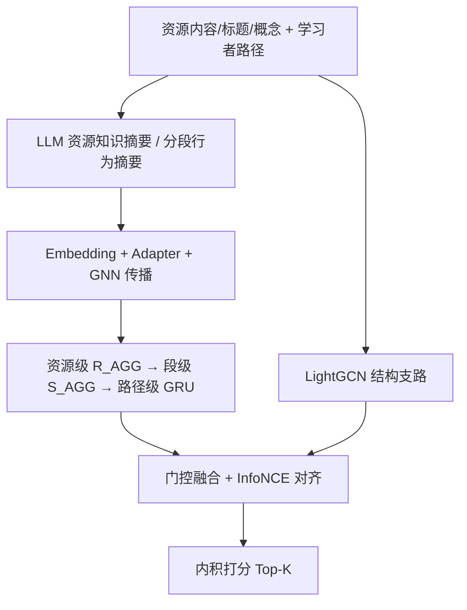
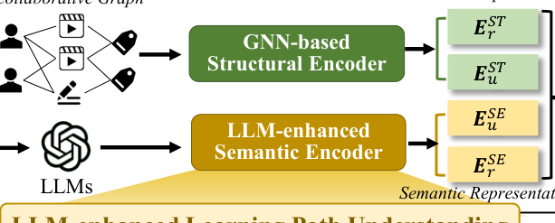
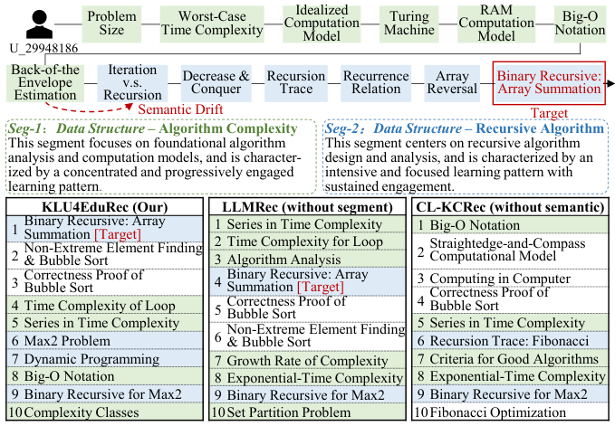

# LLM-Enhanced Knowledge and Learning Path Understanding for Graph-based Educational Recommendation (LLM 增强的知识与学习路径理解用于图教育推荐)

- **会议/期刊**: IJCAI 2026 (Special Track on AI and Social Good)
- **作者与机构**: Qingqing Liang, Shuyan Zheng, Peiwei Xia, Chunyang Wang, Xuesong Lu, Aoying Zhou（华东师范大学数据科学与工程学院；贵州大学计算机学院）
- **推荐链路定位**: 召回（Top-K 资源推荐，全库排序）
- **研究方向**: 大语言模型推荐 / 图神经网络与知识图谱推荐
- **论文原文**: [论文原文链接](https://www.ijcai.org/proceedings/2026/0813.pdf)
- **开源代码**: [开源代码仓库链接](https://github.com/DaSESmartEdu/KLU4EduRec)

## TL;DR (1分钟核心速览)

教育推荐主流做法是纯 ID 图协同过滤，既读不懂资源承载的知识，也读不懂学习者路径内部**学习模式的阶段性漂移**；已有 LLM4Rec 增强工作只给物品/用户做语义画像，把整条路径当作一个整体总结，导致粗粒度表征掩盖阶段切换。KLU4EduRec 提出双分支框架：LLM 摘要资源核心知识经 Adapter 注入 LightGCN，同时用"瞬时语义变化 + EMA 平滑 + 滑窗累积漂移"检测路径分段并逐段归纳"学什么(知识)+怎么学(行为)"，GRU 时序聚合，最后与结构表征做门控融合 + InfoNCE 跨视图对齐。在两个 MOOCCube 数据集、过滤路径长度 <10、8:1:1 时间序切分、无偏 Full-Ranking 协议下，Recall@10 相对最优基线提升 7.1%/7.3%，NDCG@10 提升 8.2%/7.6%，MRR@10 提升 4.0%/8.9%。

## Background & Motivation (背景与核心矛盾)

- **主流范式**: 教育平台数据天然构成含学习者、资源、课程、知识概念的异质图，因此 LightGCN/KGRec 类 ID 初始化 GNN 传播 + BPR 优化是事实标准，近期 SKarREC、ExRec、KCD 开始让 LLM 充当语义增强器（LLM-as-enhancer）。
- **前人局限**: (1) 现有 LLM 增强只把资源/概念文本化，**从不建模学习者行为模式语义**，推荐与学习者真实学习阶段错配；(2) 视频字幕、题目描述等丰富文本未被充分利用，而整条路径直接塞进 LLM 既超上下文，又只能得到粗糙的整体画像，阶段内部变化被抹平。
- **核心洞察 (Key Insight)**: 教育动机理论指出学习动机以"阶段"演化、阶段内相对稳定——因此学习路径的语义变化应当**先分段再聚合**：路径上相邻资源语义突变即代表学习模式漂移，是天然的切分信号。
- **本文切入点**: 以"资源知识摘要 + 漂移驱动分段 + 段内三级聚合"为语义支路，与图结构支路门控融合并对齐。

## Method (核心方法设计)

### 1. 整体框架 (Overall Architecture)

模型为双分支。绿支路用 LightGCN 在协同图 $\mathcal{G}$上传播 ID 表征得$e^{ST}_u,e^{ST}_r$；黄支路离线调用 Qwen3-235B 为每个资源生成 ≤80 词核心知识摘要、为每个路径分段生成学习模式摘要，经 Qwen3-Embedding-8B 编码 + 轻量 Adapter 投影进推荐空间，再由 GNN 在图上传播得到"结构-知识感知"资源表征，并按"资源→分段→路径"三级聚合出学习者语义表征。两支路用可学习门控融合后内积打分，以 BPR 为主损失、双向 InfoNCE 对齐为辅。训练/推理采用三阶段流水线：语义离线抽取并冻结 → 用交互数据训练推荐器 → 在线仅对新形成的分段调用 LLM 做增量分段与时序更新。

<figure class="paper-figure" markdown="span">
  <figcaption>图1：KLU4EduRec 的整体架构。</figcaption>
</figure>

### 2. 关键设计拆解 (Key Designs)

1. **漂移驱动的路径分段（Pattern-Drift Segmentation）**：痛点是把整条路径交给 LLM 会超长且丢失阶段变化。先量化相邻资源的瞬时语义变化 $\delta_i = 1-\cos(e^{LLM}_{r_i}, e^{LLM}_{r_{i-1}})$，再用指数滑动平均抑制短时探索噪声$\tilde{\delta}_i = \eta\delta_i + (1-\eta)\tilde{\delta}_{i-1}$，最后在窗口$\omega$上累积$\Delta_i = \sum_{j=i-\omega+1}^{i}\tilde{\delta}_j$，一旦$\Delta_i > \gamma$ 即判定模式漂移并开启新分段。直觉：EMA 抓"模式惯性"，滑窗累积抓"持续性迁移"，二者共同把偶发跳转与真实阶段切换区分开。
2. **三级层次聚合（Resource→Segment→Path）**：段内回答"学什么/怎么学"。行为语义 $e^{BE}_{u,k}=\mathrm{ADPT}_u(\mathrm{LLMemb}(s_{u,k}))$由段内行为摘要编码而来；知识语义以行为语义为 query 对段内资源语义做注意力汇聚$e^{KE}_{u,k}=\mathrm{R\_AGG}(e^{BE}_{u,k},[e^{SE}_{r_{k,j}}])$；段级$e^{SE}_{u,k}=e^{BE}_{u,k}+e^{KE}_{u,k}$；路径级$e^{SE}_{u}=\mathrm{GRU}([e^{SE}_{u,k}])$。相比单次全局摘要，层次聚合让每一段的意图在最终表征中保留独立贡献，并显式编码阶段演化顺序。
3. **门控融合、对齐与训练目标**：结构/语义来自两种建模范式，直接拼接易不一致，故 $e_x = g_x e^{ST}_x + (1-g_x)e^{SE}_x$做自适应加权，并加 InfoNCE 对齐同实体两视图、推开异实体：$\mathcal{L}^{align}_x = -\log \frac{\exp(\mathrm{sim}(e^{ST}_x,e^{SE}_x)/\tau)}{\sum_{x'}\exp(\mathrm{sim}(e^{ST}_x,e^{SE}_{x'})/\tau)}$。总目标$\mathcal{L}=\mathcal{L}_{rec}+\alpha\mathcal{L}^{align}_u+\beta\mathcal{L}^{align}_r+\lambda\|\Phi\|_2^2$，负样本为 BPR 常规未观测采样（非难负采样），资源侧 LLM 表征冻结以保证语义不被协同信号污染；推理侧无额外 LLM 开销（仅新分段触发）。

## Experimental Setup & Evaluation Protocol (实验设置与评估协议)

- **数据集与预处理**: 两个真实教育数据集，过滤学习路径长度 $<10$ 的学习者，保留视频/题目文本、课程与知识概念：

| 数据集 | #Users | #Items | #Interactions(图边) | 稀疏度/密度 | 特征/场景说明 |
| :--- | :---: | :---: | :---: | :---: | :--- |
| MOOCCubeX | 9,506 | 7,219 | 659,714 | 0.96% | 视频/题目文本 + 概念，平均路径长 69.40 |
| MOOCCube | 9,831 | 11,885 | 935,943 | 0.80% | 同上，平均路径长 95.20 |

- **数据划分与防穿越**: 按学习路径时间序做 8:1:1 切分（`全局时间戳切分`），保证预测只用历史行为，无未来泄漏。
- **排名评测协议**: 采用 `Full-Ranking (全库未交互排序)`，正样本对全部未观测资源排序，指标 Recall@5/10、NDCG@5/10、MRR@10，4 个随机种子取均值。
- **对比基线与超参设置**: 9 个基线覆盖三类——通用 GNN（LightGCN、KGRec、RecDCL）、LLM 增强 GNN（LLMRec、RLMRec、CIKGRec）、教育图模型（ACKRec、CL-KCRec、KCD）。$d=64$，LightGCN 层数 2（MOOCCubeX）/1（MOOCCube），lr$5e^{-3}$，$\eta=0.3$，$\omega=5$，$\gamma$取语义漂移分布 75% 分位（2.02/2.42），$\lambda=5e^{-4}/5e^{-5}$，$\alpha=5e^{-3}/1e^{-4}$，$\beta=5e^{-5}/1e^{-4}$；未报告显著性检验。

## Key Experimental Results (实验关键数据)

### 1. 主实验对比 (Main Results)

| Model | MOOCCubeX R@5 | R@10 | N@10 | MRR@10 | MOOCCube R@5 | R@10 | N@10 | MRR@10 |
| :--- | :---: | :---: | :---: | :---: | :---: | :---: | :---: | :---: |
| LightGCN (2020) | 0.4479 | 0.5969 | 0.5698 | 0.3355 | 0.1746 | 0.2784 | 0.2182 | 0.1920 |
| KGRec (2023) | 0.5049 | 0.6548 | 0.6457 | 0.4030 | 0.1971 | 0.2861 | 0.2365 | 0.2245 |
| LLMRec (2024) | 0.5500 | 0.7225 | 0.6782 | 0.3999 | 0.2038 | 0.3025 | 0.2500 | 0.2236 |
| RLMRec (2024) | 0.5452 | **0.7249** | **0.6773** | 0.4218 | 0.1899 | 0.2886 | 0.2282 | 0.1995 |
| CIKGRec (2025) | 0.5125 | 0.6678 | 0.6549 | 0.4096 | 0.1932 | 0.2847 | 0.2472 | 0.2254 |
| ACKRec (2020) | 0.5255 | 0.6691 | 0.6521 | 0.3831 | 0.1902 | 0.2653 | 0.2290 | 0.2187 |
| CL-KCRec (2024) | 0.5269 | 0.6715 | 0.6657 | 0.3833 | 0.1866 | 0.2892 | 0.2456 | 0.2128 |
| KCD (2025) | 0.5079 | 0.6515 | 0.6437 | 0.3819 | 0.1852 | 0.2821 | 0.2219 | 0.2072 |
| **KLU4EduRec** | **0.6001** | **0.7765** | **0.7335** | **0.4388** | **0.2232** | **0.3247** | **0.2691** | **0.2456** |
| Improv.% | +9.1% | +7.1% | +8.2% | +4.0% | +9.5% | +7.3% | +7.6% | +8.9% |

（表中第二优以原文字下划线标注；R=Recall，N=NDCG，Improv. 为相对第二优基线的提升幅度。）

### 2. 消融实验 (Ablation Study)

| 变体 | MOOCCubeX NDCG@10 | Δ | MOOCCube NDCG@10 | Δ |
| :--- | :---: | :---: | :---: | :---: |
| KLU4EduRec 完整 | **0.7355** | — | **0.2691** | — |
| w/o align（去双视图对齐） | 0.6733 | −8.5% | 0.2566 | −4.6% |
| w/o t_agg（段表征均值代替 GRU） | 0.7257 | −1.3% | 0.2504 | −7.0% |
| w/o BE（去行为语义） | 0.7247 | −1.5% | 0.2505 | −6.9% |
| w/o KE（去知识语义） | 0.7217 | −1.9% | 0.2567 | −4.6% |
| w/o seg（整条路径全局摘要） | 0.7087 | −3.6% | 0.2514 | −6.6% |
| w/o item（去资源语义） | 0.6461 | −12.1% | 0.2390 | −11.2% |
| w/o user（去学习者语义） | 0.6881 | −6.4% | 0.2447 | −9.1% |

### 3. 关键实验发现 (Key Findings)

1. **资源语义是全套件的最大单点贡献**：去掉资源摘要支路（w/o item）在 MOOCCubeX 上 NDCG@10 掉 12.1%，远超去掉分段（−3.6%）与去掉对齐（−8.5%），说明教育场景中"资源到底讲什么"比"用户表征多精细"更接近瓶颈；而语义对齐本身在稀疏图（MOOCCube 密度 0.80%）上的收益（−4.6%）小于更稠密图（−8.5%），提示结构信号越弱时跨视图对齐越关键。
2. **分段 + 时序聚合是路径建模的必要条件**：w/o seg 与 w/o t_agg 在 MOOCCube 上分别掉 6.6%/7.0%，而该数据集平均路径长达 95.2，语义漂移次数更多——路径越长、阶段越多，整条全局摘要的信息损失越严重，GRU 保留的顺序信息也越不可替代。
3. **LLM 增强并非万能，粒度决定胜负**：同为 LLM 增强，RLMRec 在 MOOCCube 上甚至低于纯结构 LightGCN（MRR@10 0.1995 vs 0.1920），KCD 直接全局摘要整条路径仅得 0.2072；KLU4EduRec 通过"资源级精细 + 段级细粒度"把 MOOCCube MRR@10 推到 0.2456（+8.9%），案例研究（图 6）显示其推荐严格落在"算法复杂度→递归"漂移后的新阶段，而 LLMRec 跨阶段混杂、CL-KCRec 与当前阶段弱相关。

<figure class="paper-figure" markdown="span">
  <figcaption>图6：案例研究：捕捉学习模式漂移的重要性。</figcaption>
</figure>

## Highlights & Limitations (亮点、对比与审稿批判)

- **与代表作对比 (vs. Prior Work)**: 对照 RLMRec/LLMRec——它们把用户画像做成单一静态文本视图、与协同信号跨视图对齐，本文则把"用户视图"升级为**分段时序结构**；对照 SKarREC/ExRec——它们只做资源/概念侧语义（概念文本化、题目解题步骤），从不触碰学习者行为语义；对照 KCD——同样用 LLM 总结路径，但整条一次性总结，本文的多粒度分段是其直接替代方案。
- **可迁移亮点**: (1) "EMA 平滑 + 滑窗累积漂移 + 分位数阈值"是模型无关的通用序列分段器，可直接搬到会话推荐、兴趣漂移建模与长序列电商行为切分；(2) "LLM 语义离线冻结 + Adapter + 图传播"让语义与拓扑互补，且在线零 LLM 调用，工程上极具性价比。
- **审稿级局限批判**: (1) 分段阈值 $\gamma$依赖数据集分位（2.02/2.42）而非自适应学习，论文未做$\gamma$/$\omega$/$\eta$ 的独立敏感性分析，跨域迁移需重扫；(2) 仅两个同源 MOOCCube 数据集、单次 4 种子且**无显著性检验、无冷启动/长尾分桶、无线上 A/B**，对"可解释性提升"仅给单例案例研究而无数值评估；(3) 资源语义完全冻结且依赖 Qwen3-235B 的摘要质量，摘要偏差无法被推荐损失反向纠正，长路径仍需截断。

## Rating (四维评分)

- **方法创新性 (Novelty)**: ⭐⭐⭐⭐ （把"学习模式漂移"形式化为可计算的语义漂移检测并驱动分段，再配三级层次聚合，思路新颖但组件多为成熟模块的组合）
- **评估协议与实验扎实度 (Protocol & Experiments)**: ⭐⭐⭐⭐ （Full-Ranking 无偏协议 + 9 个强基线 + 7 组消融齐全，但仅两同源数据集、缺显著性检验与冷启动分析）
- **写作与数学规范度 (Clarity & Rigor)**: ⭐⭐⭐⭐ （分段与聚合公式链条清晰、提示词与三级符号定义完整，但阈值选取与复杂度/时延分析偏薄）
- **工业落地与复现价值 (Industrial & Practical Value)**: ⭐⭐⭐⭐⭐ （代码开源、语义离线抽取使在线零 LLM 调用、增量分段可流式更新，已有国内大型在线学习平台合作，落地路径明确）

