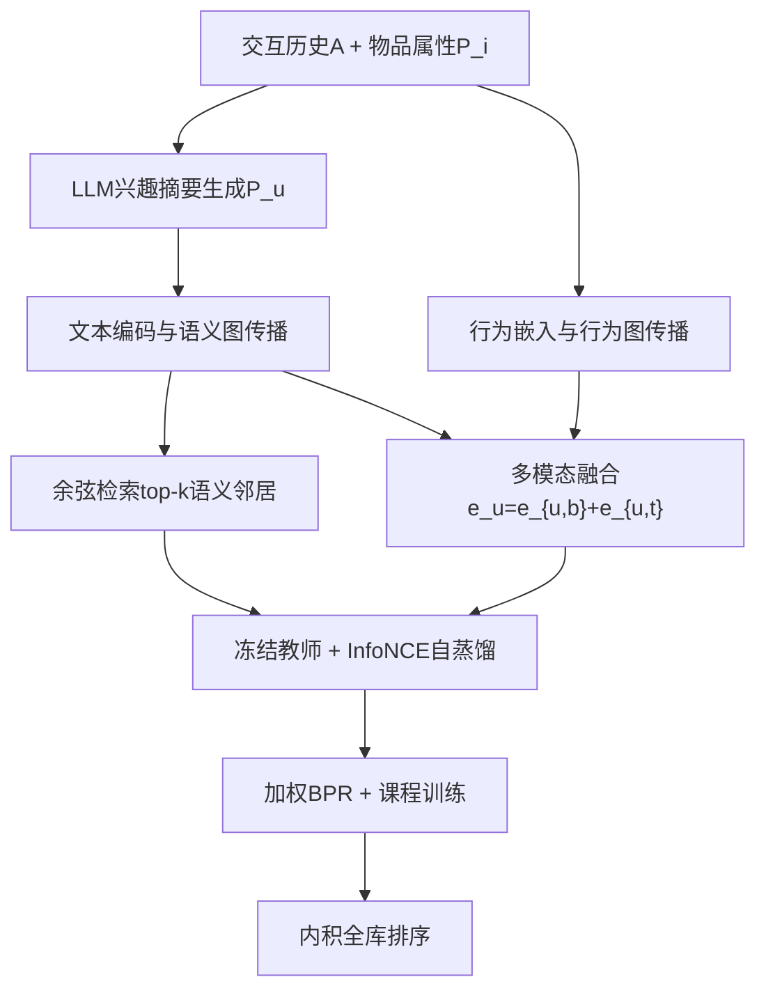
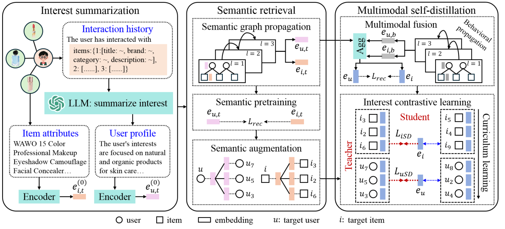

# LLM-Summarized Interest Distillation for Multimedia Recommendation (LLM摘要兴趣蒸馏用于多媒体推荐)

- **会议/期刊**: IJCAI 2026
- **作者与机构**: Meng Jian, Zhuoyang Xia, Haolun Fan, Lifang Wu（北京工业大学；内蒙古交通设计研究院）
- **推荐链路定位**: 召回/排序（全库打分）
- **研究方向**: 大语言模型推荐 / 多模态推荐
- **论文原文**: [论文原文链接](https://www.ijcai.org/proceedings/2026/0300.pdf)
- **开源代码**: 暂未开源

## TL;DR (1分钟核心速览)

本文针对多媒体推荐中商品属性文本冗长且偏离用户兴趣、稀疏交互导致兴趣建模偏差的问题，提出SID：用Llama3-8B在提示约束下生成100–200词用户兴趣画像，经Qwen2.5-3B编码并在交互图上传播后检索语义邻居；再以冻结的多教师通过InfoNCE多模态自蒸馏增强稀疏学生。在Beauty/Toys/Cellphones的8:2随机划分与全库排序top-20协议下，Recall@20较最佳基线分别提升10.33%/13.75%/4.82%。

## Background & Motivation (背景与核心矛盾)

- **主流范式**: 多媒体推荐多在行为图上融合视觉/文本模态或LLM编码结果，再以图卷积学习用户—物品表示；LLM4Rec则用LLM生成用户/物品画像或初始化节点。
- **前人局限**: 商品标题、品牌、类目与描述主要刻画物品属性，长文本中大量兴趣无关信息会稀释用户兴趣；稀疏交互图的结构邻居不完整，仅靠图传播难以恢复兴趣模式。
- **核心洞察 (Key Insight)**: 图1的实证显示，兴趣无关描述会使兴趣建模偏离下游推荐目标；引入任务相关的语义邻居可扩展数据视角，并更有效推断稀疏用户兴趣。
- **本文切入点**: 先用LLM“压缩去噪”兴趣文本，再把检索到的语义邻居作为多教师，将多模态协同知识蒸馏进目标学生，兼顾文本质量与协同邻居数量。

## Method (核心方法设计)

### 1. 整体框架 (Overall Architecture)

输入用户交互矩阵$A$与物品属性文本$P_i$。首先由Llama3-8B按系统/用户提示生成结构化用户画像$P_u$，经Qwen2.5-3B编码并投影为语义嵌入；在交互图上传播语义嵌入后，以余弦相似度检索top-$k$相似用户/物品。行为嵌入随机初始化并在同一图上传播，与语义嵌入相加融合。检索邻居冻结为教师，通过InfoNCE将多教师多模态知识蒸馏到目标学生；最终以自适应加权BPR与课程学习联合优化，推理时仅用内积全库排序。

<figure class="paper-figure" markdown="span">
  <figcaption>图2：所提出的SID模型框架，包括三个模块：(a) 兴趣总结模块采用LLM描述用户兴趣；(b) 语义检索模块筛选语义相似的邻居作为教师；(c) 多模态自蒸馏模块将教师的多模态知识迁移到目标学生以进行兴趣建模。</figcaption>
</figure>
图 2：SID 由兴趣摘要、语义检索与多模态自蒸馏三模块构成。

### 2. 关键设计拆解 (Key Designs)

1. **LLM兴趣摘要（压缩兴趣相关信号）**：物品描述冗长且属性化，直接编码会把噪声带入兴趣表示。SID用提示工程约束LLM只关注个人兴趣，输出JSON格式的100–200词画像：$P_u=\mathrm{LLM}(Q_s,Q_u)$，再由文本编码器得到$e^{(0)}_{u,t}=\mathrm{proj}(\mathrm{Enc}(P_u))$。直觉是先把“物品属性清单”转成“用户兴趣摘要”，降低下游图传播与检索的语义噪声。
2. **语义检索多教师（补足稀疏邻居）**：稀疏图的一跳邻居不足以刻画兴趣。SID在语义图上做LightGCN式传播并聚合多层表示，再按余弦相似度选邻居：$g_u=\mathrm{topk}_{u'}(\cos(e_{u,t},e_{u',t}))$，物品侧同理。检索邻居不直接改图结构，而是作为多教师提供语义协同信号，避免硬增广引入错误边。
3. **多模态自蒸馏与课程训练**：行为与语义通道融合为$e_u=e_{u,b}+e_{u,t}$；以教师相似度聚合$s(e_u,e_{g_u})=\sum_{j\in g_u}\cos(e_u,e_j)$，并优化
$\mathcal{L}^{SD}_u=-\log\frac{\exp(s(e_u,e_{g_u})/\tau_{sd})}{\sum_{u'\in B_u}\exp(s(e_u,e_{g_{u'}})/\tau_{sd})}$，教师侧停止梯度以稳定蒸馏。训练目标为$\mathcal{L}_{\text{main}}=\mathcal{L}_{rec}+\beta\mathcal{L}_{iSD}$（前期）或再加$\beta\mathcal{L}_{uSD}$（后期），即先物品侧、后用户侧的课程学习；负采样为每正样本随机256负样本，InfoNCE分母使用批内样本，推理仅需内积，主要开销在离线LLM摘要、文本编码与top-$k$检索。

## Experimental Setup & Evaluation Protocol (实验设置与评估协议)

- **数据集与预处理**: 采用Amazon Beauty/Toys/Cellphones，含用户—物品交互及物品文本属性；未提5-core过滤。

| 数据集 | #Users | #Items | #Interactions | 稀疏度/密度 | 特征/场景说明 |
| :--- | :---: | :---: | :---: | :---: | :--- |
| Beauty | 22,363 | 12,101 | 198,502 | 0.073% | 美妆，文本属性+隐式交互 |
| Toys | 19,412 | 11,924 | 167,597 | 0.072% | 玩具，文本属性+隐式交互 |
| Cellphones | 27,879 | 10,429 | 194,439 | 0.067% | 手机，文本属性+隐式交互 |

- **数据划分与防穿越**: 按8:2随机划分训练/测试；未采用全局时间戳切分，需警惕随机划分的乐观偏差。
- **排名评测协议**: 无偏Full-Ranking，对测试用户全部未交互物品按预测分排序，取top-20；报告Recall@20、NDCG@20、Precision@20。
- **对比基线与超参**: 覆盖MFBPR/LightGCN、SGL/SimGCL、BM3-T/SMORE-T、RLMRec-Con/AlphaRec；文本编码统一为Qwen2.5-3B，嵌入64维，图卷积3层，lr=3e-4，Adam，$\tau_p=0.2$、$\tau_{sd}\in\{0.2,0.2,0.3\}$、$\beta=0.2$、$k=10$；每实验重复10次取均值，未报告显著性$p$值。

## Key Experimental Results (实验关键数据)

### 1. 主实验对比 (Main Results)

| Model | Beauty R@20 | Beauty N@20 | Beauty P@20 | Toys R@20 | Toys N@20 | Toys P@20 | Cell. R@20 | Cell. N@20 | Cell. P@20 |
| :--- | ---: | ---: | ---: | ---: | ---: | ---: | ---: | ---: | ---: |
| MFBPR | 0.0992 | 0.0502 | 0.0080 | 0.0880 | 0.0467 | 0.0060 | 0.1041 | 0.0501 | 0.0062 |
| LightGCN | 0.1373 | 0.0709 | 0.0111 | 0.1295 | 0.0673 | 0.0088 | 0.1577 | 0.0756 | 0.0092 |
| SGL | 0.1483 | 0.0769 | 0.0121 | 0.1387 | 0.0716 | 0.0096 | 0.1649 | 0.0804 | 0.0097 |
| SimGCL | 0.1530 | 0.0785 | 0.0124 | 0.1437 | 0.0736 | 0.0100 | 0.1744 | 0.0850 | 0.0102 |
| BM3-T | 0.1146 | 0.0557 | 0.0088 | 0.1018 | 0.0488 | 0.0067 | 0.1454 | 0.0680 | 0.0083 |
| SMORE-T | 0.1496 | 0.0723 | 0.0112 | 0.1486 | 0.0700 | 0.0099 | 0.1513 | 0.0730 | 0.0087 |
| RLMRec-Con | 0.1469 | 0.0726 | 0.0116 | 0.1305 | 0.0634 | 0.0089 | 0.1544 | 0.0737 | 0.0091 |
| AlphaRec | 0.1588 | 0.0755 | 0.0119 | 0.1520 | 0.0721 | 0.0101 | 0.1697 | 0.0763 | 0.0098 |
| **SID** | **0.1752** | **0.0887** | **0.0137** | **0.1729** | **0.0870** | **0.0116** | **0.1828** | **0.0867** | **0.0107** |
| Improv. vs best baseline | 10.33% | 12.99% | 10.48% | 13.75% | 18.21% | 14.85% | 4.82% | 2.00% | 4.90% |

### 2. 消融实验 (Ablation Study)

| Variant | Beauty R@20 | Beauty N@20 | Toys R@20 | Toys N@20 | Cell. R@20 | Cell. N@20 |
| :--- | ---: | ---: | ---: | ---: | ---: | ---: |
| w/o reasoning | 0.1705 | 0.0876 | 0.1714 | 0.0868 | 0.1800 | 0.0862 |
| w/o text | 0.1373 | 0.0709 | 0.1295 | 0.0673 | 0.1577 | 0.0756 |
| w/o RA | 0.1670 | 0.0850 | 0.1616 | 0.0826 | 0.1789 | 0.0859 |
| w/o SD | 0.1444 | 0.0734 | 0.1347 | 0.0691 | 0.1404 | 0.0672 |
| w/o RA+SD | 0.1658 | 0.0849 | 0.1608 | 0.0824 | 0.1781 | 0.0858 |
| w/o uSD | 0.1730 | 0.0874 | 0.1715 | 0.0866 | 0.1807 | 0.0865 |
| w/o iSD | 0.1702 | 0.0873 | 0.1639 | 0.0840 | 0.1804 | 0.0864 |
| w/o curriculum | 0.1724 | 0.0878 | 0.1696 | 0.0859 | 0.1824 | 0.0866 |
| **SID** | **0.1752** | **0.0887** | **0.1729** | **0.0870** | **0.1828** | **0.0867** |

### 3. 关键实验发现 (Key Findings)

- **文本质量是最大杠杆，但需与语义图传播协同**：移除LLM摘要（w/o reasoning）仅使Beauty R@20从0.1752降至0.1705，而移除整个文本通道（w/o text）崩至0.1373/0.1295/0.1577，几乎退回LightGCN水平；说明SID收益并非只来自“更短文案”，而是摘要后的语义编码、图传播与检索共同提供兴趣信号。
- **多教师蒸馏比单纯检索更关键**：w/o SD在Beauty/Toys降至0.1444/0.1347，降幅显著大于w/o RA的0.1670/0.1616；w/o RA+SD仍高于w/o SD，表明语义检索必须经InfoNCE蒸馏转成学生参数，否则邻居只提供有限增益。
- **课程学习与长尾/稀疏优势一致**：w/o curriculum在三个数据集均低于SID（0.1724/0.1696/0.1824），Toys上w/o iSD掉至0.1639，说明物品侧教师信号对稀疏商品更重要；图5–7进一步显示SID在低流行度物品、稀疏用户组下降更缓，t-SNE用户—物品簇更紧凑。

## Highlights & Limitations (亮点、对比与审稿批判)

- **与代表作对比 (vs. Prior Work)**: AlphaRec直接以LLM编码物品初始化图节点，缺少用户兴趣摘要与教师蒸馏；RLMRec生成用户画像但未引入语义邻居多教师迁移；SMORE侧多重模态频域图学习，却未显式清洗兴趣无关文本。SID将“摘要去噪”和“检索蒸馏”串成一条闭环。
- **可迁移亮点**: 用LLM把长属性文本压缩为受格式约束的兴趣画像，可直接迁移到冷启动画像与跨域用户理解；冻结语义邻居作多教师、再以InfoNCE自适应蒸馏，可替代硬图增广，降低错误边风险。
- **审稿级局限批判**: 其一，Llama3-8B摘要、Qwen2.5-3B编码与全量top-$k$余弦检索带来较高离线成本，在线推理虽仅内积，但复现与工业部署门槛不低；其二，8:2随机划分未做全局时间切分，且仅报告10次均值、未给显著性检验，全库排序结论可能偏乐观。

## Rating (四维评分)

- **方法创新性 (Novelty)**: ⭐⭐⭐⭐ （将LLM兴趣摘要、语义邻居检索与多教师自蒸馏组合成闭环，思路新，但InfoNCE蒸馏与图传播本身并非全新。）
- **评估协议与实验扎实度 (Protocol & Experiments)**: ⭐⭐⭐ （三数据集、Full-Ranking与10次重复较完整，但随机8:2划分、无时间切分、无显著性检验限制结论强度。）
- **写作与数学规范度 (Clarity & Rigor)**: ⭐⭐⭐⭐ （三模块与损失定义清晰，检索和蒸馏公式可复现；课程阈值$T$、教师聚合细节与复杂度分析略简。）
- **工业落地与复现价值 (Industrial & Practical Value)**: ⭐⭐⭐ （模块可插拔、线上仅内积友好，但LLM/编码器与检索开销高，且暂未开源，复现成本偏高。）

