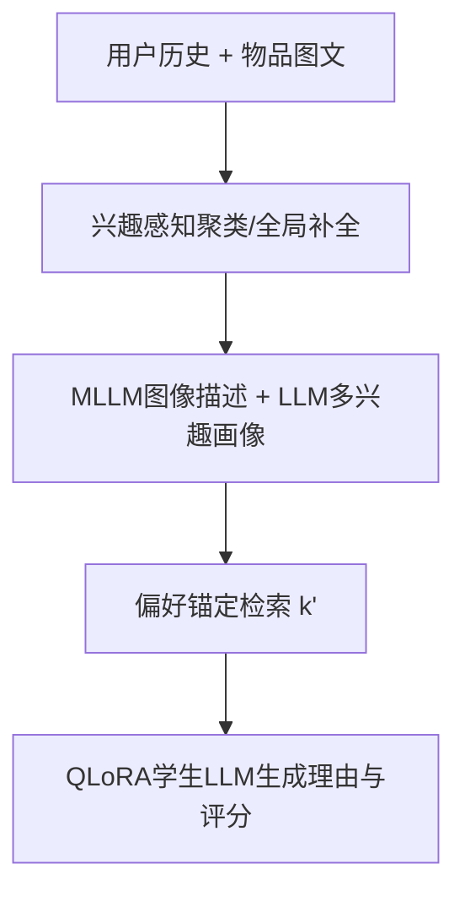
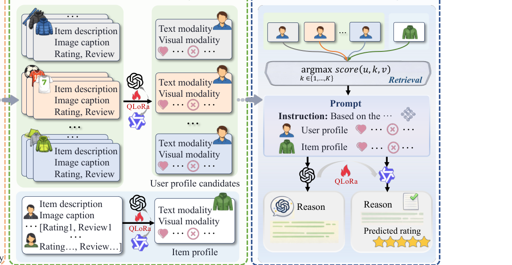

# Joint Multi-Modal Multi-Interest Profiling and Preference-Grounded Reasoning for Explainable Recommendation (联合多模态多兴趣画像与偏好锚定推理的可解释推荐)

- **会议/期刊**: IJCAI 2026
- **作者与机构**: Anqi Wang, Jianye Xie 等；中国石油大学（华东）、浙江大学、云南财经大学、南京信息工程大学等
- **推荐链路定位**: 端到端解释生成 + 评分预测
- **研究方向**: 多模态推荐 / 大语言模型推荐
- **论文原文**: [论文原文链接](https://www.ijcai.org/proceedings/2026/0339.pdf)
- **开源代码**: 暂未开源

## TL;DR (1分钟核心速览)

针对多模态多兴趣可解释推荐中视觉证据利用不足与统一画像难辨兴趣的问题，PRIME 用兴趣感知聚类、多模态多兴趣画像和偏好锚定检索驱动 LLM 推理。Amazon 三域按时间 8:1:1 切分、5-core 过滤，BLEURT 较 Reason4Rec 提升 7.4%–10.2%，MAE 降低 5.2%–6.4%。

## Background & Motivation (背景与核心矛盾)

- **主流范式**: 可解释推荐多基于评论/文本构造用户表征，近期 XRec、Reason4Rec 等用 LLM 生成解释并预测评分，但仍以单一统一画像为主。
- **前人局限**: 一是文本中心方法忽略图像中的风格、颜色等直接偏好信号；二是 LLM 统一画像把多面兴趣纠缠在一起，难以定位目标物品对应的具体兴趣。
- **核心洞察 (Key Insight)**: 用户兴趣天然多面，且物品图文信息可作为可检索、可对齐的语义证据；解释的忠实性取决于“先找对兴趣，再推理”。
- **本文切入点**: 先把物品组织为兴趣感知簇，构造多模态多兴趣画像，再对目标物品检索最相关兴趣画像进行 grounded reasoning。

## Method (核心方法设计)

### 1. 整体框架 (Overall Architecture)

PRIME 先将物品 CLIP 图文特征残差量化，学习模态注意力与 $K$个可学习原型，经 Gumbel-Softmax 软分配得到兴趣簇；再用全局原型从用户更广历史中检索 top-$z$补充物品，扩充各簇。随后用 MLLM 将图像转成描述，LLM 在 `[Like]`/`[Dislike]` 标签下生成$K$ 个用户画像与 1 个物品画像，并以 QLoRA 蒸馏到学生 LLM。推理时按正/负偏好匹配分检索最相关兴趣画像，拼装提示让学生 LLM 同时生成理由和评分。

<figure class="paper-figure" markdown="span">
  <figcaption>图2：所提出的 PRIME 求解 MMER 问题的模型框架。</figcaption>
</figure>

### 2. 关键设计拆解 (Key Designs)

1. **兴趣感知聚类与全局补全**：为解决单兴趣粒度粗、局部历史证据不足，先做模态加权 $\mathbf{h}_v=\sum_m \alpha_v^m\mathbf{e}_v^m$，再以原型$\mathbf{c}_k$做软分配$\pi_{v,k}=\frac{\exp((s_{v,k}+g_k)/\tau)}{\sum_{j=1}^{K}\exp((s_{v,j}+g_j)/\tau)}$；随后按$w_{k,v}=\mathrm{sim}(\mathbf{c}_k,\mathbf{h}_v)$检索 top-$z$，得$\tilde{\mathcal{V}}_k=\mathcal{V}_k\cup\mathcal{V}_k^{sup}$。直觉是原型既做“兴趣锚点”，又做跨历史补证据的查询。
2. **多模态多兴趣画像**：为把视觉信号转成 LLM 可读证据，先用 MLLM 生成 $n_v=\mathrm{MLLM}(g_v)$，再令 LLM 生成$p_{u,k}=\mathrm{LLM}(S_u,T_{u,k})$与$p_v=\mathrm{LLM}(S_v,T_v)$；用户画像按兴趣簇解耦，物品画像聚合全局图文与历史反馈。这样既保留细粒度偏好，也让后续检索有明确载体。
3. **偏好锚定推理与训练目标**：为让解释对准目标物品，将画像拆成正/负部分，计算 $score(u,k,v)=\mathrm{sim}(\mathbf{q}_{u,k}^{+},\mathbf{t}_v)-\mu\mathrm{sim}(\mathbf{q}_{u,k}^{-},\mathbf{t}_v)$，取$k'=\arg\max_k score(u,k,v)$作为推理依据。训练上聚类阶段用$\mathcal{L}=\mathcal{L}_{rec}+\beta\mathcal{L}_{KL}+\lambda\|\Theta\|_2^2$，推理阶段联合$\mathcal{L}_{match}=\mathcal{L}_{gen}+\gamma\mathcal{L}_{reg}$；无负采样，采用 teacher-student SFT，QLoRA 参数$r=64,\alpha=16$。

## Experimental Setup & Evaluation Protocol (实验设置与评估协议)

- **数据集与预处理**: Amazon 三子集，采样最近两年交互，`5-core` 过滤，验证/测试剔除训练未见冷启动用户与物品。

| 数据集 | #Users | #Items | #Interactions | 稀疏度/密度 | 特征/场景说明 |
| :--- | :---: | :---: | :---: | :---: | :--- |
| Sports | 18,838 | 10,320 | 141,470 | 约 0.073% | 运动户外，图文+评分/评论 |
| Clothing | 19,807 | 12,133 | 128,200 | 约 0.053% | 服饰鞋包，视觉风格关键 |
| Toys | 8,400 | 5,282 | 59,894 | 约 0.135% | 玩具游戏，跨类历史补全 |

- **数据划分与防穿越 (Splitting Strategy)**: 按交互时间戳 `8:1:1` 划分，测试集严格晚于训练/验证集，避免信息泄漏。
- **排名评测协议 (Ranking Protocol)**: 本文不做全库排名，评估的是评分回归与解释生成；评分用 MAE/RMSE，解释用 GPTScore/BLEURT，并另做 100 例/域三人人工评价 Persuasiveness/Faithfulness/Scrutability。
- **对比基线与超参设置**: 基线含 MF、NRT、CoNet、PETER、LATTICE、EMER、PEPLER、GPT-4o、XRec、EXP3RT、Reason4Rec；$K=4,z=5,\tau=0.1,\beta=0.01,\lambda=10^{-4},\mu=1,\gamma=1$，单卡 RTX 4090、5 次随机种子取均值。未报告显著性$p$ 值。

## Key Experimental Results (实验关键数据)

### 1. 主实验对比 (Main Results)

| 模型 | Sports MAE↓ | Sports RMSE↓ | Sports BLEURT↑ | Clothing MAE↓ | Clothing RMSE↓ | Clothing BLEURT↑ | Toys MAE↓ | Toys BLEURT↑ |
| :--- | ---: | ---: | ---: | ---: | ---: | ---: | ---: | ---: |
| PETER | 0.6892 | 0.9501 | 0.4421 | 0.8521 | 1.1563 | 0.4234 | 0.6715 | 0.4355 |
| LATTICE | 0.6459 | 0.9323 | - | 0.8126 | 1.0953 | - | 0.6258 | - |
| PEPLER | 0.6354 | 0.9213 | 0.4651 | 0.7956 | 1.0827 | 0.4525 | 0.6153 | 0.4586 |
| GPT-4o | 0.7165 | 0.9611 | 0.4610 | 0.8677 | 1.2447 | 0.4555 | 0.7060 | 0.4590 |
| XRec | - | - | 0.4681 | - | - | 0.4653 | - | 0.4667 |
| EXP3RT | 0.5924 | 0.8851 | 0.4783 | 0.7659 | 1.0628 | 0.4717 | 0.5854 | 0.4750 |
| Reason4Rec | 0.5840 | 0.8723 | 0.4831 | 0.7587 | 1.0578 | 0.4819 | 0.5750 | 0.4824 |
| **PRIME** | **0.5541** | **0.8353** | **0.5243** | **0.7125** | **0.9956** | **0.5311** | **0.5384** | **0.5180** |

相对最强基线 Reason4Rec：BLEURT 分别提升 8.5%/10.2%/7.4%，MAE 分别降低 5.2%/6.1%/6.4%。

### 2. 消融实验 (Ablation Study)

| 变体 | Sports MAE | Sports BLEURT | Clothing MAE | Clothing BLEURT | Toys MAE | Toys BLEURT |
| :--- | ---: | ---: | ---: | ---: | ---: | ---: |
| PRIME-E | 0.5680 | 0.5082 | 0.7322 | 0.5021 | 0.5718 | 0.4927 |
| PRIME-V | 0.5652 | 0.5128 | 0.7524 | 0.4880 | 0.5526 | 0.5054 |
| PRIME-S | 0.5721 | 0.5016 | 0.7354 | 0.4983 | 0.5655 | 0.4984 |
| PRIME-M | 0.5752 | - | 0.7480 | - | 0.5688 | - |
| **PRIME** | **0.5541** | **0.5243** | **0.7125** | **0.5311** | **0.5384** | **0.5180** |

### 3. 关键实验发现 (Key Findings)

- **视觉证据是最大增量之一**：去掉视觉后 PRIME-V 在 Clothing 上 BLEURT 从 0.5311 降至 0.4880（-8.1%），MAE 从 0.7125 升至 0.7524，说明服饰域颜色/风格视觉信号对忠实话术最关键。
- **全局补全对稀疏域更关键**：去掉全局检索的 PRIME-E 在 Toys 上 BLEURT 由 0.5180 降至 0.4927（-4.9%），验证仅靠局部历史难以支撑可靠语义证据。
- **多兴趣解耦与 grounded reasoning 均有独立贡献**：PRIME-S 单画像使 Clothing BLEURT 降 6.2%、MAE 升 3.2%；PRIME-M 直接评分使 Clothing MAE 升至 0.7480。人评中 PRIME 在 Clothing 的 P/F/S 胜率达 65%/77%/60%，忠实性优势最明显。

## Highlights & Limitations (亮点、对比与审稿批判)

- **与代表作对比 (vs. Prior Work)**: 相较 PEPLER/EMER 的文本/评论中心建模，PRIME 显式引入图像描述与视觉聚类；相较 XRec/Reason4Rec 的统一 LLM 画像，PRIME 用 $K$ 个兴趣画像加检索，避免“一张画像解释所有物品”。
- **可迁移亮点**: MLLM 图像转描述可低成本注入任意 LLM4Rec 管线；“原型聚类 + top-z 历史补全”可迁移到多兴趣召回与用户画像构建。
- **审稿级局限批判**: 依赖 GPT-4o 教师生成画像与解释，离线成本高且可能继承幻觉；仅三个 Amazon 域、无 ranking 协议、无开源代码与显著性检验，跨域泛化仍需补证。

## Rating (四维评分)

- **方法创新性 (Novelty)**: ⭐⭐⭐⭐ （多兴趣聚类、视觉画像与偏好锚定检索组合新颖，问题切分清晰。）
- **评估协议与实验扎实度 (Protocol & Experiments)**: ⭐⭐⭐ （时间切分、5-core、人评与消融完整，但缺显著性检验、ranking 评估和代码。）
- **写作与数学规范度 (Clarity & Rigor)**: ⭐⭐⭐⭐ （模块与公式链条清楚，符号定义较完整，复杂度与失败案例分析偏少。）
- **工业落地与复现价值 (Industrial & Practical Value)**: ⭐⭐⭐ （画像/解释生成依赖大模型，线上延迟与成本需优化；聚类与检索思路易迁移。）

