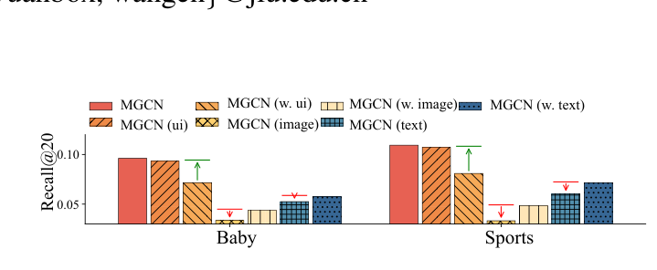
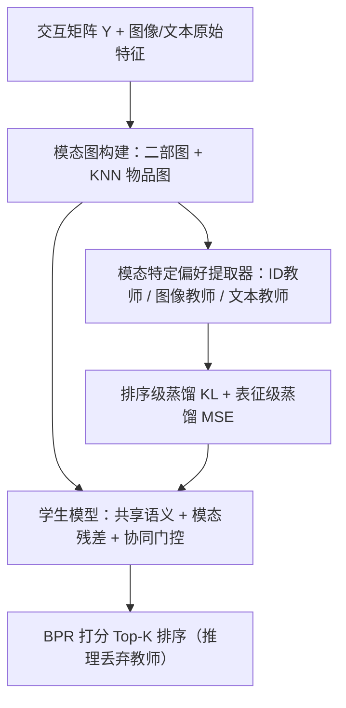
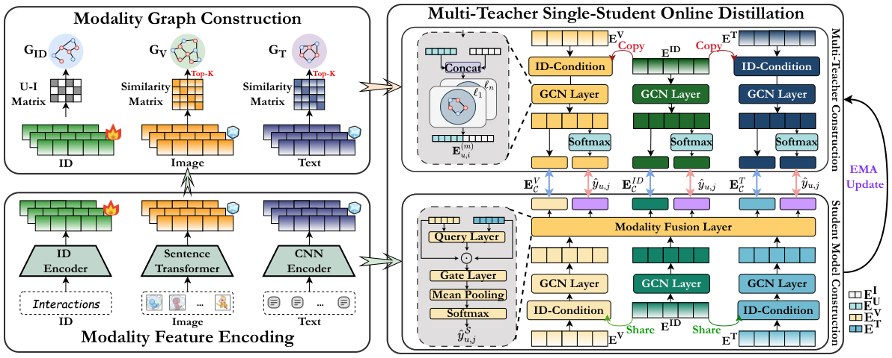

# Three Minds, One Student: Online Multi-Teacher Knowledge Distillation for Multimodal Recommenders (三心一徒：面向多模态推荐器的在线多教师知识蒸馏)

- **会议/期刊**: IJCAI 2026
- **作者与机构**: Hangtong Xu, Yuanbo Xu, En Wang（吉林大学计算机科学与技术学院）
- **推荐链路定位**: 召回（用户-物品表征学习与 Top-K 排序）
- **研究方向**: 多模态推荐 / 图神经网络推荐
- **论文原文**: [论文原文链接](https://www.ijcai.org/proceedings/2026/0348.pdf)
- **开源代码**: [MICLab-Rec/MTS4MM](https://github.com/MICLab-Rec/MTS4MM)

## TL;DR (1分钟核心速览)

现有多模态推荐把图像/文本硬塞进注意力或早/晚融合模块，但 ID 协同信号会"短路"掉辅助模态，融合反而劣于单模态独立建模。本文提出 MTS4MM：为 ID、图像、文本各建一个专职教师，用一个学生模型通过**排序级 KL 蒸馏 + 表征级归一化 MSE 蒸馏**选择性吸收三者知识，并用模态特定偏好提取器显式分离共享/私有语义。在 5 个 Amazon/MicroLens 数据集、MMRec 全库 Full-Ranking 协议下，Recall@20 相对提升 4.4%–7.2%，且推理时丢弃教师、开销低于 COHESION/SMORE。

## Background & Motivation (背景与核心矛盾)

- **主流范式**: MMGCN / DualGNN / LGMRec / FREEDOM / SMORE / COHESION 等依赖注意力、门控或早/晚融合，把 ID、图像、文本压入同一隐空间，隐含假设"融合策略能自动均衡各模态贡献"。
- **前人局限**: ① **模态支配（modality dominance）**：ID 协同信号在联合优化中压倒图/文信号，融合表征几乎退化为纯 ID 表征；② **欠对齐假设**：融合机制默认各模态表征已对齐且等量可信，一旦图像/文本含噪或弱相关，融合就成了信号抑制器而非放大器。
- **核心洞察 (Key Insight)**: 作者对 MGCN 做模态剥离实验（图 1）：`MGCN(ui/image/text)` 只用单模态推理，`MGCN(w. …)` 只用单模态训练+推理。结果显示融合模型的 Recall 几乎被 ID-only 变体解释，且**融合模型普遍不如各单模态独立建模**——说明模态间互补性在当前融合范式下未被利用，真正的瓶颈是"如何调控各模态知识的注入"，而非"融合算子设计"。
- **本文切入点**: 放弃端到端融合，把多模态推荐改写为**可控知识迁移**：每个模态做独立专家（教师），由一个学生在排序与表征两个层面按需蒸馏。

<figure class="paper-figure" markdown="span">
  <figcaption>图1：我们提出MGCN的模态特定变体，其在不同训练和推理设置下运行。MGCN指原始模型，使用所有模态进行训练和推理。MGCN（ui/image/text）仅使用指定模态进行推理。相比之下，MGCN（w. ui/image/text）是单模态模型，其训练和推理均仅使用对应模态。</figcaption>
</figure>

## Method (核心方法设计)

### 1. 整体框架 (Overall Architecture)

输入为交互矩阵 $\mathbf{Y}$与图像特征（4,096 维，CNN 编码）、文本特征（384 维，Sentence Transformer 编码）。三支教师各自在专属图上传播：ID 教师在用户-物品二部图$\tilde{\mathbf{A}}$上做 LightGCN 式层均值聚合；图像/文本教师先以 ID 嵌入做**特征级门控**（ID-conditioned），再在模态 KNN 物品图$\tilde{\mathbf{A}}^{(m)}$ 上传播、经归一化关联矩阵回流到用户侧。学生复用相同编码器，额外引入"共享语义 + 模态残差 + 协同门控"的融合层得到统一表征。训练时教师由 BPR 独立优化、再经 EMA 吸收学生跨模态知识；学生同时接受 BPR、InfoNCE 与两级蒸馏损失。推理阶段**仅保留学生前向**，教师全部丢弃。

<figure class="paper-figure" markdown="span">
  <figcaption>图2：MTS24MM的整体架构由三个模态特定教师（ID、Image和Text）和一个融合学生组成。</figcaption>
</figure>

### 2. 关键设计拆解 (Key Designs)

1. **ID-conditioned 模态编码（把辅助模态"挂"在协同语义上，而非另起炉灶）**：以往直接把 $H_i^{(m)}$ 当作物品表征，导致图/文自成一套空间、与 ID 空间错位。本文改为特征级门控，用 ID 嵌入调制模态语义：
$\mathbf{E}_i^{(m)} = \mathbf{E}_i^{id,(m)} \odot \sigma\!\left(\mathbf{H}_i^{(m)} \mathbf{W}_g^{(m)}\right)$，
再在 $\tilde{\mathbf{A}}^{(m)}$上传播并层均值池化，最后经$(\mathbf{D}_u^{-1/2}\mathbf{Y}\mathbf{D}_i^{-1/2})$ 回流用户侧。直觉：模态信息只作为对协同语义的**调制量**存在，天然抑制"辅助模态自成主导"或"完全被淹没"两个极端。
2. **排序级 + 表征级双通道蒸馏（管"排序偏好"，也管"空间对齐"）**：单一表征蒸馏无法传递教师对候选集的相对偏好。排序级以批内候选集 $\mathcal{C}$（正样本 ∪ 采样负样本）为单位，教师分布取**均匀集成**：
$\bar{p}_T(j\mid u)=\frac{1}{|\mathcal{M}|}\sum_{k} \mathrm{softmax}\!\left(\frac{(\mathbf{e}_u^{T_k})^\top \mathbf{e}_j^{T_k}}{\tau}\right)$，
$\mathcal{L}_{kd}^{rank}=\tau^2 \cdot \mathrm{KL}\!\left(\bar{p}_T(\cdot\mid u)\,\Vert\,p_S(\cdot\mid u)\right)$，其中$\tau^2$用于抵消温度缩放造成的梯度收缩，避免高温下蒸馏信号消失。表征级则在$\ell_2$归一化后做 MSE：$\mathcal{L}_{kd}^{emb}=\sum_k \lVert \mathrm{norm}(\mathbf{E}_C^{S,(k)})-\mathrm{norm}(\mathbf{E}_C^{T,(k)})\rVert_2^2$，消除教师间尺度失配。两者互补：前者传"谁排前面"，后者传"为什么相似"。
3. **学生端共享-私有解耦 + 教师在线上线（保住模态贡献的可控性）**：学生先算共享语义 $\mathbf{E}_C^S=\alpha_V\mathbf{E}_V^S+\alpha_T\mathbf{E}_T^S$（$\alpha$由共享 query 网络 softmax 得到），残差$\mathbf{E}_S^{(m),sp}=\mathbf{E}_S^{(m)}-\mathbf{E}_C^S$再由协同信号门控$\tilde{\mathbf{E}}_S^{(m),sp}=g_m(\mathbf{E}_S^{ID})\odot\mathbf{E}_S^{(m),sp}$，最终$\mathbf{E}^S=\mathbf{E}_S^{ID}+\mathrm{Avg}(\mathbf{E}_C^S,\tilde{\mathbf{E}}_S^{V,sp},\tilde{\mathbf{E}}_S^{T,sp})$。教师则走两阶段更新：先各自用 BPR 保专业度，再$\boldsymbol{\Theta}_T^{(k)}\leftarrow\mu\boldsymbol{\Theta}_T^{(k)}+(1-\mu)\boldsymbol{\Theta}_S^{(k)}$ 做 EMA 同步，把学生学到的跨模态知识回流给教师，形成在线互促闭环。
4. **总损失、负采样与推理开销**：总目标为 $\mathcal{L}=\mathcal{L}_{rec}^S+\lambda_{cl}\mathcal{L}_{cl}^S+\mathcal{L}_{rec}^T+\lambda_{rank}\mathcal{L}_{kd}^{rank}+\lambda_{emb}\mathcal{L}_{kd}^{emb}$；负采样沿用 BPR 的均匀单负样本，无额外难负采样或"免负采样"设计；蒸馏候选集即批内正负并集，复杂度为线性$O(dB|\mathcal{C}|)$。图 5 显示 MTS4MM 参数规模与推理时间均低于 COHESION、SMORE——因为教师只在训练期存在。

## Experimental Setup & Evaluation Protocol (实验设置与评估协议)

- **数据集与预处理**: 五个公开数据集（Amazon 三品类 + 服饰 + 电子 + 视频平台 MicroLens），沿用 MMRec 基准的物品级过滤设定：

| 数据集 | #Users | #Items | #Interactions | 稀疏度 | 特征/场景说明 |
| :--- | :---: | :---: | :---: | :---: | :--- |
| Baby | 19,445 | 7,050 | 160,792 | 99.88% | 母婴，图像 4,096 / 文本 384 |
| Sports | 35,598 | 18,357 | 296,337 | 99.95% | 运动户外 |
| Clothing | 39,387 | 23,033 | 278,677 | 99.97% | 服饰，视觉主导场景 |
| Elec | 192,403 | 63,001 | 1,689,188 | 99.99% | 电子产品，最大规模 |
| MicroLens | 98,129 | 17,228 | 705,174 | 99.96% | 短视频平台，多模态内容 |

- **数据划分与防穿越 (Splitting Strategy)**: 论文声明"与 MMRec 框架及前置工作对齐"，即每用户 `Leave-One-Out`：最后一条交互作测试、倒数第二条作验证，其余训练；原文未额外重述，此处按 MMRec 基准协议认定。
- **排名评测协议 (Ranking Protocol)**: 无偏 `Full-Ranking`（对全库未交互物品排序），指标 Recall@{10,20}、NDCG@{10,20}，五个随机种子取均值。
- **对比基线与超参设置**: 通用模型 MF/BPR、LightGCN；多模态基线 VBPR、MMGCN、GRCN、DualGNN、SLMRec、BM3、MGCN、FREEDOM、LGMRec、DAMRS、PGL、SMORE、COHESION（共 13 个）。各基线超参按其原文最优配置复现，emb 维度 $d$ 与图传播层数在补充材料中给出；主表以均值报告，未标注显著性检验，但跨 4 个指标 × 5 个数据集全面领先可视为经验显著。

## Key Experimental Results (实验关键数据)

### 1. 主实验对比 (Main Results)

| 数据集/指标 | LightGCN | VBPR | BM3 | MGCN | FREEDOM | LGMRec | DAMRS | SMORE | COHESION | **MTS4MM** | Improv. |
| :--- | :---: | :---: | :---: | :---: | :---: | :---: | :---: | :---: | :---: | :---: | :---: |
| Baby R@20 | 0.0754 | 0.0663 | 0.0883 | 0.0960 | 0.0992 | 0.0957 | 0.0944 | 0.1027 | 0.1034 | **0.1093** | +5.71% |
| Baby N@20 | 0.0328 | 0.0284 | 0.0383 | 0.0429 | 0.0424 | 0.0426 | 0.0411 | 0.0453 | 0.0446 | **0.0482** | +6.40% |
| Sports R@20 | 0.0864 | 0.0856 | 0.0980 | 0.1093 | 0.1089 | 0.1012 | 0.1022 | 0.1103 | 0.1094 | **0.1165** | +5.62% |
| Sports N@20 | 0.0387 | 0.0384 | 0.0438 | 0.0490 | 0.0481 | 0.0447 | 0.0458 | 0.0496 | 0.0488 | **0.0524** | +5.65% |
| Elec R@20 | 0.0540 | 0.0458 | 0.0648 | 0.0626 | 0.0601 | 0.0639 | 0.0610 | 0.0631 | 0.0628 | **0.0694** | +6.61% |
| Elec N@20 | 0.0250 | 0.0202 | 0.0302 | 0.0289 | 0.0273 | 0.0295 | 0.0279 | 0.0290 | 0.0265 | **0.0322** | +6.27% |
| Clothing R@20 | 0.0525 | 0.0530 | 0.0651 | 0.0950 | 0.0940 | 0.0776 | 0.0893 | 0.0967 | 0.0877 | **0.1017** | +5.17% |
| Clothing N@20 | 0.0239 | 0.0232 | 0.0295 | 0.0432 | 0.0422 | 0.0346 | 0.0396 | 0.0435 | 0.0390 | **0.0456** | +4.83% |
| MicroLens R@20 | 0.1079 | 0.1033 | 0.0966 | 0.1105 | 0.0999 | 0.1077 | 0.1112 | 0.1116 | 0.1002 | **0.1241** | +6.71% |
| MicroLens N@20 | 0.0473 | 0.0441 | 0.0401 | 0.0467 | 0.0417 | 0.0462 | 0.0478 | 0.0470 | 0.0435 | **0.0526** | +6.05% |

### 2. 消融实验 (Ablation Study)

| 变体 | Baby R@20 | Baby N@20 | Sports R@20 | Sports N@20 |
| :--- | :---: | :---: | :---: | :---: |
| w/o $\mathcal{L}_{kd}^{rank}$ | 0.1062 | 0.0463 | 0.1125 | 0.0510 |
| w/o $\mathcal{L}_{kd}^{emb}$ | 0.1085 | 0.0475 | 0.1142 | 0.0518 |
| w/o 模态偏好门控 ($mg$) | 0.0983 | 0.0451 | 0.1135 | 0.0506 |
| w/o all（各模态独立 BPR） | 0.0963 | 0.0425 | 0.1095 | 0.0495 |
| **MTS4MM（完整）** | **0.1093** | **0.0482** | **0.1165** | **0.0524** |

### 3. 关键实验发现 (Key Findings)

1. **模态偏好门控是"防支配"的主承重墙**：在 Baby 上移除 $mg$使 R@20 从 0.1093 掉到 0.0983（−10.1%），跌幅大于任何单级蒸馏的移除（−2.8% / −0.7%）；而在 Sports 上移除$mg$ 几乎无损（0.1165→0.1135），说明门控的收益与"模态强度是否失衡"强相关，与图 1 中 Sport/Baby 的模态剥离现象互为印证。
2. **两级蒸馏互补，排序级在均衡数据上更关键**：Sports 上单独去掉 $\mathcal{L}_{kd}^{rank}$掉 3.4%（0.1165→0.1125），去掉$\mathcal{L}_{kd}^{emb}$仅掉 2.0%；两者全去掉（`w/o all`）则掉 6.0%，说明"排序偏好传递"与"表征空间对齐"不可互相替代。图 3 进一步表明$\lambda_{rank},\lambda_{emb}$ 在 0.2–1.0 区间内性能波动仅 0.05%–0.46%，对超参不敏感。
3. **融合增益确实来自跨模态互补，而非 ID 单模态**：图 4 中 MTS4MM 全部单模态变体（推理期剥离/训练期剥离）均显著落后完整模型，相对最优单模态变体提升达 Baby 27.7%、Sports 31.1%；t-SNE（图 6）显示学生融合嵌入中无任一模态主导且与教师良好对齐。效率侧（图 5）训练加三教师的 MTS4MM 仍比 COHESION、SMORE 参数更少、推理更快。

## Highlights & Limitations (亮点、对比与审稿批判)

- **与代表作对比 (vs. Prior Work)**: 与 SMORE/COHESION 的"多阶段融合 + 图/谱正则"路线本质不同——后者仍在**同一前向图**内耦合模态并靠正则抑制偏置，MTS4MM 把模态拆分到**独立教师**并靠蒸馏权重 $\lambda_{rank},\lambda_{emb}$ 显式调节注入强度；与 MMKD(PromptMM) 等蒸馏工作相比，本文首次把"排序级分布蒸馏 + 教师 EMA 在线同步"引入多模态推荐，且蒸馏候选集为批内构造，不引入额外服务化成本。
- **可迁移亮点**: ① **ID-conditioned 门控**（用主模态嵌入调制辅助模态）可平移到跨域/多场景推荐中的辅助特征注入；② **教师 EMA 吸收学生参数**的"反向蒸馏"闭环，可用在任何多专家-单塔落地的工业场景中以零推理成本换取多专家收益。
- **审稿级局限批判**: ① 教师数量随模态线性增长，训练显存与构图（每模态一张 KNN 物品图）开销未量化，仅给出推理期效率；② 划分与 Full-Ranking 协议依赖 MMRec 基准而未在正文重述，且未报告显著性检验/方差；③ 排序级蒸馏依赖**均匀集成**教师分布，当某模态严重噪声时该均匀权重可能拖累整体（论文仅用固定 $\tau$与人工$\lambda$ 调节，未做自适应加权）；④ 5 个数据集均为 Amazon 系 + 单一视频集，冷启动物品与新用户场景未做分桶分析。

## Rating (四维评分)

- **方法创新性 (Novelty)**: ⭐⭐⭐⭐ （把多模态推荐从"融合算子"范式切换到"可控知识迁移"，配以模态剥离实证支撑，思路干净且首次系统化）
- **评估协议与实验扎实度 (Protocol & Experiments)**: ⭐⭐⭐⭐ （5 数据集 × 13 基线 × Full-Ranking × 5 seed，消融/敏感性/模态贡献/效率/t-SNE 齐全，但缺显著性检验与冷启动分桶）
- **写作与数学规范度 (Clarity & Rigor)**: ⭐⭐⭐⭐ （公式链条完整、$\tau^2$缩放与$\ell_2$归一化等细节均有动机说明，个别符号如$\mathbf{E}_i^{id,(m)}$与$R$ 矩阵定义略欠统一）
- **工业落地与复现价值 (Industrial & Practical Value)**: ⭐⭐⭐⭐⭐ （教师仅存在于训练期，推理零额外开销且比 SMORE/COHESION 更轻，代码已开源，适合作为现有多模态召回塔的"免费增益"插件）

