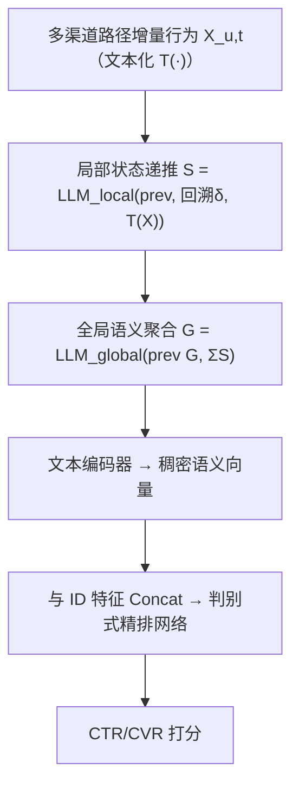
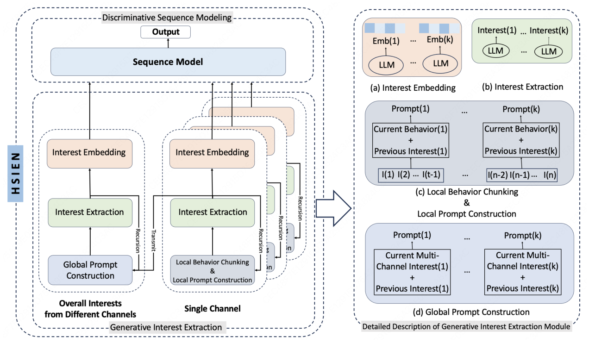

# Bridging the Semantic Gap: Leveraging LLMs for Hierarchical Interest Evolution in Sequential Recommendation (弥合语义鸿沟：以 LLM 驱动层级兴趣演化的序列推荐)

- **会议/期刊**: IJCAI 2026
- **作者与机构**: Yifan Cao, Rui Wu, Xiang Wang, Wei Peng 等（美团 + 中国人民大学信息资源管理学院）
- **推荐链路定位**: 精排（CTR/CVR 预估，特征侧）
- **研究方向**: 序列与会话推荐 / 大语言模型推荐
- **论文原文**: [论文原文链接](https://www.ijcai.org/proceedings/2026/0273.pdf)
- **开源代码**: 暂未开源

## TL;DR (1分钟核心速览)

工业 CTR 模型依赖离散 ID 共现，在跨渠道、长尾、冷启场景存在「语义鸿沟」；而现有 LLM4Rec 强行用 LLM 直接生成 Item ID，既造成模态错配又带来毫秒级不可接受的推理成本。HSIEN 让 LLM 只负责「高层语义兴趣推理」：以马尔可夫状态空间逐块递推局部兴趣、以语义 MoE 聚合跨渠道全局意图，输出自然语言兴趣流并编码为稠密向量注入判别式模型。在 Amazon-Book（AUC 0.7795 vs. MIMN 0.7593，+2.66%）与美图工业集（+0.59PP AUC）上验证，线上 A/B 提升 ROI +3.0PP、GMV +2.7PP。

## Background & Motivation (背景与核心矛盾)

- **主流范式**: 工业界以 Wide&Deep/DeepFM/DIN/SIM 为代表，靠离散 Item ID 的 embedding 与共现记忆做实时打分；近年 LLM4Rec（P5、TIGER、HLLM、LLaRA）则把推荐改写成「生成目标 ID 或物品描述」的语言生成任务。
- **前人局限**: 其一是 **语义鸿沟**——不同业务渠道（外卖/即时零售/酒旅）的 ID 空间互不重叠，模型无法理解「防晒霜」与「度假村」的语义关联，冷启与长尾上性能陡降；其二是 **模态错配 + 效率瓶颈**——要求 LLM 直接生成离散 ID，既浪费其连续语义空间的推理能力、易产生幻觉，又需每次请求全量历史过一遍 LLM，无法满足 RTB 毫秒级要求。
- **核心洞察 (Key Insight)**: LLM 的强项是高层意图推理而非底层 ID 检索匹配，应「职责分离」——让 LLM 输出语义空间中的显式兴趣摘要，而非 ID。
- **本文切入点**: 构建「生成式推理（上游）+ 判别式决策（下游）」的协同架构，并把 LLM 调用完全挪到离线，线上只做向量查表，使推理复杂度降为 $O(1)$。

## Method (核心方法设计)

### 1. 整体框架 (Overall Architecture)

HSIEN 按「微观—宏观—表征」三层自底向上构建。输入为用户跨 $K$个渠道、按可变时间块切分的增量行为序列$\mathbf{X}_{u,t}=\{X^{(k)}_{u,t}\}_{k=1}^{K}$。**微观层**：每个渠道维护一个满足马尔可夫性的语义状态$S^{(k)}_{u,t}$，仅用「上一块摘要 + 本块增量行为的文本化提示」递推出新状态，避免全序列$O(T)$复算。**宏观层**：LLM 充当元推理器，把上一块全局状态与各渠道局部状态联合推理，输出全局意图流$G_{u,t}$，同时完成跨渠道去噪与高阶隐意图推导。**表征层**：用预训练文本编码器把全局流映射为定长稠密向量，与 ID 类稀疏特征拼接后送入下游判别式网络。线上服务时全部语义向量已在离线算好并缓存于 KV，实时链路无任何 LLM 调用。

<figure class="paper-figure" markdown="span">
  <figcaption>图2：HSIEN 将基于 LLM 的生成式兴趣提取与判别式序列建模相结合。它根据当前行为和先前摘要递归更新 Global 和 Local 语义兴趣，然后将其嵌入为稠密向量以供下游预测。</figcaption>
</figure>

### 2. 关键设计拆解 (Key Designs)

1. **局部兴趣马尔可夫递推（Local Recursive Evolution）**：痛点是对超长序列直接过 LLM 成本爆炸。本文把状态更新写成显式转移算子 $S^{(k)}_{u,t}=\mathrm{LLM}_{\text{local}}(I_{\text{prompt}},\tilde{S}^{(k)}_{u,t-1},\mathcal{T}(X^{(k)}_{u,t}))$，其中$\mathcal{T}(\cdot)$ 把 item ID 连同商品名、类目、价格等元数据转写成自然语言叙事，激活 LLM 的世界知识（如从价格推断消费层级）。为压住信息过载，提示词强制把状态压缩为「固定若干关键词」，等价于一次有监督的去噪蒸馏——这既是正则也是上下文长度控制。

2. **稀疏回溯机制 $\delta(\cdot)$与语义 MoE 聚合（SMoE）**：真实行为高度稀疏，若按块严格递推会出现大量空状态，导致兴趣流断裂。本文定义回溯窗口$W$（取 10）取最近有效状态$\tilde{S}^{(k)}_{u,t-1}=S^{(k)}_{u,\tau},\ \tau=\max\{t'<t\mid S^{(k)}_{u,t'}\neq\varnothing,\ t-t'\le W\}$，保证长尾用户兴趣链连续。宏观层则用$G_{u,t}=\mathrm{LLM}_{\text{global}}\big(I_{\text{agg}},G_{u,t-1},\sum_{k}S^{(k)}_{u,t}\big)$ 完成两件事：**跨渠道去噪**（若即时零售点了高价品但在外卖/到餐渠道长期价格敏感，则下调高价偏好权重）与**高阶隐意图推理**（由"度假酒店+防晒霜+美甲"推出"海岛度假"标签），这是纯 ID 共现模型根本做不到的能力。

3. **语义-协同双路融合与推理效率**：语义流经文本编码器后，多渠道路径经 attention 加权得到 $\mathbf{v}_{\text{global}}$，逐渠道序列得到$\{\mathbf{v}^{(k)}_{\text{channel}}\}_{k=1}^{K}$，再与 ID 稀疏特征$\mathbf{v}_{\text{base}}$拼接$\mathbf{v}_{\text{input}}=\mathrm{Concat}(\mathbf{v}_{\text{base}},\mathbf{v}_{\text{global}},\{\mathbf{v}^{(k)}_{\text{channel}}\})$，由判别式网络输出$\hat{y}_{u,a}=F_{\text{disc}}(\mathbf{v}_{\text{input}})$；训练目标为标准二分类交叉熵$\mathcal{L}=-\frac{1}{N}\sum\left[y\log\hat{y}+(1-y)\log(1-\hat{y})\right]$。**无需任何负采样**（CTR 是逐曝光样本的二分类）。部署上采取「离线递推—向量化缓存—在线零推理」三段式，线上额外开销仅为一次 KV 检索，真正把 LLM 的世界知识做成了静态特征表。

## Experimental Setup & Evaluation Protocol (实验设置与评估协议)

| 数据集 | #Users | #Items | #Interactions | 稀疏度/密度 | 特征/场景说明 |
| :--- | :---: | :---: | :---: | :---: | :--- |
| Amazon (Book) | 75,053 | 358,367 | 150,016 | 极稀疏 | 1,583 个类目，评论文本+元数据 |
| Industrial (Meituan) | 0.12 B | 0.4 B | 9.3 B | 极稀疏 | 15.7 万类目，多渠道路径（到餐/即时零售/外卖/医药），30%+ 样本序列长度 >10,000 |

- **数据划分与防穿越**: Amazon 采用类 `Leave-One-Out` 时序协议——用前 $T-1$条行为预测是否产生第$T$ 条评论，并过滤序列长度 < 20 的样本以聚焦长序列；工业集采用全局时间戳切分，训练集为连续 49 天、测试集为紧随其后 1 天，行为序列回溯三个月窗口。
- **排名评测协议**: 两者均为工业标准的曝光级二分类评估，主指标 **AUC**（非 Full-Ranking / 非采样排序），报告中给出 5 次重复的 mean ± std。
- **对比基线与超参设置**: 基线覆盖 Embedding&MLP、GRU4Rec、DIN、RUM、DIEN、MIMN、ARNN；Adam 优化器，学习率 0.001 指数衰减（rate 0.9），FCN 维度 200×80×2，embedding 维度 $d=16$；所有模型在相同设置下公平对比。

## Key Experimental Results (实验关键数据)

### 1. 主实验对比 (Main Results)

| 模型 | Amazon-Book AUC | Industrial AUC |
| :--- | :---: | :---: |
| Embedding&MLP | 0.7367 ± 0.00043 | — |
| GRU4Rec | 0.7411 ± 0.00182 | — |
| DIN | 0.7419 ± 0.00049 | 0.8442 |
| ARNN | 0.7420 ± 0.00029 | — |
| RUM | 0.7428 ± 0.00041 | — |
| DIEN | 0.7481 ± 0.00102 | — |
| MIMN（最强基线） | 0.7593 ± 0.00150 | — |
| **HSIEN (Ours)** | **0.7795 ± 0.00106** | **0.8501** |
| Improv. | **+2.66%** (vs. MIMN) | **+0.59 PP** (vs. DIN) |

线上 A/B（2025-12-03 至 2026-01-12，美团展示广告全量场景）：**ROI +3.0 PP，GMV +2.7 PP**。

### 2. 消融实验 (Ablation Study)

| 变体 | Amazon AUC | 说明 |
| :--- | :---: | :--- |
| Global-only | 0.7670 ± 0.00141 | 仅用 SMoE 全局语义流 |
| Local-only | 0.7581 ± 0.00130 | 仅用各渠道局部语义流 |
| **Global + Local (Full)** | **0.7795 ± 0.00106** | 双路互补 |
| HSIEN w/o 递归更新 | 0.7587 ± 0.00135 | 只依赖孤立日增量 |
| **HSIEN w/ 递归更新** | **0.7795 ± 0.00106** | 马尔可夫状态递推 |

### 3. 关键实验发现 (Key Findings)

1. **语义互补而非语义替代**：Global-only（0.7670）单路已超过最强 ID 基线 MIMN（0.7593），而 Global+Local 双路再涨 1.25 PP 至 0.7795，说明跨渠道元推理与渠道内细粒度兴趣是正交增益，拼接而非替代才吃满收益。
2. **递归机制是长周期的胜负手**：去掉马尔可夫递推直接掉到 0.7587（−2.08 PP），等价于退回「只看当天」的短视模型；这证明三个月的兴趣演化必须靠状态压缩传递，而该压缩又可把复杂度从 $O(T)$ 降到与序列长度无关。
3. **工业数据的增益"小数字、大价值"**：+0.59 PP AUC 在十亿级样本、数亿用户规模下对应线上 ROI +3.0 PP / GMV +2.7 PP 的真实商业收益，且跨渠道（外卖→酒旅）迁移场景的预测偏差被显著缓解。

## Highlights & Limitations (亮点、对比与审稿批判)

- **与代表作对比 (vs. Prior Work)**: 相较 TIGER/P5/HLLM 这类「LLM 直接生成 ID」的范式，HSIEN 把输出锚定在开放语义空间，从根上消除模态错配与 ID 幻觉；相较 MIMN 这类「增量记忆网络」处理超长序列，本文用 LLM 的语义压缩替代固定容量的记忆槽，兼具去噪与跨域推理能力；相较 DIN/DIEN 的注意力兴趣演化，本文的兴趣演化由 LLM 在自然语言层面显式完成，具备可解释的意图叙事。
- **可迁移亮点**: (1)「离线递推—向量缓存—在线查表」的三段式部署模板可无痛套用到任何 LLM 特征增强的实时系统；(2) 回溯窗口 $\delta(\cdot)$ 是一个极轻量的稀疏序列补洞技巧，可迁移到任何按时间块聚合的行为建模；(3) 强制固定关键词数的提示约束，是一种低成本的语义正则与上下文长度控制手段。
- **审稿级局限批判**: (1) 语义状态的更新强依赖提示词模板与关键词数量等超参，论文自承「不同 prompting 策略的影响」留作未来工作，缺少敏感性分析；(2) 评估仅用 AUC 这一二分类指标，未给出 GAUC、校准误差或冷启/长尾分桶的细粒度结果，无法直接量化「语义鸿沟被弥合多少」；(3) 每日离线重算意味着兴趣状态存在最高一天的时间滞后，对当日兴趣漂移（如突发热点）无能为力；(4) 开源缺失，回溯窗口、块大小等关键设计的可复现性受限。

## Rating (四维评分)

- **方法创新性 (Novelty)**: ⭐⭐⭐⭐ （「生成式负责语义、判别式负责 ID 匹配」的职责分离清晰，马尔可夫状态空间式 LLM 兴趣递推是 LLM4Rec 中少见的效率友好设计）
- **评估协议与实验扎实度 (Protocol & Experiments)**: ⭐⭐⭐⭐ （公有集 + 十亿级工业集 + 真实线上 A/B 三重验证，多次重复给出 std；但仅用 AUC、缺少长尾/冷启分桶与超参敏感性分析）
- **写作与数学规范度 (Clarity & Rigor)**: ⭐⭐⭐ （框架叙述清楚、公式简洁易读，但方法部分数学推导偏浅，状态压缩的信息论解释与复杂度分析只给结论未给推导）
- **工业落地与复现价值 (Industrial & Practical Value)**: ⭐⭐⭐⭐⭐ （已在美团广告全量上线，$O(1)$ 在线推理、ROI/GMV 双升，落地价值远超多数学术 LLM4Rec 工作；扣分项为未开源）

