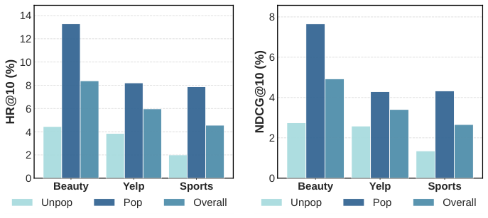
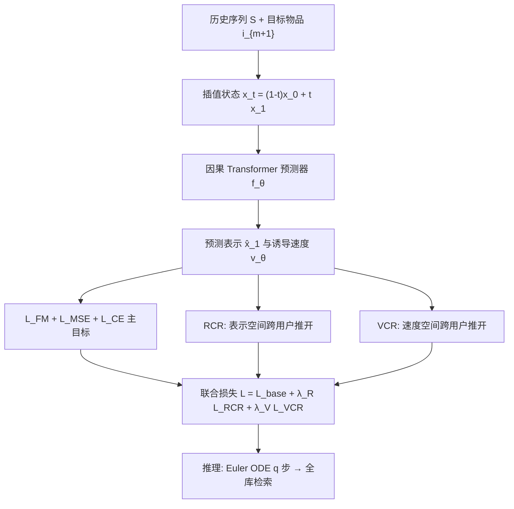
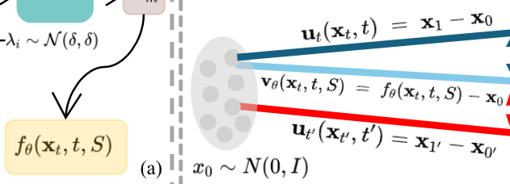

# Contrastive Flow Matching for Sequential Recommendation (面向序列推荐的对比流匹配)

- **会议/期刊**: IJCAI 2026
- **作者与机构**: Wangyu Jin, Yang Xue, Wenwen Xia, Hongliang He, Guanfeng Liu, Pengpeng Zhao (苏州大学、Macquarie University)
- **推荐链路定位**: 召回 (端到端生成式检索)
- **研究方向**: 序列与会话推荐 / 生成式推荐
- **论文原文**: [论文原文链接](https://www.ijcai.org/proceedings/2026/0305.pdf)
- **开源代码**: 暂未开源

## TL;DR

Flow Matching 序列推荐 (FM4Rec) 因缺乏跨用户分离监督，会陷入 "averaged flow"——不同用户的速度场方向趋同，导致生成物品高度同质化、长尾性能崩溃。本文提出 ConFM，在表示空间与诱导速度空间各加一个对比正则化器 (RCR / VCR)，强制不同用户的生成轨迹彼此远离。在 4 个基准、Leave-One-Out + Full-Ranking 协议下全面超越 FM4Rec，平均相对提升最高 5.87%，非流行组提升达 14.81%。

## Background & Motivation

- **主流范式**: 生成式序列推荐把"下一物品预测"建模为历史条件下的分布生成。DM 派 (DiffuRec / DreamRec / DiQDiff) 走噪声加噪-多步去噪路径；FM 派 (FM4Rec) 走确定性的噪声→目标物品表示的直线传输，避免多步随机采样。
- **前人局限**: FM4Rec 用单一共享预测器 $f_\theta$服务所有用户，缺乏显式的跨用户分离信号。即使以用户历史$S$ 为条件，模型仍倾向输出"全体用户平均"的速度方向；同时长尾目标缺少足够监督，生成表示愈发同质。
- **核心洞察 (Key Insight)**: 作者在 Beauty / Sports / Yelp 上做流行度分层诊断 (图 1)，FM4Rec 在 pop 组 HR@10 可达 unpop 组的数倍，说明瓶颈不是"能否生成"，而是"生成是否可区分"。根源在于速度场由预测表示诱导 $v_\theta = f_\theta(x_t,t,S) - x_0$，而$f_\theta$ 在共享参数下输出趋同，这一相似性直接传播到速度方向。
- **本文切入点**: 既然 averaged flow 源自"表示相似→速度相似"，就在表示空间与速度空间同时注入跨用户对比信号。

<figure class="paper-figure" markdown="span">
  <figcaption>图1：FM4Rec 在三个数据集上的流行度分层诊断结果。(a) 整体、pop 和 unpop 组的 HR@10；(b) 整体、pop 和 unpop 组的 NDCG@10。我们按目标物品的流行度划分测试实例，其中 pop 表示训练集中出现频率最高的前 20% 物品内的目标，unpop 表示其余目标；整体报告完整测试集。</figcaption>
</figure>

## Method (核心方法设计)

### 1. 整体框架 (Overall Architecture)

ConFM 沿用 FM4Rec 骨干：给定历史 $S$与目标物品$x_1$，采样噪声端$x_0\sim\mathcal{N}(0,I)$与$t\sim U(0,1)$，构造插值状态$x_t=(1-t)x_0+tx_1$；将$(x_t,t,S)$通过因果 Transformer 得到下一物品预测$\hat{x}_1=f_\theta(x_t,t,S)$，并由$v_\theta=\hat{x}_1-x_0$诱导速度场，用标准 FM 回归训练。关键增量是在 mini-batch 内额外计算 RCR（表示级）与 VCR（速度级）两个跨用户对比正则，与$\mathcal{L}_{FM}$、$\mathcal{L}_{MSE}$、$\mathcal{L}_{CE}$联合优化。推理时从噪声起用 Euler 求解 ODE，$q$步得到$\hat{x}_1$ 后与全库物品嵌入打分。两个正则项只在训练期生效，推理开销与 FM4Rec 完全一致。

<figure class="paper-figure" markdown="span">
  <figcaption>图2：ConFM 的整体框架。</figcaption>
</figure>

### 2. 关键设计拆解 (Key Designs)

1. **表示对比正则 RCR (Representation Contrastive Regularizer)**：痛点——共享预测器把不同用户映射到相近的 $\hat{x}_{1,b}$，表示可分性退化。做法是摒弃需要正负对构造的 InfoNCE，改用 batch 内 log-sum-exp 惩罚项：
$$\mathcal{L}_{RCR}=\frac{1}{B}\sum_{b=1}^{B}\log\Big(\sum_{b'\neq b}\exp\big(\text{sim}(\hat{x}_{1,b},\hat{x}_{1,b'})\big)\Big)$$
它只需两两余弦相似度，无需数据增广即可推开 batch 内所有其他用户；直觉上等价于"让每个表示都远离当前 batch 的重心方向"，抑制坍缩到全局平均模式。

2. **速度对比正则 VCR (Velocity Contrastive Regularizer)**：痛点——RCR 只约束输出表示，而速度 $v_\theta=\hat{x}_1-x_0$还依赖随机采样的$x_0$与$t$，表空间可分不能保证速度方向可分。VCR 直接在诱导速度空间施加排斥：
$$\mathcal{L}_{VCR}=-\frac{1}{B}\sum_{b=1}^{B}\big\|v_\theta(x_{t,b},t_b,S_b)-u_{t,b'}\big\|_2^2$$
其中 $u_{t,b'}=x_{1,b'}-x_{0,b'}$ 是随机采样的另一用户的目标速度。用负 MSE 而非三元组损失，是因为作者发现 MSE 提供的是绝对方向监督（直接指定"不要朝向哪个方向"），比三元组只给相对距离约束更直接、更稳定。

3. **训练目标与推理效率**：总损失
$$\mathcal{L}=\mathcal{L}_{base}+\lambda_R\mathcal{L}_{RCR}+\lambda_V\mathcal{L}_{VCR}$$
其中 $\mathcal{L}_{base}=\mathcal{L}_{FM}+\mathcal{L}_{MSE}+\mathcal{L}_{CE}$沿用 FM4Rec。负样本即 batch 内其他用户（in-batch 天然负采样），无需额外采样器。复杂度增量仅$O(B^2d+Bd)$，推理无额外开销（$O(q\cdot N\cdot B\cdot(n^2d+nd^2))$ 与骨干相同）。

## Experimental Setup & Evaluation Protocol (实验设置与评估协议)

- **数据集与预处理**: Amazon 三子集 (Beauty / Sports / Toys) + Yelp，采用 `5-core` 过滤掉交互 <5 的用户与物品。

| 数据集 | #Users | #Items | #Interactions | 稀疏度 | 特征/场景说明 |
| :--- | :---: | :---: | :---: | :---: | :--- |
| Yelp | 30,431 | 20,033 | 316,354 | 99.95% | 本地商户点评 |
| Sports | 35,598 | 18,357 | 296,337 | 99.95% | Amazon 运动品类 |
| Toys | 19,412 | 11,924 | 167,597 | 99.93% | Amazon 玩具品类 |
| Beauty | 22,363 | 12,101 | 198,502 | 99.93% | Amazon 美妆品类 |

- **数据划分与防穿越 (Splitting Strategy)**: `Leave-One-Out` 协议，每个用户最后一条交互作测试、倒数第二条作验证，其余作训练，与 SASRec 系列的经典设定一致。
- **排名评测协议 (Ranking Protocol)**: 无偏 `Full-Ranking (全库未交互排序)`，**不做负采样**，对全部候选物品打分，规避采样偏差。指标为 HR@{5,10,20} 与 NDCG@{5,10,20}。
- **对比基线与超参设置**: (1) 传统：GRU4Rec、Caser、SASRec、BERT4Rec；(2) 对比学习：CL4SRec、CaDiRec；(3) 生成式：DreamRec、DiQDiff、DiffuRec、FM4Rec。嵌入维度 $d=128$，最大序列长 50，batch 512，Adam 学习率 0.001，dropout 0.1/0.3。$\lambda_V\in\{10^{-3},\ldots,5\times10^{-1}\}$、$\lambda_R\in\{10^{-3},\ldots,7\times10^{-1}\}$ 经网格搜索确定。

## Key Experimental Results (实验关键数据)

### 1. 主实验对比 (Main Results)

下表汇总 4 数据集、8 个代表性基线的核心指标（%，最优加粗，次优下划线）：

| 数据集 | 指标 | SASRec | BERT4Rec | CL4SRec | CaDiRec | DreamRec | DiffuRec | FM4Rec | **ConFM** | Improv. |
| :--- | :--: | :--: | :--: | :--: | :--: | :--: | :--: | :--: | :--: | :--: |
| Yelp | HR@10 | 2.51 | 3.39 | 4.95 | 3.79 | 2.62 | 5.20 | 5.97 | **6.24** | +4.63% |
| | NDCG@10 | 1.19 | 1.67 | 3.22 | 1.95 | 1.91 | 2.96 | 3.41 | **3.71** | +8.85% |
| | NDCG@20 | 1.66 | 2.23 | 3.71 | 2.53 | 2.00 | 3.64 | 4.23 | **4.50** | +6.52% |
| Sports | HR@10 | 2.67 | 3.59 | 3.34 | 4.13 | 2.57 | 3.86 | 4.55 | **4.81** | +5.56% |
| | NDCG@10 | 1.41 | 1.90 | 1.75 | 2.24 | 1.85 | 2.30 | 2.66 | **2.76** | +3.82% |
| | NDCG@20 | 1.80 | 2.51 | 2.24 | 2.75 | 1.95 | 2.74 | 3.17 | **3.28** | +3.21% |
| Toys | HR@10 | 7.10 | 4.50 | 6.03 | 7.77 | 6.50 | 7.11 | 7.80 | **8.17** | +4.69% |
| | NDCG@10 | 3.95 | 2.31 | 3.20 | 4.60 | 4.59 | 4.60 | 4.96 | **5.16** | +4.03% |
| | NDCG@20 | 4.70 | 2.91 | 3.50 | 5.16 | 4.75 | 5.25 | 5.68 | **5.88** | +3.53% |
| Beauty | HR@10 | 6.03 | 6.01 | 7.16 | 7.16 | 5.57 | 7.78 | 8.39 | **8.55** | +1.94% |
| | NDCG@10 | 3.04 | 3.00 | 3.02 | 3.99 | 3.90 | 4.74 | 4.93 | **5.05** | +2.35% |
| | NDCG@20 | 3.95 | 3.91 | 3.59 | 4.77 | 4.10 | 5.47 | 5.74 | **5.88** | +2.38% |

### 2. 消融实验 (Ablation Study)

| 数据集 | 指标 | w/o VCR | w/o RCR | w/ Triplet | ConFM |
| :--- | :--: | :--: | :--: | :--: | :--: |
| Yelp | HR@10 | 6.03 | 5.17 | 6.20 | **6.24** |
| | NDCG@10 | 3.52 | 2.86 | 3.70 | **3.71** |
| Sports | HR@10 | 4.70 | 3.41 | 4.44 | **4.81** |
| | NDCG@10 | 2.77 | 1.80 | 2.59 | **2.76** |
| Toys | HR@10 | 8.10 | 8.04 | 7.98 | **8.17** |
| | NDCG@10 | 5.15 | 5.09 | 5.06 | **5.16** |
| Beauty | HR@10 | 8.39 | 8.35 | 8.22 | **8.55** |
| | NDCG@10 | 4.97 | 4.92 | 4.83 | **5.05** |

### 3. 关键实验发现 (Key Findings)

1. **两类正则互补且 RCR 更关键**：去掉 RCR 在 Yelp 上 NDCG@10 从 3.71 暴跌至 2.86（-22.9%），远超去掉 VCR 的 3.52（-5.1%）；说明表示可分性是速度可分的前提。VCR 在 Sports 上 HR@10 从 4.81 掉到 4.70，单独作用也稳定为正，二者并非冗余。
2. **负 MSE 优于三元组**：把 VCR 换成三元组（`w/ Triplet`）后，Sports HR@10 仅 4.44、Toys 7.98 均低于完整版，验证了"绝对方向监督比相对距离约束更稳"的设计判断。
3. **长尾显著受益、流行组不牺牲**：在非流行组 (unpop)，Yelp HR@10 相对最佳基线提升 14.81%，NDCG@10 提升 18.22%；Sports 相应为 8.70% / 8.89%。而在流行组 (pop) 仅提升 0.12% / 3.50%，说明收益几乎全部来自个性化可分性增强而非整体拟合变好。
4. **超参敏感性不对称**：$\lambda_V$呈明显先升后降（过大导致轨迹过度分离、偏离主目标），而$\lambda_R$在$10^{-3}\sim7\times10^{-1}$ 宽区间内波动平缓，说明表示级约束更"鲁棒"，速度级约束需精细调节。

## Highlights & Limitations (亮点、对比与审稿批判)

- **与代表作对比 (vs. Prior Work)**: 与 FM4Rec 本质区别是把"单一共享预测器"升级为"表示+速度双层跨用户分离"，无需改骨干结构、零推理开销。与 DiffuRec/DiQDiff/DreamRec 相比，走确定性 ODE 而非多步随机采样，避免生成方差。与 CL4SRec/CaDiRec 相比，对比信号来自 batch 内跨用户而非序列内的数据增广，更直接作用于生成物个性化。
- **可迁移亮点**: (1) "表示→诱导速度"的双层分离思路可推广到其他以预测表示诱导速度的生成式推荐；(2) 用负 MSE 替代 InfoNCE 三元组作为排斥项，简单且稳定，值得在流匹配/扩散推荐中复用。
- **审稿级局限批判**: (1) 两正则依赖 in-batch 负样本，batch=512 下 $O(B^2d)$的 pairwise 相似度在大规模训练中仍有额外开销，且 batch 内用户可能语义相近，负样本质量未评估；(2) 仅在 4 个公开 Amazon/Yelp 数据集验证，缺线上 A/B 与工业规模延迟数据；VCR 需网格搜索$\lambda_V$，调参敏感；与 FM4Rec 的增益在 Beauty 上仅 ~2.3%，收益随数据集规模衰减。

## Rating (四维评分)

- **方法创新性 (Novelty)**: ⭐⭐⭐⭐ （首次指出 FM 推荐的 averaged flow 现象，用表示+速度双空间对比正则对症下药，诊断实验有说服力，但两个正则本身机制朴素）
- **评估协议与实验扎实度 (Protocol & Experiments)**: ⭐⭐⭐⭐ （4 数据集 + Full-Ranking 无采样偏差 + 流行度分层 + 消融 + 超参敏感性，覆盖完整；缺显著性检验与线上实验）
- **写作与数学规范度 (Clarity & Rigor)**: ⭐⭐⭐⭐ （公式简洁清晰，速度诱导与双层分离逻辑推导连贯，但 RCR 的 log-sum-exp 缺乏与 InfoNCE 关系的理论探讨）
- **工业落地与复现价值 (Industrial & Practical Value)**: ⭐⭐⭐⭐ （推理零额外开销、骨干可插拔、代码未开源但方法极易复现；VCR 调参敏感与 batch 负样本开销是落地需权衡点）

