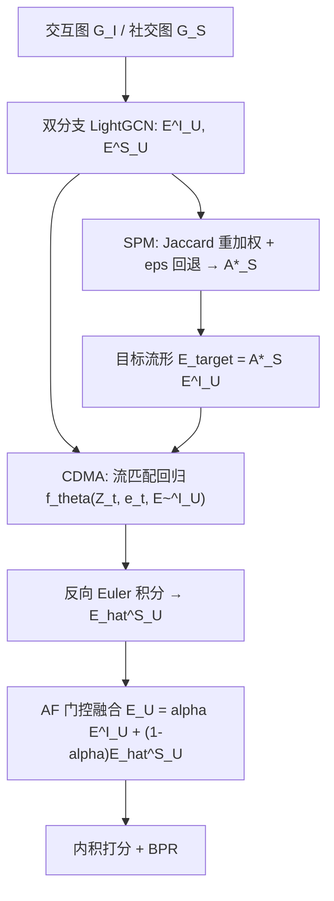
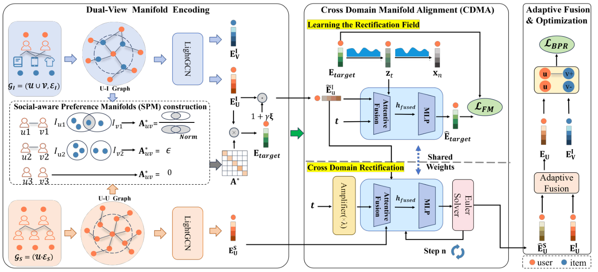

# Manifold-Aligned Rectification Flow for Denoised Social Recommendation (面向去噪社交推荐的流形对齐整流流)

- **会议/期刊**: IJCAI 2026
- **作者与机构**: Qing Meng, Zhufu Song, Huiyu Min, Qian Huang, Pengcheng Zhang（河海大学、南京林业大学）
- **推荐链路定位**: 召回（双分支 LightGCN 内积打分）
- **研究方向**: 社交与群组推荐 / 自监督与交互去噪
- **论文原文**: [论文原文链接](https://www.ijcai.org/proceedings/2026/0326.pdf)
- **开源代码**: 暂未开源

## TL;DR (1分钟核心速览)

社交推荐的核心痛点是社交边与真实兴趣在语义空间上并不一致，而现有 DDPM/流匹配去噪都只在**社交域内部**平滑，缺乏偏好分布引导，去噪后的社交向量仍与偏好空间错位。本文提出 MARF：用交互图构造"社交感知偏好流形"作为流匹配的目标分布，学习一条把噪声社交表征连续输运到偏好流形的速度场，再以用户级门控与协同信号融合。在 Ciao/Yelp/Epinions 的随机 7:1:2 划分下，Recall@20 相对最优基线 RecFlow 提升 2.34%/3.88%/5.56%。

## Background & Motivation (背景与核心矛盾)

- **主流范式**: 以 GNN（GraphRec/DiffNet/KCGN/MHCN）在社交图与交互图上做多层消息传递；去噪侧则从启发式剪边（DSL、Jaccard 过滤）演进到隐空间生成式净化（RecDiff 的 DDPM、RecFlow 的流匹配）。
- **前人局限**: ① 社交噪声明显非高斯，DDPM 的高斯前向假设与真实噪声分布失配，逆过程难以达到最优解；② 即便换成流匹配，去噪目标仍是"重建干净社交图"，整个输运过程**未被偏好分布显式引导**，得到的表征受社交图内在几何约束，与推荐所需的偏好判别空间错位。
- **核心洞察 (Key Insight)**: 社交同质性与社交影响在真实网络中经常不一致（大量社交连边用户并无共同兴趣），因此问题本质不是"在社交流形上去掉几条边"，而是"把占据社交流形的点搬运到偏好流形上"，即一次跨流形的**输运**而非域内**平滑**。
- **本文切入点**: 在交互域构造一个同时含社交结构的偏好流形作为流匹配的 target，学习从该流形出发的正向路径，推理时反向积分把社交表征直接映射进偏好域。

## Method (核心方法设计)

### 1. 整体框架 (Overall Architecture)

输入为用户-物品交互图 $G_I$与社交图$G_S$，先用双分支 LightGCN 分别得到兴趣表征$E^I_U$与社交表征$E^S_U$。随后 SPM 模块用交互重叠度重加权社交邻接，构造社交感知偏好流形$E_{\text{target}}=A^*_S E^I_U$作为流匹配目标；CDMA 模块学习从$E_{\text{target}}$（$t=0$）到高斯噪声$X_n$（$t=1$）的最优传输路径，训练 fθ 直接回归目标流形；推理时以$Z_1=E^S_U$为初值反向 Euler 积分$n$步得到整流表征$\hat{E}^S_U$。最后由自适应门控 AF 将$\hat{E}^S_U$与$E^I_U$ 加权为用户最终向量，内积打分并用 BPR 训练。

<figure class="paper-figure" markdown="span">
  <figcaption>图1：MARF 的整体架构。该框架通过以下方式校正噪声社交信号：(1) 双视角流形编码与社交感知目标构建；(2) 使用流匹配的跨域流形对齐（CDMA），以弥合社交-兴趣语义差距；(3) 自适应融合，将校正后的表示整合用于推荐。</figcaption>
</figure>

### 2. 关键设计拆解 (Key Designs)

1. **社交感知偏好流形 SPM（构造可信目标分布）**: 直接把 $E^I_U$当目标会让社交表征塌缩为纯兴趣向量、丢失社交先验；而在原始$A_S$上守恒又会把噪声带进目标。本文对$A_S$逐元素重加权：两用户有共同交互物品时取物品集的 Jaccard 相似度，**无共同交互但存在社交边**时回退为常数$\epsilon$，其余置 0，再取 top-$k$邻域得$A^*_S$，目标流形为$E_{\text{target}}=A^*_S E^I_U$。该$\epsilon$ 回退是关键：冷启动用户无共交互物品时仍能保留拓扑先验，而高活跃用户则被 Jaccard 语义过滤掉社交圈噪声。
2. **跨域流形整流 CDMA（沿偏好方向的输运）**: 采用最优传输插值 $Z_t=(1-t)E_{\text{target}}+tX_n$定义时间路径，并把兴趣表征做乘性扰动$\tilde{E}^I_U=E^I_U\odot(1+\gamma\xi),\ \xi\sim\mathcal{N}(0,I)$以建模兴趣不确定性；$[Z_t,e_t,\tilde{E}^I_U]$经注意力动态赋权后送入两层 MLP fθ，**直接回归$E_{\text{target}}$而非瞬时速度场**（规避拟合噪声速度场的不稳定性），损失为$\mathcal{L}_{FM}=\mathbb{E}\|\hat{E}_{\text{target}}-E_{\text{target}}\|^2$。推理时以$Z_1=E^S_U$起，令$\hat{v}_\theta(Z_t,t)=\hat{E}_{\text{target}}-Z_t$，按$Z_{t-\Delta t}=Z_t-\hat{v}_\theta(Z_t,t)\Delta t$反向积分至$t=0$得$\hat{E}^S_U$。为缓解 MLP 的低频偏置导致的过平滑，仅对**标量时间**做$\lambda$倍放大的正弦编码（$\lambda=1000$），迫使网络捕捉高频分量以区分语义相近但兴趣不同的用户。
3. **自适应融合与训练目标**: 逐用户门控 $\alpha_u=\sigma(\mathbf{w}_2^\top\tanh(\mathbf{W}_1[E^I_U;\hat{E}^S_U]+\mathbf{b}_1)+b_2)$，$E_U=\alpha_u E^I_U+(1-\alpha_u)\hat{E}^S_U$，使社交先验仅在可靠时被采纳；总损失$\mathcal{L}=\mathcal{L}_{BPR}+w\mathcal{L}_{FM}+\lambda_{reg}\|\Theta\|_2^2$，负采样为 BPR 标准未交互均匀采样（无难负样本挖掘）。

## Experimental Setup & Evaluation Protocol (实验设置与评估协议)

- **数据集与预处理**: 沿用 RecDiff 发布的预处理版本（未额外声明 `5-core` 过滤步骤）。

| 数据集 | #Users | #Items | #Interactions | 社交边 | 场景说明 |
| :--- | :---: | :---: | :---: | :---: | :--- |
| Ciao | 1,925 | 15,053 | 23,223 | 65,084 | 消费点评，有向信任关系 |
| Epinions | 14,680 | 233,261 | 447,312 | 632,144 | 消费点评，噪声最高的稀疏域 |
| Yelp | 99,262 | 105,142 | 672,513 | 1,298,522 | 本地生活，无向好友链 |

- **数据划分与防穿越 (Splitting Strategy)**: 随机 `比例划分` 7:1:2（train/valid/test），非时间戳切分，存在轻度未来信息混入风险。
- **排名评测协议 (Ranking Protocol)**: 原文仅写"standard setting"，**未显式声明** `Full-Ranking` 还是 `Sampled Ranking`（正负比未给出），仅报告 Recall@20 与 NDCG@20——这是复现与横向对比的主要模糊点。
- **对比基线与超参设置**: 覆盖矩阵分解（TrustMF）、GNN 社交推荐（DiffNet/GraphRec/DGRec/NGCF/KCGN/MHCN/SMIN）、自监督（DSL）、生成式（GDMSR/RecDiff/RecFlow）共 13 个基线；$d=64$（Ciao）/128（其余），batch 2048/4096，Adam，$\lambda=1000$，$k\in[5,50]$、$n\in[10,50]$、$w\in[0.01,1.0]$网格搜索；未报告显著性检验（无$p$ 值）。

## Key Experimental Results (实验关键数据)

### 1. 主实验对比 (Main Results)

| Method | Ciao R@20 | Ciao N@20 | Yelp R@20 | Yelp N@20 | Epinions R@20 | Epinions N@20 |
| :--- | :---: | :---: | :---: | :---: | :---: | :---: |
| TrustMF | 0.0539 | 0.0343 | 0.0371 | 0.0193 | 0.0265 | 0.0195 |
| DiffNet | 0.0528 | 0.0328 | 0.0557 | 0.0292 | 0.0384 | 0.0273 |
| GraphRec | 0.0540 | 0.0335 | 0.0419 | 0.0201 | 0.0334 | 0.0246 |
| NGCF | 0.0559 | 0.0363 | 0.0450 | 0.0230 | 0.0353 | 0.0243 |
| MHCN | 0.0621 | 0.0378 | 0.0567 | 0.0292 | 0.0438 | 0.0321 |
| DSL | 0.0606 | 0.0389 | 0.0504 | 0.0259 | 0.0365 | 0.0267 |
| RecDiff | 0.0712 | 0.0419 | 0.0597 | 0.0308 | 0.0460 | 0.0336 |
| RecFlow | 0.0725 | **0.0438** | 0.0618 | **0.0341** | 0.0486 | 0.0341 |
| **MARF** | **0.0742** | **0.0453** | **0.0642** | 0.0335 | **0.0513** | **0.0360** |
| Improv. | +2.34% | +3.42% | +3.88% | -1.76% | +5.56% | +5.57% |

### 2. 消融实验 (Ablation Study)

| 变体 | Ciao R@20 | Ciao N@20 | Epinions R@20 | Epinions N@20 |
| :--- | :---: | :---: | :---: | :---: |
| w/o CDMA | 0.0623 | 0.0392 | 0.0491 | 0.0344 |
| w/o SPM | 0.0642 | 0.0386 | 0.0500 | 0.0355 |
| w/o AF | 0.0672 | 0.0399 | 0.0435 | 0.0299 |
| MARF (Full) | **0.0742** | **0.0453** | **0.0513** | **0.0360** |

### 3. 关键实验发现 (Key Findings)

1. **CDMA 是真正的去噪引擎，不是锦上添花**：去掉 CDMA（直接用 $E_{\text{target}}$ 打分）使 Ciao Recall@20 从 0.0742 掉到 0.0623（-16.0%），跌幅远超 w/o SPM（-13.5%）与 w/o AF（-9.4%），说明"跨域连续输运"提供了静态过滤无法弥合的语义跨越能力，SPM 只是为输运提供可信的结构先验。
2. **门控按用户可靠性分配社交权重是必需的**：w/o AF 换成平均池化后，Epinions NDCG@20 从 0.0360 降至 0.0299（-17.2%），跌幅甚至大于 Ciao；因 Epinions 社交噪声更重，固定权重的平均融合会把噪声直接注入最终表征，而 $\alpha_u$ 能对高噪声用户自动降权。
3. **收益主要来自稀疏与噪声场景，但排序质量已接近瓶颈**：Epinions（最稀疏）Recall 提升 5.56%、Ciao 仅 2.34%；而 Yelp 上 NDCG 反被 RecFlow 低 1.76%（0.0335 vs 0.0341），说明 MARF 主要通过扩大召回候选池获益，top-20 内部排序精修仍有空间；配合图 2 的 KDE，最难的 20% 样本余弦相似度分布整体右移，证实整流确实是跨流形搬运而非局部平滑。

## Highlights & Limitations (亮点、对比与审稿批判)

- **与代表作对比 (vs. Prior Work)**: 相比 RecDiff（DDPM 在社交域内重建社交图，受高斯假设限制）与 RecFlow（流匹配但目标仍是干净社交图，纯"复原式去噪"），MARF 把学习目标改为**偏好流形**，即"迁移式整流"；相比 DSL/MHCN 等剪边与超图方法，它不动离散图结构而在连续隐空间完成整流，避免了剪枝不可逆的信息损失。
- **可迁移亮点**: ① "用下游域构造 FM 目标分布"这一范式可平移到跨域推荐、模态缺失补全；② 仅对时间标量做 $\lambda$ 放大正弦编码以打破 MLP 低频偏置，是一种极低成本的高频注入技巧，可直接用于任意扩散/流式推荐网络。
- **审稿级局限批判**: ① 评测协议未声明 Full-Ranking 或采样排序（亦无正负比与显著性检验），在如此小的绝对提升（$+0.0017$Recall）下，横向可比性与结论稳健性存疑；②$E_{\text{target}}=A^*_S E^I_U$由交互表征派生而最终打分又含$E^I_U$分量，目标与输入存在同源耦合，可能放大已观测交互的影响；③ 推理需$n$步 Euler 积分（最佳$n$约 20–30），在线打分延迟与训练时的$k$、$\lambda$、$w$多超参敏感性（$w$在噪声集需保守、$\lambda$ 过大导致数值振荡）在文中均未量化。

## Rating (四维评分)

- **方法创新性 (Novelty)**: ⭐⭐⭐⭐ （把社交去噪重构为"社交流形→偏好流形"的跨域输运，视角新颖；但流匹配骨架与 RecFlow 同源，增量集中在目标分布构造）
- **评估协议与实验扎实度 (Protocol & Experiments)**: ⭐⭐⭐ （三数据集 + 13 基线较完整，消融与活跃度/超参分析到位；但划分与排序协议描述模糊、无显著性检验、Yelp NDCG 未胜出）
- **写作与数学规范度 (Clarity & Rigor)**: ⭐⭐⭐⭐ （SPM 的 $\epsilon$回退与直接回归目标流形的动机交代清楚，公式完整；正向/反向时间方向与$Z_1=E^S_U$ 初值的符号使用略显绕）
- **工业落地与复现价值 (Industrial & Practical Value)**: ⭐⭐⭐ （无需难负采样、整流模块可离线预计算，工程友好；但多步 ODE 推理与 $k/\lambda/w$ 三重敏感超参抬高了调参成本，且暂无开源代码）

