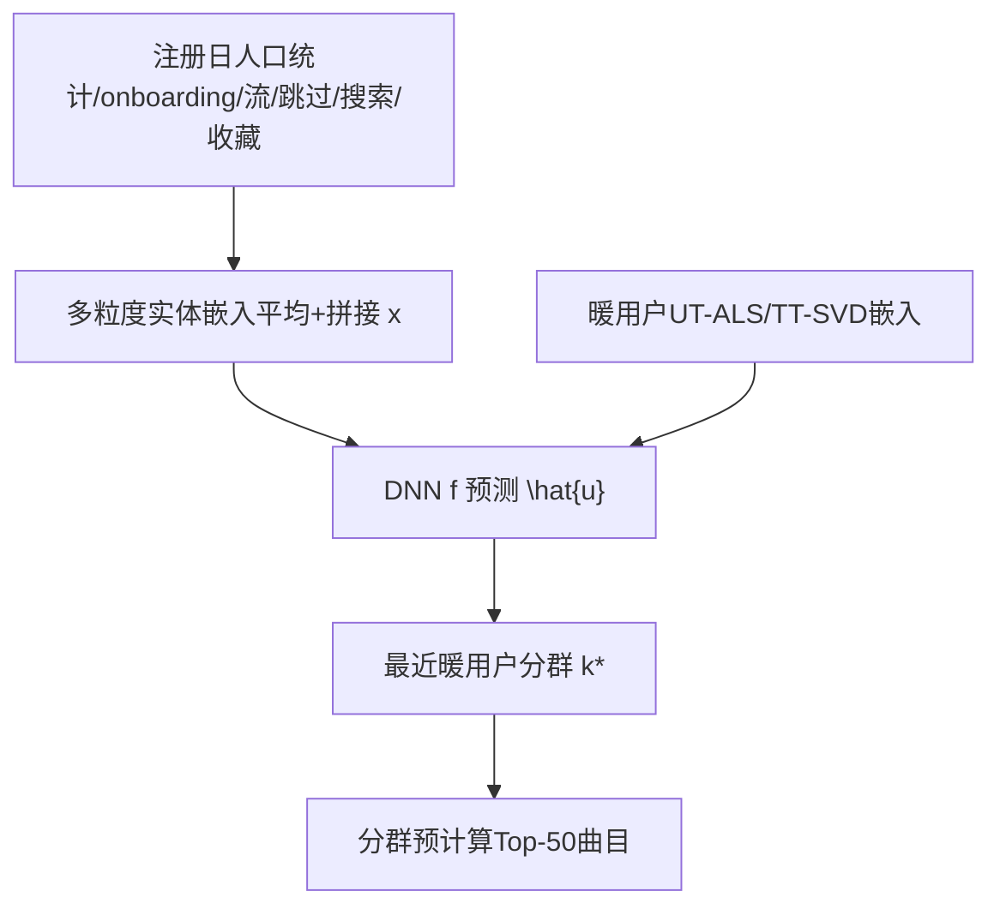

# A Semi-Personalized System for User Cold Start Recommendation on Music Streaming Apps (音乐流媒体应用中的用户冷启动半个性化推荐系统)

- **会议/期刊**: KDD 2021
- **作者与机构**: Léa Briand, Guillaume Salha-Galvan, Walid Bendada, Mathieu Morlon, Viet-Anh Tran；Deezer Research（含 LIX/École Polytechnique、LAMSADE/Paris Dauphine）
- **推荐链路定位**: 召回（冷用户嵌入预测与分群Top-N召回）
- **研究方向**: 冷启动与长尾推荐 / 协同过滤
- **论文原文**: [https://arxiv.org/abs/2106.03819v1](https://arxiv.org/abs/2106.03819v1)
- **开源代码**: [https://github.com/deezer/semi_perso_user_cold_start](https://github.com/deezer/semi_perso_user_cold_start)

## TL;DR (1分钟核心速览)

面向Deezer新注册、交互极少的冷用户，本文用人口统计与注册日异构行为训练DNN，把冷用户映射进既有协同过滤嵌入空间，再以暖用户$k$-means分群做半个性化Top-50召回。离线50k曲目全库排序中TT-SVD版NDCG@50较最强基线提升8.76%，在线A/B的展示到播放/收藏率显著提升（$p<0.01$）。

## Background & Motivation (背景与核心矛盾)

- **主流范式**: 工业界以ALS矩阵分解或物品共现SVD学习暖用户与曲目嵌入，再以人口统计聚类、DropoutNet或MeLU处理冷启动。
- **前人局限**: 注册日信号稀疏且含负反馈，直接平均播放曲目或全个性化最近邻会放大噪声；无交互用户无法进入标准矩阵分解。
- **核心洞察 (Key Insight)**: 冷用户不必独立学嵌入，可从注册日异构特征回归到既有暖用户嵌入空间，再用暖用户分群约束召回。
- **本文切入点**: 以DNN预测嵌入+暖用户$k$-means分群，做半个性化Top-50，兼顾冷启动鲁棒性与线上延迟。

## Method (核心方法设计)

### 1. 整体框架 (Overall Architecture)

系统先在Deezer暖用户上训练UT-ALS（$d=256$）或TT-SVD（$d=128$）嵌入，并对暖用户做$k=1000$的$k$-means分群及分群Top曲目预计算。冷用户注册日的人口统计、onboarding、播放/跳过/搜索/收藏等被聚合成固定维向量$\mathbf{x}$，经3层MLP回归到同一嵌入空间得到$\hat{\mathbf{u}}$；再将$\hat{\mathbf{u}}$分配到最近暖分群，返回该分群预计算Top-50。离线用未来30天收听评估，线上以Golang+ONNX前向推理，嵌入与分群每周更新。

### 2. 关键设计拆解 (Key Designs)

1. **多粒度异构特征聚合**：注册日交互覆盖track/album/artist/playlist及正负反馈。对每类实体集合$\mathcal{S}_i^m$取嵌入平均$\mathbf{x}_i^m=\frac{1}{|\mathcal{S}_i^m|}\sum_{j\in\mathcal{S}_i^m}\mathbf{v}_j$，缺失模态置零后拼接$\mathbf{x}_i=[\mathbf{x}_i^{\text{demo}};\mathbf{x}_i^{\text{stream}};\ldots]$。固定维输入使模型可扩展到任意交互数，负反馈（跳过/拉黑，约占12%）也被显式保留。
2. **嵌入回归而非重训CF**：暖用户上最小化$\mathcal{L}=\frac{1}{N}\sum_i\lVert f(\mathbf{x}_i)-\mathbf{u}_i\rVert_2^2$，其中$f$为400-300-200-ReLU MLP。冷用户仅需一次前向得$\hat{\mathbf{u}}_c=f(\mathbf{x}_c)$。这样把人口统计与少量行为映射到协同空间，零交互时仍可由国家/年龄嵌入给出合理先验，且不破坏暖用户表征。
3. **分群约束的半个性化召回**：对暖用户嵌入做$k$-means得质心$\mathbf{c}_k$，冷用户分配$k^*=\arg\min_k\lVert\hat{\mathbf{u}}_c-\mathbf{c}_k\rVert_2$，推荐该群预计算Top-50。相比全个性化最近邻，分群把稀疏冷用户的噪声预测“收缩”到群体偏好。训练为MSE回归、免负采样；线上仅需MLP前向+1,000质心比较，曲目列表离线预计算，满足生产低延迟。

## Experimental Setup & Evaluation Protocol (实验设置与评估协议)

- **数据集与预处理**: 非`5-core`；冷用户需注册后首月至少50次播放。

| 数据集 | #Users | #Items | #Interactions | 稀疏度/密度 | 特征/场景说明 |
| :--- | :---: | :---: | :---: | :---: | :--- |
| Deezer-Offline | 100,000（70k暖+30k冷；20k验证/10k测试） | 50,000 tracks | 未披露总数；冷用户首月≥50次播放 | 未披露；跳过/拉黑约占12%交互 | 注册日人口统计、onboarding、流/跳过/搜索/收藏；未来30天留出 |

- **数据划分与防穿越 (Splitting Strategy)**: 暖用户70k用于训练嵌入与MLP；冷用户取2020年11月首周注册的30k，20k验证/10k测试；输入仅注册日，标签为注册后30天收听，属时间切分+冷启动划分，非Leave-One-Out。
- **排名评测协议 (Ranking Protocol)**: 在50,000首曲目全库候选中为每冷用户返回Top-50，非采样负例排序；用Precision/Recall/NDCG@50，报告10次运行均值与标准差；线上A/B用展示到播放/收藏率，$p<0.01$。
- **对比基线与超参设置**: Popularity、Registration Day Streams、Input Features Clustering、DropoutNet、MeLU；UT-ALS $d=256$、TT-SVD$d=128$；MLP 400-300-200、batch 512、lr 1e-4、100/130 epochs，验证集调参。

## Key Experimental Results (实验关键数据)

### 1. 主实验对比 (Main Results)

| 方法 | TT P@50 | TT R@50 | TT NDCG@50 | UT P@50 | UT NDCG@50 |
| :--- | ---: | ---: | ---: | ---: | ---: |
| Popularity | 8.92 | 3.01 | 9.72 | 8.92 | 9.72 |
| Registration Day Streams | 9.30 | 3.48 | 9.73 | 16.88 | 17.72 |
| Input Features Clustering | 8.84 | 2.97 | 9.75 | 8.85 | 9.75 |
| DropoutNet Semi-Pers. | 20.85 | 7.55 | 22.61 | **19.83** | **21.55** |
| MeLU Semi-Pers. | 19.66 | 6.87 | 21.63 | 19.35 | 21.33 |
| Deezer Full-Pers. | 9.58 | 3.53 | 9.77 | 18.50 | 20.22 |
| Deezer Semi-Pers. (ours) | **22.75** | **8.26** | **24.59** | 19.00 | 20.38 |

TT-SVD上，Deezer Semi-Pers. 相对最强基线DropoutNet Semi-Pers. 提升P@50 **+9.11%**、R@50 **+9.40%**、NDCG@50 **+8.76%**；UT-ALS上DropoutNet Semi-Pers. 更强（P@50 19.83 vs 19.00），说明收益依赖嵌入空间几何。

### 2. 消融实验 (Ablation Study)

| 配置 | 关键变化 | P@50 | R@50 | NDCG@50 |
| :--- | :--- | ---: | ---: | ---: |
| Input Features Clustering | w/o DNN，仅原始特征$k$-means | 8.84 | 2.97 | 9.75 |
| Registration Day Streams | w/o DNN/分群，注册日播放平均 | 9.30 | 3.48 | 9.73 |
| Deezer Full-Pers. | w/o 分群，最近邻Top-50 | 9.58 | 3.53 | 9.77 |
| Deezer Semi-Pers. | 完整 | **22.75** | **8.26** | **24.59** |

### 3. 关键实验发现 (Key Findings)

1. **半个性化是主收益来源**：TT-SVD上Full-Pers. NDCG@50仅9.77，Semi-Pers.达24.59（+14.82点），说明稀疏冷用户的最近邻噪声被分群先验显著抑制；但UT-ALS上Full-Pers. 20.22、Semi-Pers. 20.38，收益仅+0.16，表明效果依赖嵌入空间几何与候选质量。
2. **DNN映射比原始特征聚类关键**：去掉DNN的Input Features Clustering仅9.75 NDCG@50，完整模型24.59（+14.84点）；Registration Day Streams也仅9.73，证明异构特征回归到协同空间而非直接平均播放。
3. **交互覆盖决定冷启动上限**：注册日无交互的5%用户P@50仅17.74，比全局均值低5.01点；有播放/跳过及onboarding至少3位歌手喜欢的用户更高。线上A/B中展示到播放与收藏率相对基线显著提升（$p<0.01$），验证工业价值。

## Highlights & Limitations (亮点、对比与审稿批判)

- **与代表作对比 (vs. Prior Work)**: DropoutNet用dropout模拟冷启动并联合学习暖/冷嵌入，且只用正反馈；MeLU用元学习为每个用户做局部更新；本文不改暖嵌入，只用一次前向回归+分群，显式利用跳过/拉黑负反馈，线上可部署。相比Registration Day Streams，核心是把稀疏行为经DNN映射并与群体先验融合。
- **可迁移亮点**: 多粒度实体嵌入平均+缺失置零，适合任意冷启动特征；分群Top列表预计算把个性化召回压到低延迟，可作为全个性化前的安全回退。
- **审稿级局限批判**: 假设曲目目录固定，未处理新歌冷启动；离线只在50k热门曲目上评Top-50，未覆盖73M全库，且UT-ALS上未超过DropoutNet；$k=1000$与群内热门召回可能加剧长尾/流行度偏差，离线仅报告标准差未做完整显著性检验。

## Rating (四维评分)

- **方法创新性 (Novelty)**: ⭐⭐⭐⭐ （DNN嵌入回归+暖用户分群半个性化是工程化组合创新，理论新颖度有限但问题切中要害）
- **评估协议与实验扎实度 (Protocol & Experiments)**: ⭐⭐⭐⭐ （100k用户时间冷启动切分、10次运行、在线A/B $p<0.01$，并开放代码与脱敏数据）
- **写作与数学规范度 (Clarity & Rigor)**: ⭐⭐⭐⭐ （系统流程与特征管线清晰，公式简洁；生产细节因保密有省略，理论分析较少）
- **工业落地与复现价值 (Industrial & Practical Value)**: ⭐⭐⭐⭐⭐ （Deezer真实部署，Golang+ONNX低延迟推理，代码与数据公开，复现价值高）

