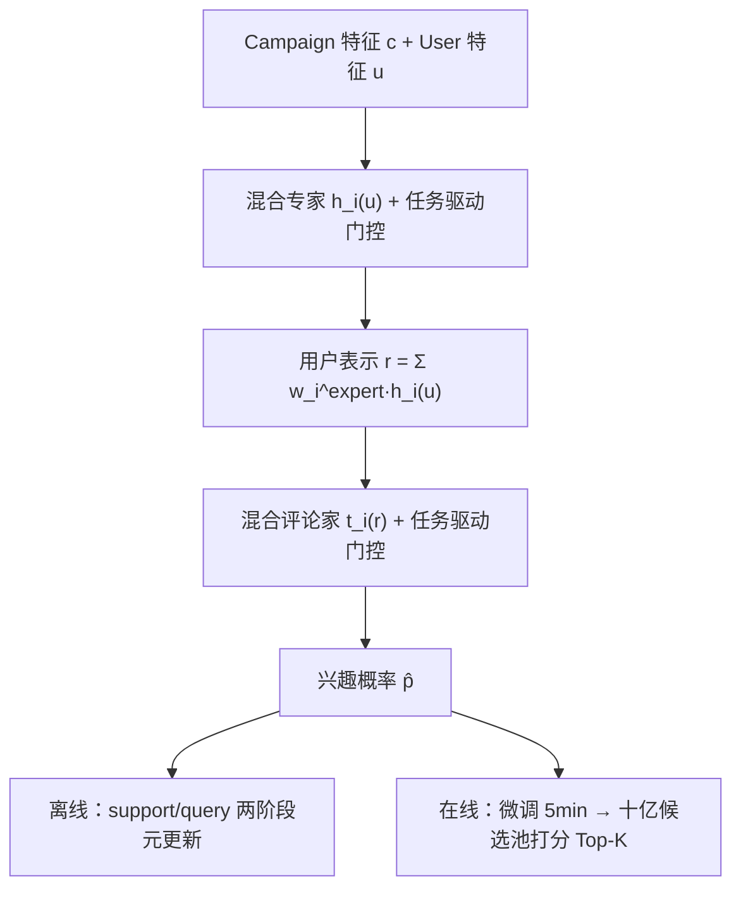
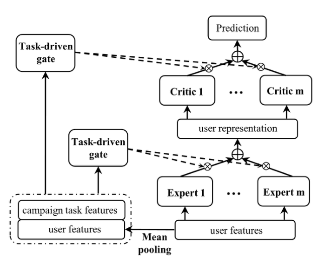

# Learning to Expand Audience via Meta Hybrid Experts and Critics for Recommendation and Advertising（面向推荐与广告的元混合专家-评论家人群扩展）

- **会议/期刊**: KDD 2021
- **作者与机构**: Yongchun Zhu, Yudan Liu, Ruobing Xie, Fuzhen Zhuang（通讯）, Xiaobo Hao 等；中科院计算所、微信搜索应用部、北航
- **推荐链路定位**: 召回（人群扩展 / look-alike 候选池召回）
- **研究方向**: 冷启动与长尾推荐 / 多任务学习与列表级重排
- **论文原文**: [https://arxiv.org/abs/2105.14688v1](https://arxiv.org/abs/2105.14688v1)
- **开源代码**: [https://github.com/easezyc/MetaHeac](https://github.com/easezyc/MetaHeac)

## TL;DR (1分钟核心速览)

Look-alike 人群扩展要为每天数百个异质 campaign 找种子相似用户，但种子集常仅数百人：单任务定制从零训练严重过拟合，只预训练 embedding 的两阶段方法又不建模任务关系与泛化。MetaHeac 把「理解种子（support）—扩展人群（query）」构造为元学习任务离线训练通用模型，并以任务驱动门控的混合专家+混合评论家建模任务关系；在线仅用种子集微调。在两个私有/公开数据集上，小种子场景 AUC 相对提升 1.7%/2.3%、P@5% 提升 7.0%/8.9%，微信线上 CVR 提升 4.64%–15.40%。

## Background & Motivation (背景与核心矛盾)

- **主流范式**: 经历规则匹配 → 预定义相似度（Cosine/Jaccard）→ 模型化的三阶段演进；当前主流是两阶段范式：离线在全部 campaign 上预训练公共 embedding，在线为每个 campaign 训练/微调定制分类器（Pinterest、Hubble）。
- **前人局限**: ① 数百个 campaign 覆盖体育、社会、政治等完全不同品类，一个公共模型难以兼顾，且任务间固有冲突（某任务种子恰是另一任务的负样本）会被单图拟合抹平；② 种子集常只有几百人，从零训练的单阶段模型严重过拟合。
- **核心洞察**: 已有两阶段法只预训练 embedding、**不预训练深层网络**，且直接在全量 campaign-user 图上拟合、未显式优化"对新任务的泛化"。若把"种子集"当作 support 集、"扩展人群"当作 query 集，则"人群扩展"本身可被当作一个可学习的**技能**。
- **本文切入点**: 用元学习"学会如何扩展人群"，再用混合专家/评论家显式刻画任务间关系。

## Method (核心方法设计)

### 1. 整体框架 (Overall Architecture)

输入 campaign 特征 $c=\{e^c_1..e^c_N\}$与 user 特征$u=\{e^u_1..e^u_M\}$（look-up embedding，$k=16$）。$n$个专家$h_i(\cdot)$抽取多视角用户表示，任务驱动门控按 campaign 特征加权聚合为单一向量$r$；随后$m$个评论家$t_i(\cdot)$各自给出兴趣偏好意见，再由第二个任务驱动门控加权汇总为最终概率$\hat{p}$。离线阶段跨全部历史 campaign 以元学习方式训练通用模型$\theta$；在线阶段用新 campaign 的种子集与随机负例微调得到定制模型，对候选池全量打分取 Top-K 作为扩展人群；反馈每小时增量回灌。

<figure class="paper-figure" markdown="span">
  <figcaption>图2：Meta Hybrid Experts and Critics（MetaHeac）的模型结构。</figcaption>
</figure>

### 2. 关键设计拆解 (Key Designs)

1. **两阶段元任务模拟（Learn to Expand）**：痛点是从零训练在少种子上过拟合。将单个 campaign 数据集 $D^{[c]}$划分为不相交的 support$D^{[c]}_a$（理解种子）与 query$D^{[c]}_b$（模拟已扩展人群），先做任务内自适应$\theta^{[c]}=\theta-\alpha\frac{\partial \mathcal{L}_a(\theta)}{\partial \theta}$，再用 query 损失二阶更新通用参数$\theta \leftarrow \theta-\beta\sum_{T_i}\frac{\partial \mathcal{L}_b(\theta^{[c]})}{\partial \theta}$。直觉：只有"见过种子后还能命中真实扩展人群"的初始化才真正可迁移，等价于学习一个低损失、快适应的初始化。
2. **任务驱动门控的混合专家**：单专家只覆盖用户的部分特征，平均池化又会抹掉任务特性。故门控输入同时取 campaign 特征与**均值池化后的**用户特征 $w^{expert}=\mathrm{softmax}(g(c,\mathrm{mean}(u)))$，表示$r=\frac{1}{n}\sum_i w^{expert}_i h_i(u)$。对用户特征做 mean pooling 是刻意的：让任务信息主导门控，使高相关任务选中相似专家、弱相关任务被推向不同专家，从而在同一模型中编码任务关系。
3. **混合评论家与训练目标**：单评论家难以兼容同一用户在不同任务上的异质标签，逐任务评论家又受限于种子稀缺。故 $\hat{p}=\frac{1}{m}\sum_{i} w^{critic}_i\sigma(t_i(r))$，使用**另一套独立门控**。总损失为各任务带权交叉熵；训练无需 hard negative 挖掘（种子为正、池内均匀采样为负）；推理为纯 MLP 前向，十亿用户打分约 10 分钟。

## Experimental Setup & Evaluation Protocol (实验设置与评估协议)

| 数据集 | #Tasks | #Seeds | #Expanded Audiences | 特征/场景说明 |
| :--- | :---: | :---: | :---: | :--- |
| Tencent Look-alike（公开） | 172 | 421,961 | 2,265,989 | 广告 6 类特征 + 用户 14 类特征（兴趣/关键词/主题三级） |
| WeChat Look-alike（私有） | 90 | 286,036 | 3,146,396 | 内容营销 campaign，脱敏处理 |

- **数据划分与防穿越**: **任务级划分**。Tencent 随机取 60% campaign 作训练任务、40% 作测试任务；WeChat 用前 2 天（58 任务）训练通用模型、第 3 天（32 任务）测试。测试任务内再按种子规模切成 $S^{[c]}\le T$与$S^{[c]}>T$两组（Tencent$T=4000$、WeChat$T=10000$，8:2）。
- **排名评测协议**: **Sampled Ranking**——种子:负例 = 1:20（Tencent）/1:10（WeChat），指标为 AUC、P@5%、R@5%（$K=5$），**非全库 Full-Ranking**。
- **对比基线与超参**: 基线三类——单阶段（LR、MLP_one-stage）、仅预训练 embedding（MLP+emb、Pinterest、Hubble）、预训练网络（MLP+pre-training、Shared-Bottom+pre-training、MMoE+pre-training）。Embedding $d=16$、batch 512、Adam 全局学习率网格$\{0.001..0.1\}$、局部学习率$\alpha=0.001$、专家/评论家数在$[3,10]$调优；配对 t 检验（**/$p<0.005$，*/$p<0.05$）。

## Key Experimental Results (实验关键数据)

### 1. 主实验对比 (Main Results)

| 方法 | Tencent AUC | P@5% | R@5% | WeChat AUC | P@5% | R@5% | (S≤T 组) |
| :--- | :---: | :---: | :---: | :---: | :---: | :---: | :--- |
| LR (单阶段) | 0.5942 | 0.1015 | 0.1044 | 0.5654 | 0.1351 | 0.0742 | |
| MLP_one-stage | 0.5928 | 0.1048 | 0.1081 | 0.6663 | 0.2477 | 0.1363 | |
| MLP+emb | 0.6624 | 0.1881 | 0.1930 | 0.7143 | 0.3058 | 0.1684 | |
| Pinterest | 0.6245 | 0.1635 | 0.1665 | 0.6289 | 0.1947 | 0.1066 | |
| Hubble (GNN) | 0.6797 | 0.2056 | 0.2110 | 0.7391 | 0.3524 | 0.1936 | |
| MLP+pre-training | 0.7117 | 0.2325 | 0.2384 | 0.7440 | 0.3473 | 0.1908 | |
| MMoE+pre-training | 0.6977 | 0.2224 | 0.2280 | 0.7368 | 0.3265 | 0.1797 | |
| **MetaHeac** | **0.7239** | **0.2489** | **0.2554** | **0.7607** | **0.3839** | **0.2110** | |
| Improv. | +1.7% | +7.0% | +7.1% | +2.3% | +8.9% | +9.0% | |

$S^{[c]}>T$ 组同表趋势但增益收窄：Tencent **0.7142**/0.2244/0.2356（+0.8%/+4.7%/+4.7%），WeChat **0.7323**/0.3133/0.1707（+0.4%/+2.3%/+1.9%）。

### 2. 消融实验 (Ablation Study)

| 变体 (Tencent) | S≤T AUC | S≤T P@5% | S>T AUC | S>T P@5% |
| :--- | :---: | :---: | :---: | :---: |
| w/o Hybrid Critics | 0.7199 | 0.2472 | 0.7115 | 0.2220 |
| w/o Hybrid Experts | 0.7181 | 0.2419 | 0.7112 | 0.2193 |
| w/o Meta-learning | 0.7173 | 0.2431 | 0.7107 | 0.2180 |
| **MetaHeac (Full)** | **0.7239** | **0.2489** | **0.7142** | **0.2244** |

### 3. 关键实验发现 (Key Findings)

1. **增益集中在种子稀缺区**：Tencent 小种子组 P@5% 相对提升 7.0%，大种子组仅 4.7%；WeChat 为 8.9% vs 2.3%，而 AUC 仅 +1.7%/+2.3%（大种子组低至 0.8%/0.4%）。说明迁移知识主要补偿"种子不足导致的定制模型不稳"，而非全面提升全局排序分辨率。
2. **元学习是首要增益源，其次专家，最后评论家**：去掉 Meta/HE/HC 后小种子 AUC 分别下降 0.0066/0.0058/0.0040，P@5% 分别下降 0.58/0.70/0.17 个点；三者叠加才达 0.7239，验证"通用初始化 + 多视角表征 + 多意见融合"互补。收敛曲线显示 MetaHeac 初始 loss 更低、收敛 loss 最低，佐证学到的初始化更优。
3. **线上收益来自人群质量而非流量放大**：广告场景曝光仅 +0.65%，但转化 +15.50%、CVR +15.40%；视频/文章场景曝光 +3.07%/+3.18%，CVR +7.90%/+4.64%。等量 Top-K 下转化率显著抬升，说明扩展人群精准度真实提升。

## Highlights & Limitations (亮点、对比与审稿批判)

- **与代表作对比**: vs **Hubble**（在 campaign-user 大图上跑 GNN，但只预训练 embedding 与图表征，在线仍从头训分类头）——MetaHeac 预训练整个网络并显式优化可适应性；vs **MMoE**（专家共享但 head 硬绑定单任务，论文指出其设计面向 <5 任务场景）——MetaHeac 用门控在数百任务间软共享，并把门控同时用于专家与评论家；vs **Pinterest**（相似度分类，依赖预定义度量）——端到端可学。
- **可迁移亮点**: ① 把业务两阶段流程（先理解种子、再向外扩展）直接翻译成 support/query 元任务，是很好的"任务构造即归纳偏置"范例；② 门控输入对用户侧做 mean pooling 以让任务特征主导，可迁移到任意"任务多、样本少"的广告/多业务场景。
- **审稿级局限批判**: ① 评估为 1:20/1:10 采样排序下的 AUC/P@K%，非全库排序，且"实际扩展人群"作正例天然带曝光与位置偏置，未做无偏估计或 IPS 校正；② 线上阶段对同 campaign 的实时反馈每小时增量训练，任务级划分下测试 campaign 的标签信息仍可能通过增量链路渗入，与严格 zero-shot 冷启设定存在差距；③ 公式 $r=\frac{1}{n}\sum_i w_i h_i(u)$同时含 softmax 权重与$1/n$归一化，权重和不为 1，符号与实现一致性略欠严谨；④ 专家/评论家数与阈值$T$ 需网格调优，十亿用户 10 分钟检索的延迟开销未与基线对比。

## Rating (四维评分)

- **方法创新性 (Novelty)**: ⭐⭐⭐⭐ （把 look-alike 两阶段流程重构为元任务并以双门控 MoE 建模任务关系，组合新颖，但单点技术均为成熟组件的巧妙拼装）
- **评估协议与实验扎实度 (Protocol & Experiments)**: ⭐⭐⭐ （离线双数据集+分组分桶+显著性检验+线上 A/B 较完整，但采样排序协议与曝光偏置未处理）
- **写作与数学规范度 (Clarity & Rigor)**: ⭐⭐⭐⭐ （元学习更新与门控公式清晰、算法伪码完整，仅门控归一化与部分符号细节欠严谨）
- **工业落地与复现价值 (Industrial & Practical Value)**: ⭐⭐⭐⭐⭐ （十亿用户微信真实部署，含每日 400–500 campaign、5 分钟微调、10 分钟检索的完整工程量化，且已开源）

