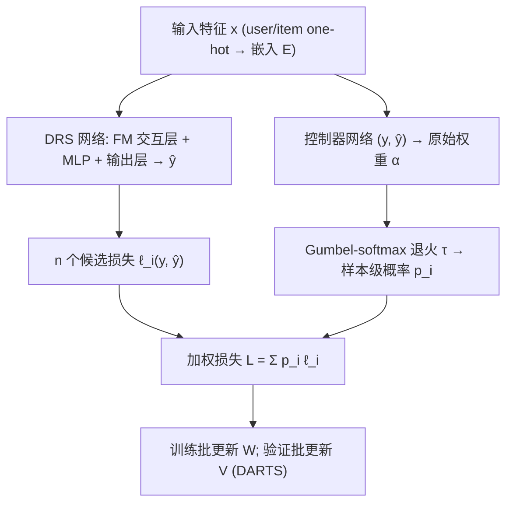
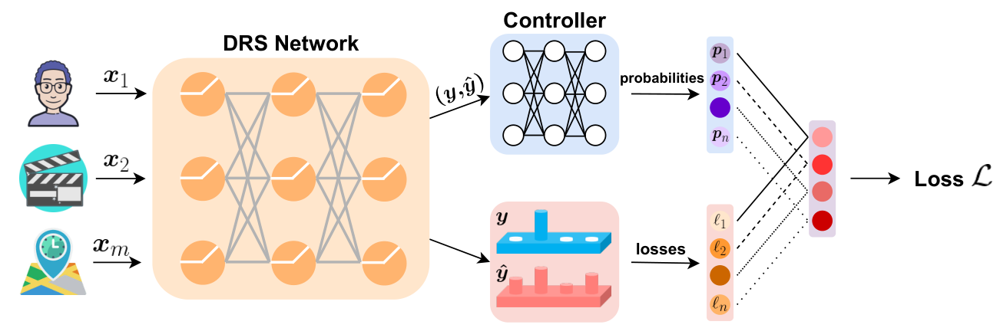

# AutoLoss: Automated Loss Function Search in Recommendations (推荐系统中的自动化损失函数搜索)

- **会议/期刊**: KDD 2021 (Proceedings of the 27th ACM SIGKDD Conference on Knowledge Discovery and Data Mining)
- **作者与机构**: Xiangyu Zhao, Haochen Liu, Wenqi Fan, Hui Liu, Jiliang Tang, Chong Wang (City University of Hong Kong / Michigan State University / The Hong Kong Polytechnic University / ByteDance)
- **推荐链路定位**: 精排 (CTR 预估与评分预测的训练目标层)
- **研究方向**: 协同过滤与双塔召回 / CTR 预估与特征交叉
- **论文原文**: [https://arxiv.org/abs/2106.06713v1](https://arxiv.org/abs/2106.06713v1)
- **开源代码**: [https://github.com/rixwew/pytorch-fm](https://github.com/rixwew/pytorch-fm) （基于该库实现，AutoLoss 框架代码未单独开源）

## TL;DR (1分钟核心速览)

深度推荐系统普遍沿用单一固定损失函数（MSE/CE/Hinge），而候选损失加权融合的方法要么穷举/手工搜权重、要么学习一组**全局静态**权重，忽略不同样本收敛行为的差异，且重训成本高。AutoLoss 提出控制器网络以 $(\boldsymbol{y},\hat{\boldsymbol{y}})$ 为输入，为**每个数据样本**动态生成候选损失的权重，并用 Gumbel-softmax 做可微硬选择以滤除次优损失的噪声梯度，外层以 DARTS 式双层优化在验证集上更新控制器。Criteo 与 ML-20m 两数据集、DeepFM/IPNN 两骨干下，AUC 相比最强基线 SLF 提升 0.11–0.14 个百分点（如 Criteo-DeepFM 0.8081→0.8092），训练耗时同时缩短约 60%。

## Background & Motivation (背景与核心矛盾)

- **主流范式**: DRS（DeepFM/IPNN 等）先经 Embedding→FM 交互层→MLP→输出层得到 $\hat{y}$，再用单一固定损失（CE、MSE、Focal、Hinge）反向传播；近期工作（MeLU/BOHB/DARTS）试图在多个损失上学习一组加权和系数。
- **前人局限**: 其一，加权融合需在巨大权重空间内穷举或手工搜索，算力与时间代价极高，且**软融合无法消除次优损失的梯度污染**；其二，学到的是全局静态权重，无法适配在线推荐中不同 user-item 样本的非平稳收敛行为，跨模型、跨数据集迁移时又必须重训。
- **核心洞察 (Key Insight)**: 训练损失与评估指标（如 CE 训练 vs. AUC 评测）之间存在鸿沟，单一梯度方向不一定最优；而样本级差异（噪声样本、难样本）恰恰要求"因样本而异"的损失选择，而非一组统一权重。
- **本文切入点**: 把损失函数选择形式化为架构搜索问题——控制器逐样本输出损失概率，Gumbel-softmax 赋予硬选择的可微性，DARTS 双层优化保障泛化性与可迁移性。

## Method (核心方法设计)

### 1. 整体框架 (Overall Architecture)

每轮迭代含前向与反向两步。前向：DRS 网络由 $\boldsymbol{x}$输出$\hat{\boldsymbol{y}}$；据$(\boldsymbol{y},\hat{\boldsymbol{y}})$算出$n$个候选损失$\mathcal{L}_C=[\ell_1,\dots,\ell_n]$；同时控制器网络（以$\boldsymbol{y}$与$\hat{\boldsymbol{y}}$拼接为输入，两层 128 维 MLP + softmax）输出样本级原始权重$\boldsymbol{\alpha}$，经 Gumbel-softmax 得选择概率$\boldsymbol{p}$，加权得总损失$\mathcal{L}$并前传。反向：先在训练批上按$\nabla_{\boldsymbol{W}}\mathcal{L}_{train}$更新 DRS 参数$\boldsymbol{W}$，再在验证批上用一阶近似$\boldsymbol{W}^{*}(\boldsymbol{V})\approx\boldsymbol{W}-\xi\nabla_{\boldsymbol{W}}\mathcal{L}_{train}$更新控制器参数$\boldsymbol{V}$，交替进行，控制器每 7 次 DRS 更新才更新一次。

<figure class="paper-figure" markdown="span">
  <figcaption>图1：AutoLoss 框架概览。</figcaption>
</figure>

### 2. 关键设计拆解 (Key Designs)

1. **Gumbel-softmax 可微硬选择替代软融合**：软加权 $\mathcal{L}=\sum_i \alpha_i\ell_i$中所有候选的梯度都会流入，次优损失持续污染参数更新；而 RL 硬选择又因依赖马尔可夫决策过程存在奖励延迟。本文引入 Gumbel 噪声$g_i=-\log(-\log u_i)$，取$p_i=\frac{\exp((\log\alpha_i+g_i)/\tau)}{\sum_j\exp((\log\alpha_j+g_j)/\tau)}$，$\tau$按$\max(0.01,\,1-0.00005t)$退火至近 one-hot。直觉：噪声扰动使 argmax 等价于按$\alpha$ 采样，softmax 又保留梯度通路，从而实现"近似硬选择却可端到端反传"，天然过滤掉未被选中损失的噪声梯度。
2. **样本级控制器网络**：统一静态权重 $\alpha$无法刻画样本收敛差异。控制器以$(\boldsymbol{y},\hat{\boldsymbol{y}})$为输入（受课程学习启发，用当前预测误差刻画收敛状态），对 batch 内每个样本输出各自的$[\alpha_{b1},\dots,\alpha_{bn}]$，实现"难样本偏 Hinge、噪声样本偏 Focal"的自适应分配，并显著提升跨骨干/跨数据集的迁移能力。
3. **训练目标与双层优化**：$\min_{\boldsymbol{V}}\mathcal{L}_{val}(\boldsymbol{W}^{*}(\boldsymbol{V}),\boldsymbol{V})$s.t.$\boldsymbol{W}^{*}(\boldsymbol{V})=\arg\min_{\boldsymbol{W}}\mathcal{L}_{train}(\boldsymbol{W},\boldsymbol{V}^{*})$，内层仅走一步梯度近似$\boldsymbol{W}-\xi\nabla_{\boldsymbol{W}}\mathcal{L}_{train}$，取$\xi=0$ 即一阶近似。训练/验证批**分离**是关键：若与 SLF 一样在同一训练批上联合更新，控制器会过拟合训练样本。推理阶段无需控制器，仅保留 DRS，在线打分开销与原模型完全一致。

## Experimental Setup & Evaluation Protocol (实验设置与评估协议)

- **数据集与预处理**:

| 数据集 | #Users | #Items | #Interactions | 稀疏度/密度 | 特征/场景说明 |
| :--- | :---: | :---: | :---: | :---: | :--- |
| Criteo | 未披露(匿名) | 未披露(匿名) | 45,840,617 | 39 特征域 / 1,086,810 特征值 | 展示广告点击日志，13 数值域分桶为类别域，二分类任务 |
| ML-20m | 138,493 | 27,278 | 20,000,263 | 2 特征域 / 165,771 特征值 | 5 星评分，每用户 ≥20 条，转为 5 类分类任务 |

- **数据划分与防穿越 (Splitting Strategy)**: 采用比例划分，并从中划出独立验证批用于控制器更新（原文未细述比例），训练/验证批严格分离以防控制器过拟合。
- **排名评测协议 (Ranking Protocol)**: 非检索式排序任务，采用分类指标评估——Criteo 用 AUC 与 Logloss（二分类），ML-20m 用 AUC（one-vs-rest 多分类）与 Logloss；AUC 提升 0.001 量级即视为推荐场景下的显著改进，并做双侧 t 检验 $p<0.05$。
- **对比基线与超参设置**: 三组基线——固定损失（Focal/KL/Hinge/CE）、固定权重融合（MeLU/BOHB/DARTS）、样本级权重（SLF）；骨干为 DeepFM 与 IPNN。嵌入维度 $d=16$，MLP 两层 128 维 + BN + Dropout(0.2)，Adam，学习率 0.001，batch size 2000，温度$\tau=\max(0.01,1-0.00005t)$，控制器更新频率$f=7$。

## Key Experimental Results (实验关键数据)

### 1. 主实验对比 (Main Results)

| 数据集-骨干 | 指标 | Focal | KL | Hinge | CE | MeLU | BOHB | DARTS | SLF | **AutoLoss** | Improv.% (vs SLF) |
| :--- | :---: | :---: | :---: | :---: | :---: | :---: | :---: | :---: | :---: | :---: | :---: |
| Criteo-DeepFM | AUC↑ | 0.8046 | 0.8042 | 0.8049 | 0.8056 | 0.8063 | 0.8065 | 0.8067 | 0.8081 | **0.8092*** | +0.14% |
| Criteo-DeepFM | Logloss↓ | 0.4466 | 0.4469 | 0.4463 | 0.4457 | 0.4436 | 0.4435 | 0.4433 | 0.4426 | **0.4416*** | −0.23% |
| Criteo-IPNN | AUC↑ | 0.8077 | 0.8072 | 0.8079 | 0.8085 | 0.8090 | 0.8092 | 0.8093 | 0.8098 | **0.8108*** | +0.12% |
| Criteo-IPNN | Logloss↓ | 0.4435 | 0.4437 | 0.4432 | 0.4428 | 0.4423 | 0.4422 | 0.4423 | 0.4418 | **0.4409*** | −0.20% |
| ML-20m-DeepFM | AUC↑ | 0.7681 | 0.7682 | 0.7685 | 0.7692 | 0.7695 | 0.7695 | 0.7696 | 0.7705 | **0.7717*** | +0.16% |
| ML-20m-DeepFM | Logloss↓ | 1.2320 | 1.2317 | 1.2316 | 1.2310 | 1.2307 | 1.2305 | 1.2305 | 1.2299 | **1.2288*** | −0.09% |
| ML-20m-IPNN | AUC↑ | 0.7721 | 0.7722 | 0.7725 | 0.7733 | 0.7735 | 0.7734 | 0.7736 | 0.7745 | **0.7756*** | +0.14% |
| ML-20m-IPNN | Logloss↓ | 1.2270 | 1.2269 | 1.2266 | 1.2260 | 1.2256 | 1.2257 | 1.2255 | 1.2249 | **1.2236*** | −0.11% |

（`*` 表示相对最强基线 SLF 双尾 t 检验 $p<0.05$；为保持紧凑，仅列 9 列核心数值，原始表格 4 行骨干组合全部保留。）

### 2. 消融实验 (Ablation Study)

| 数据集-骨干 | 指标 | AL-1 (等权 0.25×4) | AL-2 (去 Gumbel，软 softmax) | **AutoLoss** |
| :--- | :---: | :---: | :---: | :---: |
| Criteo-DeepFM | AUC↑ | 0.8052 | 0.8083 | **0.8092*** |
| Criteo-DeepFM | Logloss↓ | 0.4460 | 0.4422 | **0.4416*** |
| Criteo-IPNN | AUC↑ | 0.8081 | 0.8102 | **0.8108*** |
| Criteo-IPNN | Logloss↓ | 0.4431 | 0.4416 | **0.4409*** |

### 3. 关键实验发现 (Key Findings)

1. **多损失融合必须"选"而非"平均"**：AL-1 等权平均四个候选损失后 AUC 仅 0.8052，甚至低于单损失 CE 的 0.8056，说明不加区分的多损失叠加会引入相互冲突的梯度，AutoLoss 的 0.8092 表明收益主要来自**选择**机制而非"更多损失"本身。
2. **Gumbel 硬选择的边际价值可被量化**：去掉 Gumbel（AL-2，保留控制器但用软 softmax 输出）AUC 从 0.8092 降到 0.8083、Logloss 从 0.4416 升到 0.4422，即约 60% 的控制器增益来自硬选择对次优损失噪声梯度的过滤。
3. **迁移性与效率同时成立**：以 Criteo+DeepFM 训练的控制器冻结后直接驱动 NFM、AutoInt（图 3）与 Avazu 数据集，仍稳定优于 CE 与 SLF 预训练控制器；同时 $f=7$的稀疏更新使训练时间较 MeLU/BOHB/DARTS/SLF 缩短约 60%，且$f$ 过大或过小都会掉点（图 4），验证了"控制器少更新即可兼顾精度与效率"。

## Highlights & Limitations (亮点、对比与审稿批判)

- **与代表作对比 (vs. Prior Work)**: 相比 MeLU/BOHB/DARTS 这类**全局静态权重**方案，AutoLoss 把参数从"$n$ 个标量"扩展到"逐样本函数"，并将更新数据源从训练批改为验证批；相比 SLF 这一同样做样本级加权的最近工作，AutoLoss 用 Gumbel-softmax 实现硬选择（SLF 为软加权且与主网络同批联合更新），既滤噪又抑过拟合。与 DARTS 原意搜索网络结构不同，本文把 DARTS 仅作为双层优化求解器，搜索空间落在损失层。
- **可迁移亮点**: (1) "冻结控制器直接迁移到新骨干/新数据集"的范式可复制到多任务损失加权（如 MTL 中的不确定性加权、GradNorm）与多目标精排；(2) 用 $(\boldsymbol{y},\hat{\boldsymbol{y}})$ 作为控制器输入刻画样本收敛状态，是一种极低成本（仅两层 MLP）的样本重加权实现，几乎不增加在线开销。
- **审稿级局限批判**: (1) 增益幅度较小——AUC 提升 0.001 量级，虽在推荐场景被认可，但相对工程调参收益而言说服力有限，且候选损失集仅 4 个（Focal/KL/Hinge/CE），搜索空间偏窄；(2) 双层优化需额外划出验证批并每轮多做一次控制器前后向，训练流程复杂度上升，$f$与$\tau$ 退火速率两个超参敏感性在文中仅以图表粗略带过，缺乏对样本级权重分布的可解释性分析。

## Rating (四维评分)

- **方法创新性 (Novelty)**: ⭐⭐⭐⭐ （首次将损失函数搜索引入 DRS，样本级控制器 + Gumbel 硬选择 + DARTS 双层优化的组合在 2021 年视角下组合新颖，但单点技术均为已有组件的巧妙拼接）
- **评估协议与实验扎实度 (Protocol & Experiments)**: ⭐⭐⭐⭐ （两数据集×两骨干×9 基线×双指标、含 t 检验、消融、跨模型与跨数据集迁移、效率研究，覆盖完整；扣分在于划分比例与验证集构造细节披露不足，增益幅度偏小）
- **写作与数学规范度 (Clarity & Rigor)**: ⭐⭐⭐⭐ （Gumbel-softmax 与双层优化的公式推导链条完整、符号自洽，$\tau$ 退火与一阶近似均有解释；但 DRS 骨干部分公式近乎教科书复述，占篇幅而增量有限）
- **工业落地与复现价值 (Industrial & Practical Value)**: ⭐⭐⭐⭐ （推理阶段零额外开销、训练提速约 60%、控制器可跨模型复用，工业友好；但依赖 pytorch-fm 生态、AutoLoss 本体未独立开源，复现需自行实现控制器与双层优化循环）

