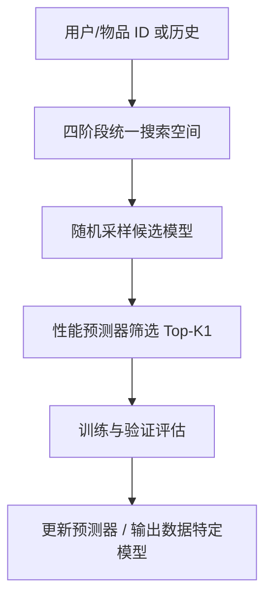
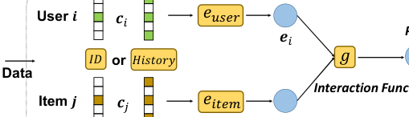

# Efficient Data-specific Model Search for Collaborative Filtering (面向协同过滤的高效数据特定模型搜索)

- **会议/期刊**: KDD 2021
- **作者与机构**: 陈高、姚权铭、金德鹏、李勇；清华大学电子工程系 BNRist、Paradigm Inc.
- **推荐链路定位**: 召回/排序模型设计（CF 模型自动搜索，覆盖评分预测与 Item Ranking）
- **研究方向**: 协同过滤与双塔召回
- **论文原文**: [https://arxiv.org/abs/2106.07453v1](https://arxiv.org/abs/2106.07453v1)
- **开源代码**: 暂未开源

## TL;DR (1分钟核心速览)

针对 CF 模型高度依赖数据分布、人工设计难以泛化的痛点，AutoCF 把 CF 统一为“输入编码→嵌入→交互→预测”四阶段搜索空间，用随机搜索+MLP 性能预测器高效挑选数据特定模型。在 5 个真实数据集上，评分预测 RMSE/MAE 相对 SOTA 稳定提升 1.65%–6.01%，全库排序 Recall@20/NDCG@20 提升 20.10%–22.66%；融合模型再提升 10.96%–13.39%。

## Background & Motivation (背景与核心矛盾)

- **主流范式**: 基于隐因子的 CF 模型是主流，MF/FISM/NCF/NeuMF 等通过可学习 embedding 与交互函数预测用户偏好。
- **前人局限**: 数据在形式、规模、稀疏度上高度异构，神经模型并非总优于浅层模型；单点模块搜索（如只搜交互函数）难以覆盖完整设计空间。
- **核心洞察**: 现有 CF 模型可拆成四个相对独立的阶段，阶段间组合可生成文献中未出现的新模型；模型优劣随数据集变化，应是 data-specific 问题。
- **本文切入点**: 用 AutoML 在四阶段空间内做全模型搜索，并用性能预测器降低候选评估成本。

## Method (核心方法设计)

### 1. 整体框架 (Overall Architecture)

AutoCF 先将用户/物品编码为 ID 或交互历史，再经嵌入函数映射为稠密向量，随后由交互函数完成用户-物品匹配，最后由预测函数输出偏好分数。搜索空间覆盖不同阶段算子，并额外搜索嵌入维度与学习率；搜索时随机采样候选模型，用性能预测器筛出 top-$K_1$ 个真正训练评估，再以评估结果更新预测器。训练任务分为评分预测与 Item Ranking，分别采用 RMSE loss 与 BPR loss，推理时按标准 CF 打分排序。

<figure class="paper-figure" markdown="span">
  <figcaption>图1：CF 模型的统一框架，包含四个阶段：输入编码、嵌入函数、交互函数和预测函数。</figcaption>
</figure>

### 2. 关键设计拆解 (Key Designs)

1. **四阶段统一搜索空间**：痛点是人设计的 CF 模型分散且难以系统扩展；本文将模型写成 $\mathbf{c}_i=\mathrm{ID}(i)$或$\mathbf{r}_i$，$\mathbf{e}_i=e_{\text{user}}(\mathbf{c}_i)$，$s_{ij}=g(\mathbf{e}_i,\mathbf{e}_j)$，$\hat{O}_{ij}=h(s_{ij})$，其中输入、嵌入、交互、预测分别取 ID/History、MAT/MLP、MUL/MINUS/MIN/MAX/CONCAT、SUM/VEC/MLP。这样既能覆盖 MF、FISM、GMF、MLP、JNCF、SVD++、NeuMF、DELF，又能组合出新模型；原文报告有效组合为$135\times|\mathcal{S}_{dim}|\times|\mathcal{S}_{lr}|$。

2. **性能预测器加速搜索**：痛点是随机搜索虽简单，但逐个训练候选代价过高，且四阶段不相交导致无法使用 supernet 权重共享。本文用 MLP 预测模型性能 $P(x_o)=\mathrm{MLP}(\mathrm{Concat}(x_o))$，并以 pairwise ranking loss 训练：
$\mathcal{L}_{P}=\sum_{(x^{+},x^{-})\in O}-\log\sigma(P(x^{+})-P(x^{-}))$。
预测器只需区分候选优劣而非拟合绝对分数，因此可用少量已评估模型快速筛掉差候选。

3. **训练目标、负采样与推理效率**：评分预测用 RMSE loss，排序任务用 BPR loss；每个正样本随机采 1 个未交互物品作负样本，优化器为 Adam。推理时直接使用搜索到的模型打分，无额外预测器开销；预测器只用于离线搜索阶段。

## Experimental Setup & Evaluation Protocol (实验设置与评估协议)

- **数据集与预处理**: 评分预测用 MovieLens-100K、MovieLens-1M、Yelp、Amazon-Book；排序用 MovieLens-100K、MovieLens-1M、Yelp、Pinterest。正文未展开 5-core 等过滤细节，统计在 Appendix A.4。

| 数据集 | #Users | #Items | #Interactions | 任务/说明 |
| :--- | :---: | :---: | :---: | :--- |
| MovieLens-100K | 943 | 1682 | 100k | 评分+排序；小规模、流行度偏置较明显 |
| MovieLens-1M | 6040 | 3706 | 1M | 评分+排序；中等规模 |
| Yelp | 见 A.4 | 见 A.4 | 见 A.4 | 评分+排序；稀疏真实业务数据 |
| Amazon-Book | 见 A.4 | 见 A.4 | 见 A.4 | 评分；用户侧更稀疏 |
| Pinterest | 见 A.4 | 见 A.4 | 见 A.4 | 排序；隐式反馈 |

- **数据划分与防穿越**: 正文未明示采用 Leave-One-Out、比例划分还是全局时间切分，仅说明划分/预处理与原始论文存在差异；需以 Appendix A.4 为准，复现时需谨慎。
- **排名评测协议**: Item Ranking 使用无偏 **Full-Ranking**，对全部未交互物品排序，报告 Recall@20 与 NDCG@20；训练阶段为 BPR + 随机负采样（每个正样本采 1 个未观测负样本）。
- **对比基线与超参**: 对比 MF、FISM、GMF、MLP、DMF、JNCF、CMF、SVD++、NeuMF、DELF 及 SinBestFuse；嵌入维度与学习率也纳入搜索空间，未固定单一 $d$，未见显著性检验报告。

## Key Experimental Results (实验关键数据)

### 1. 主实验对比 (Main Results)

评分预测（RMSE/MAE，越低越好；加粗为最优）：

| 数据集 | MF | FISM | GMF | MLP | DMF | JNCF-Cat | CMF | AutoCF | Improv. |
| :--- | :---: | :---: | :---: | :---: | :---: | :---: | :---: | :---: | :---: |
| ML-100K | 0.8964/0.4906 | 0.9212/0.4645 | 0.8872/0.4993 | 0.8632/0.4665 | 0.5118/0.4682 | 0.4587/0.4124 | 0.7151/0.4232 | **0.4479/0.3876** | 2.24%/6.01% |
| ML-1M | 0.8152/0.7061 | 1.0379/0.9516 | 1.2125/1.0259 | 0.8135/0.6588 | 0.8043/0.6577 | 0.7990/0.6041 | 1.2688/0.8722 | **0.7933/0.5911** | 1.65%/2.15% |
| Yelp | 1.1031/0.8204 | 1.0746/1.2510 | 1.0413/0.7473 | 0.9218/0.6598 | 0.9051/0.6587 | 0.9029/0.6559 | 1.4401/1.0088 | **0.9012/0.6410** | 2.18%/4.56% |
| Amazon-Book | 1.0661/0.9910 | 1.0265/1.1273 | 1.0249/0.9148 | 0.8803/0.7565 | 0.8458/0.7563 | 0.8454/0.7534 | 1.3474/1.2708 | **0.8431/0.7351** | 3.65%/3.35% |

Item Ranking（Recall@20/NDCG@20，越高越好；加粗为最优）：

| 数据集 | MF | FISM | GMF | MLP | DMF | JNCF-Dot | JNCF-Cat | CMF | AutoCF | Improv. |
| :--- | :---: | :---: | :---: | :---: | :---: | :---: | :---: | :---: | :---: | :---: |
| ML-100K | 0.1073/0.1345 | 0.1572/0.1422 | 0.1047/0.1412 | 0.1358/0.1221 | 0.1833/0.1213 | 0.2067/0.1448 | 0.1875/0.1454 | 0.1450/0.1091 | **0.2327/0.1755** | 21.64%/21.20% |
| ML-1M | 0.0990/0.0589 | 0.1097/0.0627 | 0.1092/0.0619 | 0.0929/0.0542 | 0.0940/0.0352 | 0.1255/0.0640 | 0.1221/0.0642 | 0.0830/0.0489 | **0.1346/0.0785** | 21.26%/22.66% |
| Yelp | 0.0870/0.0486 | 0.0928/0.0516 | 0.0939/0.0499 | 0.0807/0.0430 | 0.0800/0.0428 | 0.0954/0.0503 | 0.0961/0.0517 | 0.0707/0.0384 | **0.1155/0.0633** | 21.07%/22.44% |
| Pinterest | 0.0965/0.0645 | 0.1022/0.0703 | 0.1011/0.0691 | 0.0868/0.0602 | 0.0876/0.0602 | 0.1027/0.0705 | 0.1045/0.0705 | 0.0778/0.0523 | **0.1255/0.0862** | 20.10%/22.27% |

融合模型对比中，AutoCF 相对 SinBestFuse 等最佳融合基线再提升 10.96%–13.39%，说明搜索到的单模型组合仍有增益。

### 2. 消融实验 (Ablation Study)

| 消融/替换 | 数据集与指标 | 对照 | AutoCF | 变化 |
| :--- | :--- | :---: | :---: | :---: |
| 搜索空间：NeuMF+NASNet vs 四阶段空间 | ML-100K RMSE | 0.6754 | **0.4075** | -35.00% |
| 搜索空间 | ML-1M Recall@20 | 0.1399 | **0.1677** | +14.36% |
| 搜索空间 | Pinterest Recall@20 | 0.1218 | **0.1554** | +27.58% |
| 预测器加速：Rand vs Rand(P) | ML-100K 评分评估模型数 | 1420 | **150** | -89.44% |
| 预测器加速 | ML-1M 排序评估模型数 | 1510 | **330** | -78.15% |
| 预测器加速 | Yelp 排序评估模型数 | 1240 | **510** | -58.87% |

### 3. 关键实验发现 (Key Findings)

- **搜索空间比单纯 NAS 更关键**：在 ML-100K 评分任务上，NeuMF+NASNet 的 RMSE 为 0.6754，AutoCF 降至 0.4075（35.00%）；排序 Recall@20 从 0.2327 提到 0.2904（24.79%），说明四阶段联合搜索能跳出仅优化 MLP 交互的局部空间。
- **性能预测器显著降低评估成本**：ML-100K 评分任务只需评估 150 个模型，相比随机搜索 1420 个减少 89.44%；且 Rand(P) 与 Reinforce(P) 接近，表明离散空间中的瓶颈在候选评估而非搜索算法本身。
- **数据特定性被实验验证**：评分任务 top 模型偏好 History+MLP+max/min+MLP/VEC，排序任务偏好 History+MAT+multiply+VEC/SUM；稀疏 Amazon-Book 仍需 ID+History。不同数据集 top-1 模型不同，直接证明“没有万能 CF 模型”。

## Highlights & Limitations (亮点、对比与审稿批判)

- **与代表作对比 (vs. Prior Work)**: 相比 NCF/NeuMF 只人工设计 MLP 交互，AutoCF 搜索完整四阶段；相比 SIF 只搜交互函数，本文覆盖输入、嵌入、交互、预测全链路；相比 RL-NAS，本文用随机搜索+预测器在离散 CF 空间更简单有效。
- **可迁移亮点**: 四阶段分解可作为 CF 模型设计的“算子字典”；pairwise 性能预测器可迁移到推荐模型超参/结构联合搜索，尤其适合无法权重共享的离散空间。
- **审稿级局限批判**: 搜索空间仍由人工限定，未覆盖图传播、Attention、序列建模等新算子；正文未明示数据切分与过滤细节，且未报告显著性检验，复现与公平比较存在风险。

## Rating (四维评分)

- **方法创新性 (Novelty)**: ⭐⭐⭐⭐ （将 CF 设计统一为四阶段 AutoML 问题，组合泛化与数据特定视角新颖，但单点算子较常规）
- **评估协议与实验扎实度 (Protocol & Experiments)**: ⭐⭐⭐⭐ （5 个数据集、评分+排序双任务、Full-Ranking 与消融较完整；切分细节和显著性检验不足）
- **写作与数学规范度 (Clarity & Rigor)**: ⭐⭐⭐⭐ （四阶段公式与搜索流程清晰，预测器损失简洁；搜索空间规模与约束解释略简）
- **工业落地与复现价值 (Industrial & Practical Value)**: ⭐⭐⭐⭐ （预测器大幅降本，适合离线模型选型；未开源且搜索空间需按业务扩展）

