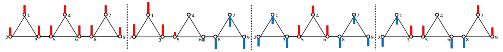
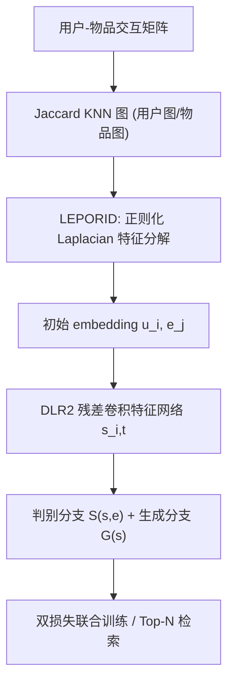
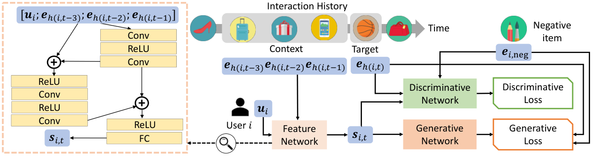

# Initialization Matters: Regularizing Manifold-informed Initialization for Neural Recommendation Systems (初始化至关重要：面向神经推荐系统的流形感知正则化初始化)

- **会议/期刊**: KDD 2021 (27th ACM SIGKDD)
- **作者与机构**: Yinan Zhang, Boyang Li, Yong Liu, Hao Wang, Chunyan Miao（南洋理工大学 / 阿里巴巴-南洋理工联合研究院 / 阿里巴巴集团）
- **推荐链路定位**: 召回（Embedding 初始化层，正交于任意召回/排序骨干）
- **研究方向**: 协同过滤与双塔召回 / 序列与会话推荐
- **论文原文**: [https://arxiv.org/abs/2106.04993v2](https://arxiv.org/abs/2106.04993v2)
- **开源代码**: 暂未开源（校验链接指向基线 NetMF 仓库，非本文实现）

## TL;DR (1分钟核心速览)

本文针对"随机初始化使神经推荐系统甚至打不过 KNN"这一痛点，提出 **LEPORID** 初始化：在用户/物品 KNN 图上用拉普拉斯特征映射（LE）注入多尺度流形邻域信息，并按节点度数做自适应岭正则以压制长尾高方差；再配一个残差卷积特征网络 + 判别/生成双损失的 **DLR2** 模型。在 ML-1M / Steam / Anime 三数据集、时间切分 + 全库未交互候选排序协议下，DLR2+LEPORID 在 ML-1M 的 F1@10 上相对最强神经基线（HGN+LEPORID）提升 **45.3%**、相对最强传统基线（UserKNN）提升 **52.4%**。

## Background & Motivation (背景与核心矛盾)

- **主流范式**: 推荐主流做法是随机初始化 user/item embedding（Gaussian $\mathcal{N}(0,0.01^2)$），或用 BPR/SVD/NetMF/node2vec/Graph-Bert 预训练后再微调；骨干网络从 NCF、NGCF/DGCF 到 HGN 等序列模型。
- **前人局限**: ① 文献 [8] 指出调优良好的 UserKNN/ItemKNN 常反超复杂神经模型，说明神经模型未利用数据流形上的邻域结构；② 理论结果（收敛点靠近初始化点）意味着随机初始化的网络很难自行"长"出邻域几何；③ 而基于预训练的初始化要么依赖 side information（用户画像、视觉特征），要么训练代价高、收敛难调。
- **核心洞察 (Key Insight)**: 图 1 显示 LE 的前若干维天然把图按由粗到细的粒度切分（第 2 维分两簇、第 3 维分三簇），即 LE 本身就是多尺度邻域编码器；但图 2 进一步揭示 KNN 图的边是由不等量数据估计出来的——低度节点增加一条边，其 LE embedding 的 $\ell_2$ 变化远大于高度节点，说明尾部节点 embedding 方差高、不可靠。
- **本文切入点**: 保留 LE 的流形结构优势，用与 $(d_{\max}-d_i)$ 成正比的岭项给孤立节点做"自适应方差缩减"，得到 LEPORID。

<figure class="paper-figure" markdown="span">
  <figcaption>图1：由Laplacian Eigenmaps（LE）生成的节点嵌入。我们按从左到右的顺序依次展示前四个嵌入维度，以条形覆盖在每个节点上。正值/负值分别用红色/蓝色表示，条形长度表示绝对值。我们观察到在后续维度中相邻节点之间的波动更大。</figcaption>
</figure>

## Method (核心方法设计)

### 1. 整体框架 (Overall Architecture)

LEPORID 是一个**离线、与模型无关**的初始化步骤：先用交互集合的 Jaccard 相似度分别构建用户图与物品图（互为 top-$K$邻居才连边，权重为 Jaccard 值），在该图上求解带流行度正则的归一化拉普拉斯特征分解，取最小$D$个特征向量组成$\tilde{Q}\in\mathbb{R}^{N\times D}$作为初始 embedding；随后把 embedding 交给下游任意神经推荐器联合训练。DLR2 是该初始化的"最佳搭档"：输入$[\,\boldsymbol{u}_i;\boldsymbol{e}_{h(i,t-3)};\boldsymbol{e}_{h(i,t-2)};\boldsymbol{e}_{h(i,t-1)}\,]$经两层残差卷积块得到状态$\boldsymbol{s}_{i,t}$，再分叉到判别分支$\mathcal{S}$与生成分支$\mathcal{G}$ 做联合打分/回归。

<figure class="paper-figure" markdown="span">
  <figcaption>图3：网络架构，包括特征网络，其馈入两个分支：判别网络和生成网络。特征网络采用左侧框中的残差结构。</figcaption>
</figure>

### 2. 关键设计拆解 (Key Designs)

1. **LEPORID：把"数据不足"写进目标函数**。原 LE 只最小化 $\tfrac12\sum_{i,j}W_{ij}(q_i-q_j)^2$，当$d_i$很小时几乎所有$W_{ij}\approx 0$，$q_i$几乎不受约束、方差极大。LEPORID 增加$\alpha\sum_i (d_{\max}-d_i)q_i^2$，矩阵形式为$\boldsymbol{q}^{(k)}=\arg\min_{\boldsymbol{q}}\boldsymbol{q}^{\top}\big((1-\alpha)D-W+\alpha d_{\max}I\big)\boldsymbol{q}$，即$L_{\text{reg}}$。由于$d_{\max}\ge d_i$保证半正定，仍可用特征分解求解；概率视角上等价于给$q_i$ 加一个方差随度数自适应的高斯先验，度数越低收缩越强。
2. **DLR2 的残差特征网络：让初始化信息"活着"穿过网络**。作者引用残差网络输出在特定条件下可逆（含输入全部信息）的结论，用两层 Conv+ReLU 残差块而非纯 MLP，使 LE 携带的流形几何不被多层非线性快速冲刷掉；消融显示"无卷积"与"无残差"都显著掉点，而强可逆的 RevNet 与 DLR2 表现相当，佐证"可逆性利于利用好初始化"的假设。
3. **判别 + 生成双损失的互补监督与推理开销**。判别分支输出距离，用 square-square loss $\mathcal{L}_{S}=\mathbb{E}\big[\mathcal{S}(\boldsymbol{s},\boldsymbol{e}_{pos})^2+(\max(m_S-\mathcal{S}(\boldsymbol{s},\boldsymbol{e}_{neg}),0))^2\big]$；生成分支直接回归目标 embedding，用 hinge loss$\mathcal{L}_{G}=\mathbb{E}\big[\max(\lVert G(\boldsymbol{s})-\boldsymbol{e}_{pos}\rVert_2-\lVert G(\boldsymbol{s})-\boldsymbol{e}_{neg}\rVert_2+m_G,0)\big]$；总损失$\mathcal{L}=\mathcal{L}_{S}+\mathcal{L}_{G}$。负样本为**均匀随机采样**（每正样本 1 个负样本，无难负样本挖掘、无 in-batch 共享）；在线推理可用生成分支直接出向量做 ANN 检索，或用判别分支对候选打分。初始化开销方面，利用 KNN 图稀疏性（稀疏度$>1-2K^2/N^2$），用 Implicit Restarted Lanczos 求解前$D$个特征向量，复杂度$O(K^2D\kappa)$与$N$无关：Anime 的$47143\times47143$ 用户图求 64 维特征向量仅需 172 秒，而 BPR 收敛需 1888 秒。

## Experimental Setup & Evaluation Protocol (实验设置与评估协议)

- **数据集与预处理**: 仅保留交互数 $\ge 20$ 的用户与物品（类似 20-core 过滤），并统计尾部 25% 用户/物品的交互占比：

| 数据集 | #Users | #Items | #Interactions | 稀疏度/密度 | 特征/场景说明 |
| :--- | :---: | :---: | :---: | :---: | :--- |
| ML-1M | 6,040 | 3,650 | 1,000,127 | 密度 4.54% | 电影评分，尾部用户交互占 4.51%、尾部物品仅 1.08% |
| Steam | 33,699 | 6,253 | 1,470,329 | 密度 0.70% | 游戏平台，最稀疏；尾部用户交互占 11.67% |
| Anime | 47,143 | 6,535 | 6,143,751 | 密度 1.99% | 动漫社区，规模最大；尾部物品仅 0.93% |

- **数据划分与防穿越 (Splitting Strategy)**: **全局时间戳切分**——每个用户前 70% 交互训练、次 10% 验证、末 20% 测试；测试时从候选集中剔除训练集与验证集中已交互物品。
- **排名评测协议 (Ranking Protocol)**: 近似 **Full-Ranking**（对"未在训练/验证中出现过的全部物品"排序，非采样负例），指标为 HR@5/10 与 F1@5/10（F1 为 precision-recall 调和平均，作者称其比 accuracy 更能反映错分）。
- **对比基线与超参设置**: 传统侧 TopPop、UserKNN、ItemKNN、SLIM、BPR；神经侧 NCF、NGCF、DGCF、HGN，加上本文 DLR2；初始化侧对比 Random / SVD / BPR / NetMF / node2vec / Graph-Bert（无 side info）/ LE。embedding 维度 $D$与各基线超参见原文附录；正则系数$\alpha=0.7$最优，邻居数$K$ 敏感性低；未报告显著性检验。

## Key Experimental Results (实验关键数据)

### 1. 主实验对比 (Main Results)

| 方法 | 初始化 | ML-1M HR@10 | ML-1M F1@10 | Steam HR@10 | Steam F1@10 | Anime HR@10 | Anime F1@10 |
| :--- | :--- | :---: | :---: | :---: | :---: | :---: | :---: |
| TopPop | – | 0.4377 | 0.0517 | 0.2306 | 0.0307 | 0.6103 | 0.0807 |
| UserKNN | – | 0.5419 | 0.0760 | 0.2575 | 0.0357 | 0.5899 | 0.0802 |
| ItemKNN | – | 0.5235 | 0.0682 | **0.2720** | **0.0385** | 0.7431 | 0.1204 |
| SLIM | – | 0.5253 | 0.0680 | 0.2588 | 0.0354 | 0.7132 | 0.1011 |
| BPR | random | 0.1581 | 0.0171 | 0.2348 | 0.0338 | 0.0800 | 0.0114 |
| NGCF | LEPORID | 0.5258 | 0.0667 | 0.2084 | 0.0277 | 0.6401 | 0.1014 |
| HGN | LEPORID | 0.5475 | 0.0797 | 0.2745 | 0.0380 | 0.6488 | 0.0902 |
| DLR2 | LE | 0.6730 | 0.1070 | 0.2878 | 0.0420 | 0.7438 | 0.1409 |
| **DLR2** | **LEPORID** | **0.7026** | **0.1158** | **0.2994** | **0.0437** | **0.7654** | **0.1421** |
| **Improv.** | – | +29.4% | **+45.3%** | +8.8% | **+13.7%** | +3.0% | **+18.0%** |

（`Improv.` 为相对该数据集最强基线：ML-1M 对 HGN+LEPORID，Steam 对 ItemKNN，Anime 对 ItemKNN；若对最强传统基线 UserKNN，ML-1M F1@10 提升达 **52.4%**。）

### 2. 消融实验 (Ablation Study)

| 消融维度 | 变体 | HR@10 | F1@10 |
| :--- | :--- | :---: | :---: |
| 双损失 (ML-1M) | w/o $\mathcal{L}_S$（仅生成分支） | 0.4982 | 0.0601 |
| 双损失 (ML-1M) | w/o $\mathcal{L}_G$（仅判别分支） | 0.6826 | 0.1112 |
| 双损失 (ML-1M) | Full ($\mathcal{L}_S+\mathcal{L}_G$) | **0.7026** | **0.1158** |
| 初始化 (ML-1M, DLR2) | Random | 0.4538 | 0.0497 |
| 初始化 (ML-1M, DLR2) | SVD | 0.5820 | 0.0775 |
| 初始化 (ML-1M, DLR2) | BPR | 0.6273 | 0.0979 |
| 初始化 (ML-1M, DLR2) | node2vec | 0.6603 | 0.1011 |
| 初始化 (ML-1M, DLR2) | LE | 0.6730 | 0.1070 |
| 初始化 (ML-1M, DLR2) | **LEPORID** | **0.7026** | **0.1158** |

| 尾部用户子集 (DLR2) | ML-1M HR@5 / F1@10 | Steam HR@5 / F1@10 | Anime HR@5 / F1@10 |
| :--- | :---: | :---: | :---: |
| Random | 0.1490 / 0.0382 | 0.0817 / 0.0212 | 0.3209 / 0.0732 |
| SVD | 0.2623 / 0.0722 | 0.0704 / 0.0155 | 0.2989 / 0.0765 |
| LE | 0.3192 / 0.0880 | 0.0973 / 0.0258 | 0.3617 / 0.0955 |
| **LEPORID** | **0.3536 / 0.1045** | **0.1240 / 0.0321** | **0.3953 / 0.1195** |
| 相对 LE 提升 | +10.8% / +18.7% | +27.4% / +24.4% | +9.3% / +25.1% |

### 3. 关键实验发现 (Key Findings)

1. **初始化是神经推荐的第一性变量，而非骨干架构**：NCF 在 ML-1M 上 F1@10 从随机初始化的 0.0044 跃升至 LEPORID 的 0.0561（超 10 倍），且在 ML-1M/Steam 上 LEPORID 初始化的普通神经模型即可反超调优 KNN，直接反驳"神经推荐不如 KNN"的结论。
2. **LEPORID 对已用图信息的模型依然互补**：NGCF 在 Anime 的 F1@10 相对其最佳基线（SVD 初始化）提升 **67.02%**，DGCF 提升 **31.50%**，说明空间消息传递与谱域流形初始化捕捉的是不同信号。
3. **正则项精确命中长尾**：在交互最少 25% 用户上，LEPORID 相对 LE 的提升（Steam HR@5 +27.4%、Anime F1@10 +25.1%）明显大于全集提升幅度，验证"$(d_{\max}-d_i)$ 加权收缩"确实在做方差缩减；同时双损失协同也高度非对称——给仅生成分支补上判别损失可涨 F1@10 **68.41%**，反方向只涨 **4.19%**。

## Highlights & Limitations (亮点、对比与审稿批判)

- **与代表作对比 (vs. Prior Work)**: 相比 DelfCF/[8] 的"KNN 胜过神经模型"诊断，本文给出了可操作的解法而非仅报告现象；相比 NetMF/node2vec/Graph-Bert 等预训练初始化，LEPORID 不依赖 side information、有闭式收敛保证且复杂度与 $N$ 解耦（172s vs 1888s）；相比 NGCF/DGCF 这类空间域图卷积，它作用在谱域且作为初始化与任意骨干正交组合。
- **可迁移亮点**: ①"度数自适应岭正则"可无缝搬到 LightGCN 的邻接归一化、矩阵分解的隐向量先验、乃至冷启动 item embedding 收缩估计；②"用残差/可逆结构保住初始化信息"是低成本 trick，可加在任意深层序列模型底部。
- **审稿级局限批判**: ① 序列骨干只对比了 HGN，缺少 SASRec/BERT4Rec 等更强序列基线，DLR2 的相对优势可能被架构代差解释；② 评测仅用 HR/F1，未报 NDCG@K，也未做显著性检验，且 KNN 图构建的 $O(N^2)$相似度搜索在千万级用户工业场景仍是瓶颈（需 ANN 近似）；③$\alpha=0.7$ 为单数据集网格搜出的最优值，跨域稳健性存疑，正则强度与图稀疏度的耦合关系未做理论刻画。

## Rating (四维评分)

- **方法创新性 (Novelty)**: ⭐⭐⭐⭐ （把"KNN 图边由不等量数据估计"这一统计事实转化为度数自适应岭正则，洞察清晰、推导干净，但本质仍是 LE + Tikhonov 正则的组合式创新）
- **评估协议与实验扎实度 (Protocol & Experiments)**: ⭐⭐⭐⭐ （三域数据集 + 时间切分 + 未交互全库排序 + 6 种初始化 × 5 种骨干的交叉矩阵实验很扎实，但缺显著性检验与 NDCG）
- **写作与数学规范度 (Clarity & Rigor)**: ⭐⭐⭐⭐⭐ （LE→LEPORID 的半正定性与概率先验双视角解释完整，复杂度与收敛性有明确交代，图 1/图 2 的动机可视化极有说服力）
- **工业落地与复现价值 (Industrial & Practical Value)**: ⭐⭐⭐⭐ （初始化与模型解耦、稀疏特征分解秒级完成，落地门槛低；但未开源，且大规模 KNN 构图需自行替换为 ANN 方案）

