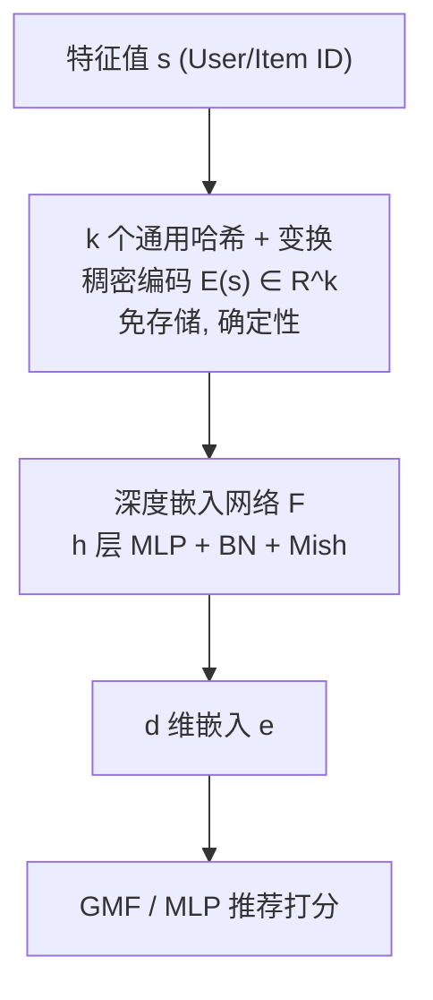
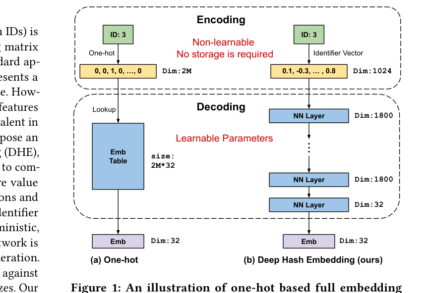

# Learning to Embed Categorical Features without Embedding Tables for Recommendation (无需嵌入表：为推荐系统学习类别特征嵌入)

- **会议/期刊**: KDD 2021 (Research Track)
- **作者与机构**: Wang-Cheng Kang, Derek Zhiyuan Cheng, Tiansheng Yao, Xinyang Yi, Ting Chen, Lichan Hong, Ed H. Chi (Google Research, Brain Team)
- **推荐链路定位**: 召回（用户/物品 ID 嵌入层，可下沉至任意精排 ID 特征）
- **研究方向**: 协同过滤与双塔召回 / 冷启动与长尾推荐
- **论文原文**: [arXiv:2010.10784v2](https://arxiv.org/abs/2010.10784v2)
- **开源代码**: 暂未开源

## TL;DR (1分钟核心速览)

针对工业推荐系统中「十亿级 ID 嵌入表占数百 GB、新 ID 无法上线」的痛点，本文提出 Deep Hash Embedding (DHE)：用 $k$ 个通用哈希函数把特征值映射为**稠密、实数、唯一、免存储**的编码向量，再用 5 层 MLP 在线"即时计算"嵌入，彻底删除嵌入表与查表操作。在 ML-20M / Amazon Books 上以 GMF/MLP 为骨干、仅用 **1/4 全量模型参数**即达到与 one-hot 全量嵌入相当的 AUC（97.67 vs. 97.67），并全面优于 Hashing Trick、Bloom、HashEmb、Hybrid Hashing 等哈希基线，且天然支持 OOV 与侧信息增强。

## Background & Motivation (背景与核心矛盾)

- **主流范式**: 类别特征（User/Item ID）一律走 one-hot 编码 + 嵌入表查表，数学上等价于一个**单层超宽网络** $e = \mathbf{W}^{\top}\mathbf{b}$，其中$\mathbf{b}\in\{0,1\}^n$。
- **前人局限**: (i) 表大小 $O(nd)$随词表线性膨胀，1B 视频 ID × 100 维≈400GB；(ii) 在线学习中新 ID 无对应行，OOV 只能置零或随机初始化。哈希技巧用$m \ll n$个桶压表，但**碰撞不可避**，$m<n$时平均每行被$\lceil n/m \rceil$ 个 ID 共享。
- **核心洞察 (Key Insight)**: 作者系统提出好编码的四条性质——**唯一性 (Uniqueness)、等相似性 (Equal Similarity)、高维性 (High Dimensionality)、高香农熵 (High Shannon Entropy)**——并指出无任何已有方案同时满足：one-hot 熵极低（每维几乎恒为 0），二元编码引入"ID 8 比 ID 7 更像 ID 9"的**错误归纳偏置**，double hashing 的碰撞对天然更相似，identity 编码维度仅 1。
- **本文切入点**: 既然解码端可以是深网络，编码端就不必是 one-hot；用"多哈希稠密实值编码 + 深窄 MLP"同时在保证无碰撞的前提下把参数量与词表规模 $n$ **解耦**。

## Method (核心方法设计)

### 1. 整体框架 (Overall Architecture)

沿用 $T = F\circ E$的编码-解码抽象：编码函数$E:\mathbb{N}\to\mathbb{R}^{k}$完全确定性、不可学习、零存储，把 ID 变成$k$维稠密向量；解码函数$F:\mathbb{R}^{k}\to\mathbb{R}^{d}$是一个带 BN 与 Mish 的$h$层前馈网络，输出$d$ 维嵌入后送入 GMF/MLP 推荐骨干端到端训练。全流程无嵌入表、无查表，训练与推理均在 GPU/TPU 上以矩阵乘完成；新 ID 只需重算哈希即可立即获得嵌入。

<figure class="paper-figure" markdown="span">
  <figcaption>图1：基于one-hot的全嵌入与Deep Hash Embedding（DHE）为2M个ID生成32维嵌入的示意图。维度数字来自我们的实验，用于提供一个具体示例。两个模型取得相似的AUC，而DHE的模型大小仅为全模型的1/4。DHE使用稠密哈希编码为每个特征值获得唯一标识符，并应用深度嵌入网络生成特征嵌入。DHE不执行任何嵌入查找。</figcaption>
</figure>

### 2. 关键设计拆解 (Key Designs)

1. **稠密哈希编码 (Dense Hash Encoding)**：为同时满足四条性质，采用 $k$个通用哈希（实验中$k=1024$，桶数$m=10^6$）生成整数编码$h_i = ((a_i s + b_i) \boldsymbol{o}d p)\boldsymbol{o}d m$，再线性归一化到$[-1,1]$（或经 Box–Muller 变换近似$\mathcal{N}(0,1)$）：$\text{enc}_i = 2\cdot\frac{h_i-1}{m-1}-1$。碰撞空间达$m^k$，唯一性近乎严格成立；各维独立均匀分布使每维熵取到最大值$\log m$；且任意两 ID 的期望欧氏距离为常数，不引入语义偏置。物理直觉：这等价于给网络喂一个"确定性随机种子"，取代 GAN 中的噪声输入。
2. **深度嵌入网络 (Deep Embedding Network)**：one-hot 查表是 1 层宽网络，而哈希编码→嵌入是高非线性变换，必须用深窄网络记忆。参数量 $O(k d_{\text{NN}} + (h-1)d_{\text{NN}}^2 + d_{\text{NN}}d)$与$n$、$m$ 完全无关。由于 ReLU 网络是分段线性函数、表达力不足，作者实测发现该模块瓶颈是**欠拟合**而非过拟合（dropout 反而有害），最终选定 Mish + BatchNorm（ReLU 97.47 → Mish+BN 97.67）。
3. **侧特征增强编码与训练目标**：将 20 维 Genre 二值向量与哈希编码拼接，使 $E(s)=[\text{enc}(s);\text{side}(s)]$——哈希编码负责**记忆身份**，侧特征负责**泛化相似性**。整体损失沿用 BPR/交叉熵类成对目标，端到端联合优化推荐骨干与嵌入网络，**无需任何负采样策略改造**（负样本沿用原骨干设置）；推理端为$O(k)$ 次哈希 + 前向 MLP。

## Experimental Setup & Evaluation Protocol (实验设置与评估协议)

- **数据集与预处理**:

| 数据集 | #Users | #Items | 总词表 | #Interactions | 稀疏度 | 说明 |
| :--- | :---: | :---: | :---: | :---: | :---: | :--- |
| Movielens-20M | 138K | 27K | 165K | 20M | 99.47% | 稠密评分，含 20 维 Genre 侧特征 |
| Amazon Books | 1.9M | 0.7M | 2.6M | 27M | 99.99% | 2018 版 5-core，极高稀疏 |

- **数据划分与防穿越**: 全局时间戳切分——按时间排序后，**每个用户留最后两个交互**分别作验证集与测试集，其余全部训练（`Leave-Last-Two-Out`）；所有评分均视为观测到的隐式反馈。
- **排名评测协议**: 非 Full-Ranking，采用**成对 AUC**（正样本 vs. 未交互样本排序正确的概率），随机猜测 AUC=0.5；所有结果为 5 次实验均值。
- **对比基线与超参设置**: 骨干为 GMF（浅层）与 3 层 MLP（[256,128,64]）；基线含 One-hot Full、Hashing Trick、Bloom Embedding、HashEmb、Hybrid Hashing、Compositional Embedding（默认 $k=2$，Full 为唯一不压参数者）。嵌入维度$d=32$（在$\{8,16,32,64\}$中搜索），Adam，lr=0.001，单卡 V100；DHE 统一$k=1024$、5 层等宽 MLP、$m=10^6$。原文未报告显著性检验。

## Key Experimental Results (实验关键数据)

### 1. 主实验对比 (Main Results)

ML-20M、$d=32$、参数量约为 Full Embedding 的 1/4（多哈希类方法取$k$ 见注）：

| 方法 | GMF AUC(%) | MLP AUC(%) | 相对 Full 参数 |
| :--- | :---: | :---: | :---: |
| One-hot Full Embedding | 97.64 | 97.67 | 1×（≈5M） |
| Hash Emb ($k=2$) | 97.34 | 97.42 | 1/4 |
| Hybrid Hashing ($k=2$) | 97.22 | 97.31 | 1/4 |
| Bloom Emb ($k=1024$) | – | 97.39 | 1/4 |
| **DHE (ID only, $k=1024$)** | **97.66** | **97.67** | 1/4 |
| **DHE + Genres 增强** | **97.71** | **97.73** | 1/4 |

> Hashing Trick 与 Compositional Embedding 仅在原文图 2 以曲线呈现：Hashing Trick 在小模型下显著劣化（碰撞伤害），Compositional 在 Amazon 极稀疏场景略优于 DHE。Amazon Books 上 Full Embedding 需 ≈80M 参数，DHE 在 1/4 预算下曲线与 Full 基本重合。

### 2. 消融实验 (Ablation Study)

| 消融维度 | 设置 | GMF | MLP |
| :--- | :--- | :---: | :---: |
| 编码方案 | Identity (1 维) | 94.99 | 95.01 |
| | Random Fourier | 94.98 | 94.99 |
| | Binary ($\lceil\log n\rceil$) | 97.38 | 97.36 |
| | Dense Hash-Gaussian | 97.62 | 97.66 |
| | **Dense Hash-Uniform** | **97.66** | **97.68** |
| 激活/归一化 | ReLU, w/o BN | 97.33 | 97.47 |
| | Mish, w/o BN | 97.43 | 97.50 |
| | ReLU + BN | 97.54 | 97.59 |
| | **Mish + BN** | **97.66** | **97.67** |
| 网络结构 | Pyramid MLP | 97.20 | 97.49 |
| | DenseNet-like MLP | 97.53 | 97.50 |
| | Residual 等宽 MLP | 97.61 | 97.60 |
| | **等宽 MLP (5 层)** | **97.66** | **97.68** |
| 哈希数 $k$ | 8 / 32 / 128 / 1024 / 2048 | – | 96.77 / 97.44 / 97.58 / **97.67** / 97.65 |

### 3. 关键实验发现 (Key Findings)

1. **编码是主因，网络是次因**：稠密哈希编码把 AUC 从 Identity 的 95.01 提升到 97.68（+2.67 pt），超过 BN+Mish 带来的全部增益（+0.20 pt）；而 Binary 编码因引入 ID 序关系偏置损失 0.3 pt，直接验证了"等相似性"性质的必要性。
2. **可扩展的 $k$是 DHE 独有红利**：$k\le 8$时 DHE 落后（编码仅$k$维，短于 one-hot 哈希的$m\cdot k$），$k\ge 32$反超；Bloom/Hybrid 在$k=32$达峰后随$k$增大反而下滑（97.43→97.28），因共享嵌入表使碰撞随$k$ 放大，而 DHE 无表可碰。
3. **侧特征确实带来泛化而非仅仅是"多一路输入"**：只用 Genres 做编码 AUC 崩到 79.17（完全丢失身份），哈希+Genres 比仅 MLP 侧输入略优（97.72 vs. 97.67），说明 DHE 的物品嵌入已隐式吸收了类型语义；但两处并用无进一步增益。
4. **效率代价明确**：1M 次查询（batch=100）GPU 上前向耗时 Full 3.4s、HashEmb 6.1s、DHE 27.2s（约 9×/4.5× 慢），但 DHE 从 CPU 到 GPU 提速 64%，而查表类仅 1%，预示其随算力提升可持续受益。

## Highlights & Limitations (亮点、对比与审稿批判)

- **与代表作对比 (vs. Prior Work)**: 与 Hashing Trick / Bloom / Hybrid Hashing 的本质区别在于**编码是否为 one-hot**——前者在 $m$桶 one-hot 上做"共享行的碰撞抵扣"，DHE 改用$m^k$空间稠密编码，从根上消除碰撞且使$k$可无痛放大；与 Compositional Embedding 相比，后者靠 quotient-remainder 双哈希 + 小 MLP 修补碰撞，DHE 则完全取消表与查表。相对全量嵌入，DHE 是把"1 层宽网络"换成"$h$ 层窄网络"的参数效率路线。
- **可迁移亮点**: (i) 四性质（唯一/等相似/高维/高熵）可作为**任何 ID 表征方案的评估清单**；(ii) 确定性哈希编码 + Box–Muller 变换这套"确定性随机种子"技巧，可直接迁移到序列推荐的位置编码、生成式推荐语义 ID 的初始化、或联邦场景下的免表参数化。
- **审稿级局限批判**: (i) 仅用 AUC 单一指标、无 Recall@K/NDCG 与 Full-Ranking 协议，且两数据集仍属中小规模（2.6M 词表），对"十亿级"工业宣称缺乏线上验证；(ii) 推理成本 9× 于查表，对延迟敏感的在线服务仍需混合方案；$k$、深度、激活均为经验搜索，未给理论最优；(iii) 每 ID 的"隐式容量"不可控，长尾 ID 的表达质量缺乏分桶实验支撑。

## Rating (四维评分)

- **方法创新性 (Novelty)**: ⭐⭐⭐⭐ （把"嵌入表=1 层宽网络"这一视角讲透并给出四性质编码公理，DHE 的免表参数化在 2021 年属开创性，但核心仍是对哈希技巧的工程化重构）
- **评估协议与实验扎实度 (Protocol & Experiments)**: ⭐⭐⭐ （5 次均值、双骨干双数据集较稳，但仅 AUC、无显著性检验、无全库排序与长尾分桶，工业规模论断缺证据）
- **写作与数学规范度 (Clarity & Rigor)**: ⭐⭐⭐⭐⭐ （编码四性质有附录形式化定义与碰撞/熵/欧氏距离推导，$O(\cdot)$ 复杂度清晰，消融层次分明）
- **工业落地与复现价值 (Industrial & Practical Value)**: ⭐⭐⭐⭐ （免表、支持 OOV 与在线学习、可吃 GPU 加速红利，对存储受限场景价值高；但无开源且推理慢 9× 限制线上直接替换）

