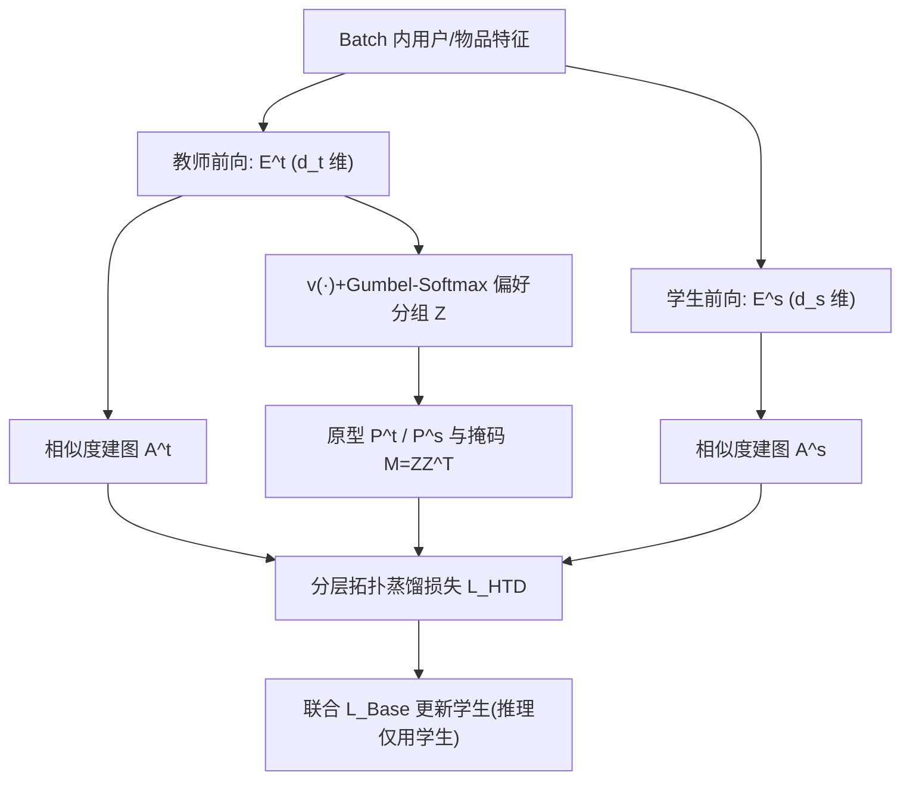
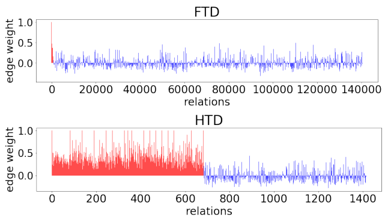
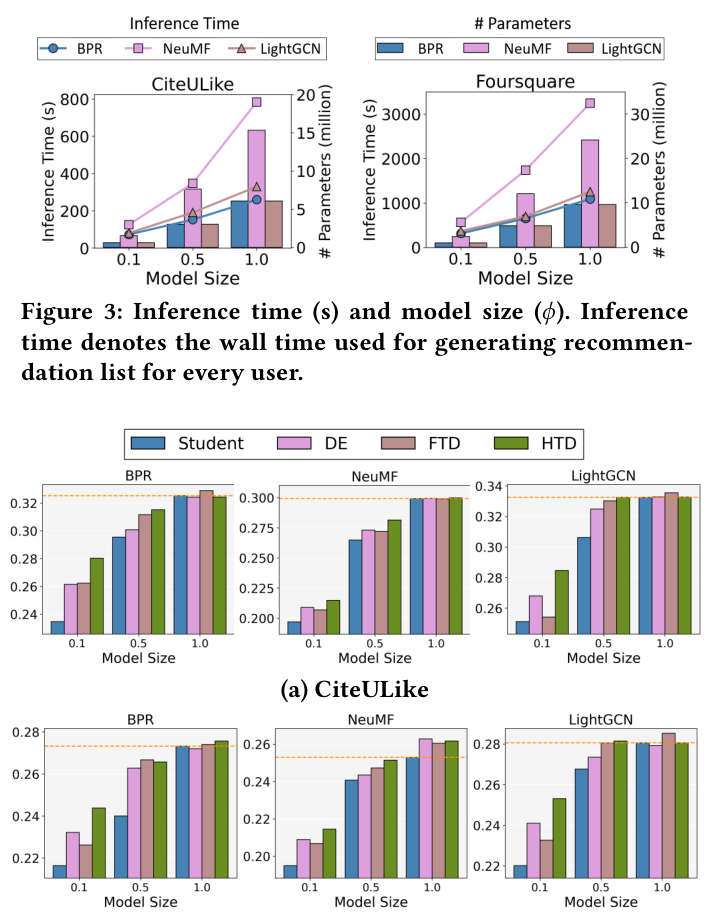

# Topology Distillation for Recommender System (推荐系统拓扑蒸馏)

- **会议/期刊**: KDD 2021（9 页正文 + 2 页附录）
- **作者与机构**: SeongKu Kang, Junyoung Hwang, Wonbin Kweon, Hwanjo Yu（POSTECH，韩国）
- **推荐链路定位**: 召回（轻量学生模型在线服务，教师离线训练）
- **研究方向**: 协同过滤与双塔召回 / 图神经网络推荐
- **论文原文**: [https://arxiv.org/abs/2106.08700v1](https://arxiv.org/abs/2106.08700v1)
- **开源代码**: [https://github.com/changun/CollMetric](https://github.com/changun/CollMetric)

## TL;DR (1分钟核心速览)

现有推荐蒸馏（FitNet / DE）只做**逐点 hint regression**，把每个实体的表示单独对齐，忽略了推荐系统真正有价值的信息——表示空间中的**相对关系**。本文先把教师空间的关系建成加权拓扑图，用 Full Topology Distillation (FTD) 直接对齐整张图，发现学生容量不足时反而掉点；进而提出 HTD，用 Gumbel-Softmax 自适应分组，把拓扑拆成「组级原型关系 + 组内实体级关系」两级蒸馏。在 CiteULike / Foursquare × BPR/NeuMF/LightGCN 上改用**严格 Full-Ranking**协议，Recall@50 相对 DE 提升 3.0%–7.2%，相对无蒸馏学生提升 9.0%–19.4%。

## Background & Motivation (背景与核心矛盾)

- **主流范式**: 用大教师 + 小学生的知识蒸馏（KD）压缩推荐模型，知识来源分两类——预测层（RD/CD/RRD 让学生模仿排序）与中间层（FitNet、DE 的 hint regression）。
- **前人局限**: ① 中间层方法**逐点对齐** $\mathbf{e}^t_i \approx f(\mathbf{e}^s_i)$，把「用户偏好是相对于其他用户/物品而存在」这一核心性质丢掉了；② DE 虽按偏好聚类后用多个$f_k$ 分开蒸馏，但仍只蒸馏个体表示，未约束空间几何。
- **核心洞察 (Key Insight)**: 作者实验观察到，直接让学生学**全拓扑**（FTD）并不总是有效，在 LightGCN+CiteULike 上 Recall@50 从 Student 的 0.2512 掉到 0.2542 以下的水平甚至低于 DE——因为师生容量差（$\phi=0.1$）过大，全部关系监督过于苛刻。
- **本文切入点**: 把拓扑**分层压缩**：跨组关系用原型汇总成概览，组内关系保留细粒度监督，让学生只聚焦真正影响 top-$N$ 排序的强相关关系。

## Method (核心方法设计)

### 1. 整体框架 (Overall Architecture)

输入为 batch 内的用户/物品特征，教师与学生分别前向得到表示矩阵 $\mathbf{E}^t\in\mathbb{R}^{b\times d_t}$、$\mathbf{E}^s\in\mathbb{R}^{b\times d_s}$（$d_s \ll d_t$）。以余弦相似度在 batch 内构建两张全连接拓扑图$\mathbf{A}^t,\mathbf{A}^s$；同时用小网络$v(\cdot)$+ Gumbel-Softmax 把 batch 内实体软分配到$K$个偏好组，得到分配矩阵$\mathbf{Z}$，据此生成组级原型$\mathbf{P}^t,\mathbf{P}^s$与组内掩码$\mathbf{M}=\mathbf{Z}\mathbf{Z}^\top$。蒸馏损失与基模型损失联合优化，$v$与$f_k$ 仅在离线训练使用，**推理阶段仅保留小学生模型**，无额外开销。

### 2. 关键设计拆解 (Key Designs)

1. **全拓扑蒸馏 FTD（把「关系」变成监督信号）**：以余弦相似度为边权 $a^t_{ij}=\rho(\mathbf{e}^t_i,\mathbf{e}^t_j)$建图，用 Frobenius 距离对齐整张邻接矩阵$\mathcal{L}_{FTD}=\|\mathbf{A}^t-\mathbf{A}^s\|_F^2$。它首次把「谁和谁像」而非「谁是什么」作为知识，但要求学生一次吞下$b\times b$ 条关系，容量差大时监督过载，实验中甚至不如 DE。

2. **分层拓扑 HTD（用原型压缩跨组关系）**：核心是「组内细看、组间粗看」。组级拓扑不走 $|G_1|\times|G_2|$的全部跨组边，而用原型$\mathbf{P}^t=\tilde{\mathbf{Z}}^\top\mathbf{E}^t$表示组，只蒸馏原型与**异组**实体的关系$h^t_{kj}=\rho(\mathbf{P}^t[k,:],\mathbf{e}^t_j),\ j\notin G_k$（即 Group(P,e)，比 Group(P,P) 保留更多信息）；组内则用$\mathbf{M}=\mathbf{Z}\mathbf{Z}^\top$做掩码，仅对齐同组实体间的全部细粒度关系$\|\mathbf{M}\odot(\mathbf{A}^t-\mathbf{A}^s)\|_F^2$。直觉是跨组弱相关边对 top-$N$ 排序贡献小，压缩后学生把有限容量投给强相关邻居。

<figure class="paper-figure" markdown="span">
  <figcaption>图2：FTD 和 HTD（采用 Group(P,e)）从教师蒸馏到学生的关系知识。红色/蓝色分别对应属于相同/不同偏好组的实体的关系（在 CiteULike 上的 BPR）。</figcaption>
</figure>

3. **训练目标与效率**：总损失 $\mathcal{L}=\mathcal{L}_{Base}+\lambda_{TD}\mathcal{L}_{HTD}$，其中
$$\mathcal{L}_{HTD}=\gamma\big(\|\mathbf{H}^t-\mathbf{H}^s\|_F^2+\|\mathbf{M}\odot(\mathbf{A}^t-\mathbf{A}^s)\|_F^2\big)+(1-\gamma)\sum_{i=1}^{b}\Big\|\mathbf{e}^t_i-\sum_{k=1}^{K}z_{ik}f_k(\mathbf{e}^s_i)\Big\|_2^2$$
第二项沿用 DE 的 hint regression 以保证分组过程可微并可反传更新 $v$。$\gamma=0.5$ 时退化为 DE；负采样沿用基模型 BPR 的均匀采样，无额外负样本构造；蒸馏仅发生在 batch 内，**推理成本与学生独立训练完全相同**。

## Experimental Setup & Evaluation Protocol (实验设置与评估协议)

- **数据集与预处理**: 沿用 DE [8] 的 CiteULike（物品带标签）与 Foursquare（物品带 GPS 坐标），正文未列表格，统计量与过滤阈值见原文附录。

| 数据集 | #Users | #Items | #Interactions | 稀疏度/密度 | 特征/场景说明 |
| :--- | :---: | :---: | :---: | :---: | :--- |
| CiteULike | 见附录 | 见附录 | 见附录 | — | 物品 tag 侧信息，用于 Tag Retrieval 下游任务 |
| Foursquare | 见附录 | 见附录 | 见附录 | — | 物品 GPS 坐标，用于 Region Classification 下游任务 |

- **数据划分与防穿越 (Splitting Strategy)**: 沿用 DE 的开源划分设置（具体细节见附录）；未做冷启动专用切分。
- **排名评测协议 (Ranking Protocol)**: **无偏 Full-Ranking（全库未交互物品排序）**——这是本文相对 DE 的关键协议升级（DE 采用采样负例评测），指标 Recall@{10,20,50}、NDCG@{10,20,50}；显著性用 paired t-test，$p<0.05$。
- **对比基线与超参**: 基线为 Student（无蒸馏）、FitNet（原始 hint regression）、DE（SOTA，分组 $f_k$蒸馏）、FTD（本文）；基模型 BPR / NeuMF / LightGCN，学生规模$\phi\in\{0.1,0.5,1.0\}$，$K\approx30\text{–}40$，$\lambda_{TD}\approx10^{-3}$，batch size 210，$\gamma=0.5$。

## Key Experimental Results (实验关键数据)

### 1. 主实验对比 (Main Results)

$\phi=0.1$（学生容量为教师 10%），Recall@50 / NDCG@50：

| 数据集 / 基模型 | Student | FitNet | DE | FTD | **HTD** | Improv. vs DE |
| :--- | :---: | :---: | :---: | :---: | :---: | :---: |
| CiteULike + BPR | 0.2347/0.0864 | 0.2521/0.0924 | 0.2615/0.0960 | 0.2624/0.0953 | **0.2803/0.1031** | +7.2% / +7.4% |
| CiteULike + NeuMF | 0.1970/0.0697 | 0.2020/0.0723 | 0.2090/0.0736 | 0.2069/0.0733 | **0.2154/0.0772** | +3.1% / +4.8% |
| CiteULike + LightGCN | 0.2512/0.0944 | 0.2653/0.0969 | 0.2680/0.0988 | 0.2542/0.0926 | **0.2847/0.1075** | +6.2% / +8.8% |
| Foursquare + BPR | 0.2164/0.0809 | 0.2258/0.0845 | 0.2322/0.0856 | 0.2262/0.0857 | **0.2438/0.0921** | +5.0% / +7.6% |
| Foursquare + NeuMF | 0.1950/0.0653 | 0.2062/0.0729 | 0.2089/0.0741 | 0.2068/0.0719 | **0.2152/0.0770** | +3.0% / +3.9% |
| Foursquare + LightGCN | 0.2202/0.0834 | 0.2315/0.0872 | 0.2410/0.0910 | 0.2327/0.0884 | **0.2531/0.0956** | +5.0% / +5.1% |

### 2. 消融实验 (Ablation Study)

$\phi=0.1$，CiteULike / Foursquare 上 Recall@50 / NDCG@50：

| 变体 | BPR-CiteULike | LightGCN-CiteULike | BPR-Foursquare | LightGCN-Foursquare |
| :--- | :---: | :---: | :---: | :---: |
| FTD（全拓扑） | 0.2624/0.0953 | 0.2542/0.0926 | 0.2262/0.0857 | 0.2327/0.0884 |
| FTD+DE | 0.2650/0.0969 | 0.2572/0.0931 | 0.2339/0.0867 | 0.2335/0.0872 |
| **HTD（完整）** | **0.2803/0.1031** | **0.2847/0.1075** | **0.2438/0.0921** | **0.2531/0.0956** |
| w/o 组级（Entity only） | 0.2608/0.0968 | 0.2709/0.1010 | 0.2361/0.0871 | 0.2453/0.0910 |
| w/o 实体级（Group only） | 0.2619/0.0948 | 0.2596/0.0976 | 0.2349/0.0874 | 0.2432/0.0910 |
| Group(P,P) 替代 Group(P,e) | 0.2648/0.0982 | 0.2683/0.0987 | 0.2399/0.0887 | 0.2459/0.0909 |

### 3. 关键实验发现 (Key Findings)

1. **分层是必需的，不是锦上添花**：去掉组级或实体级任一分支，CiteULike+LightGCN 上 Recall@50 分别掉到 0.2596 / 0.2709（完整 0.2847，$\downarrow$8.8% /$\downarrow$4.8%），且单分支甚至略逊于带 DE 的 FTD+DE（0.2572）；说明「概览 + 细节」两级监督才有增益，而非任一层单独有效。
2. **容量差越小、全拓扑越香**：$\phi$从 0.1 升到 1.0 时 FTD 与 HTD 差距收窄，Foursquare+LightGCN($\phi=1.0$) 上 FTD 反超 HTD——验证 FTD 适合自蒸馏/大容量场景，HTD 专治极端压缩。
3. **表示语义也被一起修好**：下游 Tag Retrieval（Recall@10）上 BPR-linear 的 Teacher/Student/DE/HTD 为 0.3121/0.2421/0.2542/0.2635，Region Classification 为 0.6531/0.4222/0.5448/0.5653；且 HTD 在相似度分布上的平均 KL 散度（Most similar 与 Random 两组）均为最低，证明关系保持确实带来了更准确的物品语义编码。

## Highlights & Limitations (亮点、对比与审稿批判)

- **与代表作对比 (vs. Prior Work)**: 相比 FitNet 的单一回归层，HTD 蒸馏的是空间几何而非点坐标；相比 DE 用 $K$个$f_k$ 避免异偏好知识混叠，HTD 进一步显式约束「同组要像、异组只需经原型概括」；相比纯预测层 KD（RRD 让学生模仿排序），拓扑监督同时覆盖 user–item、user–user、item–item 三类关系，信息更稠密（组合 RRD 后仍以 HTD 最佳，见图 5/6）。
- **可迁移亮点**: ①「掩码 + 原型」的分层监督可无缝搬到 LightGCN/双塔的 embedding 对齐、跨域迁移与图对比学习；② batch 内建全连接图做蒸馏，实现零额外推理成本，便于线上替换现有召回模型。
- **审稿级局限批判**: ① 拓扑在 batch 内构建（CiteULike 上 batch size 需 ≥ 约 $2^8$才稳定），大 batch 与小数据下拓扑覆盖不全，且$O(b^2)$的成对相似度使训练开销随 batch 平方增长；② 分组数$K$与蒸馏层选择敏感（$K$的优劣区间 30–40，$\lambda_{TD}$需$10^{-3}$ 量级），且深层模型 NeuMF 上增益仅 3% 左右，附录级细节与划分协议披露不足，复现需依赖作者代码与 DE 设置。

<figure class="paper-figure" markdown="span">
  <figcaption>图3：推理时间（s）与模型大小（𝜙）。推理时间指为每个用户生成推荐列表所用的实际耗时。</figcaption>
</figure>

## Rating (四维评分)

- **方法创新性 (Novelty)**: ⭐⭐⭐⭐ （把「关系拓扑」而非「点表示」作为蒸馏对象，并用容量差解释 FTD 失效、提出两级分解，动机—机制闭环漂亮，但 Gumbel 分组本身沿用 DE）
- **评估协议与实验扎实度 (Protocol & Experiments)**: ⭐⭐⭐⭐ （2 数据集 × 3 基模型 × 3 学生规模共 18 组 + Full-Ranking + paired t-test + 下游任务与 KL 分析，唯划分与统计细节压到附录）
- **写作与数学规范度 (Clarity & Rigor)**: ⭐⭐⭐⭐ （FTD 与 HTD 损失层次分明、符号统一，但 $\mathbf{H}$ 在 Group(P,P)/Group(P,e) 两种定义下复用同一记号，易混淆）
- **工业落地与复现价值 (Industrial & Practical Value)**: ⭐⭐⭐⭐ （推理零额外开销、代码已开源、压缩比 $\phi=0.1$ 下收益稳定，代价是训练侧成对相似度与 Gumbel 分组带来的显存/调参成本）

