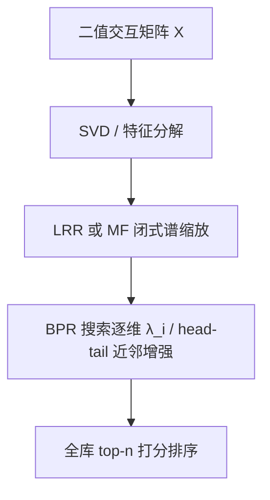
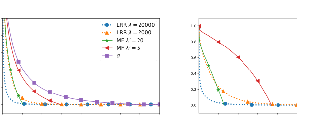

# Towards a Better Understanding of Linear Models for Recommendation (线性推荐模型再理解：低秩回归与矩阵分解的统一闭式解视角)

- **会议/期刊**: KDD 2021
- **作者与机构**: Ruoming Jin, Dong Li (Kent State University); Jing Gao, Zhi Liu, Li Chen (iLambda); Yang Zhou (Auburn University)
- **推荐链路定位**: 召回 / 线性 top-n 打分
- **研究方向**: 协同过滤与双塔召回（线性模型与矩阵分解）
- **论文原文**: [论文原文链接](https://arxiv.org/abs/2105.12937v2)
- **开源代码**: 暂未开源（论文称附录提供代码，未给出公开链接）

## TL;DR (1分钟核心速览)

本文针对线性推荐中低秩回归（EASE/SLIM）与矩阵分解（ALS/PureSVD）“经验上回归更强、理论上关系不清”的痛点，推导二者统一闭式解，指出它们分别以 $1/(1+\lambda/\sigma_i^2)$与$1-\lambda'/\sigma_i$缩放用户-物品矩阵奇异值；进一步用 BPR 搜索逐维$\lambda_i$ 并构造 head/tail 近邻模型。在 ML-20M/Netflix 用户划分全库 top-n 协议下，LRR+λ_i+HT+RMD 的 Recall@50 达 0.522，较闭式 LRR 提升 1.75%。

## Background & Motivation (背景与核心矛盾)

- **主流范式**: 邻域回归（SLIM/EASE/EDLAE）学习 item-item 相似矩阵 $W$，使$X\approx XW$；矩阵分解（ALS/WMF、PureSVD）学习用户/物品隐向量，使$x_{ui}\approx q_i^\top p_u$。
- **前人局限**: 低秩回归表面上只是 MF 的特例、参数量更少，按理应更受限；但 EASE/EDLAE 等回归模型在 Recall/nDCG 上常优于 ALS/WMF。与此同时，两类模型的最优正则系数 $\lambda$ 相差数千倍，缺乏理论解释。
- **核心洞察 (Key Insight)**: 二者都在 SVD 谱空间压缩奇异值，但压缩函数不同——回归以 $1/(1+\lambda/\sigma_i^2)$缩放，MF 以$1-\lambda'/\sigma_i$缩放；前者可保留更多中低奇异值，因而能使用更大秩$k$。
- **本文切入点**: 用统一闭式解比较 LRR 与 MF，并给出可学习的逐维 $\lambda_i$ 搜索与后处理近邻模型。

## Method (核心方法设计)

### 1. 整体框架 (Overall Architecture)

模型先对二值交互矩阵 $X$做 SVD/特征分解，得到$X=U\Sigma V^\top$；低秩回归和矩阵分解分别在谱空间给出相似矩阵的闭式解，并通过选择秩$k$与正则强度控制奇异值压缩。随后以 BPR 为目标，对逐维正则参数$\lambda_i$做梯度搜索，或对已有模型$W$叠加 head/tail 缩放与稀疏化，得到“近邻模型”。最终以$x_u\widehat W$ 对全库物品打分排序。

### 2. 关键设计拆解 (Key Designs)

1. **统一闭式解与“谱缩放”视角**：痛点在于 LRR 与 MF 看似结构不同，无法解释性能与正则范围差异。对 $\min_{\operatorname{rank}(W)\le k}\|X-XW\|_F^2+\|\Gamma W\|_F^2$，当$\Gamma^\top\Gamma=\operatorname{diag}(\lambda_1,\ldots,\lambda_k)$时有$\widehat W=V_k\operatorname{diag}\left(\frac{\sigma_1^2}{\sigma_1^2+\lambda_1},\ldots,\frac{\sigma_k^2}{\sigma_k^2+\lambda_k}\right)V_k^\top$；MF 的闭式解则为$\widehat W=V_k\operatorname{diag}\left(1-\frac{\lambda'}{\sigma_1},\ldots,1-\frac{\lambda'}{\sigma_k}\right)V_k^\top$。前者对大小奇异值做相对缩放，$\lambda$可很大且$k$可超过 1000；后者做绝对减缩，$\lambda'$受限且有效秩通常更小。由此解释：MF 的有效自由度实际只有$O(nk)$，并不比 LRR 更灵活。

2. **BPR 驱动的逐维超参搜索**：闭式解只解决了固定 $\lambda$，但最优的$\lambda_i$是高维连续空间。作者令$\lambda_i(\alpha_i)=\lambda+c\tanh(\alpha_i)$，在网格搜索得到的$\lambda$附近构造有界搜索域，并用 BPR loss 优化$\alpha_i$：$\mathcal{L}=\sum_{u,i\in X_u^+,j\in X_u^-}-\log\sigma\left(t\,x_u(W(\alpha_{1:k})_{*i}-W(\alpha_{1:k})_{*j})\right)$。这样既保留闭式解的可解释性，又能逐维调节奇异值压缩强度。

3. **Nearby 线性模型与训练/推理开销**：对已有 $W$叠加$W_{HT}=\operatorname{diagM}(H)W\operatorname{diagM}(T)$，或用$W_S=S\odot\widehat W\odot(\widehat W\ge t)$做稀疏重加权，相当于在已学模型附近做后拟合探索。训练负例从$X_u^-$采样，BPR 为 pairwise 损失；推理仍为线性打分$x_u\widehat W$，但闭式解依赖$n\times n$ 特征分解，物品数达百万时计算不可行。

<figure class="paper-figure" markdown="span">
  <figcaption>图1：ML-20M 的几何变换。</figcaption>
</figure>
图1：ML-20M 上 LRR 与 MF 的奇异值压缩曲线，LRR 能保留更多中低奇异值。

## Experimental Setup & Evaluation Protocol (实验设置与评估协议)

- **数据集与预处理**: 主实验使用 ML-20M、Netflix，MSD 置于附录；论文未显式报告 5-core 过滤，沿用 EASE/EDLAE 的用户分组设定。

| 数据集 | #Users | #Items | #Interactions | 稀疏度/密度 | 特征/场景说明 |
| :--- | :---: | :---: | :---: | :---: | :--- |
| ML-20M | 136,677 | 20,108 | ~10M | 极稀疏 | 电影隐式反馈 |
| Netflix | 463,435 | 17,769 | ~57M | 极稀疏 | 电影隐式反馈 |

- **数据划分与防穿越**: 基本模型对比采用 `Leave-One-Out`；主对比采用强泛化设定，将用户划分为训练/验证/测试组，避免同一用户信息穿越。
- **排名评测协议**: 采用全库未交互物品排序（Full-Ranking），报告 Recall@20、Recall@50、nDCG@100；论文未报告采样负例比例。BPR 训练阶段从负例集 $X_u^-$ 采样。
- **对比基线与超参设置**: 基线含 ALS/WMF、SLIM、EASE、EDLAE、CDAE、MultiVAE；LRR 取 $k=2K/3K$、$\lambda=10K/40K$，MF 取$k=1K$，EASE 取$\lambda=400/1000$。未报告显著性检验。

## Key Experimental Results (实验关键数据)

### 1. 主实验对比 (Main Results)

| 模型 | ML-20M R@20 | ML-20M R@50 | ML-20M nDCG@100 | Netflix R@20 | Netflix R@50 | Netflix nDCG@100 |
| :--- | :---: | :---: | :---: | :---: | :---: | :---: |
| SLIM | 0.370 | 0.495 | 0.401 | 0.347 | 0.428 | 0.379 |
| ALS/WMF | 0.363 | 0.502 | 0.393 | 0.321 | 0.406 | 0.355 |
| EASE | 0.391 | 0.521 | 0.420 | 0.360 | 0.444 | 0.392 |
| MultiVAE | **0.395** | **0.537** | **0.426** | 0.351 | 0.444 | 0.386 |
| LRR (closed-form) | 0.376 | 0.513 | 0.406 | 0.347 | 0.432 | 0.380 |
| LRR + λ_i + HT + RMD | 0.386 | 0.522 | 0.418 | 0.351 | 0.435 | 0.384 |
| EDLAE Full Rank | 0.393 | 0.523 | 0.424 | **0.364** | **0.449** | **0.397** |
| EDLAE Full Rank + HT | **0.395** | 0.527 | **0.426** | **0.364** | **0.449** | 0.396 |

注：LRR+λ_i+HT+RMD 相比 LRR 闭式解，ML-20M 的 R@20/R@50/nDCG@100 分别提升 2.66%/1.75%/2.96%；EDLAE Full Rank+HT 相比 EDLAE Full Rank，R@50 提升 0.76%。

### 2. 消融实验 (Ablation Study)

| 配置（ML-20M） | R@20 | R@50 | nDCG@100 |
| :--- | :---: | :---: | :---: |
| LRR closed-form | 0.376 | 0.513 | 0.406 |
| + λ_i | 0.380 | 0.515 | 0.410 |
| + λ_i + HT | 0.386 | 0.520 | 0.418 |
| + λ_i + HT + RMD | 0.386 | 0.522 | 0.418 |
| EDLAE | 0.389 | 0.521 | 0.422 |
| EDLAE + HT | 0.394 | 0.527 | 0.424 |

### 3. 关键实验发现 (Key Findings)

- 闭式基本模型确有竞争力：Leave-One-Out 下 ML-20M 的 LRR Recall@50=0.5114，高于 MF 的 0.5007，接近 EASE 的 0.5208，说明回归阵营的结构优势并非调参偶然。
- 逐维 $\lambda_i$ 与 head/tail 后处理稳定增益：LRR 的 R@50 从 0.513 升至 0.522；EDLAE+HT 从 0.521 升至 0.527，验证“近邻模型”可对已学线性模型做后拟合提升。
- 零对角约束收益很小：LRR+λ_i+HT 的 R@50=0.520，再加 RMD 仅到 0.522，说明 EASE 类模型的泛化主要来自谱缩放与正则，而非对角置零本身。

## Highlights & Limitations (亮点、对比与审稿批判)

- **与代表作对比 (vs. Prior Work)**: EASE 给出固定 $\lambda$下的闭式解但未讨论秩与谱机制；EDLAE 用 dropout 诱导$\Lambda$做低秩正则；本文则统一解释二者与 MF 的奇异值缩放差异，并把$\lambda$ 扩展为可学习逐维参数。
- **可迁移亮点**: (1) 在 SVD 闭式解上学习逐维 $\lambda_i$，可迁移到任何基于 Gram 矩阵的线性召回模型；(2) head/tail 缩放与稀疏化可作为训练后的低成本“模型邻域搜索”插件。
- **审稿级局限批判**: 闭式解需对 $n\times n$ 物品 Gram 矩阵做特征分解，百万级物品工业场景不可行；评估仅限隐式反馈与离线全库排序，未报告显著性检验、采样排序或线上 A/B，且未开源代码链接。

## Rating (四维评分)

- **方法创新性 (Novelty)**: ⭐⭐⭐⭐ （用统一闭式解揭示 LRR/MF 的奇异值缩放差异，理论视角新颖，但模型仍是线性族。）
- **评估协议与实验扎实度 (Protocol & Experiments)**: ⭐⭐⭐ （三数据集与多基线较完整，含 Leave-One-Out 与用户划分，但缺显著性检验和采样排序分析。）
- **写作与数学规范度 (Clarity & Rigor)**: ⭐⭐⭐⭐ （推导链条清晰、符号统一；部分结论依赖 $\Gamma=\Lambda^{1/2}V^\top$ 等设定。）
- **工业落地与复现价值 (Industrial & Practical Value)**: ⭐⭐⭐ （近邻后处理易落地，但闭式解特征分解对大规模物品不友好，且未提供公开代码。）

