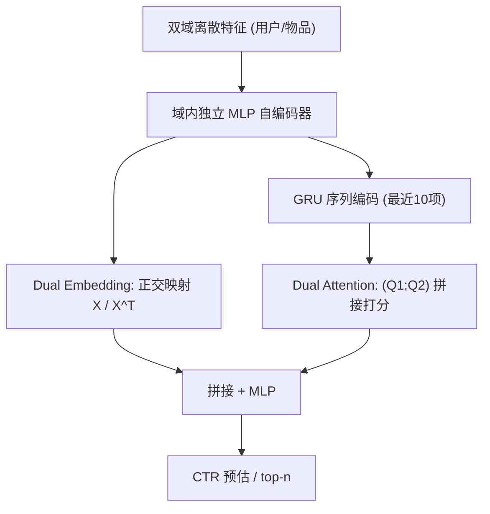
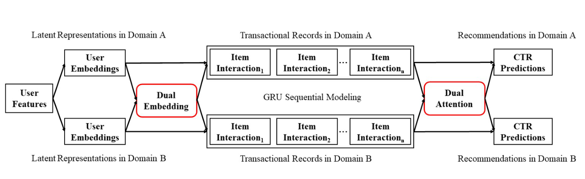

# Dual Attentive Sequential Learning for Cross-Domain Click-Through Rate Prediction (面向跨域点击率预测的双重注意力序列学习)

- **会议/期刊**: KDD 2021
- **作者与机构**: Pan Li, Alexander Tuzhilin (NYU Stern) ; Zhichao Jiang, Maofei Que, Yao Hu (阿里巴巴优酷认知与智能实验室)
- **推荐链路定位**: 精排 (CTR 预估)，跨域双场景联合训练
- **研究方向**: 跨域与多场景推荐 / 序列推荐
- **论文原文**: [https://arxiv.org/abs/2106.02768v1](https://arxiv.org/abs/2106.02768v1)
- **开源代码**: 暂未开源

## TL;DR (1分钟核心速览)

现有跨域序列推荐几乎都是**单向迁移**（源域 → 目标域），在双域同时上线时会牺牲源域效果。本文提出 DASL：先用**Dual Embedding** 学一个正交映射把两个域的重叠用户表征拉进共享隐空间，再用**Dual Attention** 让两个域的 Query 拼接后共同算注意力权重，形成双向迭代的对偶学习闭环。在 Imhonet / Amazon / Youku 三个跨域数据集、5 折交叉验证的 AUC 与 HR@10 上一致超越 Pi-Net、MiNet、DDTCDR、CoNet、DIN、Wide&Deep，平均 AUC +1.36%、HR@10 +1.72%；优酷线上 A/B 视频播放量 VV 提升 7.07%。

## Background & Motivation (背景与核心矛盾)

- **主流范式**: 跨域推荐用迁移学习把源域用户偏好注入目标域以缓解冷启动与稀疏；序列侧代表作为 Pi-Net（共享账号单元 + 跨域迁移单元）与 MiNet（长短期兴趣三路融合）。
- **前人局限**: ① 全部建模为单向迁移 $S\to T$，目标域涨点但源域可能退化，工业平台多域并存时无法"全赢"；② 静态跨域模型（DDTCDR/CoNet）不建模用户行为序列，无法捕捉"下次点击"的时序依赖。
- **核心洞察 (Key Insight)**: 用户在两个域的行为互为上下文——看过 Harry Potter 电影、又在图书域读完原著，则视频域中该序列项的注意力权重应被显著抬高；这种相互增强关系天然是**双向**的。
- **本文切入点**: 把机器翻译中的对偶学习 (dual learning) 引入序列 CTR，用"双向映射 + 双向注意力 + 迭代至收敛"替代单向蒸馏。

## Method (核心方法设计)

### 1. 整体框架 (Overall Architecture)

每个域独立训练一对 MLP 自编码器（用户/物品各一套，且跨域不共享，防止信息泄漏）得到离散特征到稠密向量的映射；用户历史（最近 10 次消费）经 GRU 编码为偏好隐状态；随后两个分支并行：Dual Embedding 在重叠用户上学习正交映射把 $A$域用户向量转到$B$ 域（及其反向），Dual Attention 用两域 Query 拼接后共同为历史行为打分，最终把用户隐向量、序列偏好与注意力上下文拼接送入 MLP 输出 CTR，按效用 top-n 推荐。

<figure class="paper-figure" markdown="span">
  <figcaption>图1：所提出的用于提供跨域序列推荐的DASL框架概览。</figcaption>
</figure>

### 2. 关键设计拆解 (Key Designs)

1. **正交对偶映射 (Dual Embedding)**：直接对齐两域用户向量会破坏域内几何结构、拖垮单域效果。本文只以重叠用户为枢轴，学习映射 $\boldsymbol{X}$使$\boldsymbol{X}\boldsymbol{W}^{u_A}\approx\boldsymbol{W}^{u_B}$，并同时优化其对偶式：

$$\mathcal{L}_{X}=\min_{\boldsymbol{X}}\sum_{u\in\mathcal{U}_{A}\cap\mathcal{U}_{B}}\lVert\boldsymbol{X}\boldsymbol{W}^{u_A}-\boldsymbol{W}^{u_B}\rVert^{2},\quad \mathcal{L}_{X^{T}}=\min_{\boldsymbol{X}}\sum_{u}\lVert\boldsymbol{W}^{u_A}-\boldsymbol{X}^{T}\boldsymbol{W}^{u_B}\rVert^{2}$$

   约束 $\boldsymbol{X}\boldsymbol{X}^{T}=\boldsymbol{X}^{T}\boldsymbol{X}=\boldsymbol{I}$。正交性保证内积（相似度）不变，从而"同域相似用户"经三角不等式自动在共享空间聚拢，非重叠用户也被间接传播受益；同时$\boldsymbol{X}^{T}=\boldsymbol{X}^{-1}$ 使反向映射免于额外参数，参数量与计算量都被约束。两式交替更新、迭代至收敛即为对偶学习。

2. **双域注意力 (Dual Attention)**：经典 DIN 类注意力只看单域历史，无法判断某条记录在跨域证据下的真实重要性。本文将另一域 Query 拼进打分：

$$\text{Attention}(Q_1,K,V)=\text{softmax}\!\left(\frac{(Q_1;Q_2)K^{T}}{\sqrt{d_k}}\right)V$$

   对称地有 $\text{Attention}(Q_2,K,V)=\text{softmax}\big((Q_2;Q_1)K^{T}/\sqrt{d_k}\big)V$。物理直觉是：跨域证据提升置信度，从而把注意力权重重新分配到真正相关的历史上，且两域互相校正、天然形成双向增益。

3. **训练目标与推理**：总损失为双域重建损失 $\mathcal{L}_u,\mathcal{L}_i$+ 对偶映射损失$\mathcal{L}_X$ + CTR 二分类交叉熵（评分被二值化为 click / non-click），采用 pointwise 标签而非显式负采样；推理为一次前向 + top-n 排序，GRU 与点积注意力使在线开销与单域 DIN 同量级。

## Experimental Setup & Evaluation Protocol (实验设置与评估协议)

- **数据集与预处理**: 评分/行为二值化为点击标签；序列统一取每用户最近 10 个物品；物品严格单域归属；以统一 user ID 识别重叠用户。

| 数据集 | #Users | #Items | #Interactions | 稀疏度 | 场景说明 |
| :--- | :---: | :---: | :---: | :---: | :--- |
| Imhonet (Books / Movies) | 804,285 / 959,502 | 182,653 / 79,866 | 223.0M / 51.3M | 0.0157% / 0.0669% | 重叠用户 318,225，评分反馈 |
| Amazon (Toys / Video Games) | 1,342,911 / 826,767 | 327,698 / 50,210 | 2.25M / 1.32M | 0.0005% / 0.0032% | 重叠用户 131,684，购买行为 |
| Youku (TV Shows / Short Videos) | 63,360 / 63,360 | 17,966 / 941,507 | 11.56M / 19.16M | 1.0150% / 0.0321% | 100% 重叠，2020-12 线上日志 |

- **数据划分与防穿越 (Splitting Strategy)**: **5 折交叉验证**取均值，非时间戳切分；序列按记录 timestamp 内部有序，未做严格的全局时间切分。
- **排名评测协议 (Ranking Protocol)**: 报告 **AUC**（pointwise CTR 判别）与 **HR@10**（top-10 命中率）；正文未明确说明候选集规模与负采样比例，属**采样排序**而非全库 Full-Ranking。
- **对比基线与超参**: 三大类共 6 个基线——跨域序列 (Pi-Net, MiNet)、跨域静态 (DDTCDR, CoNet)、单域序列 (DIN, Wide&Deep)；主实验以 `*` 标注显著性，第二优基线作为提升分母。

## Key Experimental Results (实验关键数据)

### 1. 主实验对比 (Main Results)

| 模型 | Imhonet-Books AUC | HR@10 | Imhonet-Movies AUC | HR@10 | Amazon-Toys AUC | HR@10 | Youku-Short AUC | HR@10 |
| :--- | :---: | :---: | :---: | :---: | :---: | :---: | :---: | :---: |
| Wide & Deep | 0.8198 | 0.8608 | 0.8172 | 0.8568 | 0.8300 | 0.7618 | 0.8395 | 0.8295 |
| DIN | 0.8233 | 0.8579 | 0.8198 | 0.8571 | 0.8317 | 0.7629 | 0.8410 | 0.8295 |
| CoNet | 0.8186 | 0.8562 | 0.8198 | 0.8590 | 0.8382 | 0.7663 | 0.8444 | 0.8310 |
| DDTCDR | 0.8235 | 0.8553 | 0.8203 | 0.8577 | 0.8403 | 0.7685 | 0.8459 | 0.8308 |
| Pi-Net | 0.8278 | 0.8644 | 0.8237 | 0.8630 | 0.8399 | 0.7697 | 0.8488 | 0.8324 |
| MiNet | 0.8294 | 0.8630 | 0.8245 | 0.8644 | 0.8411 | 0.7703 | 0.8486 | 0.8341 |
| **DASL** | **0.8375\*** | **0.8752\*** | **0.8380\*** | **0.8752\*** | **0.8520\*** | **0.7844\*** | **0.8635\*** | **0.8539\*** |
| Improv.% | +0.98% | +1.25% | +1.64% | +1.25% | +1.30% | +1.83% | +1.73% | +2.37% |

（对称侧同样领先：Amazon-VideoGames AUC 0.8511 / HR@10 0.7844，Youku-TV Shows AUC 0.8825 / HR@10 0.8565，均为 **最优**。）

### 2. 消融实验 (Ablation Study)

| 变体 | Books AUC | Books HR@10 | Toys AUC | Toys HR@10 | TV Shows AUC | TV Shows HR@10 |
| :--- | :---: | :---: | :---: | :---: | :---: | :---: |
| **DASL (full)** | **0.8375** | **0.8752** | **0.8520** | **0.7844** | **0.8825** | **0.8565** |
| w/o Dual Embedding | 0.8333 | 0.8704 | 0.8468 | 0.7803 | 0.8771 | 0.8523 |
| w/o Dual Attention | 0.8341 | 0.8712 | 0.8482 | 0.7795 | 0.8777 | 0.8529 |
| Single-Domain (双组件全去) | 0.8234 | 0.8580 | 0.8319 | 0.7629 | 0.8642 | 0.8366 |

### 3. 关键实验发现 (Key Findings)

1. **双向迁移的收益是"双域同时获得"**：DASL 在两个对称域上都涨点（Books AUC +0.98%、Movies AUC +1.64%），而 Pi-Net/MiNet 的增益更集中于被迁移侧，验证了对偶机制避免了源域的效果回退。
2. **两个组件互补且缺一不可**：去掉 DE 使 Toys AUC 掉 0.52%（0.8520→0.8468），去掉 DA 掉 0.38%；而双组件全去后降到 0.8319，说明正交映射提供的表征对齐与跨域注意力提供的证据重加权是乘法式互补，且 DA 的损失略小于 DE，表征对齐是主承载。
3. **跨域 + 序列两者都必要**：跨域静态模型（DDTCDR 0.8403）已强于单域序列 DIN（0.8317），但被跨域序列 Pi-Net（0.8399→DASL 0.8520）进一步拉大，线上优酷 A/B 中 VV 提升 **7.07%**，离线 AUC 的 1–2% 量级增益在工业指标上被放大。

## Highlights & Limitations (亮点、对比与审稿批判)

- **与代表作对比 (vs. Prior Work)**: 相比 Pi-Net / MiNet 的**单向** "源域→目标域" 信息共享，DASL 把迁移写成可逆正交映射 + 双域 Query 联合注意力，实现双向闭环；相比 DDTCDR 的对偶学习，本文将其从**静态评分预测**推进到**序列 next-item CTR**，引入 GRU 与跨域注意力。
- **可迁移亮点**: ① 正交映射约束 $XX^{T}=I$ 让跨域对齐"免费"得到逆映射，参数量不增，可直接搬到多场景表征对齐或双塔跨域召回；② "把另一域 Query 拼进 softmax 打分" 是一种极低成本的多场景特征交互技巧，可替代复杂的跨域门控网络。
- **审稿级局限批判**: ① 评测协议薄弱——5 折交叉验证 + 二值化 pointwise 标签，未说明候选集规模、负采样比例，HR@10 的绝对数值可比性存疑；② 主表中 DASL 在 Books 与 Movies、Toys 与 Video Games 的 HR@10 出现**完全相同**（0.8752 / 0.7844），Youku 上 DASL-DE 与 DASL-DA 也给出几乎一致的数字，暗示可能存在报告或复现瑕疵；③ 仅在**域对**上建模，映射矩阵随域数呈 $O(K^2)$ 增长，多域扩展与收敛性仅有定性论述，缺少理论保证。

## Rating (四维评分)

- **方法创新性 (Novelty)**: ⭐⭐⭐⭐ （把对偶学习从静态评分迁移到序列 CTR，正交映射约束优雅且带三角不等式直觉，但组件本身均为已有算子的组合）
- **评估协议与实验扎实度 (Protocol & Experiments)**: ⭐⭐⭐ （三数据集 + 六基线 + 消融 + 线上 A/B 完整，但 5 折 CV、负采样与候选集未交代，且存在可疑的重复数值）
- **写作与数学规范度 (Clarity & Rigor)**: ⭐⭐⭐⭐ （公式与三阶段流程清晰，但对偶迭代的收敛性与复杂度仅一笔带过，缺少形式化算法框）
- **工业落地与复现价值 (Industrial & Practical Value)**: ⭐⭐⭐⭐ （优酷线上 VV +7.07% 且已进入部署，推理开销与单域 DIN 同量级；但代码未开源，复现依赖细节缺失）

