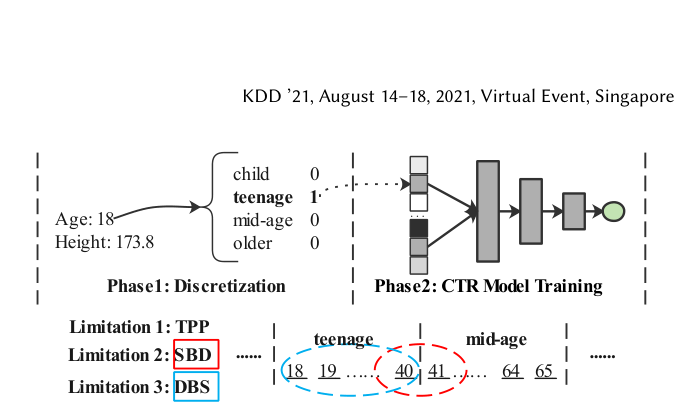
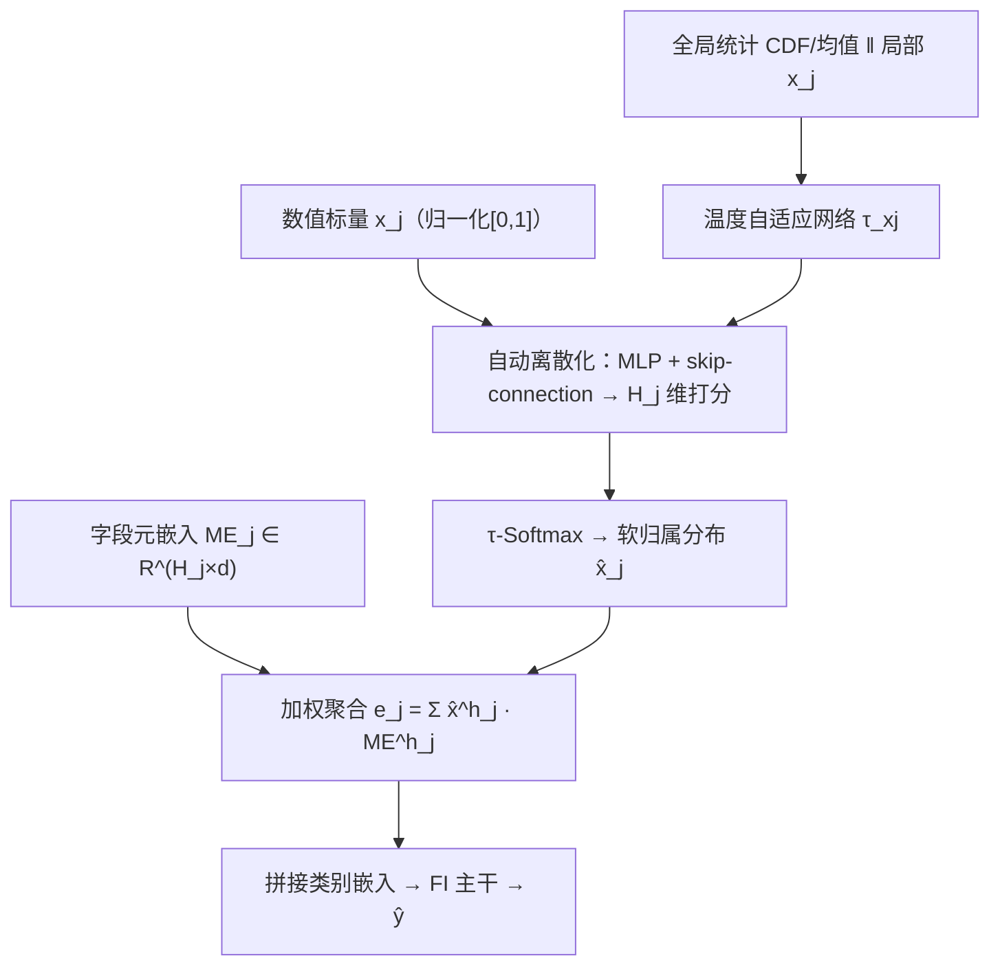
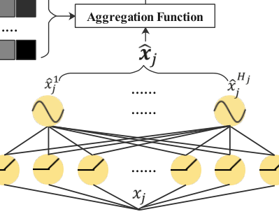

# An Embedding Learning Framework for Numerical Features in CTR Prediction (CTR 预估中数值特征的嵌入学习框架)

- **会议/期刊**: KDD 2021 (Research Track)
- **作者与机构**: Huifeng Guo, Bo Chen, Ruiming Tang, Zhenguo Li, Xiuqiang He (华为诺亚方舟实验室)；Weinan Zhang (上海交通大学)
- **推荐链路定位**: 精排 (Embedding 层，可插拔替换任意深度 CTR 模型的数值特征入口)
- **研究方向**: CTR/CVR 预估与特征交叉
- **论文原文**: [https://arxiv.org/abs/2012.08986v2](https://arxiv.org/abs/2012.08986v2)
- **开源代码**: [MindSpore Model Zoo - AutoDis](https://gitee.com/mindspore/mindspore/tree/master/model_zoo/research/recommend/autodis)

## TL;DR (1分钟核心速览)

深度 CTR 模型长期只卷 Feature Interaction 结构，而把数值特征的嵌入学习当成预处理：要么不学嵌入，要么全字段共享一个向量，要么靠 EDD/LD/GBDT 做离线硬分桶。硬分桶带来三大病灶——分桶与 CTR 目标两阶段脱耦 (TPP)、桶边界近值嵌入突变 (SBD)、同桶远值嵌入相同 (DBS)。AutoDis 为每个数值字段配置 $H_j$个**元嵌入**，用带跳连的两层 MLP 把标量映射为$H_j$ 维打分，经温度缩放 Softmax 得到**软分桶分布**，再对该分布做**加权聚合**，端到端学出"连续但可区分"的嵌入。Criteo/AutoML/工业集 AUC 分别相对提升 0.17%/0.23%/0.22%，线上 A/B 的 CTR +2.1%、eCPM +2.7%。

## Background & Motivation (背景与核心矛盾)

- **主流范式**: Embedding & Feature Interaction 两段式。类别特征走查表嵌入，数值特征则被"降级处理"——DeepFM 用一个字段嵌入乘以标量值，DLRM 用 DNN 混合全部数值字段，YouTube DNN 用平方/开方手工变换。
- **前人局限之一（容量）**: Field Embedding 全场共享同一向量 $e_j = x_j\cdot \mathbf{e}_j$，嵌入只能沿一条射线线性伸缩，容量极低；No Embedding 则完全无可学习参数或丢失字段区分度。
- **前人局限之二（可微性）**: Discretization 容量高但需离线规则（EDD/EFD/LD/TD），分桶函数 $d_j(\cdot)$ 不可导，与 CTR 目标两阶段割裂 (TPP)，并天然引发桶边界断层 (SBD) 与桶内均质 (DBS)（见 <figure class="paper-figure" markdown="span">
  <figcaption>图2：现有离散化方法的局限性：(1) TPP（两阶段问题）；(2) SBD（值相似但嵌入不相似）；DBS（值不相似但嵌入相同）。</figcaption>
</figure>）。
- **核心洞察 (Key Insight)**: 数值特征真正需要的不是"一个值一个嵌入"（参数爆炸）或"一桶一个嵌入"（阶跃不连续），而是**分桶的软归属 + 桶嵌入的可微加权**——让嵌入随特征值连续变化，同时保留足够表达自由度。
- **本文切入点**: 把"桶"改造成字段内共享的**元嵌入基**，把"分桶规则"改造成**可学习、可微、带温度控制的 Softmax 打分器**。

## Method (核心方法设计)

### 1. 整体框架 (Overall Architecture)

对第 $j$个数值字段的标量$x_j$（先归一化到$[0,1]$）：① 元嵌入矩阵$\mathbf{ME}_j\in\mathbb{R}^{H_j\times d}$提供字段级共享的$H_j$个潜空间子基；② 自动离散化模块（带跳连的两层 MLP + 温度缩放 Softmax）把$x_j$映射成$H_j$维软归属概率$\hat{\mathbf{x}}_j$；③ 温度$\tau_{x_j}$由"全局字段统计（采样 CDF、均值）+ 局部输入值"经小网络自适应生成；④ 加权聚合$\mathbf{e}_j=\sum_h \hat{x}^h_j\cdot \mathbf{ME}^h_j$ 得到该值的嵌入；⑤ 与类别嵌入拼接后送入任意 FI 主干（FNN/W&D/DeepFM/DCN/IPNN/xDeepFM）联合训练。整链无离线阶段、无额外推理图。

<figure class="paper-figure" markdown="span">
  <figcaption>图4：AutoDis框架的架构。</figcaption>
</figure>

### 2. 关键设计拆解 (Key Designs)

1. **元嵌入 (Meta-Embeddings)**：朴素做法"值当类别"会导致参数爆炸与低频值欠训练，Field Embedding 则容量不足。折中方案是字段内共享 $H_j$个可学习基向量，参数规模仅$H_j\times d$（Criteo 上$H_j=20$），把"无穷值域"压到"可控子空间组合"，容量与复杂度解耦。

2. **可微自动离散化 + 自适应温度**：先算打分 $\mathbf{h}_j=\text{LeakyReLU}(\mathbf{w}_j x_j)$，$\tilde{\mathbf{x}}_j=\mathbf{W}_j\mathbf{h}_j+\alpha\mathbf{h}_j$（$\alpha$ 为跳连系数，保证标量到高维的可学习非线性），再取温度 Softmax：
$$\hat{x}^h_j=\frac{\exp(\tilde{x}^h_j/\tau_{x_j})}{\sum_{l=1}^{H_j}\exp(\tilde{x}^l_j/\tau_{x_j})}$$
$\tau\to 0$退化为 one-hot 硬分桶、$\tau\to\infty$退化为均匀分布，故$\tau$直接控制"离散化锐度"。因不同字段分布差异大（最优$\tau$在 Criteo 为$10^{-5}$、AutoML 为$4\times10^{-3}$），作者用
$$\tau_{x_j}=\text{Sigmoid}\big(\mathbf{W}^2_j\,\text{LeakyReLU}(\mathbf{W}^1_j[\bar{\mathbf{n}}_j\,\|\,\mathbf{x}_j])\big)$$
按字段+实例自适应，并将输出 rescale 至 $(\tau-\epsilon,\tau+\epsilon)$ 稳定训练。**直觉**：软归属使相近取值得到相近分布，从根上消除 SBD；加权聚合使同分布也能得到不同向量，从根上消除 DBS。

3. **聚合函数与训练目标**：Max-Pooling 等价于硬分桶（重新引入 SBD）；Top-K-Sum 只用前 K 个且丢弃权重值（$K<H_j$时 DBS 仍在）。最终采用加权平均$\mathbf{e}_j=\sum_{h}\hat{x}^h_j\cdot\mathbf{ME}^h_j$，使嵌入成为元嵌入的凸组合——值越近、分布越近、嵌入越近，即 **Continuous-But-Different**。损失为标准 LogLoss + L2：
$$\mathcal{L}=-\frac{1}{Q}\sum_{i=1}^{Q}\big[y_i\log\hat{y}_i+(1-y_i)\log(1-\hat{y}_i)\big]+\lambda\|\Theta\|_2^2$$
无负采样环节（CTR 点式二分类），推理仅多一次 MLP 前向，参数增量 0.15%、batch 推理延迟 +4.31%。

## Experimental Setup & Evaluation Protocol (实验设置与评估协议)

- **数据集与预处理**: 数值特征统一 min-max 归一化到 $[0,1]$（稳定训练，非离散化）。

| 数据集 | #Num field | #Cats field | #Instances | 正样本率 | 场景说明 |
| :--- | :---: | :---: | :---: | :---: | :--- |
| Criteo | 13 | 26 | 45.8M | 25.6% | Criteo Display Ad Challenge 2013，展示广告 |
| AutoML | 23 | 51 | 4.69M | 5.8% | NeurIPS 2018 AutoML Challenge，高稀疏 |
| Industrial | 41 | 44 | 8.75M | 3.3% | 某主流广告平台采样，字段最多、最稀疏 |

- **数据划分与防穿越 (Splitting Strategy)**: 论文未显式声明时间切分，沿用 Criteo/AutoML 社区常规的**随机比例划分**（训练/验证/测试独立同分布），未做冷启动或时间外推划分——这是一个评估上的隐含假设。
- **排名评测协议 (Ranking Protocol)**: 非全库排序任务。评估为 **CTR 点式二分类**，指标为 `AUC` 与 `LogLoss`，不做负采样排序（负样本即真实曝光未点击日志）。
- **对比基线与超参设置**: 三类基线共 6 个——No Embedding (YouTube、DLRM)、Field Embedding (FE)、Discretization (EDD、LD、TD/DeepGBM)；兼容性实验把 AutoDis 插入 FNN/Wide&Deep/DeepFM/DCN/IPNN/xDeepFM。嵌入维度 $d=80$(Criteo) /$70$(AutoML)，隐层固定 1024-512-256-128，DCN/xDeepFM 交叉层 3 层，Adam + 网格学习率，$H_j=20/40$，$\alpha\in\{0,0.1,\dots,1\}$。全部实验重复 5 次随机种子，采用双侧非配对$t$-test（$\star$表示$p<0.05$）。

## Key Experimental Results (实验关键数据)

### 1. 主实验对比 (Main Results)

以 DeepFM 为主干，三类数值特征表示方法的横向对比（加粗为全表最优）：

| 类别 | 方法 | Criteo AUC | Criteo LogLoss | AutoML AUC | AutoML LogLoss | Industrial AUC | Industrial LogLoss |
| :--- | :--- | :---: | :---: | :---: | :---: | :---: | :---: |
| No Embedding | YouTube | 0.8104 | 0.4437 | 0.7382 | 0.1928 | 0.7259 | 0.1369 |
| No Embedding | DLRM | 0.8114 | 0.4404 | 0.7525 | 0.1900 | 0.7253 | 0.1369 |
| Field Embedding | FE | 0.8107 | 0.4412 | 0.7523 | 0.1899 | 0.7248 | 0.1369 |
| Discretization | EDD | 0.8125 | 0.4399 | 0.7545 | 0.1898 | 0.7251 | 0.1371 |
| Discretization | LD | 0.8138 | 0.4388 | 0.7527 | 0.1899 | 0.7265 | 0.1368 |
| Discretization | TD | 0.8130 | 0.4392 | 0.7531 | 0.1899 | 0.7262 | 0.1369 |
| **Ours** | **AutoDis** | **0.8152**$\star$| **0.4370**$\star$| **0.7562**$\star$| **0.1892**$\star$| **0.7281**$\star$| **0.1366**$\star$ |
| | **Improv.%** | **+0.17%** | **-0.41%** | **+0.23%** | **-0.32%** | **+0.22%** | **-0.15%** |

**兼容性（与 Field Embedding 基线对比，AUC）**：

| 主干 | Criteo 基线 → AutoDis | AutoML 基线 → AutoDis | Industrial 基线 → AutoDis |
| :--- | :---: | :---: | :---: |
| FNN | 0.8059 → **0.8092**$\star$| 0.7383 → **0.7453**$\star$| 0.7271 → **0.7289**$\star$ |
| Wide&Deep | 0.8097 → **0.8121**$\star$| 0.7407 → **0.7445**$\star$| 0.7275 → **0.7288**$\star$ |
| DCN | 0.8091 → **0.8132**$\star$| 0.7489 → **0.7511**$\star$| 0.7262 → **0.7293**$\star$ |
| IPNN | 0.8101 → **0.8136**$\star$| 0.7519 → **0.7541**$\star$| 0.7269 → **0.7286**$\star$ |
| xDeepFM | 0.8103 → **0.8141**$\star$| 0.7508 → **0.7529**$\star$| 0.7275 → **0.7289**$\star$ |
| DeepFM | 0.8107 → **0.8152**$\star$| 0.7523 → **0.7562**$\star$| 0.7248 → **0.7281**$\star$ |

### 2. 消融实验 (Ablation Study)

| 组件 / 超参 | 设置 | Criteo AUC | AutoML AUC | 说明 |
| :--- | :--- | :---: | :---: | :--- |
| 聚合函数 | Max-Pooling | 0.8136 | 0.7515 | 退化为硬分桶，SBD 回归 |
| 聚合函数 | Top-K-Sum | ~0.8145 | 0.7549 | 丢弃权重值，DBS 未根除 |
| 聚合函数 | **Weighted-Average** | **0.8152** | **0.7562** | 全基 + 权重，最优 |
| 温度策略 | 全局 $\tau$最优 | 0.8150 ($10^{-5}$) | 0.7560 ($4\times10^{-3}$) | 数据集间差 400 倍 |
| 温度策略 | **自适应 $\tau_{x_j}$** | **0.8152** | **0.7562** | 免调参且最优 |
| 元嵌入数 $H_j$ | 10 → 20/40 → 100 | 0.8148 → **0.8152** → 0.8146 | 0.7548 → **0.7562** → ~0.7549 | 先升后降，边际递减 |
| 复杂度 | EDD → AutoDis | 2.009M → 2.012M 参数 (+0.15%) | 3.48ms → 3.63ms (+4.31%) | 参数近乎免费 |
| 线上 A/B | 对照 → 实验组 | CT +2.1%, eCPM +2.7%（显著） | — | 离线 AUC +0.2% |

### 3. 关键实验发现 (Key Findings)

1. **瓶颈在"值—嵌入映射的分辨率"，不在 FI 结构**：三类基线中 No Embedding（YouTube 0.8104）与 Field Embedding（0.8107）几乎打平，说明单向量线性缩放拿不到信息；而 AutoDis 相对最强离散化基线 LD/EDD 再提 0.17–0.23% AUC，增益完全来自表征层，与 FI 主干无关（6 个主干全部 $\star$ 显著提升 0.2–0.7 个点，FNN 上最明显 +0.33%）。
2. **加权聚合是唯一不可替代的组件**：换成 Max-Pooling 后 AutoML AUC 从 0.7562 掉到 0.7515（-0.47pt，相当于把 AutoDis 打回 EDD 以下），Top-K-Sum 也掉 0.13pt——证明"软归属必须与权重数值一起进入聚合"，只取 top-K 索引会重新引入 DBS。
3. **自适应温度把"逐数据集调参"变成"免调参"**：全局最优 $\tau$在 Criteo 与 AutoML 相差两个数量级以上（$10^{-5}$vs$4\times10^{-3}$），任何固定$\tau$都无法跨场景复用；自适应网络在两者上均取得与最优全局$\tau$ 持平或更优的结果，是跨域迁移部署的关键。

## Highlights & Limitations (亮点、对比与审稿批判)

- **与代表作对比 (vs. Prior Work)**: 相比 **FE (DeepFM)**，本文用 $H_j$ 个元嵌入 + 软权重打破了"单向量线性伸缩"的容量天花板与线性约束；相比 **EDD/LD/TD**，本文把不可导的离线分桶函数替换为可微 Softmax 打分，消除 TPP，并用软加权同时解决 SBD/DBS；相比 **DLRM**，本文保留字段间区分度而非用一个 DNN 混合所有数值字段。相较同期 AutoEmb/NIS 等嵌入维度自适应工作，本文针对的是"数值值域连续性"这一正交问题。
- **可迁移亮点**: ① "全局统计（CDF/均值）+ 局部输入"生成自适应温度的小网络，可直接迁移到对比学习的温度调节、Gumbel-Softmax 退火与软量化码本分配；② "字段级共享基 + 样本级软权重"是一种参数量与表达力解耦的通用技巧，可迁移到连续值（价格、时长、GPS 距离）的嵌入化。
- **审稿级局限批判**: ① 只建模单字段内部的标量→嵌入映射，数值—数值之间的交互仍完全交给下游 FI 模块，未验证与 CrossNet/CIN 的协同增益上限；② 划分方式与数据采样细节未披露（Criteo 45.8M 明显是采样版），且缺少长尾/低频数值分桶的鲁棒性分析，$H_j$与$\alpha$ 仍需网格搜索；③ 线上只报广告精排单一场景，+4.31% 推理延迟在毫秒级严苛 SLA 下（论文自述整体需数毫秒）仍有工程压力，且未报告收益在冷启动/新广告上的分布。

## Rating (四维评分)

- **方法创新性 (Novelty)**: ⭐⭐⭐⭐ （把"离散化"重构为"元嵌入基上的可微软归属 + 加权聚合"，思路干净且有清晰的三病灶对症；但本质是软量化/注意力池化的组合变体，缺乏理论或谱分析支撑）
- **评估协议与实验扎实度 (Protocol & Experiments)**: ⭐⭐⭐⭐ （两公开 + 一工业数据集、5 次重复 + $t$-test、6 主干兼容性 + 完整消融 + 线上 A/B，相当扎实；扣分在于划分策略与采样细节交代不清、缺少长尾分桶分析）
- **写作与数学规范度 (Clarity & Rigor)**: ⭐⭐⭐⭐⭐ （TPP/SBD/DBS 三问题定义精准并与三个模块一一对应，公式简洁自洽，$\tau\to0/\infty$ 的极限讨论给出良好物理直觉）
- **工业落地与复现价值 (Industrial & Practical Value)**: ⭐⭐⭐⭐⭐ （参数仅 +0.15%、延迟 +4.31%、无离线特征工程、可插拔替换现有数值特征入口，且已在 MindSpore 开源并完成线上验证，落地成本极低）

