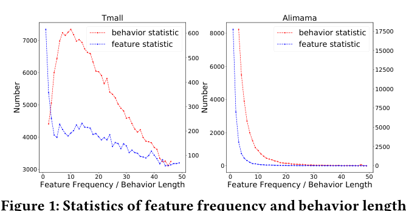
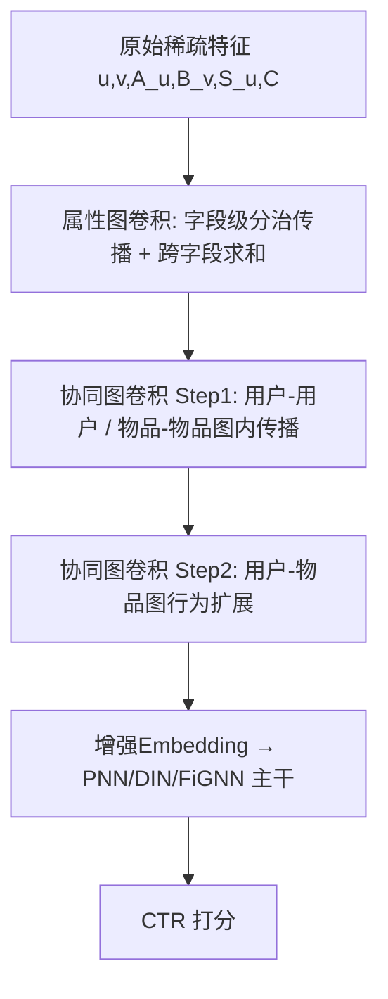
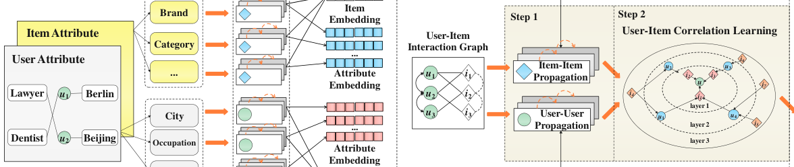

# Dual Graph enhanced Embedding Neural Network for CTR Prediction (双图增强嵌入神经网络用于CTR预估)

- **会议/期刊**: KDD 2021
- **作者与机构**: Wei Guo, Rong Su, Renhao Tan, Huifeng Guo, Yingxue Zhang, Zhirong Liu, Ruiming Tang, Xiuqiang He（华为诺亚方舟实验室）
- **推荐链路定位**: 精排（Embedding 层增强，与任意 CTR 主干即插即用）
- **研究方向**: CTR/CVR 预估与特征交叉 / 图神经网络与知识图谱推荐
- **论文原文**: [https://arxiv.org/abs/2106.00314v2](https://arxiv.org/abs/2106.00314v2)
- **开源代码**: 暂未开源（作者声明将基于 MindSpore 后续开源）

## TL;DR (1分钟核心速览)

CTR 模型的两大流派各有死穴：特征交叉派受制于**特征稀疏**（长尾 ID 共现不足），用户兴趣派受制于**行为稀疏**（大量用户序列极短）。本文不改主干网络，而是把功夫花在被长期忽视的 Embedding 层：构建用户/物品**属性图**与**协同图**（用户-用户、物品-物品、用户-物品三类边），分别用**分治式字段级卷积**与**课程学习式组织学习**精炼表征，再冻结式喂给 PNN/DIN/FiGNN 等主干。在 Alipay/Tmall/Alimama 三个工业数据集（10 负采样构造样本）上，AUC 相对最强基线提升 5.25%/2.59%/8.83%，Logloss 下降 17.13%/15.21%/11.05%。

## Background & Motivation (背景与核心矛盾)

- **主流范式**: 统一的 Embedding & Representation & Prediction 范式——随机初始化查表得到稀疏特征向量，再由特征交叉网络（FM/DeepFM/PNN/AutoInt+）或兴趣挖掘网络（DIN/DIEN/MIND）做表征学习后接 MLP 分类。
- **前人局限一（特征稀疏）**: 交叉类模型高度依赖特征共现，但真实数据中大量 ID 类特征出现次数极少（图 1 显示 Tmall/Alimama 特征频次分布严重左偏），这些特征的 Embedding 几乎得不到梯度更新，等价于随机噪声。
- **前人局限二（行为稀疏）**: 兴趣挖掘类模型需要长行为序列，但用户行为长度呈重尾分布，短序列用户无法刻画多兴趣；GIN/FiGNN 之类图模型虽引入图，却只用了单一图（item-item 共现图或 field 全连接图），丢弃了属性关系与用户-用户/物品-物品的复杂拓扑。
- **核心洞察 (Key Insight)**: 图上的高阶邻近性天然是"数据增广器"——学习一个节点的表征会顺带更新其邻居，稀疏特征因此获得额外的更新机会；短序列用户可通过相似用户的行为被"补全"（behavior expanding）。
- **本文切入点**: 不设计更复杂的交叉算子，而是把 Embedding 层当成一个**可插拔的图表征预处理器**，用双图 + 两种专用学习策略精炼所有非上下文特征。

<figure class="paper-figure" markdown="span">
  <figcaption>图 1：Tmall 和 Alimama 数据集中特征频率与行为长度分布的统计。</figcaption>
</figure>

## Method (核心方法设计)

### 1. 整体框架 (Overall Architecture)

输入实例为 $x=[u,v,\mathcal{A}_u,\mathcal{B}_v,\mathcal{S}_u,\mathcal{C}]$。主干流程被拆成三段串行增强：(1) **属性图卷积**——为用户属性图$\mathcal{G}_{ua}$与物品属性图$\mathcal{G}_{vb}$中每个字段独立做$L$层传播并跨字段求和，得到$\mathbf{z}_u,\mathbf{z}_v$及属性/序列特征的新表征$Z$；(2) **协同图卷积**——先在用户-用户图$\mathcal{G}_{uu}$、物品-物品图$\mathcal{G}_{vv}$上做"图内传播"，再切换到用户-物品二部图$\mathcal{G}_{uv}$做"跨用户-物品行为扩展"，得到$\hat{\mathbf{p}}_u,\hat{\mathbf{p}}_v$；(3) **主干预测**——增强后的$P=[\hat{\mathbf{p}}_u,\hat{\mathbf{p}}_v,\mathbf{z}_{\mathcal{A}_u},\mathbf{z}_{\mathcal{B}_v},\hat{\mathbf{p}}_{\mathcal{S}_u},\mathbf{e}_{\mathcal{C}}]$ 直接送入 PNN/DIN/FiGNN 等现成结构做交叉与 MLP。上下文特征（时间戳、展示位）刻意不建图，避免引入无明确语义关系的噪声。

<figure class="paper-figure" markdown="span">
  <figcaption>图 2：我们提出的 DG-ENN 框架概览。左侧部分是属性图卷积模块，中间部分是协同图卷积模块，右侧部分是深度网络模块。</figcaption>
</figure>

### 2. 关键设计拆解 (Key Designs)

1. **分治式字段级属性图卷积 (Divide-and-Conquer Field-wise Propagation)**：痛点是把性别、城市、品牌、类目混在一张同构图里做均值聚合，语义与分布差异极大，聚合即"信息抹平"。本文对每个字段 $t$单独建图、单独传参（GCN/NGCF 各自独立权重），层间做$\mathbf{e}_h^{(l+1)}=f^{(l)}_{\star}(\mathbf{e}_h^{(l)},\mathbf{e}_{N_h}^{(l)})$，最终$\hat{\mathbf{e}}_h=\sum_{l=0}^{L}\mathbf{e}_h^{(l)}$，再跨字段简单求和$\mathbf{z}_u=\sum_{t=1}^{J}\hat{\mathbf{e}}_u^{(t)}$。直觉：字段内传播保持语义纯度，字段间求和保持轻量，避免注意力带来的额外过拟合。聚合器实证以 **LightGCN**（去掉权重矩阵与非线性）最优，因 CTR 场景边噪声大、额外变换易过拟合。
2. **课程学习式组织学习 (Organized Learning)**：协同图里 $u_1\!\to\!v_1$、$u_1\!\to\!u_2\!\to\!v_1$、$u_1\!\to\!v_2\!\to\!u_2\!\to\!v_1$等路径语义完全不同，若三类边同时聚合则依赖关系被混淆；元路径方法又需专家知识。本文先"易"后"难"：先在$\mathcal{G}_{uu}\cup\mathcal{G}_{vv}$上学$\hat{\mathbf{z}}_u=\sum_l \mathbf{z}_u^{(l)}$，再以其为初值转入二部图$\mathbf{q}_u^{(0)}=\hat{\mathbf{z}}_u$，最终$\hat{\mathbf{p}}_u=\sum_{l}\mathbf{q}_u^{(l)}$（含$l=0$ 层以保留图内关系）。即把"用户相似/物品转移"当作学习"用户-物品偏好"的先修课。
3. **训练目标、负采样与推理效率**：沿用标准 logloss $\mathcal{L}=-\frac{1}{|\mathcal{S}|}\sum_{(x,y)}[y\log\hat{y}+(1-y)\log(1-\hat{y})]$，无额外对比/正则辅助损失，训练负样本即数据集构造时采样的未点击物品；图卷积仅在**离线训练**阶段做$L$层邻域聚合（必要时邻居采样），在线推理直接查增强后的 Embedding 表，**时延与 Base 模型完全一致**，复杂度$O(L\cdot|\mathcal{G}|\cdot d)$ 全部落在训练侧。

## Experimental Setup & Evaluation Protocol (实验设置与评估协议)

- **数据集与预处理**:

| 数据集 | #Users | #Items | #Interactions | 稀疏度/密度 | 特征/场景说明 |
| :--- | :---: | :---: | :---: | :---: | :--- |
| Alipay | 438,380 | 800,496 | 4,822,180 | 极稀疏(≈1.4e-5) | 5 字段，支付宝线上/线下行为，属性极少 |
| Tmall | 415,800 | 565,888 | 4,573,800 | 极稀疏 | 8 字段，含 age/gender、category/brand |
| Alimama | 43,047 | 47,240 | 473,517 | 稀疏(≈2.3e-4) | 12 字段，含微群 ID、职业、购物档次 |

- **数据划分与防穿越 (Splitting Strategy)**: 按用户交互时间戳排序后做**时间序留出（Leave-Last-out 变体）**：若用户共 $T$条行为，用$[1,T-3]$预测$T-2$（训练）、$[1,T-2]$预测$T-1$（验证）、$[1,T-1]$预测$T$（测试），严格保证目标物品不在输入行为序列中。
- **排名评测协议 (Ranking Protocol)**: **Sampled Ranking**——为每个正样本随机采样 **10 个未点击物品**作为负例替换目标物品（正负比 1:10），指标为 AUC 与 Logloss，而非全库 Full-Ranking，故绝对值偏高、提升幅度需打折看待。
- **对比基线与超参设置**: 三类基线——特征交叉（LR/FM/DeepFM/PNN/AutoInt+）、兴趣挖掘（DIN/DIEN）、图模型（GIN/FiGNN）；统一 $d=10$、batch 2000、MLP 层${400,400,400,1}$、Adam，图模型卷积层数在$\{1,2,3,4\}$内调；5 次重复取均值，Wilcoxon 符号秩检验$p<0.05$。

## Key Experimental Results (实验关键数据)

### 1. 主实验对比 (Main Results)

| Model | Alipay AUC | Alipay Logloss | Tmall AUC | Tmall Logloss | Alimama AUC | Alimama Logloss |
| :--- | :---: | :---: | :---: | :---: | :---: | :---: |
| FM | 0.8498 | 0.2175 | 0.9026 | 0.1831 | 0.7396 | 0.2668 |
| AutoInt+ | 0.8631 | 0.2147 | 0.9181 | 0.1730 | 0.7499 | 0.2611 |
| DeepFM | 0.8648 | 0.2084 | 0.9155 | 0.1774 | 0.7653 | 0.2581 |
| PNN | 0.8756 | 0.2020 | 0.9261 | 0.1650 | 0.7758 | 0.2534 |
| DIN | 0.8649 | 0.2081 | 0.9169 | 0.1761 | 0.7644 | 0.2584 |
| DIEN | 0.8731 | 0.2037 | 0.9235 | 0.1684 | 0.7710 | 0.2554 |
| GIN | 0.8645 | 0.2093 | 0.9194 | 0.1716 | 0.7621 | 0.2595 |
| FiGNN | 0.8632 | 0.2121 | 0.9180 | 0.1753 | 0.7438 | 0.2635 |
| **DG-ENN** | **0.9216**★ | **0.1674**★ | **0.9501**★ | **0.1399**★ | **0.8443**★ | **0.2254**★ |
| **Improv.%** | **+5.25%** | **-17.13%** | **+2.59%** | **-15.21%** | **+8.83%** | **-11.05%** |

### 2. 消融实验 (Ablation Study)

（AUC / Logloss，以 PNN 为公共主干）

| Variant | Alipay | Tmall | Alimama |
| :--- | :---: | :---: | :---: |
| PNN (无任何图) | 0.8756 / 0.2020 | 0.9261 / 0.1650 | 0.7758 / 0.2534 |
| w/o 协同图，仅属性图 | 0.9037 / 0.1831 | 0.9365 / 0.1545 | 0.8097 / 0.2428 |
| w/o 属性图，仅 uu&vv 边 | 0.9122 / 0.1753 | 0.9438 / 0.1473 | 0.8232 / 0.2353 |
| w/o 属性图，仅 uv 边 | 0.9109 / 0.1771 | 0.9437 / 0.1477 | 0.8221 / 0.2371 |
| GCN-PNN（同构聚合） | 0.9036 / 0.1842 | 0.9402 / 0.1542 | 0.7953 / 0.2487 |
| KGAT-PNN（协同+物品属性） | 0.9096 / 0.1796 | 0.9426 / 0.1510 | 0.7968 / 0.2467 |
| HGAT-PNN（异构全图） | 0.9119 / 0.1764 | 0.9433 / 0.1495 | 0.8002 / 0.2454 |
| **DG-ENN (PNN)** | **0.9216 / 0.1674** | **0.9501 / 0.1399** | **0.8443 / 0.2254** |

### 3. 关键实验发现 (Key Findings)

1. **双图互补而非冗余**：单独用属性图在 Alimama 上仅 0.8097，单独用 uu&vv 边 0.8232，二者叠加达 0.8443——说明"稀疏特征补全"与"短序列行为扩展"是两条独立增益路径；而仅用 uv 边（0.8221）略逊于 uu&vv，印证用户-用户/物品-物品相似性是更"便宜"的监督信号。
2. **图结构比聚合算子更关键**：GCN-PNN→KGAT-PNN→HGAT-PNN→DG-PNN 在 Alipay 上 0.9036→0.9096→0.9119→0.9216 单调上升，说明异构区分与字段级分治的收益大于单纯更换传播算子；而聚合器内部 LightGCN > GCN > NGCF，NGCF 的中央-邻居交叉项反而过拟合。
3. **稀疏场景增益被直接定位**：Alimama 低频特征案例中，频次仅 5 的 Brand_2 Logloss 由 0.3218→0.3111，频次 9 的 Cate_2 由 0.0851→0.0223（降 74%）；行为长度分析显示 DG-DIN 相对 DIN 的 AUC 提升随序列变短而增大（短序列端约 +9%），定量坐实"稀疏缓解"的机制解释。

## Highlights & Limitations (亮点、对比与审稿批判)

- **与代表作对比 (vs. Prior Work)**: 与 GIN（仅物品共现图、无属性）、FiGNN（field 全连接图、无协同拓扑）、HGAT/KGAT（异构聚合但忽略边的学习次序）相比，DG-ENN 的差异是**把"图怎么学"（字段分治 + 课程式分阶段）而非"图怎么建"当作主要矛盾**，且定位为可插拔 Embedding 增强器（DG-DIN 在 Tmall 上把 AUC 从 0.9169 推到 0.9644，验证了跨范式兼容性）。
- **可迁移亮点**: (1) "图内先、跨类型后"的分阶段传播可迁移到跨域/多场景图（先域内后域间）；(2) 离线图传播 + 在线只查表的部署范式，对任何"GNN 上不了线"的工业场景都是低成本解法。
- **审稿级局限批判**: (1) 评测采用 1:10 采样负例 + AUC，未做全库 Full-Ranking，稀疏物品的真实排序竞争力被掩盖，且时间序留出只保留单个目标物品，样本利用效率低；(2) 协同图依赖 $k$-NN 相似度与$\alpha_1=\alpha_2=0.5$、$k$ 等手工超参，论文未给出敏感性分析；(3) 超大工业图（千万节点）需邻居采样但未报告采样方差与 GraphSAGE 式批训练开销，"训练侧复杂度"在真实规模下仍可能是瓶颈；(4) 上下文特征被完全排除在增强之外，对位置/时段强敏感场景可能损失信息。

## Rating (四维评分)

- **方法创新性 (Novelty)**: ⭐⭐⭐⭐ （双图分工明确、课程式组织学习与字段分治具备结构性洞察，但组件本身（GCN/LightGCN/相似图）均为已有积木的重组）
- **评估协议与实验扎实度 (Protocol & Experiments)**: ⭐⭐⭐ （三工业数据集 + 三类基线 + 显著性检验 + 兼容性/消融/稀疏性三重分析完整，但 1:10 采样排序与单目标留出偏弱）
- **写作与数学规范度 (Clarity & Rigor)**: ⭐⭐⭐⭐ （公式定义清晰、复杂度分析与聚合器对比到位，跨字段整合直接用求和而非注意力，动机与实验呼应紧密；个别符号如 $f_\star$与$p^{(l)}$/$q^{(l)}$ 命名略混）
- **工业落地与复现价值 (Industrial & Practical Value)**: ⭐⭐⭐⭐ （离线图传播、在线零额外时延，且与任意 CTR 主干即插即用，工程价值高；扣分在于代码暂未开源、关键超参与采样策略披露不足）

