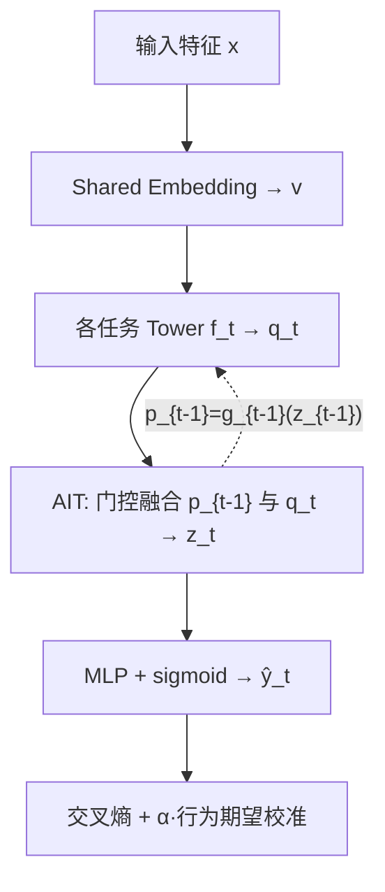
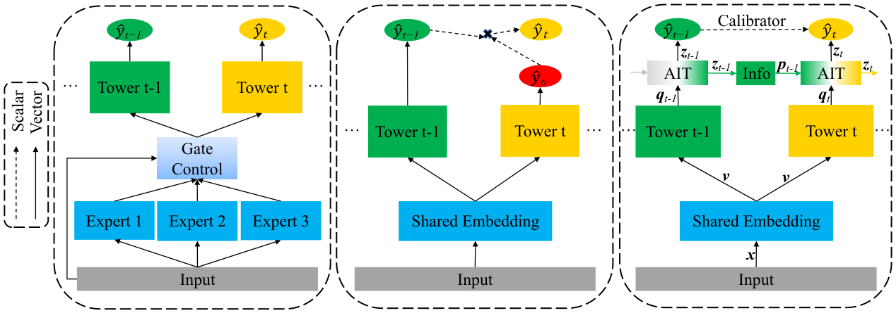

# Modeling the Sequential Dependence among Audience Multi-step Conversions with Multi-task Learning in Targeted Display Advertising (面向定向展示广告中受众多步转化序列依赖的多任务学习建模)

- **会议/期刊**: KDD 2021
- **作者与机构**: Dongbo Xi, Zhen Chen, Peng Yan, Yinger Zhang, Yongchun Zhu, Fuzhen Zhuang, Yu Chen（美团 / 浙大 / 中科院计算所 / 北航）
- **推荐链路定位**: 精排（多任务排序），线上服务于美团联名信用卡 banner 实时投放
- **研究方向**: CTR/CVR 预估与特征交叉 / 多任务学习与列表级重排
- **论文原文**: [https://arxiv.org/abs/2105.08489v2](https://arxiv.org/abs/2105.08489v2)
- **开源代码**: [https://github.com/xidongbo/AITM](https://github.com/xidongbo/AITM)

## TL;DR (1分钟核心速览)

金融广告的受众转化路径长（曝光→点击→申请→审批→激活）、每步正样本逐级稀疏、激活标签存在 T+14 延迟反馈，传统多任务学习只能做浅层专家共享或标量概率相乘，无法刻画"前步不发生则后步必不发生"的硬序相关性。本文提出 AITM：在靠近输出层的向量空间中用自适应注意力动态门控"从上一任务迁移多少信息"，并新增行为期望校准损失约束 $\hat{y}_{t-1}\ge\hat{y}_t$。在工业数据集与 Ali-CCP 上（AUC 评估）较 PLE 提升约 0.2%/0.6%，线上相比 MLP 端到端审批率 +25.00%、激活率 +42.11%。

## Background & Motivation (背景与核心矛盾)

- **主流范式**: 多任务精排分两派——Expert-Bottom（MMoE/PLE 在底层共享专家、顶层 Tower 各自独立）与 Probability-Transfer（ESMM/ESM² 在输出层做概率标量相乘）。
- **前人局限**: ① Expert-Bottom 只在浅层共享表征，而靠近输出层的向量空间承载更丰富语义却无任务间交互，序依赖完全未被显式建模；② Probability-Transfer 仅传一维标量，丢失向量空间信息，且任一概率预测偏差会沿乘积链污染全部下游任务。
- **核心洞察 (Key Insight)**: 序依赖意味着任务 $t-1$的正样本远多于$t$，其预测可作为$t$的强先验（$\hat{y}_{t-1}=0\Rightarrow\hat{y}_t=0$）；因此迁移应当是"逐样本、逐阶段"的软对齐，而非全局静态共享。
- **本文切入点**: 把信息迁移搬到输出前的向量空间，用注意力自适应学习"传什么、传多少"，再用校准项把序依赖硬约束注入损失。

## Method (核心方法设计)

### 1. 整体框架 (Overall Architecture)

输入稀疏特征经 Shared Embedding 拼接为稠密向量 $\boldsymbol{v}$，各任务 Tower 独立编码得到$\boldsymbol{q}_t$；AIT 模块以上一任务 AIT 输出$\boldsymbol{z}_{t-1}$生成迁移向量$\boldsymbol{p}_{t-1}$，与当前任务原始向量$\boldsymbol{q}_t$做门控加权融合得到$\boldsymbol{z}_t$，再由 MLP+sigmoid 输出端到端转化概率$\hat{y}_t$。训练端为多任务交叉熵叠加行为期望校准项的联合损失。第一个任务无前驱，令$\boldsymbol{z}_1=\boldsymbol{q}_1$。Tower 可为任意精排网络（DeepFM、NFM、DIFM），框架是可插拔容器。

<figure class="paper-figure" markdown="span">
  <figcaption>图 2：（a）Expert-Bottom 模式。（b）Probability-Transfer 模式。ˆ𝑦𝑜 为非端到端点击后转化率；在原论文中，多任务损失函数仅作用于 ˆ𝑦𝑡−1 和 ˆ𝑦𝑡。（c）所提出的 Adaptive Information Transfer Multi-task（AITM）框架。为简洁起见，图中仅展示两个相邻任务。</figcaption>
</figure>

### 2. 关键设计拆解 (Key Designs)

1. **自适应信息迁移 (AIT)**：痛点在前人只能浅层共享或标量相乘。算子为 $\boldsymbol{p}_{t-1}=g_{t-1}(\boldsymbol{z}_{t-1})$，$\boldsymbol{z}_t=\sum_{\boldsymbol{u}\in\{\boldsymbol{p}_{t-1},\boldsymbol{q}_t\}}w_u h_1(\boldsymbol{u})$，其中$w_u=\frac{\exp(\hat{w}_u)}{\sum_{u'}\exp(\hat{w}_{u'})}$，$\hat{w}_u=\frac{\langle h_2(\boldsymbol{u}),h_3(\boldsymbol{u})\rangle}{\sqrt{k}}$。本质是自注意力：同一输入$\boldsymbol{u}$分别投影出 Value/Query/Key，按相似度加权。直觉——对未点击用户，上一任务以接近 1 的权重强行传递"必然不转化"信号；对高置信正样本，几乎不传，避免误导。缩放$1/\sqrt{k}$ 保证了梯度稳定。

2. **行为期望校准器 (Behavioral Expectation Calibrator)**：由于序依赖，同一受众必有 $\hat{y}_{t-1}\ge\hat{y}_t$。构造松弛型 hinge 惩罚$\mathcal{L}_{lc}=\frac{1}{N}\sum_{t=2}^{T}\sum_{\boldsymbol{x}}\max(\hat{y}_t-\hat{y}_{t-1},0)$，违背单调性即产生正惩罚。相比硬截断，它可反向传播；相比顺序重归一化，它保留各任务独立校准能力。

3. **训练目标、负采样与推理效率**：总损失 $\mathcal{L}=\mathcal{L}_{ce}+\alpha\mathcal{L}_{lc}$，$\mathcal{L}_{ce}$为全空间$T$ 任务交叉熵平均。负采样上工业数据集对激活负样本降采样使正例占比保持 1%，测试集保留真实分布。推理仅增加轻量 MLP 与点积，线上 TP999 < 20ms、TP9999 < 30ms。

## Experimental Setup & Evaluation Protocol (实验设置与评估协议)

- **数据集与预处理**（频次 < 10 的特征被过滤）：

| 数据集 | #Tasks | #Train | #Validation | #Test | 各任务正例占比(%) |
| :--- | :---: | :---: | :---: | :---: | :--- |
| Industrial (美团) | 4 | 20M | 3M | 26M | 23.29 / 1.84 / 1.30 / 1.00 |
| Public (Ali-CCP) | 2 | 38M | 4.2M | 43M | 3.89 / 0.02 |

- **数据划分与防穿越**: 工业集按**全局时间顺序切分**（train/val/test 严格时序），避免未来信息泄漏；Ali-CCP 从训练集随机抽 10% 作验证集。
- **排名评测协议**: 采用工业界通用的 **AUC（Area Under ROC）** 评估排序能力，未做人工负采样排序，测试集保持线上真实分布；工业集只报告主任务 approval 与 activation，Ali-CCP 报告 click 与 purchase。
- **对比基线与超参**: 基线含 LightGBM、单任务 MLP、ESMM、OMoE、MMoE、PLE。嵌入维度 $d=5$（网格$\{1,5,10,16,32,64,128\}$），校准强度$\alpha=0.6$；5 次随机种子取均值±标准差，配对样本 t 检验。

## Key Experimental Results (实验关键数据)

### 1. 主实验对比 (Main Results)

| Model | Industrial approval | Industrial activation | Gain | Ali-CCP click | Ali-CCP purchase | Gain |
| :--- | :---: | :---: | :---: | :---: | :---: | :---: |
| LightGBM | 0.8392±0.0011 | 0.8536±0.0035 | - | 0.5837±0.0005 | 0.5870±0.0038 | - |
| MLP | 0.8410±0.0010 | 0.8602±0.0014 | +0.0018/+0.0066 | 0.6048±0.0013 | 0.5806±0.0035 | +0.0211/-0.0064 |
| ESMM | 0.8443±0.0028 | 0.8691±0.0025 | +0.0051/+0.0155 | 0.6022±0.0020 | 0.6291±0.0061 | +0.0185/+0.0421 |
| OMoE | 0.8438±0.0022 | 0.8714±0.0009 | +0.0046/+0.0178 | 0.6049±0.0020 | 0.6405±0.0041 | +0.0212/+0.0535 |
| MMoE | 0.8444±0.0026 | 0.8705±0.0009 | +0.0052/+0.0169 | 0.6047±0.0017 | 0.6420±0.0031 | +0.0210/+0.0550 |
| PLE | **0.8518**±0.0006 | **0.8731**±0.0016 | +0.0126/+0.0195 | 0.6039±0.0014 | 0.6417±0.0013 | +0.0202/+0.0547 |
| **AITM** | **0.8534**±0.0011** | **0.8770**±0.0005* | **+0.0142/+0.0234** | **0.6043**±0.0016 | **0.6525**±0.0024** | +0.0206/**+0.0655** |

### 2. 消融实验 (Ablation Study)

| 实验配置 | approval AUC | activation AUC | 说明 |
| :--- | :---: | :---: | :--- |
| $T=1$（仅 activation 单任务） | 0.8502 | 0.8663 | 无迁移，最弱 |
| $T=2$（approval→activation） | 0.8521 | 0.8740 | 一阶迁移有效 |
| $T=3$（application→approval→activation） | 0.8530 | 0.8761 | 多级链式迁移继续增益 |
| $T=4$（click→…→activation，完整） | **0.8534** | **0.8770** | 全链最佳 |
| 无 Calibrator（$\alpha=0$） | 0.8516 | 0.8724 | 序约束带来 ~0.4% AUC |
| 无 AIT（仅 q_t 拼接 p_{t-1}） | 0.8498 | 0.8720 | 自适应门控是核心 |

### 3. 关键实验发现 (Key Findings)

1. **序依赖的可视化证据**：图 4 的 t-SNE 显示，在高置信（Top 0%–50%）区间三路信息均能清晰区分正负样本；但在低置信（Top 50%–100%）区间仅用原始 $\boldsymbol{q}_t$ 完全混杂，迁移后显著可分，经 AIT 加权后边界最清晰——证明迁移价值集中在"模型自己拿不准"的长尾样本上。
2. **迁移权重的语义可解释性**：图 6 的案例分析显示，当前一任务标签为 0（红线上权 $w_u\to1$）时强迁移"负向信号"；前一任务为 1 但后一任务为 1（绿线）时几乎不传（避免噪声稀释）；而前一任务为 1、后一任务预测失败（logloss 排位升高）时迁移权重缓慢上升，说明模型在自动学习"何时该信前验、何时该独立判断"。
3. **正负比与任务数的单调效应**：图 5(c) 中正例占比从 0.025% 到 1% AUC 单调上升，超过 2.5% 后因激活负样本欠采样过猛而急剧下降（最优固定 1%）；图 5(d) 任务数 1→4 单调提升 AUC，验证多级链式正样本冗余是缓解稀疏的关键资源。线上 A/B 相比 MLP：approval +25.00%、activation +42.11%，端到端效果远超离线 AUC 的微小差异。

## Highlights & Limitations (亮点、对比与审稿批判)

- **与代表作对比 (vs. Prior Work)**: ESMM 用标量概率相乘构造 CTCVR，丢失向量空间表达且一损俱损；MMoE/PLE 在底层共享 Expert 却让顶层 Tower 完全隔离；AITM 在"最接近输出层"的向量空间做样本级门控融合，把信息流从静态共享变为动态路由，且天然兼容任意 Tower。
- **可迁移亮点**: ① 用 $\max(\hat{y}_t-\hat{y}_{t-1},0)$ 的单调松弛损失即可在任意多任务架构上注入序约束，可迁移至曝光→点击→加购→成交等电商漏斗；② 注意力门控按样本自适应分配迁移权重，可推广到主任务+辅助任务（如 CTR 主任务搭 CVR / 时长辅助任务）的蒸馏式融合。
- **审稿级局限批判**: ① 离线 AUC 提升在工业数据仅 0.2% 量级，与线上 +42% 的巨大差异缺乏深入的因果解释，可能混入流量分配、T+14 延迟窗口等混杂因素；② AIT 采用串行链式结构，任务数 $T$ 增大时误差会沿链累积，缺少对"前任务误判污染后任务"的理论分析与鲁棒性上界。

## Rating (四维评分)

- **方法创新性 (Novelty)**: ⭐⭐⭐⭐ （把信息迁移搬到输出层向量空间并用注意力自适应门控，是可插拔的通用多任务范式，但注意力+单调校准的组合并非全新机制）
- **评估协议与实验扎实度 (Protocol & Experiments)**: ⭐⭐⭐⭐ （工业+公开双数据集、时序切分、5 种子±std 与配对 t 检验齐备，线上 A/B 两周对比，唯离线 AUC 增量偏小）
- **写作与数学规范度 (Clarity & Rigor)**: ⭐⭐⭐⭐ （公式精炼、$w_u$ 的 V/Q/K 解释清晰，但缺误差累积与复杂度分析）
- **工业落地与复现价值 (Industrial & Practical Value)**: ⭐⭐⭐⭐⭐ （已在美团全量流量上线、TP999<20ms、代码开源，可作为序依赖多任务精排的事实基线）

