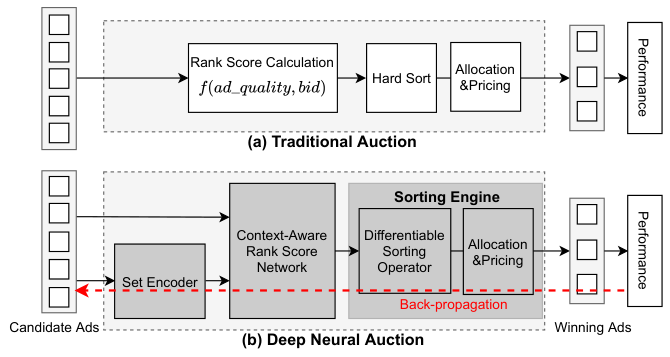
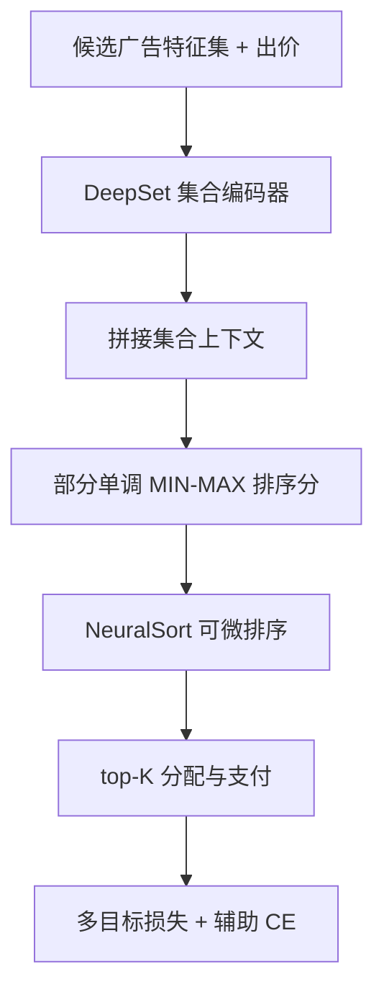
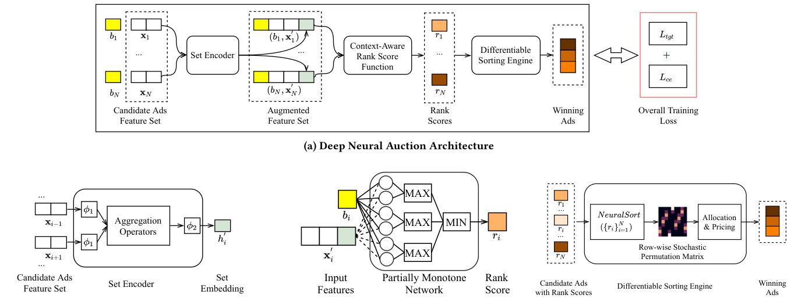

# Neural Auction: End-to-End Learning of Auction Mechanisms for E-Commerce Advertising（神经拍卖：电商广告拍卖机制的端到端学习）

- **会议/期刊**: KDD 2021
- **作者与机构**: Xiangyu Liu, Chuan Yu, Zhilin Zhang 等；阿里巴巴集团、上海交通大学
- **推荐链路定位**: 精排打分 + 拍卖分配/定价机制（多槽重排）
- **研究方向**: CTR/CVR 预估与特征交叉 / 多任务学习与列表级重排
- **论文原文**: [论文原文链接](https://arxiv.org/abs/2106.03593v2)
- **开源代码**: 暂未开源

## TL;DR (1分钟核心速览)

传统 GSP/uGSP 依赖固定排序分，难以同时优化用户体验、广告主效用与平台收入；且 top-K 分配中的离散排序不可导，反馈无法反传。DNA 用 DeepSet 编码候选集合上下文，以部分单调 MIN-MAX 网络生成上下文感知排序分，并用 NeuralSort 将 argsort 松弛为行随机置换矩阵，实现端到端多目标拍卖学习。淘宝 5M 训练/870k 测试数据上，同 RPM 水平下相对 uGSP 提升 CTR 11.58%、CVR 31.26%、GPM 16.17%。

## Background & Motivation (背景与核心矛盾)

- **主流范式**: 工业界以 GSP、uGSP 为主，按 eCPM 或线性加权分数排序并收取临界价；Deep GSP 进一步用深度网络学习排序分，但以策略搜索优化。
- **前人局限**: 其一，GSP/uGSP 的排序规则固定且线性，难以在动态竞争环境中同时优化多个冲突指标；其二，拍卖分配与定价含离散 top-K 排序，与深度学习的连续端到端训练不相容。
- **核心洞察 (Key Insight)**: 同一广告特征在不同候选集合中可能“赢/输”矛盾，普通逐广告 MLP 难以消歧；若把整组候选的集合上下文注入排序分，并保持对出价的单调性与临界价支付，就能在近似 GSP 经济性质的同时获得强表达能力。
- **本文切入点**: 将“集合编码 + 部分单调打分 + 可微排序”组合为可反传的拍卖层。

<figure class="paper-figure" markdown="span">
  <figcaption>图 1：传统拍卖与 Deep Neural Auction 的对比。采用集合编码器和上下文感知排序分数网络提取拍卖特征，与传统拍卖中固定的排序分数相比，这提升了排序分数的表示空间和灵活性。此外，可微排序引擎使拍卖（包括分配和定价）关于输入连续且可微，从而支持端到端反向传播训练。</figcaption>
</figure>

## Method (核心方法设计)

### 1. 整体框架 (Overall Architecture)

DNA 接收一次 PV 请求下全部候选广告的特征集与出价，先由 DeepSet 集合编码器聚合候选上下文，并将集合嵌入拼接到每个广告特征；随后共享的 MIN-MAX 部分单调网络输出每个广告的上下文感知排序分；NeuralSort 将排序分松弛为行随机置换矩阵，用矩阵乘得到 top-K 分配与支付；最后以真实反馈构造多目标损失与辅助排序交叉熵，端到端更新集合编码器和打分网络。推理时温度置零，退化为硬排序。

<figure class="paper-figure" markdown="span">
  <figcaption>图 2：(a) Deep Neural Auction 的整体架构。(b) 基于 Deep Set 的集合编码器接收完整的广告特征集合并输出集合嵌入。(c) 基于部分单调 MIN-MAX 神经网络的上下文感知排序分数函数。实线表示带非负权重的连接，虚线表示无约束连接。(d) 可微排序引擎接收生成的排序分数，并通过 NeuralSort 输出 argsort 的行随机置换矩阵及其对应的分配和支付。</figcaption>
</figure>

### 2. 关键设计拆解 (Key Designs)

1. **DeepSet 集合上下文编码**：逐广告打分无法感知竞争环境，导致同样特征在不同 PV 中标签矛盾。本文先以共享 MLP 映射每个候选，再对“除自身外”的隐状态做平均池化并二次映射：
   $\boldsymbol{h}'_i=\sigma\!\left(\phi_2\left(\mathrm{avgpool}(\{\boldsymbol{h}_j\}_{j\neq i})\right)\right)$。
   集合编码器刻意不输入出价，使某广告的排序分只通过自己的 $b_i$ 受出价影响，为 IC 留出结构条件；同时置换等变聚合消除候选顺序敏感性。

2. **部分单调 MIN-MAX 排序分与闭式支付**：为兼顾表达力与 GSP 的单调分配/临界价条件，排序分限定为对出价严格非降的 MIN-MAX 线性族：
   $r_i=\min_{q\in[Q]}\max_{z\in[Z]}\left(e^{w_{qz}}b_i+w'_{qz}\cdot \boldsymbol{x}'_i+\alpha_{qz}\right)$。
   正权 $e^{w_{qz}}$ 保证单调性，MIN-MAX 结构保留通用逼近能力；其反函数有闭式解，支付可直接写为
   $p_i=\max_{z}\min_{q}e^{-w_{qz}}\left(r_{i+1}-\alpha_{qz}-w'_{qz}\cdot \boldsymbol{x}'_i\right)$。
   这避免显式求逆，也把“临界价”嵌入网络结构。

3. **可微排序、损失与推理**：用 NeuralSort 将 argsort 连续化：
   $\hat{M}_r[k,:]=\mathrm{softmax}\left(c_k/\tau\right)$，其中$c_k=(N+1-2k)r-A_r\mathbf{1}$，$A_r$为两两绝对差矩阵。top-K 支付可由$\hat{M}_r[1:K,:]\cdot p$ 得到。主损失为
   $\mathcal{L}_{tgt}=-\sum_{i=1}^{K}\hat{M}_r[i,:]\cdot F_{all}$，并以真实反馈排序的置换矩阵作辅助行交叉熵$\mathcal{L}_{ce}$稳定训练；收入项用生成支付替代记录支付。稀疏转化采用校准后的 pCTR/pCVR，并按槽位后验 CTR 去偏。在线推理$\tau=0$，无额外组合搜索开销。

## Experimental Setup & Evaluation Protocol (实验设置与评估协议)

- **数据集与预处理**: 淘宝广告日志，训练集为 2020-07-04 的 5M 条 GSP 拍卖记录，测试集为 2020-07-05 的 870k 条；每次 PV 取 top-3 槽位。特征含出价、pCTR/pCVR、广告类目与价格、用户性别/年龄/收入、流量来源等。原论文未采用推荐系统常见的 5-core 过滤。

| 数据集 | #Users | #Items | #Interactions | 稀疏度/密度 | 特征/场景说明 |
| :--- | :---: | :---: | :---: | :---: | :--- |
| Taobao 训练 | 未披露 | 未披露 | 5M PV 拍卖 | 未披露 | 工业电商广告，top-3 槽位 |
| Taobao 测试 | 未披露 | 未披露 | 870k PV 拍卖 | 未披露 | 次日日志，全局时间切分 |

- **数据划分与防穿越 (Splitting Strategy)**: 按日期做全局时间切分，训练/测试分别取 7 月 4 日与 7 月 5 日日志，避免未来反馈泄漏。
- **排名评测协议 (Ranking Protocol)**: 非全库 Full-Ranking，也非采样负例排序；属于 PV 内候选集合的拍卖仿真/记录反馈重放，比较不同机制在相同 PV 候选上的 top-3 分配及真实反馈指标。
- **对比基线与超参设置**: 基线为 GSP（调节 squashing 指数 $\sigma\in[0.5,2.0]$）、uGSP、Deep GSP；IC 对照加入 uGFP。Deep GSP 与 DNA 的多目标权重$\lambda$在$[0,1]$网格搜索；在线对比时先调$\lambda$使 RPM 与 uGSP 对齐，再比较 CTR/CVR/GPM。原论文未报告嵌入维度与显著性检验，仅报告排序分-目标相关性 Pearson$\rho=0.989$、$p<10^{-7}$。

## Key Experimental Results (实验关键数据)

### 1. 主实验对比 (Main Results)

原文离线结果主要以 Pareto 前沿图呈现：所有学习型机制均优于 GSP/uGSP，DNA 在 RPM-CTR、RPM-CVR、RPM-GPM 三个平面上均位于 Deep GSP 外侧。下表汇总在线 A/B 的同 RPM 对比（相对 uGSP）与长期对比（相对 GSP）。

| 机制/实验 | RPM | CTR Δ | CVR Δ | GPM Δ | 说明 |
| :--- | :---: | :---: | :---: | :---: | :--- |
| uGSP（同 RPM 基准） | 对齐 | 0 | 0 | 0 | 线性多目标排序分 |
| Deep GSP（同 RPM） | 对齐 | +6.43% | +6.38% | +2.77% | 逐广告打分 + 策略搜索 |
| **DNA（同 RPM）** | 对齐 | **+11.58%** | **+31.26%** | **+16.17%** | 集合编码 + 可微排序 |
| GSP（长期基准） | 基准 | 0 | 0 | 0 | 固定 eCPM 规则 |
| **DNA（近两月 vs GSP）** | **+5.68%** | **+18.93%** | **+14.68%** | **+14.53%** | 全指标同升 |

机制性质方面，DNA 的价值 regret $\Psi_v$在四组任务均为 0，支付 regret$\Psi_p$仅 0.028%–0.118%；uGFP 的$\Psi_p$ 为 13.312%–21.616%，说明单调打分与临界价支付确实抑制了策略性压价空间。

### 2. 消融实验 (Ablation Study)

原论文未提供标准逐项数值消融表；以下依据图 5 学习曲线与 Deep GSP 对照整理，避免臆造数值。

| 变体/对照 | 证据来源 | 观测结论 |
| :--- | :--- | :--- |
| DNA 完整模型 | 图 5、在线 A/B | 四个训练任务上目标最高、收敛最稳 |
| w/o Set Encoder | 图 5 学习曲线 | 移除集合上下文后收敛更慢、目标性能更低，验证集合编码是主要增益源之一 |
| w/o NeuralSort（Deep GSP 式策略搜索） | 表 2 | 同 RPM 下 CTR/CVR/GPM 增益分别仅 +6.43%/+6.38%/+2.77%，显著低于 DNA |
| w/o 辅助 $\mathcal{L}_{ce}$ | 原文训练分析 | 作者称辅助排序任务带来更稳定训练，但未给独立数值 |
| w/o 单调约束 | 理论分析 | 将失去单调分配/临界价保证，IC/IR 不再成立；未给独立实验 |

### 3. 关键实验发现 (Key Findings)

1. **上下文集合编码贡献最大**：同 RPM 下 DNA 的 CVR 提升 31.26%，约为 Deep GSP 的 4.9 倍；Deep GSP 仅逐广告打分，说明候选集合上下文是消解“同特征不同胜负”歧义的关键。
2. **可微排序优于策略搜索**：Deep GSP 用 RL 式策略搜索优化排序分，CTR 仅 +6.43%；DNA 直接对排序过程反传，CTR 提升至 +11.58%，体现更高数据效率。
3. **多目标不牺牲收入且机制更稳**：近两月在线对比 GSP，RPM 与 CTR/CVR/GPM 同时提升 5.68%/18.93%/14.68%/14.53%；DNA 的支付 regret 仅 0.028%–0.118%，远低于 uGFP 的 13%–22%。

## Highlights & Limitations (亮点、对比与审稿批判)

- **与代表作对比 (vs. Prior Work)**: uGSP 用固定线性加权排序分，表达力受限；Deep GSP 虽学习排序分，但逐广告独立编码且依赖策略搜索；DNA 首次把集合上下文、部分单调结构与可微排序统一进工业 GSP 框架，实现端到端多目标优化。
- **可迁移亮点**: 用 DeepSet 构造 PV 级竞争上下文特征，可直接迁移到重排与多候选联合打分；用“部分单调网络 + 闭式反函数”把业务约束（如出价单调、支付临界价）编码进结构，值得用于计费/配额约束场景。
- **审稿级局限批判**: 其一，IC 并非严格成立：工程特征可能与出价相关，破坏“出价仅通过 $b_i$影响自身排序分”的假设，作者也将其留作开放问题；其二，离线评估是记录日志重放，缺少 Full-Ranking/采样排序协议与显著性检验，且仅单一平台在线验证，温度$\tau$与多目标$\lambda$ 的敏感性、训练/推理成本均未量化。

## Rating (四维评分)

- **方法创新性 (Novelty)**: ⭐⭐⭐⭐ （把 NeuralSort 可微排序嵌入 GSP 拍卖，并以部分单调网络保证经济性质，机制设计与深度学习结合新颖）
- **评估协议与实验扎实度 (Protocol & Experiments)**: ⭐⭐⭐ （5M/870k 离线加近两月在线 A/B 很有说服力，但离线仅图无数值、无显著性检验、消融不完整）
- **写作与数学规范度 (Clarity & Rigor)**: ⭐⭐⭐⭐ （三大模块与公式链条清晰，支付闭式解推导完整；IC 假设与工程特征冲突讨论略保守）
- **工业落地与复现价值 (Industrial & Practical Value)**: ⭐⭐⭐⭐ （淘宝近十亿次拍卖在线部署且全指标提升，落地价值高；但未开源，依赖自动出价与工程特征，复现门槛较高）

