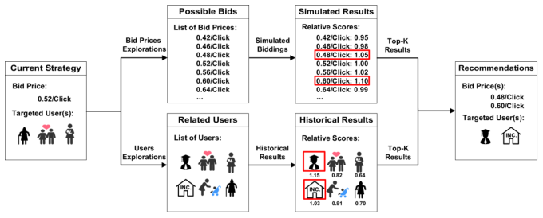
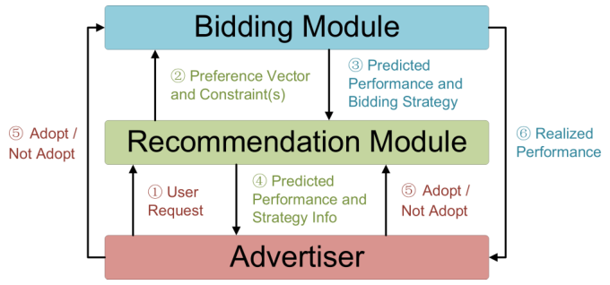
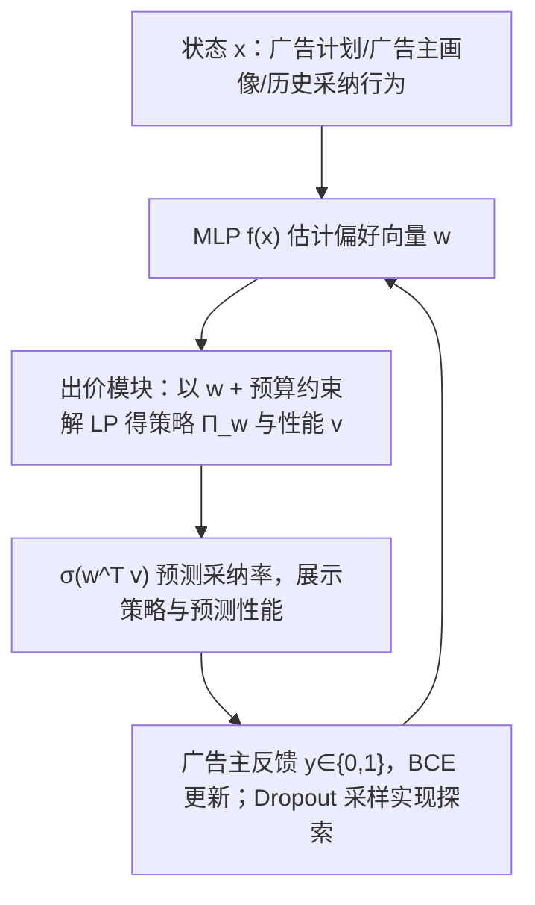

# We Know What You Want: An Advertising Strategy Recommender System for Online Advertising (知你所求：在线广告的广告策略推荐系统)

- **会议/期刊**: KDD 2021 (Proceedings of the 27th ACM SIGKDD)
- **作者与机构**: Liyi Guo, Haoqi Zhang, Zhenzhe Zheng, Fan Wu (上海交通大学 / 南京大学)；Junqi Jin, Zhiye Yang, Chuan Yu, Yuning Jiang, Xiaoqiang Zhu 等 (阿里巴巴)
- **推荐链路定位**: 广告主侧策略推荐（召回候选出价/定向策略 → 排序展示，属决策级推荐而非物品召回）
- **研究方向**: CTR/CVR 预估与特征交叉 / 强化学习与动态探索推荐
- **论文原文**: [https://arxiv.org/abs/2105.14188v3](https://arxiv.org/abs/2105.14188v3)
- **开源代码**: 暂未开源

## TL;DR (1分钟核心速览)

在线广告平台只提供有限的预设优化目标（点击、GMV），广告主无法表达细粒度目标，只能靠高成本试错摸索出价策略。本文把"广告策略推荐"重构为**学习广告主对多 KPI 的偏好权重 $\mathbf{w}$**：MLP 由广告计划上下文回归$\mathbf{w}$，出价模块据此解 LP 得到策略与预测性能$\mathbf{v}$，再以$\sigma(\mathbf{w}^\top\mathbf{v})$ 预测采纳率并用 Dropout 近似 Thompson Sampling 做探索。淘宝仿真环境 2000 轮交互中，累计期望后悔较随机偏好策略降低 61.19%，累计采纳率由 0.7606 提升至 1.0（+31.5%）。

## Background & Motivation (背景与核心矛盾)

- **主流范式**: 平台侧已有成熟的 auto-bidding（BCB/MCB）与 RTB 算法，只要目标 $\mathbf{w}^*$ 给定，RL/线性规划即可解出最优出价；因此瓶颈不在"怎么投"，而在"投什么目标"。
- **前人局限**: ① 信息不对称——广告主看不到实时竞价环境，自服务投放流程只给少数几个粗粒度目标（图1），新广告主因目标未被满足大量流失；② 用户侧推荐范式不可直接迁移——用户有点击/购买这类显式偏好信号，而广告主缺少对"策略性能"的预测能力，且策略空间是**高维连续空间**而非离散商品库。
- **核心洞察 (Key Insight)**: 广告主真正在意的不是出价数字本身，而是**策略带来的多 KPI 性能向量**；采纳/拒绝行为即是对偏好权重的隐式标注，可通过 Bandit 从交互中反推。
- **本文切入点**: 把"目标识别"降维为"偏好权重回归"，再用上下文 Bandit 让推荐（利用）与偏好探测（探索）在同一损失中共存。

<figure class="paper-figure" markdown="span">
  <figcaption>图2：原型推荐系统：出价优化模块与目标用户优化模块。</figcaption>
</figure>

## Method (核心方法设计)

### 1. 整体框架 (Overall Architecture)

推荐模块接收广告计划状态 $\mathbf{x}$（广告主画像、历史采纳行为、场景），经 MLP 输出偏好向量$\mathbf{w}$；$\mathbf{w}$与预算/PPC 约束一并送入出价模块，由离线线性规划在拍卖仿真器上求出最优策略$\Pi_\mathbf{w}$与性能$\mathbf{v}$；系统把"策略 + 预测性能"成对展示给广告主（比只给 bid 更可解释），广告主的采纳$y\in\{0,1\}$ 作为奖励回流，用 BCE 更新网络。整个闭环把"目标未知"转成"连续动作空间的 Bandit 决策"，探索通过推理期 Dropout 采样实现。

<figure class="paper-figure" markdown="span">
  <figcaption>图3：广告策略推荐系统的架构。</figcaption>
</figure>

### 2. 关键设计拆解 (Key Designs)

1. **偏好向量参数化（把离散目标枚举变成连续回归）**：痛点是不存在有限 arm 集合可供 $\epsilon$-greedy/UCB 枚举，且每个候选$\mathbf{w}$都要解一次大规模 LP，代价不可接受。作者令$\mathbf{w}=f(\mathbf{x})$，把动作选择收敛为一次前向，广告主目标是$\mathbf{w}^{*\top}\mathbf{v}$，推荐策略即$\Pi_{\mathbf{w}^*}=\arg\max_{\Pi}\mathbf{w}^{*\top}\mathbf{v}_\Pi$；物理直觉是"相似广告主在相似营销阶段有相似 KPI 权衡"，从而可用上下文泛化到冷启动广告主。

2. **采纳率似然 + Dropout 即贝叶斯（探索-利用统一）**：核心假设是采纳率随广告主所得效用单调增，故 $p(\text{Adopt})=\sigma(\mathbf{w}^\top\mathbf{v})$（$\mathbf{v}$ 按预算归一化以只保留相对值）。以此为判别头，BCE 损失为
$$\mathcal{L}=-\frac{1}{N}\sum_{(\mathbf{x},\mathbf{v},y)\in\mathcal{D}}\big[y\log p+(1-y)\log(1-p)\big].$$
探索侧不做显式 $\epsilon$ 扰动，而是用 Dropout 作为深度网络不确定性的贝叶斯近似：每次前向随机屏蔽神经元等价于采样一组参数，即一次 Thompson Sampling 假设检验，使"高概率参数更常被采到、被接受或否决得更快"。

3. **训练目标、负采样与推理开销**：损失即上式 BCE，批次内正负样本强制 $1{:}1$以防采纳稀疏导致退化；历史采纳记录经平均池化后进入$\mathbf{w}$的上下文。推理阶段关闭 Dropout，输出单一$\mathbf{w}$并调用一次 LP 求出价策略；论文未提供在线服务延迟数据，但相比"对候选$\mathbf{w}$网格逐一仿真"，该设计把动作评估成本从$O(|\mathcal{A}|)$降到$O(1)$ 网络前向 + 1 次 LP。

## Experimental Setup & Evaluation Protocol (实验设置与评估协议)

- **数据集与预处理**: 无公开数据集，作者自建仿真环境（bidding module 用淘宝展示广告竞价日志 + 离线 LP；advertiser module 用 conditional logit 模拟采纳）。线上部分为淘宝真实 A/B。

| 数据/环境 | 规模与设置 | 指标维度 | 交互/周期 | 说明 |
| :--- | :---: | :---: | :---: | :--- |
| 淘宝竞价日志（仿真） | 广告计划共享历史 bidding logs，每计划有预算 $B$与$\mathbf{w}^*$|$\mathbf{v}=[\text{PV},\text{Click},\text{GMV}]$($n=3$) | 2000 轮 |$\mathbf{w}^*=\mathbf{A}\cdot\mathbf{c}$，$\mathbf{A}$为$n\times m$典型偏好矩阵，$\mathbf{c}$为广告主特征权重，agent 可观$\mathbf{A},\mathbf{c}$ |
| 线上 A/B（2020-05-14~05-27） | 同 ARPU 分层，实验组/对照组各半，占平台日耗约 30% | ARPU、RPM、CTR、CVR、ROI 等 | 14 天 | 所有广告主此前均未用过该系统 |

- **数据划分与防穿越 (Splitting Strategy)**: 非静态划分，而是**在线交互式评估**——模型与环境边交互边更新（$T$ 轮序列决策），因此不存在传统 train/test 切分；线上 A/B 以广告主为单位做随机分流以避免同主体泄漏。
- **排名评测协议 (Ranking Protocol)**: 不使用 Full-Ranking 或 Sampled Ranking，采用 Bandit 标准指标：**累计期望后悔** $R(T)=\mathbb{E}\big[\sum_t r_{t,\mathbf{w}^*_t}\big]-\mathbb{E}\big[\sum_t r_{t,\mathbf{w}_t}\big]$与**累计采纳率**$\sum_t r_{t,\mathbf{w}_t}/T$，均按列最大值归一化（越小/越大越好）。
- **对比基线与超参设置**: 基线包括 Random Preference（无学习模块）、No Dropout、以及 Dropout ∈ {20%, 40%, 60%, 80%}、Dropout(40%) 去掉偏好相关特征；仿真采纳概率由条件 logit 生成，效用 $u=\alpha\cdot\frac{\mathbf{w}^{*\top}\mathbf{v}}{\mathbf{w}^{*\top}\mathbf{v}-\mathbf{w}^{*\top}\mathbf{v}'}$，拒绝效用为常数$C$；优化器 Adam + mini-batch SGD，正负比$1{:}1$。

## Key Experimental Results (实验关键数据)

### 1. 主实验对比 (Main Results)

| 模型 | 累计期望后悔 Metric 1 ↓ | Improv. (vs. Random) | 累计采纳率 Metric 2 ↑ |
| :--- | :---: | :---: | :---: |
| Random Preference (无学习模块) | 1.0000 | — | 0.7606 |
| No Dropout | 0.7429 | 25.71% | 0.8239 |
| Dropout 40%, 无偏好相关特征 | 0.7195 | 28.05% | 0.8535 |
| Dropout 80% | 0.5384 | 46.16% | 0.9144 |
| Dropout 20% | 0.4154 | 58.46% | 0.9725 |
| Dropout 60% | 0.4078 | 59.22% | 0.9817 |
| **Dropout 40% (完整模型)** | **0.3881** | **61.19%** | **1.0000 (+31.5%)** |

**线上 A/B（原型系统，Table 1，相对对照组）**: ARPU **+1.2%**、RPM +0.8%、CTR +1.0%、CVR +1.9%、点击量 +1.5%、支付笔数 **+3.3%**、支付金额 **+4.3%**、ROI **+3.1%**、消耗 +1.3%、PV +0.5%。出价模块与定向模块的开通率 15.8% / 25.4%，平均采纳率仅 4.5% / 3.8%，说明"广告主会谨慎挑选少数推荐"，正是引入个性化学习模块的动机。

### 2. 消融实验 (Ablation Study)

| 消融配置 | Metric 1 ↓ | Δ vs. Full | Metric 2 ↑ | Δ vs. Full |
| :--- | :---: | :---: | :---: | :---: |
| Full: Dropout 40% | 0.3881 | — | 1.0000 | — |
| w/o Dropout（纯利用） | 0.7429 | +91.4% | 0.8239 | −17.6% |
| w/o 偏好相关特征 | 0.7195 | +85.4% | 0.8535 | −14.7% |
| w/o 学习模块（随机偏好） | 1.0000 | +157.7% | 0.7606 | −23.9% |

另：三种典型目标（$[1,0,0]^\top$优化 PV、$[0,1,0]^\top$优化点击、$[0,0,1]^\top$ 优化 GMV）在仿真中各自目标 KPI 均达到归一化 1.0000，但另两项 KPI 只有 0.67–0.85，证实"目标设定不同 → 性能向量显著分化"，即偏好识别具有实质经济价值。

### 3. 关键实验发现 (Key Findings)

1. **偏好建模的收益远大于探索技巧**：仅去掉学习模块（随机偏好）就使后悔从 0.3881 恶化到 1.0000（+157.7%）、采纳率从 1.0 掉到 0.7606；而即使完全不做 Dropout（纯利用），也已比随机基线降 25.71% 后悔，说明上下文到 $\mathbf{w}$ 的映射本身是主要增益来源。
2. **探索强度存在明确的 U 型最优点**：Dropout 从 20%→40% 后悔继续下降（0.4154→0.3881）、采纳率升至 1.0，但 60%/80% 时后悔回升（0.4078/0.5384），对应"低比例探索过于保守、高比例频繁扰动无法利用已学知识"的双向失效。
3. **偏好相关特征是泛化关键**：去掉 $\mathbf{w}$ 相关输入后，模型仅靠历史采纳行为，后悔回升至 0.7195（+85.4%）、采纳率跌至 0.8535；图5 的曲线在整个 2000 轮上均劣于完整模型，说明模型确实通过理解与偏好相关的语义信息来实现对新广告主的推断，而非仅记忆采纳序列。

## Highlights & Limitations (亮点、对比与审稿批判)

- **与代表作对比 (vs. Prior Work)**: 相对经典用户侧 CF/内容推荐（[1,20,27,30,31]），本文的"物品"是抽象出价策略、"偏好信号"是高成本采纳而非免费点击，因而不能直接监督学习；相对 RTB 系列（[35,37,38,39]），那些工作把优化目标 $\mathbf{w}^*$当作已知输入，本文恰恰补上了"目标从哪来"这一上游缺口；相对标准 contextual bandit（LinUCB/$\epsilon$-greedy），本文用 MLP + Dropout 绕开了连续高维动作空间无法枚举 arm 的根本障碍。
- **可迁移亮点**: ① 用"预测性能 + 策略"成对展示替代裸参数展示，可显著提升决策类推荐的采纳率与可解释性；② 用 Dropout 作为廉价 Thompson Sampling 近似，在任何"动作空间连续、单次评估昂贵"的推荐场景（预算分配、合约定价、广告排期）均可直接复用。
- **审稿级局限批判**: ① **评估闭环自证**——仿真环境的采纳行为由作者设计的条件 logit 与 $\mathbf{w}^*=\mathbf{A}\mathbf{c}$生成，与式(4) 的$\sigma(\mathbf{w}^\top\mathbf{v})$同源假设，模型天然契合数据生成过程，离线增益（+61%）难以外推；② **线上证据薄弱且错位**——A/B 只验证了"确定性排序的原型系统"（ARPU +1.2%），而带 Bandit 学习的新系统尚未上线，且 KPI 维度仅$n=3$、Dropout 比例需人工调至 40% 才最优，超参敏感度与真实延迟/算力开销均未报告；③ 无开源代码与公开数据，复现门槛高。

## Rating (四维评分)

- **方法创新性 (Novelty)**: ⭐⭐⭐⭐ （首次将"广告主目标识别"形式化为连续偏好向量上的 contextual bandit，并用 Dropout 近似贝叶斯探索，问题定义本身比算子更出新）
- **评估协议与实验扎实度 (Protocol & Experiments)**: ⭐⭐⭐ （有真实线上 A/B 与 2000 轮交互曲线，但仿真采纳模型与推荐模型同源假设，缺少跨数据分布与延迟指标）
- **写作与数学规范度 (Clarity & Rigor)**: ⭐⭐⭐⭐ （从 $\mathbf{w}^{*\top}\mathbf{v}$目标、后悔定义到 BCE 与条件 logit 仿真链路完整自洽；式(4) 用同一$\mathbf{w}$诱导的$\mathbf{v}$ 自评分略显循环）
- **工业落地与复现价值 (Industrial & Practical Value)**: ⭐⭐⭐⭐ （原型已在淘宝展示广告上线并带来 ARPU +1.2%、ROI +3.1%，架构可直接迁移到任何"平台代决策"场景；但无开源代码，复现依赖自建拍卖仿真器）

