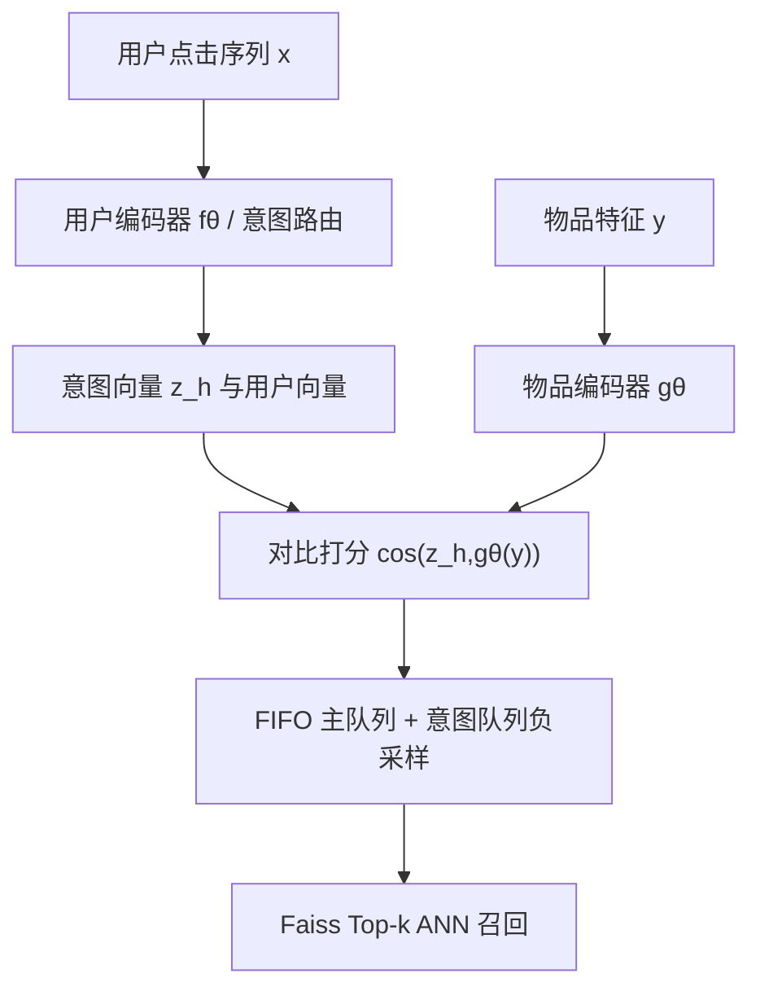
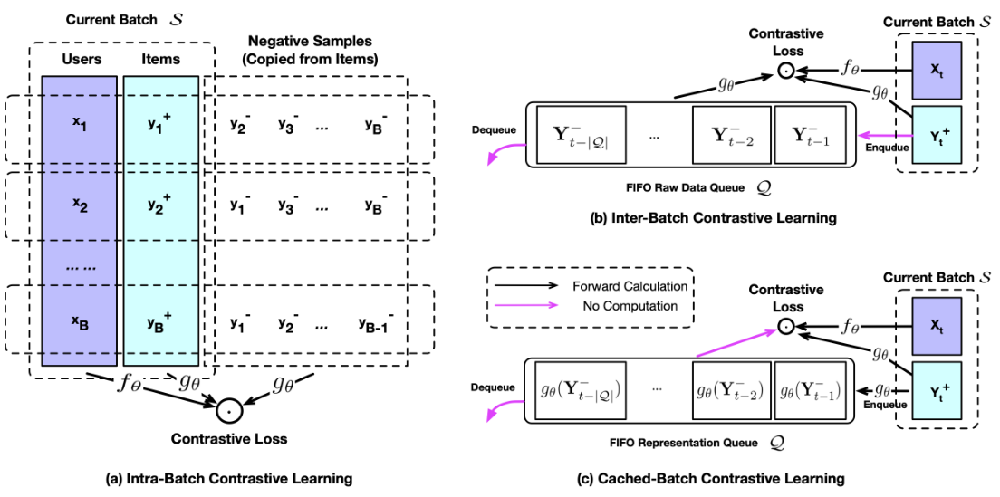

# Contrastive Learning for Debiased Candidate Generation in Large-Scale Recommender Systems（大规模推荐系统中去偏候选生成对比学习）

- **会议/期刊**: KDD 2021
- **作者与机构**: Chang Zhou, Jianxin Ma, Jianwei Zhang, Jingren Zhou, Hongxia Yang；阿里巴巴 DAMO Academy
- **推荐链路定位**: 召回（深度候选生成 DCG）
- **研究方向**: 去偏公平、可信隐私与工业架构 / 自监督对比学习与交互去噪
- **论文原文**: [https://arxiv.org/abs/2005.12964v9](https://arxiv.org/abs/2005.12964v9)
- **开源代码**: 暂未开源

## TL;DR (1分钟核心速览)

针对大规模深度召回沿用MLE/sampled softmax会复制旧系统曝光偏差、加剧马太效应，本文证明常用对比损失在负采样分布取倾向分时与IPW同解，据此设计FIFO队列CLRec与多意图多队列Multi-CLRec。公开集按BERT4Rec/HPMN协议做next-item与AUC评测，淘宝全量在线四个月A/B中CTR 5.87%→6.30%，聚合多样性翻倍且流行度指数0.658→0.224。

## Background & Motivation (背景与核心矛盾)

- **主流范式**: 工业DCG普遍采用双塔表示学习+Faiss ANN召回，训练以sampled softmax近似MLE，负样本常按物品流行度从proposal分布采样。
- **前人局限**: 训练点击来自旧推荐系统，属于MNAR曝光偏差；MLE为忠实拟合观测数据会持续低估未曝光高质量物品。且物品词表约1亿，远大于语言词表，full softmax不可行。
- **IPW的两难**: 传统IPW可校正曝光偏差，但需两阶段训练倾向模型，且$1/q(y|x)$在小倾向时高方差，难以直接用于亿级DCG。
- **核心洞察 (Key Insight)**: 对比损失Eq.(3)去掉sampled softmax中的$-\log p_n(y|x)$后，若$p_n(y|x)=q(y|x)$，其最优解与IPW同解，均逼近$r(y|x)=\frac{p_{\mathrm{data}}(y|x)/q(y|x)}{\sum_{y'}p_{\mathrm{data}}(y'|x)/q(y'|x)}$。
- **本文切入点**: 用队列隐式构造接近点击/曝光分布的负样本，把IPW去偏转为无需倾向估计器的对比学习实现。

## Method (核心方法设计)

### 1. 整体框架 (Overall Architecture)

输入用户点击序列$x$与候选物品$y$，分别经用户编码器$f_\theta(x)$、物品编码器$g_\theta(y)$映射到$d$维空间。CLRec用FIFO队列缓存当前及历史batch的正样本（或其表示），以队列样本作为负例计算对比损失，隐式按$p_{\mathrm{data}}(y)$近似倾向分布采样。Multi-CLRec进一步用$H=64$个意图原型对行为路由，生成多个意图向量，并用主队列+意图队列联合负采样。训练后用物品向量建Faiss索引，在线按内积检索Top-$k$候选。

### 2. 关键设计拆解 (Key Designs)

1. **队列式对比负采样（CLRec）**：显式负采样有通信开销且不保证一epoch内覆盖全物品；CLRec把正样本$y$入FIFO队列$\mathcal{Q}$，用队列负例计算
$\mathcal{L}_{\mathrm{CLRec}}=-\log\frac{\exp(\phi_\theta(x,y))}{\exp(\phi_\theta(x,y))+\sum_{y_i\in\mathcal{Q}}\exp(\phi_\theta(x,y_i))}$。
队列中样本频率近似$p_{\mathrm{data}}(y)$，从而把热门物品作为负例压制，物理上等价于按曝光倾向逆加权。缓存$g_\theta(y)$时，$|\mathcal{Q}|=10\times$batch可省约90%编码计算；旧负例不回传，收敛步数略增但单步更快。

<figure class="paper-figure" markdown="span">
  <figcaption>图1：单队列 CLRec 的三种变体，其隐式提议分布为 𝑝𝑛(𝑦| 𝑥) = 𝑝data(𝑦)。上标 +、− 分别表示正例和负例。变体 (a) 将当前批次中其他实例的正例用作负例。变体 (b) 创建一个固定大小的先进先出队列，用于存储先前处理的批次中遇到的正例，并使用队列中的样本作为当前批次的负例。变体 (c) 与变体 (b) 的不同之处在于，队列缓存已计算的表示 g𝜃(𝑦)</figcaption>
</figure>

2. **多意图解耦队列（Multi-CLRec）**：单队列用$q(y)$忽略用户当前意图，长尾类目下方差大；本文用原型路由
$p_{h|t}=\mathrm{softmax}_h(\langle\boldsymbol{\mu}_h,\mathbf{c}_t\rangle/(\rho\|\boldsymbol{\mu}_h\|\|\mathbf{c}_t\|))$，
并聚合意图向量$\mathbf{z}_h=\mathrm{MLP}_3([\sum_t p_{h|t}p_t g_\theta(y_t);\boldsymbol{\beta}_h])$，再以注意力选择$h^*$。主队列$\mathcal{Q}_0$与意图队列$\mathcal{Q}_{h^+}$共同作负例，等价于按$q(y|\text{intent})+\alpha q(y)$平滑倾向采样，降低意图内偏差。

3. **训练目标、负采样与推理效率**：总损失为$\mathcal{L}=\mathcal{L}_{cl}+\lambda_1\mathcal{L}_{aux,1}+\lambda_2\mathcal{L}_{aux,2}+\lambda_3\mathcal{L}_{aux,3}$，原文设$\lambda_1=\lambda_2=\lambda_3=1$；辅助损失分别做路由极化、意图-目标对齐与意图均衡。负采样不做Uniform/Hard Negative，而由队列隐式按点击分布采样；Multi-CLRec按意图分队列。推理仅需物品侧ANN，Multi可返回Top-$K$意图向量以增多样性。

## Experimental Setup & Evaluation Protocol (实验设置与评估协议)

- **数据集与预处理**: 公开集沿用SASRec/BERT4Rec与HPMN预处理；摘录仅明确部分用户量，未列全量交互数，故以“—”标注缺失项：

| 数据集 | #Users | #Items | #Interactions | 稀疏度/密度 | 特征/场景说明 |
| :--- | :---: | :---: | :---: | :---: | :--- |
| ML-1M | 6,040 | — | — | — | 电影 next-item HR |
| Beauty | 40,226 | — | — | — | Amazon美妆 next-item HR |
| Steam | 281,428 | — | — | — | 游戏 next-item HR |
| Amazon | — | — | — | — | 时间戳切分 AUC |
| UserBehavior | — | — | — | — | 阿里行为时间戳 AUC |
| 淘宝工业 | 亿级 | ≈100M | 数十亿PV/日 | 极稀疏 | 4个月在线A/B |

- **数据划分与防穿越**: 表8按BERT4Rec的leave-one-out next-item构造（最后一项测试、倒数第二项验证），并惩罚热门假阳性；表9按HPMN的全局时间戳切分，训练点击早于测试点击，存在分布漂移。
- **排名评测协议**: 表8为全库/全物品排序HR@1/5/10；表9为AUC（按原HPMN负样本构造，非全库排名）。工业在线为全量曝光/点击日志上的CTR、平均停留时长、流行度指数与聚合多样性。
- **对比基线与超参**: 基线含GRU4Rec、Caser、DIEN、SHAN、HPMN及SASRec/BERT4Rec/IPW；CLRec设batch=256、queue=2,560，Multi设$H=64$、$\rho=0.07$、$\lambda=1$；原文摘录未报告显著性检验。

## Key Experimental Results (实验关键数据)

### 1. 主实验对比 (Main Results)

| 方法 | Amazon AUC | UserBehavior AUC | 相对HPMN |
| :--- | :---: | :---: | :---: |
| GRU4Rec | 0.7760 | 0.8471 | -0.63% / -8.32% |
| Caser | 0.7582 | 0.8745 | -2.91% / -5.35% |
| DIEN | 0.7770 | 0.8934 | -0.50% / -3.31% |
| SHAN | 0.7763 | 0.8828 | -0.59% / -4.46% |
| HPMN | 0.7809 | 0.9240 | 基准 |
| IPW+Multi编码器 | 0.7888 | 0.9319 | +1.01% / +0.85% |
| CLRec | 0.7785 | 0.9278 | -0.31% / +0.41% |
| **Multi-CLRec** | **0.7993** | **0.9353** | **+2.36% / +1.22%** |

在线主结果（淘宝重流量场景，至少4个月A/B）：

| 方法 | CTR | 平均停留时长 | 流行度指数 |
| :--- | :---: | :---: | :---: |
| MIND | 5.87% | — | 0.658 |
| **CLRec** | **6.30%** | **+11.9%** | **0.224** |

### 2. 消融实验 (Ablation Study)

| 消融/变体 | 指标 | 结果 | 相对 |
| :--- | :---: | :---: | :---: |
| CLRec 负样本无特征 | HR@50 | 17.4% | -2.0pp |
| CLRec 负样本有特征 | HR@50 | 19.4% | 基准 |
| CLRec 单队列（周末） | HR@50 | 17.16% | -0.52pp |
| Multi-CLRec（周末） | HR@50 | 17.68% | 基准 |
| CLRec-u2i | HR1@50 | 17.9% | -0.4pp |
| +u2u缓存 | HR1@50 | 18.3% | 基准 |
| +MoCo | HR1@50 | 18.2% | -0.1pp |
| IPW+Multi编码器 | Amazon/UB AUC | 0.7888/0.9319 | -1.05/-0.34pp |
| Multi-CLRec | AUC | 0.7993/0.9353 | 基准 |

### 3. 关键实验发现 (Key Findings)

1. **在线去偏直接转化为收益**：CLRec相对MIND将CTR从5.87%提至6.30%，平均停留时长+11.9%，流行度指数从0.658降至0.224；集成MIND后总点击+2%，升级Multi-CLRec再+3%。
2. **马太效应显著缓解**：聚合多样性从sampled-softmax的10,780,111提至CLRec的21,905,318（>2×）；Beauty公开集从24,340提至44,408，推荐分布明显向未充分曝光物品移动。
3. **效率与表征质量可兼得**：队列缓存使训练吞吐约330k samples/s、分布式流量500MB/s，优于sampled-softmax的280k/700MB/s；负样本编码复杂特征后HR@50从17.4%升至19.4%，Multi-CLRec在周末分布漂移下HR@50从17.16%升至17.68%。

## Highlights & Limitations (亮点、对比与审稿批判)

- **与代表作对比 (vs. Prior Work)**: 相比sampled-softmax/MIND，本文不是更精细地拟合观测曝光，而是显式逼近IPW去偏目标；相比传统IPW，无需两阶段倾向估计器，避免$1/q$方差；相比InfoNCE/MoCo，本文把对比学习解释为曝光去偏工具，并用多队列把倾向分条件到用户意图。
- **可迁移亮点**: FIFO缓存负样本表示可低成本支持图像/文本等昂贵物品特征，也可承载u2u等复杂自监督任务；意图原型路由+多队列可按类目/意图分层负采样，适合多兴趣召回与长尾扶持。
- **审稿级局限批判**: 理论上用$q(y)$近似$q(y|x)$、再用$p_{\mathrm{data}}(y)$近似曝光分布，个性化倾向校正并不完整；离线HR@50相对sampled-softmax提升很小（17.8% vs 17.6%），线上收益依赖 proprietary 流量与旧系统偏差强度。缓存队列不回传旧负例，收敛步数增加；Multi-CLRec的$H=64$、路由温度与辅助损失权重仍带来调参成本。

## Rating (四维评分)

- **方法创新性 (Novelty)**: ⭐⭐⭐⭐⭐ （把对比损失与多项式IPW同解讲透，并用队列把理论落到亿级召回，多意图队列是工程化创新）
- **评估协议与实验扎实度 (Protocol & Experiments)**: ⭐⭐⭐⭐ （至少4个月线上A/B与多公开集互证，但离线HR提升幅度小、未报告显著性且无开源代码）
- **写作与数学规范度 (Clarity & Rigor)**: ⭐⭐⭐⭐ （定理、队列变体与损失链条清晰，附录承担证明；部分数据集统计与超参未在主文展开）
- **工业落地与复现价值 (Industrial & Practical Value)**: ⭐⭐⭐⭐⭐ （淘宝全量部署，训练吞吐330k samples/s、流量500MB/s，聚合多样性翻倍，召回链路可直接借鉴）

