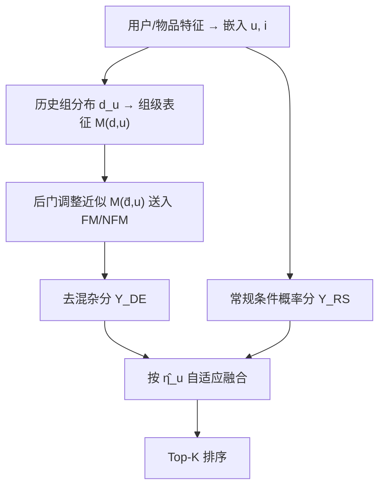

# Deconfounded Recommendation for Alleviating Bias Amplification (去混杂推荐：缓解偏差放大)

- **会议/期刊**: KDD 2021 (Proceedings of the 27th ACM SIGKDD)
- **作者与机构**: Wenjie Wang, Fuli Feng, Xiangnan He, Xiang Wang, Tat-Seng Chua（新加坡国立大学、Sea-NExT 联合实验室、中国科学技术大学）
- **推荐链路定位**: 精排（打分函数改造，模型无关插件）
- **研究方向**: 去偏公平、可信隐私与工业架构 / CTR 预估与特征交互
- **论文原文**: [https://arxiv.org/abs/2105.10648v1](https://arxiv.org/abs/2105.10648v1)
- **开源代码**: [https://github.com/WenjieWWJ/DecRS](https://github.com/WenjieWWJ/DecRS)

## TL;DR (1分钟核心速览)

现有去偏方法（公平正则、校准重排、多样性）只在排序目标上做后处理，普遍以牺牲精度换公平，且未回答"偏差放大为何发生"。本文用因果图指出：用户历史物品组分布 $D$是用户表征$U$与预测分$Y$之间的混杂子，产生虚假相关。作者提出 DecRS，用可插拔的后门调整近似算子$\sum_{\boldsymbol{d}}P(\boldsymbol{d})f(\cdot)\approx f(\cdot,M(\bar{\boldsymbol{d}},\boldsymbol{u}))$消除$D\!\to\!U$通路，并给出按兴趣漂移量$\eta_u$自适应融合的推理策略。在 ML-1M / Amazon-Book 的 Full-Ranking 协议下，以 FM 为骨干 R@20 相对提升 5.94% / 9.46%，同时$C_{KL}$ 低于校准方法。

## Background & Motivation (背景与核心矛盾)

- **主流范式**: 推荐模型从历史交互学习用户兴趣，但交互的物品组分布（如电影类型）极不均衡，反馈回路会持续放大该不均衡，形成过滤气泡与回声室。
- **前人局限**: ① 公平/多样性/校准类方法把偏差控制加到排序目标或重排阶段，与精度形成硬权衡（论文 Table 3 中 Calibration、Diversity 甚至低于原骨干）；② IPS 类因果方法依赖倾向估计精度，高方差需裁剪，无法准确定位混杂来源。
- **核心洞察 (Key Insight)**: 用户对物品组的历史点击频率 $\boldsymbol{d}_u$同时影响$U$（表征被不均衡数据拟合）与$Y$（经组级表征$M$），构成后门混杂；因此在同等真实偏好下，多数组物品天然获得更高预测分（ML-1M 上评分同为 4 的物品，多数组平均预测分 0.59 vs 少数组 0.47）。
- **本文切入点**: 不再拟合条件概率 $P(Y|U,I)$，而是估计干预分布$P(Y|do(U=\boldsymbol{u}),I=\boldsymbol{i})$，从模型内部切断混杂通路而非事后校准。

## Method (核心方法设计)

### 1. 整体框架 (Overall Architecture)

DecRS 首先在常规嵌入层之上引入组级变量：用户特征嵌入 $\boldsymbol{u}$、物品嵌入$\boldsymbol{i}$、组嵌入$\boldsymbol{v}$，并由用户历史组分布$\boldsymbol{d}$与$\boldsymbol{u}$共同生成组级用户表征$M(\boldsymbol{d},\boldsymbol{u})$。训练时不再条件于真实$\boldsymbol{d}_u$，而是按先验$P(\boldsymbol{d})$对所有可能的历史分布取期望——通过把期望搬进函数内部，化简为仅需计算$M(\bar{\boldsymbol{d}},\boldsymbol{u})$的近似算子，作为一路额外用户表征送入 FM/NFM 交互模块得到去混杂分$Y_{DE}$。推理阶段另训练一路常规模型得$Y_{RS}$，依据用户历史兴趣漂移程度$\hat{\eta}_u$ 对两路分数加权融合后输出 Top-K。

### 2. 关键设计拆解 (Key Designs)

1. **因果图与后门调整目标（从条件概率到干预分布）**：痛点在于 $P(Y|\boldsymbol{u},\boldsymbol{i})$中$\boldsymbol{d}_u$既塑造$\boldsymbol{u}$又经$M$抬高$Y$。按 do-calculus 切断$D\!\to\!U$ 后，
$P(Y|do(U=\boldsymbol{u}),I=\boldsymbol{i})=\sum_{\boldsymbol{d}\in\mathcal{D}}P(\boldsymbol{d})P(Y|\boldsymbol{u},\boldsymbol{i},M(\boldsymbol{d},\boldsymbol{u}))$，
与条件概率式 $P(\boldsymbol{d}_u|\boldsymbol{u})P(Y|\boldsymbol{u},\boldsymbol{i},M(\boldsymbol{d}_u,\boldsymbol{u}))$ 的唯一差别是把"该用户的实际分布"换成"全体用户的先验分布"。直觉上，模型被迫见过多种组分布，"多数组"不再因用户点击频次高而白拿高分。

2. **后门调整近似算子（把不可解期望变成一路额外输入）**：$D$的样本空间近乎无限，逐$\boldsymbol{d}$求和不可行；本文利用$\mathbb{E}_{\boldsymbol{d}}[f(\cdot)]\approx f(\cdot,M(\mathbb{E}_{\boldsymbol{d}}[\boldsymbol{d}],\boldsymbol{u}))$，将求和项折叠为均值分布$\bar{\boldsymbol{d}}=\sum_{\boldsymbol{d}\in\tilde{\mathcal{D}}}P(\boldsymbol{d})\boldsymbol{d}$。实现上取$M(\bar{\boldsymbol{d}},\boldsymbol{u})=\sum_{a=1}^{N}\sum_{b=1}^{K}\bar{p}(g_a)\boldsymbol{v}_a\odot x_{u,b}\boldsymbol{u}_b$，或用二阶 FM 形式建模$\boldsymbol{v}$与$\boldsymbol{u}$的组内/跨组交互。近似误差即 Jensen gap，作者用定理说明当$f$为线性时误差为零、非线性时误差有上界且随$D$ 分布集中而变小——这解释了为何该算子可安全插入任意骨干。

3. **训练目标、负采样与推理效率**：损失为标准 log loss $\mathcal{L}=\sum_{(u,i,\bar{y})\in\mathcal{T}}\ell\big(f(\boldsymbol{u},\boldsymbol{i},M(\bar{\boldsymbol{d}},\boldsymbol{u})),\bar{y}_{u,i}\big)$，训练时每个正样本随机采 1 个未交互物品作负例（Uniform 负采样，无难负例挖掘）。推理需同时前向常规模型与 DecRS 两路打分，融合权重
$Y_{u,i}=(1-\hat{\eta}_u)Y^{RS}_{u,i}+\hat{\eta}_u Y^{DE}_{u,i},\quad \hat{\eta}_u=\Big(\frac{\eta_u-\eta_{min}}{\eta_{max}-\eta_{min}}\Big)^{\alpha}$，
其中 $\eta_u$为用户历史序列前后两段组分布的对称 KL 散度。开销上仅多一路前向与$N$个组嵌入（$N\!\ll\!|\mathcal{I}|$），但需维护两套模型参数。

## Experimental Setup & Evaluation Protocol (实验设置与评估协议)

- **数据集与预处理**:

| 数据集 | #Users | #Items | #Interactions | 特征数 / 组数 | 场景说明 |
| :--- | :---: | :---: | :---: | :---: | :--- |
| ML-1M | 3,883 | 6,040 | 575,276 | 13,408 / 18 | 电影推荐，按 genre 分组，含用户性别/年龄等 |
| Amazon-Book | 29,115 | 16,845 | 1,712,409 | 46,213 / 253 | 图书推荐，按类目分组，`20-core` 过滤 |

- **数据划分与防穿越**: 按每用户交互时间戳排序后做 **`比例划分` 80%/10%/10%**（非 Leave-One-Out）；评分 $\ge 4$ 记为正向隐式反馈，验证集选模、测试集报结果。
- **排名评测协议**: **无偏 `Full-Ranking (全库未交互排序)`**，对训练中未交互的全部物品打分取 Top-K；指标 Recall@K、NDCG@K（K=10/20），外加校准偏差指标 $C_{KL}$（历史与新推荐列表的组分布漂移，越低越好）。
- **对比基线与超参设置**: 6 类基线 —— Unawareness（去掉组特征）、FairCo（组曝光公平正则）、Calibration（$C_{KL}$重排）、Diversity（列表内相似度惩罚）、IPS（以$P(\boldsymbol{d}_u)$为倾向并裁剪）。骨干为 FM 与 NFM，嵌入维度$d=64$，Adagrad 优化，学习率$\{0.005,0.01,0.05\}$、batch$\{512,1024,2048\}$、dropout$\{0.2,\dots,0.5\}$网格搜索；$\alpha\in\{0.1,\dots,10\}$中最优落在$\{0.2,0.3,0.4\}$。

## Key Experimental Results (实验关键数据)

### 1. 主实验对比 (Main Results)

| 方法 | FM·ML-1M R@10 | R@20 | N@20 | FM·Amazon R@20 | N@20 | NFM·ML-1M R@20 | N@20 | NFM·Amazon R@20 | N@20 |
| :--- | :---: | :---: | :---: | :---: | :---: | :---: | :---: | :---: | :---: |
| FM / NFM | 0.0676 | 0.1162 | 0.0715 | 0.0370 | 0.0187 | 0.1135 | 0.0697 | 0.0389 | 0.0199 |
| Unawareness | 0.0679 | 0.1179 | 0.0730 | 0.0377 | 0.0191 | 0.1143 | 0.0708 | 0.0381 | 0.0190 |
| FairCo | 0.0676 | 0.1165 | 0.0720 | 0.0370 | 0.0188 | 0.1152 | 0.0708 | 0.0390 | 0.0199 |
| Calibration | 0.0647 | 0.1149 | 0.0695 | 0.0359 | 0.0181 | 0.1131 | 0.0682 | 0.0335 | 0.0178 |
| Diversity | 0.0670 | 0.1159 | 0.0706 | 0.0369 | 0.0185 | 0.1133 | 0.0693 | 0.0386 | 0.0197 |
| IPS | 0.0663 | 0.1188 | 0.0718 | 0.0369 | 0.0187 | 0.1135 | 0.0692 | 0.0370 | 0.0189 |
| **DecRS** | **0.0704** | **0.1231** | **0.0737** | **0.0405** | **0.0205** | **0.1218** | **0.0742** | **0.0413** | **0.0211** |
| **Improv.%** | +4.14% | +5.94% | +3.08% | +9.46% | +9.63% | +7.31% | +6.46% | +6.17% | +6.03% |

### 2. 消融实验 (Ablation Study)

以 FM 为骨干、ML-1M 数据集：

| 变体 | 说明 | R@10 | R@20 | N@20 |
| :--- | :--- | :---: | :---: | :---: |
| FM | 常规条件概率建模 | 0.0676 | 0.1162 | 0.0715 |
| DecRS-EP | $M(\cdot)$ 用一阶点积式（式 7） | 0.0685 | 0.1205 | 0.0730 |
| **DecRS-FM** | $M(\cdot)$ 用二阶 FM 式（式 8） | **0.0704** | **0.1231** | **0.0737** |
| DecRS (w/o) | 关闭 $\hat{\eta}_u$融合，仅用$Y_{DE}$（图 5） | — | 介于 FM 与 Full DecRS 之间 | — |

### 3. 关键实验发现 (Key Findings)

1. **打破"精度 vs 公平"权衡**：DecRS 在 FM 上 R@20 相对提升 5.94%（ML-1M）、9.46%（Amazon-Book），同时 $C_{KL}$在所有用户分组内均低于 Calibration；而 Calibration/Diversity 为降$C_{KL}$ 付出了精度下跌（ML-1M R@20 从 0.1162 降至 0.1149/0.1159），说明在因果层消除混杂优于在排序层压约束。
2. **增益随兴趣漂移单调放大**：按 $\eta_u$分桶后，$\eta_u>4$的高漂移用户组上 N@20 相对提升达 23.87%（FM）/28.97%（NFM），而$\eta_u>0$全量组仅 3.08%/6.46%，证实$Y$对$\boldsymbol{d}_u$ 的依赖正是漂移用户受损的根源。
3. **算子形式鲁棒但非等价**：DecRS-EP 虽弱于 DecRS-FM（N@20 0.0730 vs 0.0737），仍稳定优于 FM，说明后门近似的收益来自"折叠期望"本身而非特定交互形式；同时最优 $\alpha\in\{0.2,0.3,0.4\}$ 接近 0，即对多数用户应几乎完全偏向去混杂分。

## Highlights & Limitations (亮点、对比与审稿批判)

- **与代表作对比 (vs. Prior Work)**: 与 Calibration（Steck 2021，事后重排使列表组分布逼近历史）本质不同——本文把混杂写进模型结构，重排只是约束输出；与 FairCo 相比不动排序目标加正则，而是改估计目标；与 IPS 相比不需要倾向估计与裁剪，规避了高方差。
- **可迁移亮点**: ① "期望搬进函数"式近似 + Jensen gap 上界论证，是把后门调整落地到大规模打分模型的通用模板，可迁移到流行度偏置、位置偏置、曝光偏置等混杂场景；② 用历史前后两段分布的对称 KL 作为用户级自适应权重，是一种轻量的"个性化去偏强度"信号。
- **审稿级局限批判**: ① 推理需同时部署常规模型与 DecRS 两套参数，线上打分成本约翻倍；② $\eta_u$仅将序列二分为两段，对短期突变的兴趣漂移刻画粗糙；③ 组划分依赖属性（Amazon 达 253 组），组嵌入的估计方差随$N$增大，且$C_{KL}$ 只是列表级指标，未给出个体/双边公平或线上 A/B 证据。

## Rating (四维评分)

- **方法创新性 (Novelty)**: ⭐⭐⭐⭐ （首次把物品组历史分布明确指认为混杂子并给出可插拔后门近似算子，配 Jensen gap 误差界定，因果叙事完整）
- **评估协议与实验扎实度 (Protocol & Experiments)**: ⭐⭐⭐⭐ （双数据集 + Full-Ranking + 精度与 $C_{KL}$ 双视角 + 兴趣漂移分桶，消融齐全；但缺显著性检验与线上验证）
- **写作与数学规范度 (Clarity & Rigor)**: ⭐⭐⭐⭐ （从 Eq.1 条件概率到 Eq.2 干预分布的推导逐行可验，近似误差定理引用清晰，符号表完备）
- **工业落地与复现价值 (Industrial & Practical Value)**: ⭐⭐⭐⭐ （模型无关、代码开源、组嵌入开销小；代价是双模型推理与组划分依赖人工属性定义）

