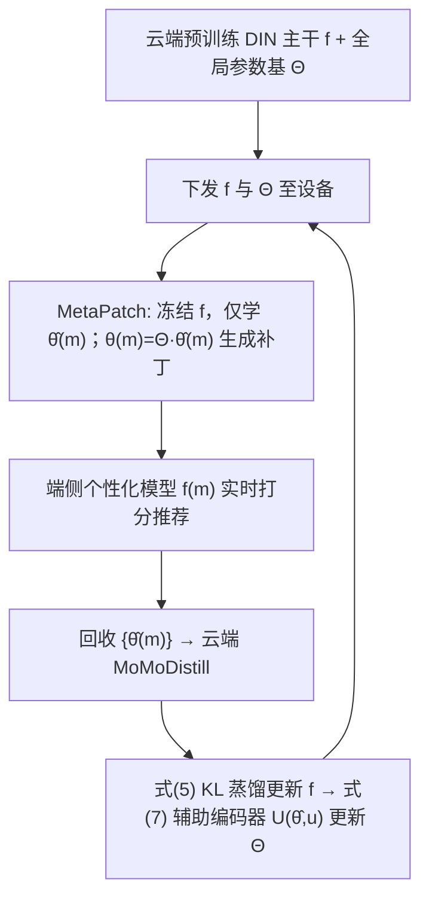
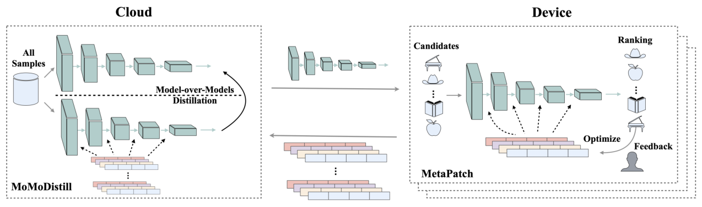
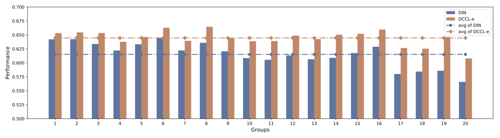

# Device-Cloud Collaborative Learning for Recommendation (面向推荐的端云协同学习)

- **会议/期刊**: KDD 2021 (Research Track)
- **作者与机构**: Jiangchao Yao, Feng Wang, Kunyang Jia, Bo Han, Jingren Zhou, Hongxia Yang（阿里巴巴达摩院 / 香港浸会大学）
- **推荐链路定位**: 精排（CTR 预估）阶段的端侧推理 + 云端训练闭环
- **研究方向**: 去偏公平、可信隐私与工业架构 / 冷启动与长尾推荐
- **论文原文**: [https://arxiv.org/abs/2104.06624v6](https://arxiv.org/abs/2104.06624v6)
- **开源代码**: 暂未开源

## TL;DR (1分钟核心速览)

集中式云端模型为最大化全局收益，会牺牲长尾用户与长尾品类；而完全端侧训练又因单设备样本稀疏陷入局部最优。本文提出 **DCCL 端云协同框架**：端侧用 **MetaPatch** 以全局参数基 $\Theta_l$生成低维"元补丁"，实现"千人千模型"且只需学习$\hat{K}\ll\sum_l K_l$ 个参数；云端用 **MoMoDistill** 对海量端侧模型做 "model-over-models" 蒸馏，反哺集中式模型与参数基。在 Amazon/MovieLens-1M/Taobao 上按 Leave-One-Out + 1:100 采样排序评估，Taobao 上 HitRate@1 相对 DIN 提升 **6.79%**，长尾用户组分桶增益显著更大。

## Background & Motivation (背景与核心矛盾)

- **主流范式**: 一条线是端侧推理（CpRec 压缩、剪枝量化、云-端拆分部署），另一条线是联邦推荐（FedAvg 聚合端侧梯度），二者都把端侧当作"算力/隐私的延伸"，仍共享一个集中式模型。
- **前人局限**: ① 云端 "model-over-data" 增量训练天然带马太效应，长尾用户/品类被系统性欠拟合；② 端侧单独微调样本量极小、非 i.i.d.，长时间个性化必然过拟合到局部最优；③ 全网络端侧微调存储与算力不可行，只调最后几层又受限于冻结的特征基。
- **核心洞察 (Key Insight)**: 云端强在"全局样本广度"，端侧强在"实时局部行为"，二者是可互补的两种偏置来源；若能把端侧模型当作"弱异构专家"蒸馏回云端，既纠云端之偏，又校端侧之偏。
- **本文切入点**: 用参数高效的 patch 结构把端侧个性化约束到极低维空间（使蒸馏可行、checkpoint 不需反复重载），再用渐进式双阶段蒸馏把端侧知识写回云端。

## Method (核心方法设计)

### 1. 整体框架 (Overall Architecture)

云端预训练 DIN 主干 $f$与全局参数基$\Theta_l$后下发设备；设备冻结$f$，仅用本地日志学习元补丁参数$\hat{\theta}^{(m)}$，经$\Theta_l$展开为补丁并插入网络，得到个性化模型$f^{(m)}$在端侧实时打分；达到时间阈值后回收$\{\hat{\theta}^{(m)}\}$，云端先固定$\Theta$用 KL 蒸馏更新$f$，再固定$f$用带用户画像的辅助编码器更新$\Theta$，形成端云互促的 EM 式循环（Algorithm 1）。

<figure class="paper-figure" markdown="span">
  <figcaption>图1：用于推荐的通用 DCCL 框架。云端负责通过来自个性化端侧模型的模型套模型蒸馏学习集中式云模型。设备接收集中式云模型以进行端侧个性化。我们提出 MoMoDistill 和 MetaPatch 分别实例化两侧。</figcaption>
</figure>

### 2. 关键设计拆解 (Key Designs)

1. **MetaPatch：把补丁参数从 $\sum_l K_l$压到$\hat{K}$**：痛点——完整大模型端侧不可训练，多层 patch 参数仍远超稀疏本地样本容量。做法是保留式(1)的旁路结构$f_l^{(m)}(\cdot)=f_l(\cdot)+h_l^{(m)}(\cdot)\circ f_l(\cdot)$，但补丁参数由全局基线性生成：$\theta_l^{(m)}=\Theta_l\hat{\theta}^{(m)}$，$\Theta_l\in\mathbb{R}^{K_l\times\hat{K}}$ 在端侧冻结、在云端学习。直觉：不同用户的个性化差异其实落在低维"兴趣子空间"，共享基 + 私有坐标既降参又保表达。

2. **MoMoDistill：从"模型套数据"到"模型套模型"**：痛点——单纯增量训练只用样本标签，浪费了已在本地拟合充分的端侧专家知识。式(5)在全体设备样本上联合优化 $\min_{\mathbf{W}_f}\ \ell(y,\hat{y})+\beta\,\mathrm{KL}(\tilde{y},\hat{y})$，$\hat{y}=f(x)$、$\tilde{y}=f^{(m)}(x)$为对应设备模型输出。补丁机制保证一次前向即可枚举所有$f^{(m)}$，避免逐 checkpoint 重载。

3. **参数基 $\Theta$的渐进学习与用户画像先验**：$\mathbf{W}_f$与$\Theta$语义不同，联合优化会落入坏局部解，故分步求解。第二阶段因$\hat{\theta}^{(m)}$异质性过强，引入辅助编码器$U(\hat{\theta},u)=\mathbf{W}^{(1)}\tanh(\mathbf{W}^{(2)}\hat{\theta}+\mathbf{W}^{(3)}u)$并代理化生成补丁，式(7) 为目标；$u$为用户画像特征，缓解冷启动设备无$\hat{\theta}$ 的问题。

- **训练目标与开销**: 端侧损失为逐点交叉熵；云端 $\ell+\beta\mathrm{KL}$；无负采样设计，全依赖采样候选集训练。端侧每轮仅上传$\hat{K}$维向量，通信量相比上传/聚合全模型梯度降低数个量级；云端每设备需 1 次$f^{(m)}$ 前向，成本随设备数线性增长。

## Experimental Setup & Evaluation Protocol (实验设置与评估协议)

| 数据集 | #Users | #Items | #Interactions | 密度 | 说明 |
| :--- | :---: | :---: | :---: | :---: | :--- |
| Amazon | 360,828 | 68,000 | 3,087,820 | ~1.3e-4 | 257 个一级品类，极稀疏 |
| MovieLens-1M | 6,040 | 3,900 | 1,000,209 | ~4.2% | 稠密小规模，验证泛化 |
| Taobao | 17,018,570 | 20,000,000 | ~9×10⁹ | ~2.6e-5 | 14,641 品类，工业级 |

- **数据划分**: `Leave-One-Out`——每用户最后 1 次交互为测试，其余按时序训练；DCCL 将训练集按时间均分为两段，前半预训练 DIN 主干、后半训练 DCCL。
- **排名评测协议**: `Sampled Ranking`——每用户 1 个真值 + 随机 100 个未交互负样本（正负比 1:100），指标 HitRate@{1,5,10}、NDCG@{5,10}；长尾分析另用 `macro-AUC`（用户级等权，非样本加权），并将用户按样本数排序等分 20 组。
- **基线**: MF、FM（传统）；NeuMF、DeepFM（深度 CTR）；SASRec、DIN（序列/兴趣建模）。DCCL 以 DIN 为主干，补丁插在特征 embedding 后两个 FC 层及倒数第二 FC 层；显著性说明原文未给 $p$ 值。

## Key Experimental Results (实验关键数据)

### 1. 主实验对比 (Main Results)

| 数据集 | 指标 | DIN | SASRec | DeepFM | NeuMF | **DCCL** | Improv. |
| :--- | :--- | :---: | :---: | :---: | :---: | :---: | :---: |
| Amazon | HR@1 | 26.56 | 26.53 | 25.43 | 26.10 | **26.94** | +1.43% |
| Amazon | HR@10 | 55.43 | 54.94 | 53.51 | 52.32 | **56.59** | +2.09% |
| Amazon | NDCG@10 | 39.22 | 39.07 | 37.67 | 37.76 | **40.45** | +3.14% |
| ML-1M | HR@1 | 37.45 | 34.85 | 15.41 | 16.45 | **38.69** | +3.31% |
| ML-1M | NDCG@10 | 58.65 | 56.94 | 37.68 | 37.90 | **59.77** | +1.91% |
| Taobao | HR@1 | 52.17 | 35.19 | 33.28 | 29.11 | **55.71** | +6.79% |
| Taobao | HR@10 | 74.80 | 69.30 | 66.09 | 65.78 | **76.70** | +2.54% |
| Taobao | NDCG@10 | 62.81 | 51.50 | 48.95 | 46.40 | **65.49** | +4.27% |

### 2. 消融实验 (Ablation Study)

| 配置 (Taobao) | HR@1 | HR@10 | NDCG@10 |
| :--- | :---: | :---: | :---: |
| DIN（基线，无模块） | 52.17 | 74.80 | 62.81 |
| + MetaPatch (DCCL-e) | 55.03 | 76.46 | 65.07 |
| + MoMoDistill (DCCL-m) | **55.71** | **76.70** | **65.49** |
| 仅 1st Junction 补丁 | 53.26 | 75.54 | 63.71 |
| 仅 2nd Junction 补丁 | 54.10 | 75.86 | 64.29 |
| 仅 3rd Junction 补丁 | 52.36 | 74.85 | 62.92 |

### 3. 关键实验发现 (Key Findings)

1. **端侧个性化贡献远大于云端蒸馏**: Taobao 上 DCCL-e 单步即带来 HR@1 +2.86（52.17→55.03），而 DCCL-m 仅再增 +0.68，说明"实时本地行为适配"是主要收益源，蒸馏更多起校准与纠偏作用。
2. **补丁位置决定个性化上限**: 低层补丁明显优于高层（NDCG@10 63.71/64.29 vs. 62.92），因为浅层更易按用户兴趣重加权 item 表征，而高层补丁只能调整最终打分偏置。
3. **长尾用户是最大受益者**: 20 组分桶中 DIN 的 macro-AUC 随组号（越靠后越长尾）单调下降，DCCL-e 在全部组均优于 DIN 且尾部组增益更大（图 4）；案例研究中长尾用户"床品"兴趣被 DIN 完全忽略，DCCL-m 的 top-5 全部命中该品类。

<figure class="paper-figure" markdown="span">
  <figcaption>图4：所有用户组中端侧个性化与 DIN 的宏平均 AUC 对比。DIN 在头部用户组的表现大致优于长尾用户组。相比之下，DCCL-e 在所有用户组中均优于 DIN，具体而言，在长尾用户组中取得更大提升。</figcaption>
</figure>

## Highlights & Limitations (亮点、对比与审稿批判)

- **与代表作对比**: 相比 CpRec（仅压缩端侧推理）与 FedRec/MetaMF（仅聚合梯度做隐私保护），本文首次把端侧模型当"专家"反向蒸馏成云端先验；相比同直觉的 [28]，MetaPatch 的低维参数化同时解决了稀疏过拟合与"频繁重载 checkpoint"的工程死结。
- **可迁移亮点**: ①"全局参数基 + 私有低维坐标"可迁移到多场景/多业务建模的参数高效个性化；② 蒸馏时把私有参数与用户画像一起编码为 $U(\hat{\theta},u)$，是新设备冷启动即获得合理补丁的实用技巧。
- **审稿级局限批判**: ① 评估仅用 1:100 采样排序 + LOO 单真值，未报告 Full-Ranking，指标对负样本分布敏感；② 云端每轮需为每台设备构造 $f^{(m)}$做前向，设备数达亿级时训练开销与$\beta$、交互间隔的敏感性均未量化，端侧能耗/通信成本也无实测；③ 仅一种补丁结构（bottleneck）与固定插层，缺少$\hat{K}$ 与补丁数量的敏感性分析；Taobao 数据不可公开、无开源代码，复现性受限。

## Rating (四维评分)

- **方法创新性 (Novelty)**: ⭐⭐⭐⭐ （"model-over-models" 双向协同视角新颖，MetaPatch 的低秩基生成把元学习与端侧存储约束真正打通）
- **评估协议与实验扎实度 (Protocol & Experiments)**: ⭐⭐⭐ （三数据集 + 长尾分桶 + 收敛曲线较完整，但仅采样排序、无显著性检验、超参敏感性缺位）
- **写作与数学规范度 (Clarity & Rigor)**: ⭐⭐⭐⭐ （式(1)(2)(5)(7) 层次清晰，两阶段渐进优化的动机解释到位，但 $\Theta$ 的预训练细节与复杂度分析偏略）
- **工业落地与复现价值 (Industrial & Practical Value)**: ⭐⭐⭐⭐ （面向真实端云部署，通信与重载问题被正面解决，Algorithm 1 可直接工程化；可惜无开源实现）

