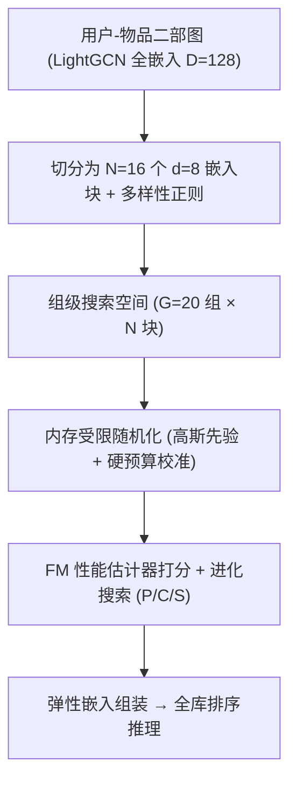
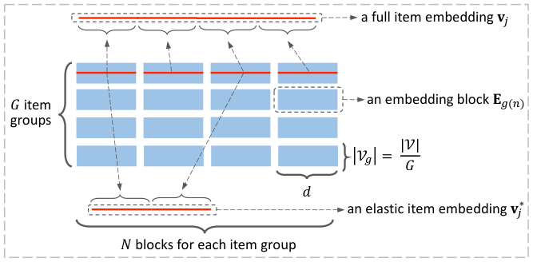

# Learning Elastic Embeddings for Customizing On-Device Recommenders (面向端侧推荐器定制的弹性嵌入学习)

- **会议/期刊**: KDD 2021 (ACM SIGKDD)
- **作者与机构**: Tong Chen, Hongzhi Yin, Zi Huang (The University of Queensland); Yujia Zheng (CMU); Yang Wang, Meng Wang (HFUT)
- **推荐链路定位**: 召回（端侧 item 表征与全库排序）
- **研究方向**: 去偏公平、可信隐私与工业架构 / 协同过滤与双塔召回
- **论文原文**: [https://arxiv.org/abs/2106.02223v1](https://arxiv.org/abs/2106.02223v1)
- **开源代码**: 暂未开源

## TL;DR (1分钟核心速览)

端侧推荐器的 embedding 是参数主体，但现有一切轻量化方案都是 "train once, get one"：换一个内存预算就得整模型重训。本文提出 RULE，把每个物品的 128 维全嵌入拆成 16 个互不共享的 8 维 **embedding block**，用多样性正则保证任一块都携带独立信息，再用"性能估计器 + 进化搜索"在组级挑选块组合，使一个训练好的模型可在 5/10/25MB 预算下免重训定制。在 Amazon-Book / Yelp2020 的 70/10/20 比例划分、全库未交互物品 Full-Ranking 协议下，RULE 全面优于 PMF、LightGCN、ESAPN、AutoEmb、DLRM-CE、LightRec，Yelp2020 5MB 时 Recall@50 相对最优基线提升 51.2%。

## Background & Motivation (背景与核心矛盾)

- **主流范式**: 端侧推荐以 latent factor 模型为主，压缩对象集中在 embedding 表：离散哈希二值化、组合嵌入（共享 meta-embedding / 并行码本）、以及给每个对象搜索嵌入维度的 NAS 方案（ESAPN、AutoEmb）。
- **前人局限**: ① 哈希量化带来不可逆信息损失，表达力甚至弱于朴素 MF；② 组合嵌入与 NAS 均绑定单一内存预算，且 NAS 的内存约束只是 reward 里的"软惩罚"，换设备必须重训，工程上不可持续。
- **核心洞察 (Key Insight)**: 物品影响力在推荐中近似服从正态分布——只有少数高影响力物品需要大容量表征，多数物品容量需求相近；若把全嵌入切成**不共享**的若干块，则"选哪些块、选几块"天然构成一个连续可调的容量旋钮，训练阶段就无需知道目标预算。
- **本文切入点**: 先一次性学出多样化、都可独立生效的嵌入块，再在部署时用低成本搜索为每个物品组拼装弹性嵌入，把"训练"与"架构搜索"彻底解耦。

## Method (核心方法设计)

### 1. 整体框架 (Overall Architecture)

RULE 分三阶段闭环。**训练期**：以 LightGCN 为基座（$L$层图传播，物品嵌入最终被切为$N=16$个$d=8$的块，$D=Nd=128$），用 BPR 损失 + 块间多样性正则联合优化全部块。**搜索期**：把$|\mathcal{V}|$个物品均匀分为$G=20$组，搜索空间从物品级$(2^N-1)^{|\mathcal{V}|}$收缩为组级$G\times N$；先按高斯先验 + 硬内存约束随机采样若干候选组合，用离线训练好的 FM 型性能估计器打分，再执行进化搜索（锦标赛选择 + 两种变异）输出最优$\{\mathcal{B}_g\}_{g=1}^{G}$。**部署期**：设备下载对应预算的块组合，只做查表拼接，打分函数零新增参数，无需重训。

<figure class="paper-figure" markdown="span">
  <figcaption>图1：所用关键符号的图示说明。推荐框架而非基础推荐器，因此我们作简要描述。</figcaption>
</figure>

### 2. 关键设计拆解 (Key Designs)

1. **弹性嵌入 + 维度无关打分函数**：痛点在于弹性嵌入维度随预算变化，点积在维度不匹配时病态、MLP 又要求固定输入维度。做法是把用户向量与"复制 $N$次拼回$D$维的单块"逐个内积再按比例归一：$r_{ij}=\frac{\max_{g'}|\mathcal{B}_{g'}|}{|\mathcal{B}_g|}\sum_{n\in\mathcal{B}_g}\mathbf{u}_i^{\top}\tilde{\mathbf{e}}_j^{(n)}$。比例项消除"块数不同导致分数尺度漂移"，且全参数自由、不窃取内存预算；物理直觉是每一块都贡献一次"局部分数"，平均后即该物品在当前容量下的可信相似度。
2. **多样性驱动的块正则**：若各块学到雷同信息，任意子集拼接必然退化，弹性就失效。损失在 BPR 基础上减去块间平方 Frobenius 距离：$\mathcal{L}=\mathcal{L}_{\text{BPR}}-\lambda\sum_{n=1}^{N}\sum_{n'=n+1}^{N}\|\mathbf{E}_n-\mathbf{E}_{n'}\|_F^2$，其中$\mathbf{E}_n$是第$n$ 块在全部物品上的块矩阵。负号使优化**最大化**块间逐元素差异，等价于强制不同块编码互补语义，从而保证"任选若干块都可用"。
3. **内存受限随机化 + 估计器驱动进化搜索（含训练目标与推理开销）**：为满足硬约束，在采样阶段就控量——每组块数 $s_g\sim\mathcal{N}(\mu,\sigma^2)$，$\mu=M/(G|\mathcal{V}_g|)$，若$\sum_g s_g>M$则随机逐组减 1 直至合规，再从$N$块中均匀抽$s_g$块。估计器输入$\mathbf{x}_g=\mathbf{W}[\text{one-hot}(g),\text{multi-hot}(\mathcal{B}_g)]$，用 FM 式二阶交互捕获组间组合效应：$\hat{y}=\mathbf{w}^{\top}\mathrm{FFN}\big(\sum_{g<g'}\mathbf{x}_g\odot\mathbf{x}_{g'}\big)+b$，以 MSE 拟合真实 Recall@100；标签集由 15,000 个随机组合、各在 1,000 名验证用户上评估得到。搜索超参$P/S/C=20/50/5$，变异为"两组交换块"或"单组重抽同量块"。BPR 采用单负样本均匀采样；推理仅查表拼接，5MB 下 IoT 单核 <200ms、手机四核 <50ms，25MB 时分别为 ~1000ms 以内与 148.5/203.19ms。

## Experimental Setup & Evaluation Protocol (实验设置与评估协议)

- **数据集与预处理**: 过滤交互数 <10 的非活跃用户与被 <10 名用户访问的物品（类似 10-core）：

| 数据集 | #Users | #Items | #Interactions | 稀疏度 | 特征/场景说明 |
| :--- | :---: | :---: | :---: | :---: | :--- |
| Amazon-Book | 52,643 | 91,599 | 2,984,108 | 99.94% | 图书评论，稠密于 Yelp |
| Yelp2020 | 138,322 | 105,843 | 3,865,586 | 99.97% | 本地商户评论，极稀疏 |

- **数据划分与防穿越 (Splitting Strategy)**: `比例划分` 70%/10%/20% 用于训练/验证/测试（非时间切分，未做全局时间戳隔离）。
- **排名评测协议 (Ranking Protocol)**: 无偏 `Full-Ranking`——每个用户全部未交互物品作为候选负样本，报告 Recall@{50,100} 与 NDCG@{50,100}；内存预算设 5MB/10MB/25MB，并据 $M$ 反推各方法的嵌入维度使总参数（全部物品 + 单个用户 + 排序层权重）恰好不超预算。
- **对比基线与超参设置**: 三类 6 个基线——固定维度 (PMF, LightGCN)、NAS 轻量化 (ESAPN, AutoEmb)、组合嵌入 (DLRM-CE, LightRec)。RULE 超参 $d=8,N=16,D=128,G=20,\lambda=10^{-4},d_0=64(128),\text{GraphSAGE 层 }L=3(2)$，网格搜索调优，配对$t$检验$p<0.05$。

## Key Experimental Results (实验关键数据)

### 1. 主实验对比 (Main Results)

Amazon-Book（Recall@50 / NDCG@50，加粗为最优）：

| Method | 5MB R@50 | 5MB N@50 | 10MB R@50 | 10MB N@50 | 25MB R@50 | 25MB N@50 |
| :--- | :---: | :---: | :---: | :---: | :---: | :---: |
| PMF | 0.0246 | 0.0255 | 0.0272 | 0.0287 | 0.0288 | 0.0305 |
| LightGCN | 0.0507 | 0.0886 | 0.0646 | 0.1074 | 0.0652 | 0.1094 |
| ESAPN | 0.0215 | 0.0394 | 0.0234 | 0.0527 | 0.0256 | 0.0561 |
| AutoEmb | 0.0202 | 0.0389 | 0.0233 | 0.0503 | 0.0250 | 0.0541 |
| DLRM-CE | 0.0233 | 0.0422 | 0.0271 | 0.0582 | 0.0328 | 0.0676 |
| LightRec | 0.0456 | 0.0742 | 0.0519 | 0.0828 | 0.0596 | 0.0989 |
| **RULE** | **0.0534** | **0.0908** | **0.0654** | **0.1279** | **0.0662** | **0.1298** |
| Improv. vs 最优基线 | +5.2% | +2.4% | +1.2% | +19.1% | +1.6% | +18.7% |

Yelp2020（Recall@50 / NDCG@50）：

| Method | 5MB R@50 | 5MB N@50 | 10MB R@50 | 10MB N@50 | 25MB R@50 | 25MB N@50 |
| :--- | :---: | :---: | :---: | :---: | :---: | :---: |
| PMF | 0.0080 | 0.0105 | 0.0082 | 0.0127 | 0.0093 | 0.0154 |
| LightGCN | 0.0133 | 0.0197 | 0.0178 | 0.0277 | 0.0199 | 0.0319 |
| ESAPN | 0.0071 | 0.0137 | 0.0081 | 0.0145 | 0.0090 | 0.0154 |
| AutoEmb | 0.0077 | 0.0132 | 0.0078 | 0.0142 | 0.0088 | 0.0150 |
| DLRM-CE | 0.0121 | 0.0124 | 0.0138 | 0.0160 | 0.0148 | 0.0195 |
| LightRec | 0.0081 | 0.0154 | 0.0126 | 0.0149 | 0.0133 | 0.0210 |
| **RULE** | **0.0201** | **0.0222** | **0.0218** | **0.0345** | **0.0229** | **0.0352** |
| Improv. vs 最优基线 | +51.2% | +12.5% | +22.3% | +24.4% | +14.9% | +10.4% |

### 2. 消融实验 (Ablation Study)

原文消融以图 2 条形图给出（NDCG@50，无逐项数值），下表为方向性归纳：

| 变体 | 改动 | 5MB | 10MB | 25MB | 归因 |
| :--- | :--- | :---: | :---: | :---: | :--- |
| NoReg | $\lambda=0$ | ↓↓ | ↓↓ | ↓↓ | 块间同质化，弹性拼接失效 |
| LowReg | $\lambda=10^{-6}$ | ↓ | ↓ | ↓ | 多样性约束不足 |
| HighReg | $\lambda=10^{-2}$ | ≈↓ | ≈↓ | ≈↓ | 过度正则压倒 BPR 精度目标 |
| DNNEst | 估计器换单层 DNN 拼接输入 | ↓ | ↓ | ↓ | 缺失组间二阶交互建模 |
| RULE-P | 按热度分组 | ≈↑ | ≈↑ | ≈↑ | 热门组自动获得更多块 |
| RULE-C | k-Means 聚类分组 | ≈↑ | ≈↑ | ≈↑ | 近邻簇共享相似块组合 |
| Default | 随机分组 $\lambda=10^{-4}$ | 基准 | 基准 | 基准 | — |

### 3. 关键实验发现 (Key Findings)

1. **预算越紧，弹性机制收益越大**：Yelp2020 在 5MB 下 RULE 相对 LightGCN 的 Recall@50 提升达 51.2%（0.0133→0.0201），而 25MB 收窄至 14.9%——说明极稀疏数据 + 极小预算下"为每个物品组按需分配容量"比"全局统一维度"更关键，LightGCN 在 5MB 时性能崩塌而 RULE 仍能维持。
2. **NAS 类方法在 Top-N 排序任务上系统性失效**：ESAPN/AutoEmb 在 Yelp2020 Recall@50 仅 0.0071–0.0090，甚至低于 LightGCN，根源是二者为评分预测设计、且内存约束仅为 reward 软惩罚；RULE 在采样阶段即施加硬预算，搜索目标直接对齐排序指标。
3. **估计器精度与最终效果正相关（图 4）**：随估计器训练 RMSE 下降，实际 NDCG@50 单调上升，验证"用低成本代理评估替代真实评估"的可行性；同时组数 $G=10\text{–}20$为甜点（$G=5$过粗、$G=50$搜索空间过大），$N$ 增至 16 后收益边际递减（受预算硬约束）。

## Highlights & Limitations (亮点、对比与审稿批判)

- **与代表作对比 (vs. Prior Work)**: 与 DLRM-CE（quotient-remainder 共享 meta-embedding）和 LightRec（并行码本）的本质区别是**块为物品独占、且块组合由搜索动态决定**，故在 5MB 极紧预算下领先（Amazon 0.0534 vs. 0.0456/0.0233）；与 ESAPN/AutoEmb 的区别是把"训练"与"架构搜索"解耦，实现 once-for-all 而非 train-once-get-one。
- **可迁移亮点**: ① "块级弹性容量 + 采样阶段硬约束"可直接搬到双塔召回索引裁剪、稀疏专家/MoE 端侧部署；② 用轻量 FM 估计器替代真实评估，可显著降低任何 NAS 型推荐的搜索开销。
- **审稿级局限批判**: ① 组级共享结构牺牲了物品级最优性，性能对分组粒度 $G$ 与分组策略敏感，且需额外 15,000 次离线评估构建估计器标签，冷启动物品块内无信息可学；② 评估仅用 70/10/20 随机比例划分（无时间戳切分、无线上 A/B），在宽松预算（25MB Amazon）下 Recall@50 增益仅 1.6%，与 LightGCN 差距接近噪声。

## Rating (四维评分)

- **方法创新性 (Novelty)**: ⭐⭐⭐⭐ （"嵌入分块 + 组级弹性组合"把轻量化从单一预算优化转为 once-for-all 定制，概念清晰且与组合嵌入/NAS 有明确分界）
- **评估协议与实验扎实度 (Protocol & Experiments)**: ⭐⭐⭐⭐ （三个内存预算 × 两个百万级数据集 × 无偏 Full-Ranking，6 个跨类别基线与配对 $t$ 检验齐全，但缺时间切分与线上验证，消融仅以图呈现无逐项数值）
- **写作与数学规范度 (Clarity & Rigor)**: ⭐⭐⭐⭐ （维度无关打分与多样性正则的动机—公式—直觉链条完整，算法伪码与超参表齐备；打分归一化项的合理性仅靠直觉、缺谱或方差分析支撑）
- **工业落地与复现价值 (Industrial & Practical Value)**: ⭐⭐⭐⭐ （免重训定制 + <200ms 单核推理对端侧场景极具吸引力，且无开源代码，块划分/估计器训练流程复现成本中等）

