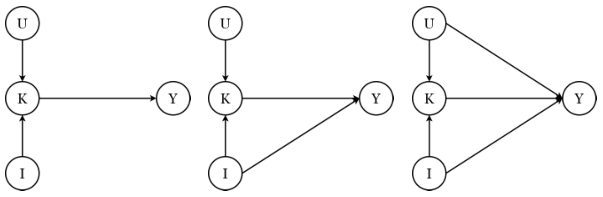
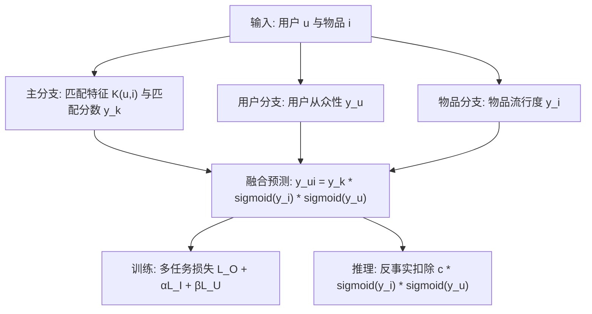
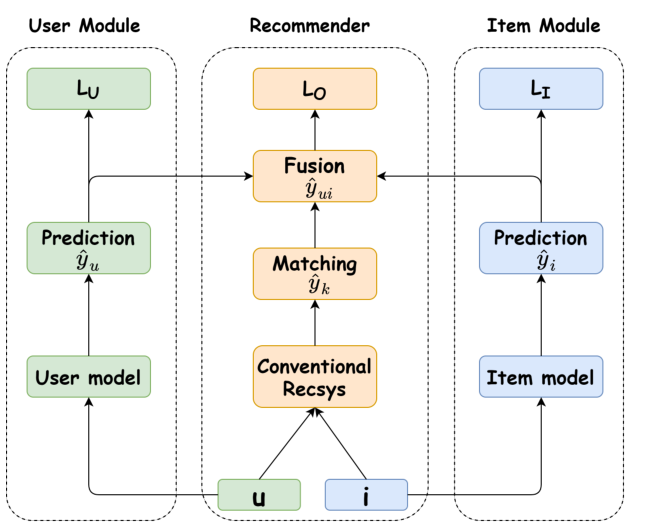

# Model-Agnostic Counterfactual Reasoning for Eliminating Popularity Bias in Recommender System（模型无关反事实推理：消除推荐系统中的流行度偏差）

- **会议/期刊**: SIGKDD 2021
- **作者与机构**: Tianxin Wei、Fuli Feng、Jiawei Chen、Ziwei Wu、Jinfeng Yi、Xiangnan He；中国科学技术大学、新加坡国立大学、京东 AI 研究院
- **推荐链路定位**: 重排 / 推理阶段去偏（可嵌入 MF、LightGCN 等主模型）
- **研究方向**: 去偏公平、可信隐私与工业架构 / 协同过滤
- **论文原文**: [论文原文链接](https://arxiv.org/abs/2010.15363v2)
- **开源代码**: 暂未开源

## TL;DR (1分钟核心速览)

针对推荐系统中的流行度偏差，现有 IPW 重加权方法对权重高度敏感且难调。本文从因果视角把排序分数分解为用户-物品匹配、物品流行度与用户从众性三条路径，训练时多任务拟合各分支，推理时用反事实推理扣除物品流行度直接效应。在五个真实数据集的去偏全库排序协议下，MACR 可无缝嵌入 MF 与 LightGCN，平均 HR@20 分别比原模型提升 153.13% 与 241.98%。

## Background & Motivation (背景与核心矛盾)

- **主流范式**: 当前推荐模型通常用逐点或成对损失拟合历史交互，热门物品因在训练集中长期高频出现而获得更高排序分数，形成“越热越推”的马太效应。
- **前人局限**: IPW 通过逆倾向加权降低热门物品在训练损失中的影响，但权重策略敏感且 notoriously 难调；正则化/重排方法盲目把推荐推向长尾，往往以牺牲准确性为代价；DICE 等因果嵌入方法虽将兴趣与流行度解耦，却缺少对用户从众性和物品流行度分别建模的细粒度因果图，也忽略推理阶段的直接效应校正。
- **核心洞察 (Key Insight)**: 作者观察到流行度偏差的本质在于因果图中存在一条从物品节点 \(I\) 到排序分数 \(Y\) 的直接路径 \(I\to Y\)。现有模型在训练与推理时都不加区分地融合该路径，使物品流行度直接抬高分数。要消除偏差，应回答反事实问题：如果只保留用户-物品匹配 \(K\)，排序分数会是多少？
- **本文切入点**: 构建包含用户、物品、匹配特征与排序分数的因果图，训练时用多任务学习拟合三条因果路径，推理时用反事实推理扣除物品流行度的直接效应。

<figure class="paper-figure" markdown="span">
  <figcaption>图2：(a) 用户-物品匹配；(b) 纳入物品流行度；(c) 纳入用户从众性的因果图。I：物品。U：用户。K：用户与物品之间的匹配特征。Y：排序分数（例如交互概率）。</figcaption>
</figure>

## Method (核心方法设计)

### 1. 整体框架 (Overall Architecture)

MACR 是在现有主分支 \(Y_k(K(U,I))\) 上增加用户分支 \(Y_u(U)\) 和物品分支 \(Y_i(I)\) 的模型无关框架。三条分支分别对应 \(U\to Y\)、\(U\&I\to K\to Y\) 与 \(I\to Y\)。训练阶段联合优化主任务和两个辅助任务，让物品分支单独拟合物品的流行度趋势、用户分支拟合用户从众性；推理阶段先按整体分数计算排序，再扣除物品流行度与用户从众性构成的直接效应项，从而降低热门物品对不相关用户的“虚假高分”。整个流程不需要改动主干推荐网络，只需追加两个小 MLP 分支。

<figure class="paper-figure" markdown="span">
  <figcaption>图5：MACR 的框架。橙色矩形表示主分支，即传统推荐系统。蓝色和绿色矩形分别表示用户模块和物品模块。</figcaption>
</figure>

### 2. 关键设计拆解 (Key Designs)

1. **因果图与三路分解**：痛点：原始模型只学习用户-物品匹配，忽略 \(I\to Y\) 直接路径和 \(U\to Y\) 路径。做法：把偏好学习过程拆成主分支匹配、物品流行度、用户从众性三因子，融合预测为
   $\hat{y}_{ui}=\hat{y}_k\cdot\sigma(\hat{y}_i)\cdot\sigma(\hat{y}_u)$
   其中 \(\sigma(\hat{y}_i)\) 与 \(\sigma(\hat{y}_u)\) 分别缩放用户-物品匹配分数，物理直觉是：一个物品再匹配，若它非常热门且用户容易从众，则其原始交互概率会被进一步放大；训练时显式分离这两项，才能在推理阶段有针对性地去掉。

2. **多任务联合训练**：若仅用整体损失 \(\mathcal{L}_O\) 监督，两个辅助分支的信息会被主分支吸收，难以学出纯粹的流行度/从众性表示。作者对用户分支与物品分支施加独立 BCE 监督：
   $\mathcal{L}=\mathcal{L}_{O}+\alpha\mathcal{L}_{I}+\beta\mathcal{L}_{U}$其中$\mathcal{L}_O$监督$\hat{y}_{ui}$，$\mathcal{L}_I$监督$\sigma(\hat{y}_i)$，$\mathcal{L}_U$监督$\sigma(\hat{y}_u)$。这样物品分支可以独立拟合不同物品的流行度，用户分支也能独立拟合用户的点击倾向。

3. **反事实推理去偏**：推理时若只使用物品属性 \(I=i\) 而阻断匹配路径，排序分数仅由物品流行度与用户从众性决定。根据总效应 \(TE\) 与自然直接效应 \(NDE\)，最终应使用总间接效应 \(TIE\) 排序：
   $\hat{s}_{ui}=\hat{y}_k\cdot\sigma(\hat{y}_i)\cdot\sigma(\hat{y}_u)-c\cdot\sigma(\hat{y}_i)\cdot\sigma(\hat{y}_u)$
   其中 \(c\) 是参考状态下匹配分支的输出。直觉：先扣除流行度直接抬高的部分，再比较用户-物品匹配本身；这一调整是用户特定的，用户分支越大，对热门物品的扣减越强。

## Experimental Setup & Evaluation Protocol (实验设置与评估协议)

- **数据集与预处理**:

| 数据集 | #Users | #Items | #Interactions | 密度 | 特征/场景说明 |
| :--- | ---: | ---: | ---: | ---: | :--- |
| Adressa | 13,485 | 744 | 116,321 | 0.011594 | 新闻推荐 |
| Globo | 158,323 | 12,005 | 2,520,171 | 0.001326 | 新闻推荐，长尾极强 |
| ML10M | 69,166 | 8,790 | 5,000,415 | 0.008225 | 电影评分二值化为隐式反馈 |
| Yelp | 31,668 | 38,048 | 1,561,406 | 0.001300 | 商户点评 |
| Gowalla | 29,858 | 40,981 | 1,027,370 | 0.000840 | 位置签到 |

- **数据划分与防穿越 (Splitting Strategy)**: 从训练数据中按物品均匀采样 10% 作为去偏测试集、另 10% 作为验证集，余下 80% 为训练集；训练数据本身保持原始长尾分布，确保评估能检验模型应对流行度偏差的能力。
- **排名评测协议 (Ranking Protocol)**: 无偏 `Full-Ranking` 全库未交互物品排序，报告 \(K=20\) 的 HR@20、Recall@20、NDCG@20，不使用采样排序。
- **对比基线与超参设置**: 对手包括 MF、LightGCN，以及 ExpoMF、CausE、BS、Reg、IPW、DICE 等去偏方法，并分别与 MF/LightGCN 结合；改进显著性检验为 \(p<0.05\)。

## Key Experimental Results (实验关键数据)

### 1. 主实验对比 (Main Results)

以下保留代表性基线，以 HR@20 为主列（MACR 两分支均列出，最优加粗）：

| 方法 | Adressa | Globo | ML10M | Yelp | Gowalla |
| :--- | :---: | :---: | :---: | :---: | :---: |
| MF | 0.111 | 0.020 | 0.058 | 0.071 | 0.174 |
| LightGCN | 0.123 | 0.017 | 0.038 | 0.061 | 0.172 |
| IPW_MF | 0.128 | 0.021 | 0.041 | 0.072 | 0.174 |
| CausE_LightGCN | 0.115 | 0.014 | 0.036 | 0.061 | 0.173 |
| BS_LightGCN | 0.139 | 0.023 | 0.038 | 0.061 | 0.178 |
| DICE_MF | 0.133 | 0.033 | 0.055 | 0.082 | 0.177 |
| DICE_LightGCN | 0.141 | 0.046 | 0.062 | 0.093 | 0.185 |
| MACR_MF | 0.140 | 0.112 | 0.140 | 0.135 | 0.252 |
| **MACR_LightGCN** | **0.158** | **0.132** | **0.155** | **0.148** | **0.254** |
| **Improv. vs 最强基线** | **+12.06%** | **+186.96%** | **+150.00%** | **+59.14%** | **+37.30%** |

### 2. 消融实验 (Ablation Study)

在 Adressa 上对 MACR_MF 逐组件移除：

| 变体 | HR@20 | Recall@20 | NDCG@20 |
| :--- | :---: | :---: | :---: |
| MACR_MF | 0.140 | 0.109 | 0.050 |
| w/o 用户分支 | 0.137 | 0.106 | 0.046 |
| w/o 物品分支 | 0.116 | 0.089 | 0.038 |
| w/o \(\mathcal{L}_I\) | 0.124 | 0.096 | 0.043 |
| w/o \(\mathcal{L}_U\) | 0.138 | 0.108 | 0.048 |

### 3. 关键实验发现 (Key Findings)

- **物品流行度分支是主导矛盾**：在 Adressa 上，移除物品分支使 NDCG@20 从 0.050 降至 0.038（约 -24%），而移除用户分支仅降至 0.046（约 -8%）；说明交互数据中的流行度偏差比用户从众性更严重，也验证了 \(I\to Y\) 是主要偏差源。
- **推理阶段扣除直接效应不可缺**：仅移除 \(\mathcal{L}_I\) 但保留物品分支参与预测时 NDCG@20 为 0.043，仍明显低于完整模型 0.050，说明“训练时多任务分离 + 推理时反事实扣除”两个环节互补，只做训练侧监督无法完全去偏。
- **长尾场景收益最大且图模型更受益**：Globo 新闻数据上 MACR_LightGCN 比最强基线 DICE_LightGCN 的 HR@20 提升约 187%，远高于 Adressa 的 12%；同时 LightGCN 在 Yelp 上反而不如 MF（0.061 vs 0.071），说明邻居传播会放大流行度偏差，而 MACR 能有效抵消这一放大效应。

## Highlights & Limitations (亮点、对比与审稿批判)

- **与代表作对比 (vs. Prior Work)**: 与 IPW 的重加权相比，MACR 不依赖难调的倾向权重，而是对每次交互显式学习“流行度”与“从众性”两个因子；与正则化/重排相比，它不盲目抬高长尾物品，而是先扣除直接效应再按匹配排序；与 DICE 相比，它额外显式建模用户从众性，并把训练与反事实推理统一到一个可插拔框架中。
- **可迁移亮点**: 把排序分数视为“匹配分数 × 偏差因子”的乘积，再用多任务学习分离偏差因子、推理时做反事实校正，可迁移到曝光偏差、位置偏差或品类偏差等场景。
- **审稿级局限批判**: ① 参考分数 \(c\) 对 LightGCN 较敏感，需要仔细调参；② 模型仅利用交互频率，未纳入曝光机制、物品质量等侧面信息，可能无法完全区分“真流行”与“曝光诱导的伪流行”。此外，训练与推理均需额外两个分支网络，线上部署有额外前向开销。

## Rating (四维评分)

- **方法创新性 (Novelty)**: ⭐⭐⭐⭐ （因果图与反事实推理拆解流行度偏差的思想新颖且模型无关，但理论深度偏向应用因果推断，并非全新因果识别理论）
- **评估协议与实验扎实度 (Protocol & Experiments)**: ⭐⭐⭐⭐ （五个真实数据集、去偏全库排序、\(p<0.05\) 显著性检验，基线包含 DICE 等强方法，消融完整）
- **写作与数学规范度 (Clarity & Rigor)**: ⭐⭐⭐⭐ （因果图、NDE/TIE 推导与多任务损失定义清晰，但负采样等实现细节正文交代不足）
- **工业落地与复现价值 (Industrial & Practical Value)**: ⭐⭐⭐⭐ （可直接插入现有 MF/LightGCN 管线，推理改动仅是减去一个可学习分支；开源代码未检测到但实现难度较低）

