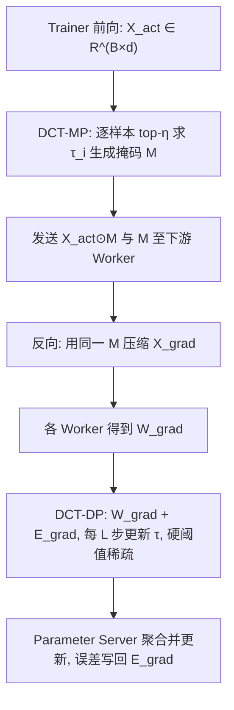

# Training Recommender Systems at Scale: Communication-Efficient Model and Data Parallelism (大规模推荐系统训练：通信高效的模型并行与数据并行)

- **会议/期刊**: KDD 2021
- **作者与机构**: Vipul Gupta, Dhruv Choudhary, Peter Tang, Xiaohan Wei, Xing Wang, Yuzhen Huang, Arun Kejariwal, Kannan Ramachandran, Michael W. Mahoney（UC Berkeley & Facebook）
- **推荐链路定位**: 端到端训练基础设施（服务于 CTR 精排 DLRM 训练）
- **研究方向**: 去偏公平与工业架构 / CTR 特征交叉
- **论文原文**: [https://arxiv.org/abs/2010.08899v2](https://arxiv.org/abs/2010.08899v2)
- **开源代码**: [https://github.com/facebookresearch/dlrm](https://github.com/facebookresearch/dlrm)

## TL;DR (1分钟核心速览)

针对混合并行（DP+MP）训练大规模推荐模型时网络带宽成为核心瓶颈的问题，本文提出 DCT 压缩框架：DP 侧对参数梯度做延迟更新 Top-K 稀疏化并配合误差反馈，MP 侧提出逐样本激活/梯度共享掩码稀疏化。在 DLRM、IWSLT'14 翻译模型与 Facebook 产线推荐模型上，DCT 实现 DP ≥100×、MP ≥20× 通信压缩，产线端到端训练时间降低 37%，CTR 交叉熵损失与基线相差 <0.01%。

## Background & Motivation (背景与核心矛盾)

- **主流范式**: 工业推荐模型参数与特征规模爆炸，纯 DP 已经难以复刻整模型，纯 MP 又无法吃满大 batch；Facebook 产线已采用 HP（DP 处理多 mini-batch + MP 切分单模型）联合扩展。
- **前人局限**: ① 现有梯度压缩（Quantization / Sparsification / Sketching）多在同步 SGD、凸性假设下做理论分析，忽视压缩本身（copy + sort 大向量）的开销；② 很多方案在真实系统中跑一次迭代反而更慢；③ MP 方向现有工作只做通信调度（GPipe/PipeDream），从未压缩过真正在网络上流动的激活/梯度本身。
- **核心洞察 (Key Insight)**: 作者观察到两个关键现象——(a) DCT-DP：设定稀疏度后，DLRM 各 FC 层的 Top-K 阈值τ 在迭代中偏离滑动均值至多 26%，因此**无需每步重排求阈**；(b) DCT-MP：每样本前向只激活极少数神经元，用逐样本激活掩码同时压前向激活与反向梯度，等价于一种有正则化效果的结构化 Dropout，甚至能提升泛化。
- **本文切入点**: 用一个统一的"硬阈值稀疏化 + 掩码共享"框架分别攻克 DP 和 MP 两个通信节点，并以**端到端墙钟时间**（而非收敛 epoch 数）为最终评价标准。

## Method (核心方法设计)

### 1. 整体框架 (Overall Architecture)

DCT 是插在 HP 训练通信路径上的压缩层，分两个算子：DCT-DP 拦截 Trainer→Parameter Server 的 `W_grad`；DCT-MP 拦截 Worker→Worker 前向的 `X_act` 和反向的 `X_grad`。两者都以一个标量阈值 τ 生成布尔掩码、只发送保留下来的非零元+必要元数据。DP 侧通过误差反馈 + L 次迭代才更新一次阈值，把 copy/sort 的算力开销摊薄；MP 侧以前向激活的逐样本 top-η 掩码约束反向梯度的同位置神经元，从而"选样训练"，把稀疏化内建为隐式正则。训练与推理都按原 DLRM 流程进行，仅压缩通信实体。

### 2. 关键设计拆解 (Key Designs)

1. **DCT-DP：延迟更新的 Top-K 梯度稀疏化 + 误差反馈**：直接照搬 top-K 压缩的理论方案在产线上因为 copy-and-sort 开销导致端到端更慢（L=1 时反而慢 11%）。本文关键改动是给阈值加"寿命"L：只有 $L$ 整除迭代号时才重排求阈值，否则沿用旧 τ。误差累积写回：
   $$W_{grad}\leftarrow W_{grad}+E_{grad},\quad M=\mathbb{I}(|W_{grad}|\ge\tau),\quad \hat{W}_{grad}=W_{grad}\odot M,\quad E_{grad}=W_{grad}-\hat{W}_{grad}$$
   由于 $|w-\mathrm{topK}_\eta(w)|\le|w|$，收缩性成立，Stich et al. 的收敛率对层内独立压缩仍然成立。物理直觉：梯度方向信息在相邻迭代间高度相关，τ 不需要每步精确，L≈1000 是现代 GPU/CPU 算力与压缩开销的甜蜜点。

2. **DCT-MP：逐样本共享掩码的激活/梯度联合稀疏化**：MP 通信量正比于 batch size，越来越大；而 ReLU 后激活天然稀疏。DCT-MP 对前向激活矩阵 $X_{act}\in\mathbb{R}^{B\times d}$ 的每一行独立计算阈值：
   $$\tau_i = \mathrm{sort}(|X_{act,i}|)_{\lfloor d\cdot\eta\rfloor},\quad m_i=\mathbb{I}(|X_{act,i}|\ge\tau_i),\quad M=[m_1;\dots;m_B]$$
   前向发 $X_{act}\odot M$与掩码$M$，反向直接复用同一个$M$压缩$X_{grad}$。其期望梯度与原网络无偏（原文附录 B 给出证明），且因每个样本只训练 top-η 神经元，等价于一种面向样本自适应的硬 Dropout：既降通信又引入结构化稀疏正则（图 5 观察到施加 DCT-MP 后激活阈值显著下移，模型自身变得更稀疏）。

3. **训练目标、压缩配置与推理开销**：整体目标即原推荐模型的交叉熵损失，DCT 不改变损失函数，只改变通信实体。DP 默认稀疏度 90–99% + 误差反馈 + L=1000；MP 默认按层位置取 75–95%，且优先在 ReLU 后切分（激活天然 50% 稀疏，压缩率更高）。推理阶段完全不引入任何额外算子，零部署开销。

## Experimental Setup & Evaluation Protocol (实验设置与评估协议)

- **数据集与预处理**:

| 数据集 | 规模 | 用途 | 特征/场景说明 |
| :--- | :---: | :---: | :--- |
| Criteo Ad Kaggle | 6 天训练 / 1 天测试 | DLRM 公开基准 | 稠密特征 + 稀疏 ID 特征，嵌入维 16，两组 4 层 MLP |
| IWSLT'14 De-En | fairseq 默认设置 | 翻译模型泛化性验证 | Transformer Enc/Dec 各 6 层，FFN 512→1024 |
| Facebook 产线推荐模型 | 7B 训练样本 / 0.5B 评估 | 大规模 HP 端到端墙钟时间 | 12 路以上模型切分，Intel 18 核 2GHz + 12.5Gbit 以太网 |

- **数据划分与防穿越**: CTR 任务采用**时间切分**（前 6 天训练、后 1 天测试）；产线模型用历史 7B 曝光训练、后 0.5B 评估，无未来信息泄漏。
- **排名评测协议**: 严格说本文不做传统 Top-K 排序评测，而是评估 CTR 分类任务的 **Cross-Entropy Loss 与 Accuracy**（DLRM 场景），翻译场景用 BLEU；端到端指标为墙钟训练时间与网络/CPU 利用率，配置与基线完全一致以保证可比性。
- **对比基线与超参设置**: 主对比是**无压缩基线**（同 HP 配置）。稀疏度 η 从 0% 扫到 99.5%，阈值寿命 L 从 1 扫到 10000；MP 切分点随机或放在 ReLU 后，未作为超参调优。

## Key Experimental Results (实验关键数据)

### 1. 主实验对比 (Main Results)

| 模型 / 场景 | 压缩策略 | 最优配置 | Test Acc (%) | Test Loss | 关键收益 |
| :--- | :--- | :---: | :---: | :---: | :---: |
| DLRM (Criteo) | 基线 | – | 78.78 | 0.4538 | – |
| DLRM | **DCT-MP** (2 MP workers) | η=90% | **78.81** | **0.4530** | 20× MP 压缩，精度+0.03 |
| DLRM | **DCT-DP** | η=98% | **78.80** | 0.4537 | 100× DP 压缩，无损 |
| DLRM | **DCT 混合** (3 MP workers) | η=90%&&75% | 78.78 | 0.4537 | 双通道同时压缩无损 |
| Transformer (IWSLT'14) | 基线 | – | – | 3.883 | BLEU 35.17 |
| Transformer | **DCT-MP** (2 MP workers) | η=90% | – | **3.879** | BLEU **35.23**，反超基线 |
| Transformer | **DCT-MP** (5 MP workers) | η=90% | – | 3.882 | BLEU 35.20，仍无损 |
| 产线推荐模型 | **DCT-MP** 单路 | η=90% | Loss -0.021%(train)/+0.016%(test) | – | 时间 **+13.95%** |
| 产线推荐模型 | **DCT 混合** DP99%+MP90% | L=1000 | 与基线差 <0.01% | – | 时间 **+37.1%**，网络 94.2%→49.3%，CPU 48.7%→91.1% |

### 2. 消融实验 (Ablation Study)

| 变体 | 配置 | 关键指标 | 结论 |
| :--- | :--- | :---: | :--- |
| DCT-DP, L=1（等价原 top-K） | 95% 稀疏 | 训练时间 **-11%**（劣化） | 每步 copy+sort 的开销吞掉全部带宽收益 |
| DCT-DP, L=1000 | 95% 稀疏 | 训练时间 **+23%** | 摊薄求阈开销是端到端加速的关键 |
| DCT-DP, L=10000 | 95% 稀疏 | 训练时间 +23% | 继续加长无额外收益，L≈1000 最优 |
| DCT-MP, 2 workers | η=98% | Test Acc 78.61 (-0.17) | 稀疏度过激，超出 MP 可承受带宽 |
| DCT-MP, 3 workers | η=95% | Test Loss +0.18% | 切分数越多，可承受稀疏度越低 |
| DCT-MP, 产线 12 路切分 | η=95% | Test Loss **+0.121%** | 产线场景 95% 已接近极限，90% 才无损 |

### 3. 关键实验发现 (Key Findings)

1. **"每步排序"是现有 Top-K 方案在工业界失灵的根因**：L=1 时 DCT-DP 反而比不压缩慢 11%，而把阈值寿命放宽到 L=1000 后取得 23% 加速；这说明**压缩带来的通信节省必须显著大于求阈的 copy/sort 开销**，端到端墙钟时间才是唯一可靠的指标。
2. **MP 侧的稀疏化不仅是压缩、本质上是正则**：DLRM 在 η=90% 时 Test Acc 由 78.78 升到 78.81、翻译任务 BLEU 由 35.17 升到 35.23，图 5 进一步显示施加 DCT-MP 后激活阈值显著下移，模型自发变得更稀疏——这一隐式结构化 Dropout 效应是"压缩无损甚至反升"的物理来源。
3. **切分数与可稀疏度是此消彼长的**：DLRM 在 2 workers 时 η=95% 仍无损，退到 3 workers 时 95% 已使 Loss 恶化 0.18%；产线 12 路切分下 95% 直接让 Test Loss 变差 0.121%。作者给出经验规则——**切分越多越应把 η 上界收到 90%**，且在 ReLU 后切分可以让激活天然 50% 稀疏、进一步抬高可压上限。

## Highlights & Limitations (亮点、对比与审稿批判)

- **与代表作对比 (vs. Prior Work)**: 相比 Stich et al. (2018) / Aji & Heafield (2017) 这类**只在同步 SGD 下证明收敛、忽略 copy-and-sort 开销**的 top-K 稀疏化，本文把"阈值寿命 L"提为核心设计，真正做出端到端加速；相比 GPipe / PipeDream 这类**只做 MP 通信调度、不压缩通信内容**的路线，DCT 首次针对 MP 的激活与梯度二维实体做压缩，且能叠加在 Pipelining 之上；相比 Ivkin et al. (2019) 的 sketching 等方案，DCT 在产线上提供了网络利用率从 94.2% 降到 49.3% 的实测证据。
- **可迁移亮点**: ①"阈值寿命 L"思想可迁移到任何**需要周期性排序/选择**的在线压缩或采样系统（如流式负采样、ANN 索引重建），把排序开销摊到千步一次；②"前向激活掩码 → 反向共享同位置掩码"这套逐样本掩码共享机制，可直接搬去做样本级梯度稀疏、MoE 路由裁剪或长序列 Attention 头裁剪。
- **审稿级局限批判**: ①**切分位置是手工经验而非可学习/可搜索的**——作者自承认未调 split 位置，仅"随机或 ReLU 后"切；产线 MP 12 路下 95% 稀疏即掉点，说明敏感层未被自动识别，压缩率存在显著改进空间；②**理论分析不完整**——DCT-DP 的收敛性诉诸 Stich et al. 的现成结论，DCT-MP 只在附录 B 给出无偏估计而**未给出方差界或收敛率**，且异步 hogwild 下误差反馈"意外有效"只有经验描述，缺乏解释为什么共享 buffer 与随机清空策略仍能稳定；③**缺乏对极端场景的鲁棒性验证**——η 在 ReLU 后切分时收益最佳，但若模型换用 GELU/Swish 等非零激活，激活稀疏度大幅下降，DCT-MP 的可压缩上限将显著衰减，论文未讨论非 ReLU 架构下的适配。

## Rating (四维评分)

- **方法创新性 (Novelty)**: ⭐⭐⭐⭐ （DCT-MP 首提 MP 激活/梯度共享掩码压缩，阈值寿命 L 的设计把已知 top-K 理论从"收敛可行"推到"端到端可行"，新颖度扎实但整体属于 top-K 稀疏化的重要工程化演进）
- **评估协议与实验扎实度 (Protocol & Experiments)**: ⭐⭐⭐⭐ （DLRM + IWSLT'14 + 7B 样本产线三档验证、网络/CPU 利用率硬指标完备，且系统给出 η 与 L 的敏感度扫描与切分-稀疏度权衡；扣分在于未做传统推荐排序指标评估、无显著性检验）
- **写作与数学规范度 (Clarity & Rigor)**: ⭐⭐⭐⭐ （两个算子伪代码清晰、结构通俗、图 3/4 掩码机制图示直观；但收敛性较依赖外部定理，MP 侧只有无偏性无方差/收敛率推导，理论严谨度略欠）
- **工业落地与复现价值 (Industrial & Practical Value)**: ⭐⭐⭐⭐⭐ （已在 Facebook 产线部署，DLRM 代码开源，网络利用率减半、CPU 利用率翻倍、端到端训练降低 37% 均为真实生产验证，对大规模推荐训练工程具有直接复用价值）

