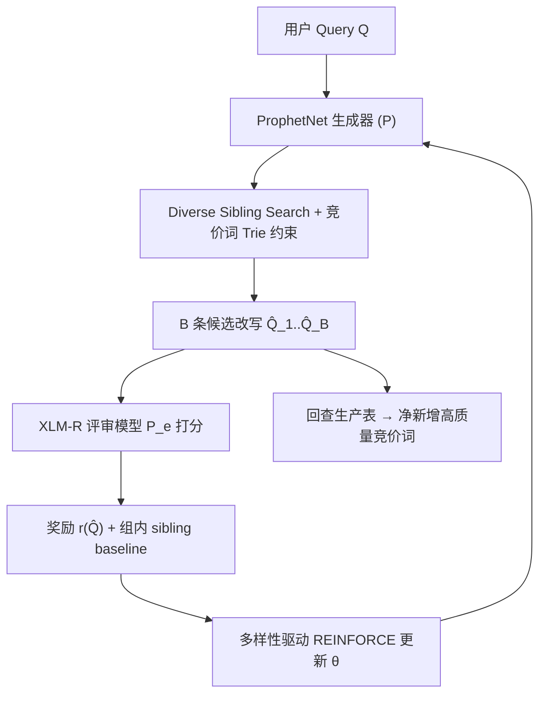
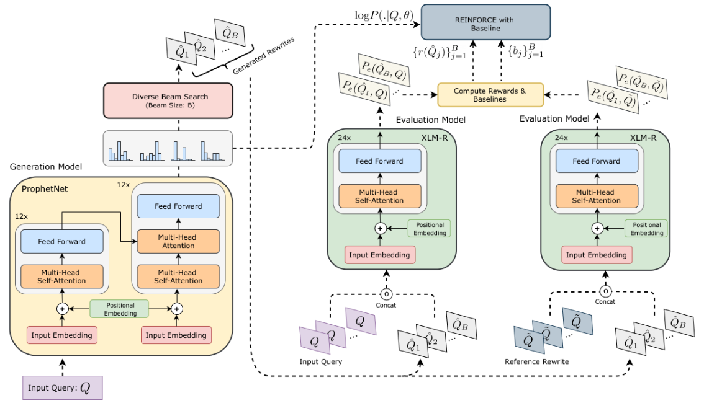
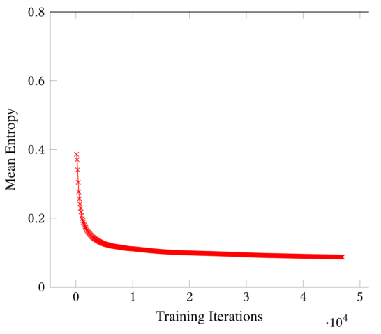

# Diversity driven Query Rewriting in Search Advertising (搜索广告中的多样性驱动查询改写)

- **会议/期刊**: KDD 2021 (Applied Data Science Track)
- **作者与机构**: Akash Kumar Mohankumar (IIT Madras / Microsoft 实习), Nikit Begwani, Amit Singh (Microsoft)
- **推荐链路定位**: 召回（赞助搜索广告的关键词/竞价词召回，离线生产表挖掘 + 线上改写）
- **研究方向**: 生成式推荐与离散语义ID / CTR 与广告匹配
- **论文原文**: [https://arxiv.org/abs/2106.03816v1](https://arxiv.org/abs/2106.03816v1)
- **开源代码**: 暂未开源

## TL;DR (1分钟核心速览)

赞助搜索的 close-variant 匹配需要把用户 query 改写成**同意图但语言多样**的竞价词。现有生成式检索（ProphetNet + trie 约束 Beam Search）受两点制约：Beam 输出词汇多样性极低（多为语序/冠词扰动），且最大似然目标与「质量 + 覆盖」真实诉求错位；直接用标准 REINFORCE 微调会让策略熵坍缩、只输出单一改写。CLOVER 将「评审模型打分」作为奖励，并把目标改为「$B$ 个多样化解码样本的期望总奖励」，配合 diverse sibling search，在英/法/德三语离线集上把 distinct unigram 从 0.590 提到 0.738、净新增高质量竞价词 2.16 个/query；Bing 线上 A/B 平均点击 +12.83%、缺陷率 −13.97%、收入 +21.29%。

## Background & Motivation (背景与核心矛盾)

- **主流范式**: 头部/腰部 query 采用离线挖掘的「生产表」$\{q:k_1,k_2,\dots,k_m\}$做同意图改写；近期工作将其视为受限生成任务，用 seq2seq 生成改写并在前缀 trie 上做约束解码，保证输出必属竞价词库$\mathcal{K}$。
- **前人局限 (1)**: Beam Search 产生的候选互为微小句法变体，无法命中「语义同、词形异」的竞价词，召回覆盖受限（"semantic gap"）。
- **前人局限 (2)**: 对数似然目标无法区分「插入无关词」这类严重错误与「同义词选择」这类轻微差异；训练集每 query 仅数条改写，而目标却是枚举全部合法改写。
- **核心洞察 (Key Insight)**: 标准 RL 目标 $J(\theta)=\mathbb{E}_{Q}\mathbb{E}_{\hat{Q}\sim P}r(\hat{Q})$存在确定性的最优策略$P^{*}(\hat{Q}|Q)=1$（仅对$\arg\max r$ 的单一改写），即在语法上「奖励最高」的解就是把概率全压在一个改写上——作者用实验（图 3）观察到训练中输出熵持续下降，覆盖度随之崩塌。
- **本文切入点**: 把「单样本期望奖励」换成「多样化解码子程序 $\mathcal{M}$输出的$B$ 个样本的期望总奖励」，让策略在获取高奖励的同时必须维持多峰分布。

## Method (核心方法设计)

### 1. 整体框架 (Overall Architecture)

输入用户 query $Q$，多语言 ProphetNet（12+12 层，next 2-gram 预训练）先在 330M 监督数据上做 SFT；再由 XLM-R 评审模型对解码出的$B$条改写（diverse sibling search + 竞价词 trie 剪枝）逐条打分，得到奖励$r(\hat{Q})$；组内其余样本的平均奖励充当 baseline，用 REINFORCE 更新生成器，从而在「高质量」与「高多样」之间取得可控平衡；线上最终以改写结果回查生产竞价词库。

<figure class="paper-figure" markdown="span">
  <figcaption>图2：CLOVER：由生成器与评估模型组成，并采用多样性驱动的强化学习算法</figcaption>
</figure>

### 2. 关键设计拆解 (Key Designs)

1. **多样性驱动 RL 目标（核心增量）**：痛点在于标准 RL 只需单点高概率即可拿满分奖励。本文将性能度量定义为多样解码下 $B$个样本的期望奖励之和$J(\theta,\mathcal{M})=\mathbb{E}_{Q}\sum_{j=1}^{B}\mathbb{E}_{\hat{Q}_j\sim \mathcal{M}(P,\theta,Q,\gamma)}r(\hat{Q}_j)$，梯度以同 query 其它样本均值为 baseline$b_j^{(i)}=\frac{1}{B-1}\sum_{k\neq j}r(\hat{Q}_k^{(i)})$。直觉上这是一种「组内相对优势归一化」：当所有$B$条改写趋同时，$r_j-b_j\to 0$，梯度自然消失，从而堵死「靠同质化刷奖励」的捷径。<figure class="paper-figure" markdown="span">
  <figcaption>图3：标准强化学习设置（使用基线算法的REINFORCE）下，输出分布的熵随训练迭代次数的变化</figcaption>
</figure>
2. **人类判断对齐的奖励 + Trie 约束解码**：启发式 BLEU/ROUGE 与人工判断几乎不相关（同义替换被判低分、单字错位反被判高分），故用 75k 人工 5 分制标注（$\ge 3$记正）微调 24 层 XLM-R 作评审模型（AUC 0.924/0.910），奖励取$r(\hat{Q})=\alpha P_e(\hat{Q},Q)+(1-\alpha)P_e(\hat{Q},\tilde{Q})$（无参考改写时$\alpha=1$）。解码时以 trie 剪枝非竞价词：$\tilde{p}(\hat{w}_t=w|\hat{w}_{<t},Q)=p(\cdot)$若$w\in \mathrm{suffix}_{\mathcal{T}_{\mathcal{K}}}(\hat{w}_{<t})$，否则为$0$；diverse sibling 在 beam 打分上加同级惩罚$\tilde{S}=S-\gamma k$，$\gamma$ 即多样性旋钮。
3. **训练目标、负采样与推理开销**：SFT 阶段沿 next $n$-gram 目标$\mathcal{L}(\theta,\mathcal{D})=-\mathbb{E}_{Q,\tilde{Q}}\big[\sum_{j=0}^{n-1}\alpha_j\sum_{t}\log p(\tilde{w}_{t+j}|\tilde{w}_{<t},Q,\theta)\big]$（$n=2,\alpha_j=0.5$）；RL 阶段 1 epoch on 24M。全文**无需负采样**（闭域生成 + trie 保证合法），推理 beam$B=20$（可扩至 50），逐词自回归解码是主要延迟来源。

## Experimental Setup & Evaluation Protocol (实验设置与评估协议)

| 数据集 | 规模 | 语言 | 用途 |
| :--- | :---: | :---: | :--- |
| Ads-large | 330M query-rewrite 对 | 英/法/德 | 生成器 SFT（5 epoch, bs 4096 token） |
| Ads-small | 24M 对 | 英/法/德 | 多样性 RL 微调（1 epoch, b=224, beam 20） |
| Eval-Query | 80k query（均长 3.42 词） | 英/法/德 | 离线评测，三语结果聚合 |
| Human-Judge | 75k 改写对（EN 45k, FR/DE 各 15k） | 三语 | 评审模型微调，5 分制 Likert |

- **数据划分与防穿越 (Splitting Strategy)**: 按 query 随机切分训练/测试，三语同分布；离线评测**不做** 训练集-生产表交集泄漏，而是用「生产表差分」作为严格的去重协议——先 `Valid Bid Filter`（不属竞价词库则弃）→ `Unique Filter`（已存于生产表则弃）→ `Global Quality Filter`（全局质量阈值）→ `Local Quality Filter`（该 query 生产表内最低质量分为阈值），四层过滤后剩下的才是真正贡献。
- **排名评测协议 (Ranking Protocol)**: 非传统 Full-Ranking/采样排序，而是**生成式闭集检索 + 逐 query 计数**：主指标 `Unique High-Quality Bid Keyword`（每 query 平均净新增高质量竞价词数）；多样性用 `Distinct Unigram / Bigram`（去重 n-gram 数 ÷ 总 token 数，惩罚长句）。质量分由评审模型给出而非字面重叠。
- **对比基线与超参设置**: 对比自身监督模型 × 三种解码（BS w/o trie、BS with trie、diverse sibling with trie）及四种集成，hidden 与词表沿用 ProphetNet-Ads 配置；多样性强度 $\gamma\in\{0.1,0.5,1\}$，beam$\in\{20,30,40,50\}$；线上以 Bing A/B 框架并行两周以上流量。

## Key Experimental Results (实验关键数据)

### 1. 主实验对比 (Main Results)

| 方法 | 解码 | Unique HQ Bid KW ↑ | Distinct Uni ↑ | Distinct Bi ↑ |
| :--- | :--- | :---: | :---: | :---: |
| Supervised (I) | BS w/o Trie | 2.10 | 0.209 | 0.573 |
| Supervised (II) | Normal BS + Trie | 3.80 | 0.590 | 0.868 |
| Supervised (III) | Diverse Sibling + Trie | 3.84 | 0.591 | 0.869 |
| **CLOVER (IV)** | **Diverse Sibling + Trie + 多样性RL** | 3.13 | **0.738** | **0.917** |
| Ensemble (I)+(II) | — | 5.13 (+3.03) | — | — |
| Ensemble (I)+(II)+(III) | — | 5.52 (+0.39) | — | — |
| **Ensemble (I)+(II)+(III)+(IV)** | — | **7.68 (+2.16)** | — | — |

线上 A/B（表 5）: Non-English $\Delta$Click **+7.90%**、$\Delta$Revenue **+16.47%**、$\Delta$Defect **−18.47%**；English$\Delta$Click **+17.76%**、$\Delta$Revenue **+26.11%**、$\Delta$Defect **−9.48%**（三语均值：点击 +12.83%、缺陷 −13.97%、收入 +21.29%）。

### 2. 消融实验 (Ablation Study)

| 配置（$\gamma$ 与解码方式） | Distinct Uni | Distinct Bi |
| :--- | :---: | :---: |
| Supervised, BS + Trie | 0.590 | 0.868 |
| Supervised, Diverse Sibling, $\gamma=0.1/0.5/1$ | 0.591 / 0.616 / 0.651 | 0.869 / 0.876 / 0.889 |
| CLOVER, BS + Trie（去掉多样解码） | 0.678 | 0.895 |
| **CLOVER, Diverse Sibling, $\gamma=0.1/0.5/1$** | **0.706 / 0.716 / 0.738** | **0.903 / 0.908 / 0.917** |

Beam 规模敏感性（CLOVER, $\gamma=1$）：$B=20\to 50$ 时净新增词 3.13→5.14（+64.2%），unigram 0.738→0.785，bigram 0.917→0.937。

### 3. 关键实验发现 (Key Findings)

1. **Trie 约束是强基线但只解决「合法性」**：加 trie 使净新增词从 2.10 跃至 3.80（+81.0%），然而 unigram 仅从 0.209 微升到 0.590、bigram 停在 0.868——合法化带来的增益与词汇多样性几乎正交，覆盖瓶颈仍在生成分布本身。
2. **仅靠解码端多样性介入会与生产表高度重叠**：监督模型切到 diverse sibling 后，集成增益仅 **+0.39** 词/query（3.84 中大部分已被旧方法命中）；而 CLOVER 的 3.13 词中有 **2.16（69%）** 为生产表净新增，说明奖励对齐 + 多样性 RL 才能挖出「语义远但意图同」的长尾竞价词。
3. **多样性与质量不呈对立**：CLOVER 在 $\gamma$ 从 0.1→1、beam 20→50 的单调扫描中多样性持续上涨，同时线上 defect 反而下降 9.48%（EN）/18.47%（非 EN），且覆盖率与关键词密度在**各 decile（含此前未被赞助内容覆盖的查询段）**均为正增益，说明评审模型作为奖励有效地把多样性约束在意图一致域内。

## Highlights & Limitations (亮点、对比与审稿批判)

- **与代表作对比 (vs. Prior Work)**: 与 Lian et al. (2019) 的端到端生成式检索、Qi et al. (2020) 的 ProphetNet-Ads 相比，本文完全复用其「生成器 + trie 约束解码」骨架，增量在于**把对齐对象从似然换成人类判断、把优化单元从单样本换成多样本**；与 Li et al. (2016) 的 diverse sibling search 相比，本文表明纯解码期干预只能贡献 0.39 净新词，而训练期多样性目标贡献 2.16。
- **可迁移亮点**: (1) 「用同组 sibling 均值做 baseline」的多样性 RL，天然适配任何需要一 query 多解（多意图召回、多路改写、生成式推荐多语义 ID 序列）的场景；(2) 「生产表差分式」的净新增评测口径，能有效惩罚与既有链路冗余的增益。
- **审稿级局限批判**: (1) 奖励模型依赖 75k 人工标注 + 每 query 局部质量阈值，跨语言/跨业务迁移需重标，且评审模型噪声会被 RL 直接放大（reward hacking 风险未量化）；(2) 训练成本高（8×V100 约两周 SFT、4×V100 RL），推理需 beam 20–50 的多样解码，延迟与线上 QPS 开销完全未报告；(3) 离线仅有自家监督模型与解码变体作基线，缺失 IR/embedding 检索类方法的同协议对比。

## Rating (四维评分)

- **方法创新性 (Novelty)**: ⭐⭐⭐⭐ （把 RL 目标从「单样本期望奖励」重塑为「多样样本总奖励」并配 sibling baseline，动机与熵坍缩现象形成闭环论证）
- **评估协议与实验扎实度 (Protocol & Experiments)**: ⭐⭐⭐⭐ （三语离线 + 生产表差分过滤 + 两周线上 A/B 与人评 defect，协议严谨；但离线基线类别偏窄、无显著性检验）
- **写作与数学规范度 (Clarity & Rigor)**: ⭐⭐⭐⭐ （目标函数、梯度与 baseline 定义完整且给出算法伪码，复杂度与延迟分析缺失）
- **工业落地与复现价值 (Industrial & Practical Value)**: ⭐⭐⭐⭐⭐ （Bing 线上收入 +21.29% 的真实增益，trie 约束+生产表差分口径可直接复用于广告/电商 query 改写）

