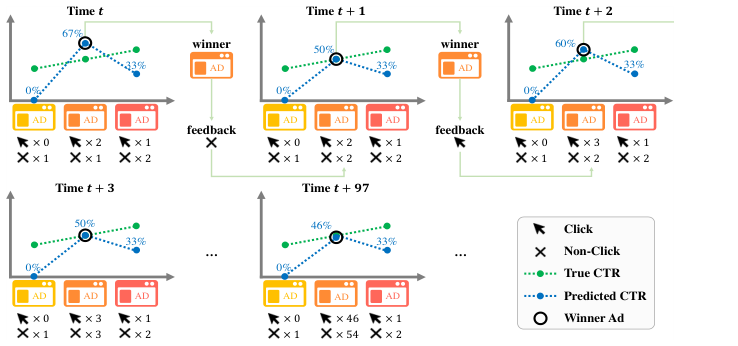
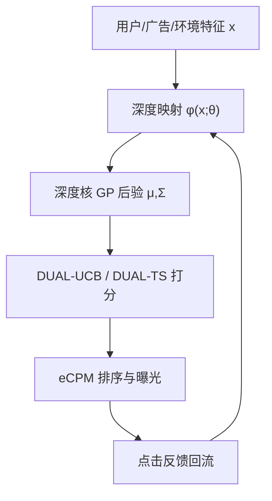

# Exploration in Online Advertising Systems with Deep Uncertainty-Aware Learning (深度不确定性感知学习驱动的在线广告探索)

- **会议/期刊**: KDD 2021
- **作者与机构**: Chao Du, Zhifeng Gao, Shuo Yuan 等，阿里巴巴集团
- **推荐链路定位**: 精排（CTR 预估）+ 广告排序/曝光决策
- **研究方向**: 强化学习与动态探索推荐 / CTR 预估与特征交叉
- **论文原文**: [arXiv:2012.02298v2](https://arxiv.org/abs/2012.02298v2)
- **开源代码**: [duchao0726/DUAL](https://github.com/duchao0726/DUAL)

## TL;DR (1分钟核心速览)

在线广告按预测 eCPM 排序会形成“只曝光高估广告”的反馈环，纯监督 CTR 模型缺乏探索；线性/逻辑 Bandit 又难以利用深度表征。本文提出 DUAL：在任意深度 CTR 模型上套深度核高斯过程，用稀疏变分后验给出 CTR 均值与方差，再以 DUAL-UCB/DUAL-TS 做广告排序。Amazon AUC 稳定提升，Yahoo! R6B 离线重放中 DUAL-TS 比 DNN-Greedy 的累计社福高 30.7%，阿里线上 A/B 社福 +8.2%、收入 +8.0%。

## Background & Motivation (背景与核心矛盾)

- **主流范式**: GSP 拍卖按预测 eCPM（CTR×出价）排序；CTR 模型以深度网络做纯监督学习，假设训练/测试样本 i.i.d.。
- **前人局限**: ① 曝光数据由模型自身排序产生，训练分布被策略反向影响，稀有广告的 CTR 长期被低估；② LinUCB/逻辑 Bandit 对真实 CTR 函数做线性假设，难以处理高维稀疏 ID 特征；BNN/Ensemble 虽可估不确定性，但推理/存储开销过大。
- **核心洞察 (Key Insight)**: 探索的关键不是“随机扰动”，而是对每个广告的 eCPM 有校准的**预测不确定性**；高斯过程后验天然提供均值与方差，深度核可保留深度模型表征能力。
- **本文切入点**: 用深度核 GP + 稀疏变分推断改造现有 CTR 模型，并把后验方差直接接入 UCB/Thompson Sampling 排序。

<figure class="paper-figure" markdown="span">
  <figcaption>图 2：缺乏探索问题示意图。假设三个广告出价相同。训练数据（即反馈）在每个时间步列出。蓝色和绿色虚线分别表示预测 CTR 和真实 CTR。没有探索时，系统会因中间广告的 CTR 预测最高而持续展示该广告。另外两个广告的 CTR 被低估后几乎没有机会被纠正，从而导致次优。建议彩色查看。</figcaption>
</figure>
图 1：缺乏探索导致高估广告持续曝光、低估广告难被纠正的反馈环（原文 Fig. 2）。

## Method (核心方法设计)

### 1. 整体框架 (Overall Architecture)

输入用户、广告、环境特征拼接为 $\mathbf{x}$，经深度映射$\phi(\mathbf{x};\theta)$得到紧凑隐表征；在 logit 函数$f$上放置 GP 先验，核函数为$k(\mathbf{x},\mathbf{x}')=k_0(\phi(\mathbf{x};\theta),\phi(\mathbf{x}';\theta))$。用隐空间诱导点与稀疏变分后验$q(u)=\mathcal{N}(v,S)$做近似推断，输出每个广告的$\mu_a,\Sigma_a$；训练端以 ELBO、温度系数与聚类正则端到端优化，服务端用 UCB/TS 将均值与方差转为排序分数。

### 2. 关键设计拆解 (Key Designs)

1. **深度核 GP 后验（把点预测变成分布预测）**：纯监督模型只给 $\hat h(\mathbf{x})$，无法区分“没数据”与“真低 CTR”。DUAL 对 logit 设 GP 先验，后验均值和方差为  
   $\mu_*=m(\mathbf{x}_*)+k(\mathbf{x}_*,Z)K_{uu}^{-1}(v-m(Z))$，  
   $\Sigma_*=k(\mathbf{x}_*,\mathbf{x}_*)-k(\mathbf{x}_*,Z)K_{uu}^{-1}(K_{uu}-S)K_{uu}^{-1}k(\mathbf{x}_*,Z)^\top$。  
   直觉是：隐空间相近的样本共享信息，远离训练数据的广告获得更大 $\Sigma_*$，从而被“有依据地探索”。

2. **隐空间诱导点 + 聚类正则（让 SVGP 可端到端训练）**：Bernoulli 似然与 GP 非共轭，且原始特征高维稀疏。DUAL 将诱导点参数化为 $Z'=\phi(Z;\theta)\in\mathbb{R}^{M\times d'}$，用$q(u)=\mathcal{N}(v,S)$ 及 ELBO 做小批量训练；并加  
   $\mathcal{R}(D_t)=\frac{1}{t}\sum_{i=1}^{t}\|\phi(\mathbf{x}_i;\theta)-z'_{c_i}\|^2$，  
   其中 $c_i$ 为最近诱导点。它防止训练初期隐表征远离诱导点导致 RBF 饱和，同时大幅减少参数量。

3. **训练目标与 Bandit 排序**：最终优化  
   $\min_{\theta,Z',v,S}\ -\mathcal{L}_\tau(D_t)+\lambda\mathcal{R}(D_t)$，  
   其中 $\mathcal{L}_\tau$为带温度$\tau$的 ELBO，$\tau$ 控制先验强度。排序侧：  
   $s_{\mathrm{UCB}}(a)=\sigma(\mu_a+\kappa\sqrt{\Sigma_a})\cdot\mathrm{Bid}(a)$；  
   $s_{\mathrm{TS}}(a)=\sigma(\hat f)\cdot\mathrm{Bid}(a),\ \hat f\sim\mathcal{N}(\mu_a,\Sigma_a)$。  
   DUAL-Greedy 只用 $\sigma(\mu_a)$，等价于带信息先验的 MAP 排序；DUAL 无需负采样，CTR 二分类按 mini-batch 训练。推理额外开销为$O(Md'+M^2)$，对角协方差时参数量仅$O(M)$。

## Experimental Setup & Evaluation Protocol (实验设置与评估协议)

- **数据集与预处理**:

| 数据集 | 规模/划分 | 物品/候选 | 特征/场景 |
| :--- | :--- | :---: | :--- |
| Amazon Books | 1,086,120 训练 / 121,216 测试 | 原文未报用户/物品数 | 沿用 DIEN 预处理，CTR 二分类 |
| Amazon Electronics | 346,110 训练 / 38,696 测试 | 原文未报 | 同上 |
| Yahoo! R6B | 约 2,800 万条日志，15 天 | 652 篇文章，候选均值 38 | 136 维多热用户特征，随机曝光日志 |

- **数据划分与防穿越**: Amazon 两数据集沿用 DIEN 的固定训练/测试划分；Yahoo! R6B 按日志时序做离线重放：前 80,000 条预训练，之后每 80,000 条更新一次（每次约 2,200 个有效样本，共 337 次更新）。
- **排名评测协议**: Amazon 用 CTR 二分类 **AUC**，不是全库排序；Yahoo! 用随机曝光日志的 **unbiased offline replay**，每个日志条目让策略重排候选集并仅在被选中广告与日志一致时收集反馈；线上用两周 A/B。
- **对比基线与超参**: Amazon 对比 DNN、Wide&Deep、PNN、DIN、DIEN；Yahoo! 对比 DNN-Greedy、DNN-$\epsilon$-Greedy ($\epsilon=0.05/0.1/0.2$)、DUAL-Greedy/UCB/TS、BNN-TS/UCB、Ensemble-TS/UCB、Random。Amazon 各模型共用 200-80-2 MLP；DUAL 隐空间 2 维、$M=200$、对角协方差。Yahoo! 用 6 维用户/广告 embedding，DUAL 为 16-2 MLP、$M=8$；重复 32 次报告均值与标准差。

## Key Experimental Results (实验关键数据)

### 1. 主实验对比 (Main Results)

| 模型 | Books Vanilla | Books DUAL | Δ_rel | Electronics Vanilla | Electronics DUAL | Δ_rel |
| :--- | :---: | :---: | :---: | :---: | :---: | :---: |
| DNN | 0.7682 | 0.7755 | +0.95% | 0.7413 | 0.7438 | +0.34% |
| Wide&Deep | 0.7729 | 0.7763 | +0.44% | 0.7441 | 0.7501 | +0.81% |
| PNN | 0.7801 | 0.7858 | +0.73% | 0.7541 | 0.7556 | +0.20% |
| DIN | 0.7885 | 0.7948 | +0.80% | 0.7593 | 0.7628 | +0.46% |
| DIEN | 0.8474 | **0.8492** | +0.21% | 0.7767 | **0.7824** | +0.73% |

### 2. 消融实验 (Ablation Study)

| 变体/策略 | 关键设置 | 观察结果 |
| :--- | :--- | :--- |
| DNN-Greedy | 纯监督 CTR + eCPM 排序 | 工业常用基线，缺乏探索 |
| DUAL-Greedy | 保留 GP 后验均值，忽略方差 | 优于 DNN-Greedy，说明信息先验本身有收益 |
| DNN-$\epsilon$-Greedy | 以$\epsilon$ 概率随机排序 | DUAL-TS 比其最佳设置高 10.0% |
| DUAL-UCB | 确定性上置信界探索 | 低于 DUAL-TS，作者归因于“贪心探索”过度集中 |
| DUAL-TS | 后验采样排序 | 比 DNN-Greedy 高 30.7%，与 Ensemble-TS 相近但仅约 20% 计算/内存开销 |

### 3. 关键实验发现 (Key Findings)

1. **深度核 GP 不牺牲预测精度**：5 个 CTR 骨干在 Books/Electronics 上均不降或提升，DNN 在 Books 相对提升 0.95%；DIEN+DUAL 达 0.8492，说明收益不是简单加参数，且预测直方图显示 DUAL 过度自信预测更少。
2. **不确定性确实转化为探索收益**：Yahoo! 重放中 DUAL-TS 比 DNN-Greedy 累计社福高 **30.7%**，比 DNN-$\epsilon$-Greedy 高 **10.0%**；DUAL-Greedy > DNN-Greedy 进一步验证后验均值/先验的价值。
3. **工业效率与线上收益兼得**：DUAL-TS 达到与 Ensemble-TS 相近的累计 SW，但计算/内存仅为后者的约 20%；阿里展示广告两周 A/B 中社福 **+8.2%**、收入 **+8.0%**，并通过样本隔离机制避免探索信息在实验组间泄漏。

## Highlights & Limitations (亮点、对比与审稿批判)

- **与代表作对比 (vs. Prior Work)**: 相比 LinUCB/逻辑 Bandit，DUAL 不假设线性 CTR，直接复用深度 CTR 表征；相比 BNN/Ensemble，DUAL 用 SVGP 隐空间诱导点把额外推理压到 $O(Md'+M^2)$；相比纯 GP Bandit，DUAL 能处理高维稀疏 ID 特征并端到端训练。
- **可迁移亮点**: ① 把任意 CTR 模型最后一层隐表征当作深度核输入，可低成本为现有模型加“不确定性头”；② 隐空间诱导点 + 聚类正则，适合其他需要 SVGP 的推荐场景。
- **审稿级局限批判**: ① 未直接评估不确定性校准（如 NLL/ECE），AUC 与 SW 只是间接证据；② Amazon 上 RBF 的 lengthscale/amplitude 需按数据集手调，$M>200$ 后收益饱和；③ 形式化假设单广告曝光，未覆盖多坑位 slate、预算/ROI 约束与长期竞价策略。

## Rating (四维评分)

- **方法创新性 (Novelty)**: ⭐⭐⭐⭐ （深度核 GP + 隐空间 SVGP + Bandit 排序的组合新颖且实用，但各组件并非首次提出）
- **评估协议与实验扎实度 (Protocol & Experiments)**: ⭐⭐⭐⭐ （Amazon 多骨干 AUC、Yahoo! 无偏重放、阿里线上 A/B 三层验证完整；缺不确定性校准与更多数据域）
- **写作与数学规范度 (Clarity & Rigor)**: ⭐⭐⭐⭐ （后验均值/方差、ELBO、复杂度推导清晰，策略定义简洁；部分实现细节需读代码）
- **工业落地与复现价值 (Industrial & Practical Value)**: ⭐⭐⭐⭐⭐ （开源代码、线上主流量 A/B、额外开销可控，对广告/推荐精排探索极具落地参考价值）

