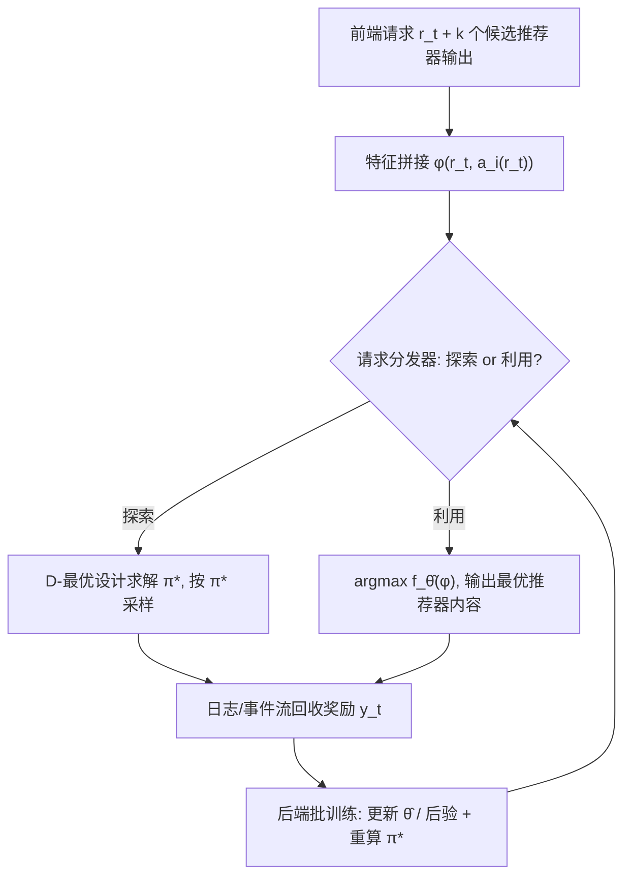
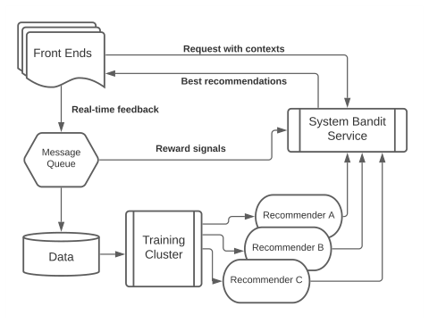
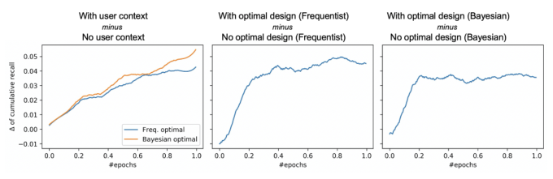

# Towards the D-Optimal Online Experiment Design for Recommender Selection (面向推荐器选择的 D-最优在线实验设计)

- **会议/期刊**: KDD 2021 (August 14–18, Virtual Event, Singapore)
- **作者与机构**: Da Xu, Chuanwei Ruan, Evren Korpeoglu, Sushant Kumar, Kannan Achan（Walmart Labs）
- **推荐链路定位**: 召回候选的**在线流量分配/实验层**（System Bandit Service，位于多个候选召回器之上）
- **研究方向**: 强化学习与动态探索推荐 / 工业架构与去偏
- **论文原文**: [https://arxiv.org/abs/2110.12132v2](https://arxiv.org/abs/2110.12132v2)
- **开源代码**: [D-optimal-recommender-selection](https://github.com/StatsDLMathsRecomSys/D-optimal-recommender-selection)

## TL;DR (1分钟核心速览)

多个候选推荐器在离线指标上势均力敌、且历史数据带曝光偏差，传统 A/B 测试又慢又贵，因此需要在线上做"推荐器级"的探索-利用。本文把该问题建模为上下文多臂老虎机，并用统计学中的 **D-最优设计** 取代"均匀 $1/k$探索"，使被选动作集合对 Fisher 信息矩阵$\log\det M(\pi)$的贡献最大。MovieLens-1M 在线模拟中累积召回率全面超越$\epsilon$-greedy / Thompson / LinUCB，并已在 Walmart.com 杂货相似商品页上线。

## Background & Motivation (背景与核心矛盾)

- **主流范式**: 候选推荐器上线评估依赖在线 A/B 测试与离线纠偏评估（interleaving、off-policy 估计）；探索-利用侧则直接套用 $\epsilon$-greedy、UCB、Thompson Sampling、LinUCB 等通用 MAB 算法。
- **前人局限（矛盾一）**: A/B 测试在个性化场景下"推荐器 × 用户分群"组合数指数爆炸，收集足够统计功效的样本慢且贵；离线纠偏方法又依赖不可混淆性、重叠性、可辨识性等难以满足的因果假设。
- **前人局限（矛盾二）**: 通用 MAB 忽略电商推荐的特有结构——候选推荐器输出的 top-$k$列表高度线性相关（例 1 中$a_2$与$a_4$输出完全相同，$a_3$可由$a_1,a_4$ 线性组合恢复），均匀探索把这些冗余臂同等对待，白白浪费流量与用户体验。
- **核心洞察 (Key Insight)**: 探索的本质是"为估计奖励模型参数 $\boldsymbol{\theta}$ 采集最大信息量"，而这正是经典最优设计理论所优化的目标；Kiefer–Wolfowitz 定理保证 D-最优与 G-最优等价，故可用凸优化求解。
- **本文切入点**: 用 D-最优设计生成探索期的动作分布 $\pi$，并把重计算全部下沉到后端批处理（stage-wise），前端只做查表，从而在"最小探索成本"而非"严谨因果推断"目标下取得效率。

## Method (核心方法设计)

### 1. 整体框架 (Overall Architecture)

每轮前端请求 $r_t$到来后，系统并行调用$k$个候选推荐器得到内容$a_i(r_t)$，拼成特征$\boldsymbol{\phi}(r_t,a_i(r_t))$；请求分发器决定本轮流向"探索"还是"利用"：探索轮按最优设计求得的$\pi^\*$采样动作，利用轮直接取$\arg\max_a f_{\hat{\boldsymbol{\theta}}}(\boldsymbol{\phi})$。探索结束后后端批量为$\boldsymbol{\theta}$ 做经验风险最小化（或后验更新），结果写入 mega cache 供前端推理读取，无逐轮实时训练。该"探索—再承诺"的分阶段结构可自适应非平稳环境（重启判据）。

<figure class="paper-figure" markdown="span">
  <figcaption>图1：系统多臂老虎机服务的高层概览。</figcaption>
</figure>

### 2. 关键设计拆解 (Key Designs)

1. **D-最优探索设计（替掉均匀 $1/k$）**: 探索期$\pi(a)=1/k$会高估冗余臂、低估唯一提供信息的臂。本文以 Fisher 信息矩阵为目标，线性奖励下$M(\pi)=\sum_{i=1}^{k}\pi(a_i)\,\boldsymbol{\phi}_i\boldsymbol{\phi}_i^{\top}$，求解$\max_{\pi}\log\det M(\pi)\ \text{s.t.}\ \sum_i\pi(a_i)=1$。因$\mathrm{var}(\hat{\boldsymbol{\theta}})\propto M(\pi)^{-1}$，最大化$\log\det$即最小化参数与预测方差；几何上等价于寻找最小体积椭球（John ellipsoid）。理论收益： fréquentist 线性设定下约$\sqrt{d}$倍加速，达到同精度只需$o(1/\sqrt{d})$ 的探索步数；模型误设时也不劣于均匀探索。

2. **贝叶斯版与历史先验的无缝融合**: 直接最大化 $\log\det M(\pi)$忽略了已采集数据，也不适配 Thompson Sampling。以 KL 增益为效用，$\boldsymbol{\theta}\sim\mathcal{N}(0,R)$时$U(\pi)=C+\tfrac12\log\det(M(\pi)+R^{-1})$，再用历史特征$\Phi_{t-1}$估$R^{-1}$，得到$\max_{\pi}\log\det\big(M(\pi)+\lambda\Phi_{t-1}\Phi_{t-1}^{\top}\big)$，$\lambda$控制先验强度。这样历史探索数据自动"折价"已充分探索的方向。非线性$f_{\boldsymbol{\theta}}$下用一阶泰勒在$\boldsymbol{\theta}_0=\hat{\boldsymbol{\theta}}$处局部线性化，$\nabla_{\boldsymbol{\theta}}f_{\boldsymbol{\theta}}\approx\nabla_{\boldsymbol{\theta}}f_{\boldsymbol{\theta}}|_{\boldsymbol{\theta}_0}$，代入同一目标即得$M(\pi;\boldsymbol{\theta}_0)$。

3. **求解与推理开销**: 用 Frank-Wolfe 求解该凸问题，每步找 $\tilde a=\arg\max_a \boldsymbol{\eta}_a^{\top}M^{-1}\boldsymbol{\eta}_a$，再按$\lambda_a=\frac{\boldsymbol{\eta}_{\tilde a}^{\top}M^{-1}\boldsymbol{\eta}_{\tilde a}/d-1}{\boldsymbol{\eta}_a^{\top}M^{-1}\boldsymbol{\eta}_a-1}$做原子更新；至多$O(d\log\log k+d/\epsilon)$次迭代达$(1+\epsilon)$最优，单次更新$O(kd^3)$，而实际$d$很小（示例中$d=6$）。**无负采样概念**（此处是模型选择而非检索训练），总目标为分阶段"最小化经验风险/更新后验 + 最大化$\log\det$"的双层结构；线上推理仅为查表 + 采样，p99 延迟可控。

## Experimental Setup & Evaluation Protocol (实验设置与评估协议)

- **数据集与预处理**: MovieLens-1M，评分二值化为 $\{0,1\}$（阈值 2.5）；类别特征 one-hot，片名用 50 维词向量，最终$\boldsymbol{\phi}$ 为拼接表示。

| 数据集 | #Users | #Items | #Interactions | 稀疏度/密度 | 特征/场景说明 |
| :--- | :---: | :---: | :---: | :---: | :--- |
| MovieLens-1M | 6,040 | 3,706 | 1,000,209 | 约 4.47% | 用户/物品元数据 + 片名词向量；电影评分 |
| Walmart.com 杂货相似商品 | 线上未披露 | 线上未披露 | 线上未披露 | — | Product KG 物品嵌入 + 时序用户图嵌入 |

- **数据划分与防穿越**: 初始仅用 **10%** 数据训练 4 个候选推荐器（userCF、itemCF、popularity、MF），其余作为"测试池"按 epoch 逐步释放，**非** Leave-One-Out、**非**全局时间戳切分，而是半合成的**在线模拟划分**（防穿越由"未交互即不入训练集 + 拒绝列表"保证）。
- **排名评测协议**: 非传统 $Full$-Ranking 或 Sampled Ranking，而是 **在线模拟的累积召回率 (Cumulative Recall)**：每 epoch 为每用户推荐 1 个物品，命中测试池中正评则计入成功并移入训练集，否则加入拒绝列表；指标为累计成功数 / 测试集正例总数，10 次运行取平均。因为候选集是 4 个推荐器（$k$ 很小），臂级选择即评测对象。
- **对比基线与超参设置**: 无上下文 MAB（$\epsilon$-greedy、Thompson）、上下文 bandit（Linear+UCB、Linear+Thompson），以及本文 Linear+Frequentist 最优设计、Linear+Bayesian 最优设计；userCF 邻居数 30，itemCF 用余弦相似度，MF 沿用前人设置；$d$ 小（示例 6），未见显著性检验报告。

## Key Experimental Results (实验关键数据)

### 1. 主实验对比 (Main Results)

原文主结果为累积召回率曲线（图 3），**未披露绝对数值**，故下表以曲线相对位次与趋势呈现（★ 为最优）：

| 方法 | 是否用上下文 | 探索策略 | 累积召回相对位次 | 关键表现 |
| :--- | :---: | :--- | :---: | :--- |
| $\epsilon$-greedy (MAB) | ✗ | 均匀$\epsilon$ | 6（最低） | 随 epoch 缓慢上升，验证模拟有效 |
| Thompson (MAB) | ✗ | 后验采样 | 5 | 优于 $\epsilon$-greedy，符合预期 |
| Linear + UCB | ✓ | 置信区间上界 | 4 | 上下文带来小幅增益 |
| Linear + Thompson | ✓ | 后验采样 | 3 | 略优于 LinUCB |
| **Linear + Frequentist 最优设计（本文）** | ✓ | **D-最优** | **2（大幅领先前四）** | 探索初期即拉开差距 |
| **Linear + Bayesian 最优设计（本文）** | ✓ | **D-最优 + 历史先验** | **1 ★** | 最佳；Thompson 额外步骤有正收益 |

### 2. 消融实验 (Ablation Study)

| 配置 | 变化 | 结论 |
| :--- | :--- | :--- |
| Full（含用户上下文 + 最优设计） | — | 最优 |
| w/o user context（fréquentist / Bayesian） | 去掉用户上下文 | 两种设定下曲线均下移，证明上下文信号被有效利用 |
| w/o optimal design（探索期改回均匀选择） | 只保留 stage-wise + 线性奖励 | 前期差距最大，后期收敛；说明最优设计的收益集中在探索早期 |
| $k$ 个臂的流量占比（图 5） | 最优设计 vs 均匀 | 最优设计更快把流量集中到 MF 与 popularity 两个"真有料"的臂 |

<figure class="paper-figure" markdown="span">
  <figcaption>图4：不同设置下系统多臂老虎机的累积召回率差异。左图分别展示了在频率学派与贝叶斯设定下使用与不使用用户上下文时的性能差异。另外两图比较了在探索阶段使用与不使用最优设计（均匀选择）的情况，二者均采用线性奖励模型。</figcaption>
</figure>

### 3. 关键实验发现 (Key Findings)

1. **收益主要来自"探索期效率"而非最终模型**：去掉最优设计后两条曲线在前期差距最大、后期趋同，说明 $\log\det$目标的核心价值是在选项大量未被探索时，用更少轮次把$\boldsymbol{\theta}$估到同等精度（理论上$\sqrt{d}$ 倍）。
2. **上下文与最优设计是正交增益**：图 4 左图显示加不加用户上下文有明显差距，中/右图显示加不加最优设计也有明显差距，二者叠加后（Bayesian 版）达到最佳，验证"用上下文建奖励模型 + 用最优设计选臂"的组合逻辑。
3. **最优设计自动识别冗余臂**：图 5 中，最优设计把流量更快压向 MF 与 popularity，而均匀策略在等价臂（如示例中 $a_2=a_4$）上仍按$1/k$ 浪费一半流量；线上 Walmart 侧（图 8）进一步显示 brand/flavor 增强模型更多服务高频客、baseline 与 price 模型更多服务低频客，说明策略在按用户分群主动探索-利用。

## Highlights & Limitations (亮点、对比与审稿批判)

- **与代表作对比 (vs. Prior Work)**: 与 LinUCB / 上下文 Thompson 相比，本文放弃"逐轮实时更新参数 + 置信界"，改用**分阶段 + 批量重训 + 最优设计**，把在线开销降到查表级；与 [9,51] 的推荐器 ensemble 相比，本文明确指出业务指标（GMV/点击）的条件分布未知，**不存在固定可优化的 ensemble 目标**，故只能做 bandit 式在线选择；与离线纠偏 A/B（如 [18]）相比，本文不追求无偏因果估计，只求"以最小流量代价找到最好推荐器"。
- **可迁移亮点**: (i) 用 Fisher 信息矩阵的 $\log\det$直接刻画"候选集合的线性相关性"，可迁移到多路召回源配额分配、多模型路由与冷启动候选池的流量调度；(ii) 用历史特征$\Phi\Phi^{\top}$近似先验精度矩阵$R^{-1}$ 的写法，是把离线日志注入在线探索的通用轻量手段。
- **审稿级局限批判**: (i) 全文实验以曲线呈现，**无绝对数值、无置信区间/显著性检验**，$k=4$的模拟规模也远小于真实多路召回场景，说服力打折；(ii) 最优设计的收益依赖奖励模型（线性/局部线性化）正确性与$\boldsymbol{\theta}_0$质量，非线性下仅局部近似，且$O(kd^3)$求解在$k$、$d$ 增大时与高峰流量冲突，文中仅以"下沉重计算"回避而未给出延迟实测。

## Rating (四维评分)

- **方法创新性 (Novelty)**: ⭐⭐⭐⭐ （把统计学 D-最优设计嫁接到推荐器选择的 bandit 问题上，Kiefer–Wolfowitz 等价性与椭球几何解释给了理论支撑，但内核仍是已知理论的跨域搬运）
- **评估协议与实验扎实度 (Protocol & Experiments)**: ⭐⭐⭐ （有开源代码与半合成在线模拟、10 次平均，且有条真实部署；但仅单一 MovieLens 数据集、无具体数值表、无显著性检验）
- **写作与数学规范度 (Clarity & Rigor)**: ⭐⭐⭐⭐ （Fisher 信息、贝叶斯 KL 增益、Frank-Wolfe 复杂度推导链条完整，示例 1 的冗余臂说明非常直观；非线性/贝叶斯组合情形留白）
- **工业落地与复现价值 (Industrial & Practical Value)**: ⭐⭐⭐⭐⭐ （真实 Walmart.com 杂货相似商品页上线，System Bandit 中间件架构与日志/事件流设计可直接复用，代码与数据开放）

