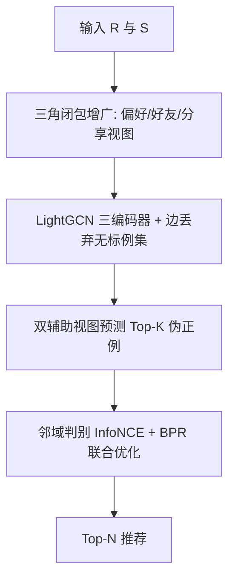
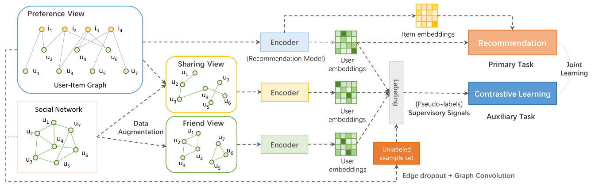

# Socially-Aware Self-Supervised Tri-Training for Recommendation (社交感知的自监督三训练推荐)

- **会议/期刊**: KDD 2021
- **作者与机构**: Junliang Yu, Hongzhi Yin, Min Gao, Xin Xia, Xiangliang Zhang, Nguyen Quoc Viet Hung；University of Queensland、重庆大学、KAUST、Griffith University
- **推荐链路定位**: 召回（Top-N 图协同过滤表征学习）
- **研究方向**: 自监督对比学习与交互去噪 / 社交与群组推荐
- **论文原文**: [arXiv:2106.03569v4](https://arxiv.org/abs/2106.03569v4)
- **开源代码**: [QRec](https://github.com/Coder-Yu/QRec)

## TL;DR (1分钟核心速览)

现有自监督推荐多靠均匀边/节点丢弃构造双视图，再做“节点对自身”的自判别；同质用户被误当负样本。SEPT 用社交三元闭包增广出好友、分享两个辅助视图，与偏好视图组成三编码器三训练，以另外两视图的 Top-K 伪正例做邻域判别 InfoNCE，并与 BPR 联合优化。5 折全库排序下，Yelp 的 NDCG@10 较 LightGCN 提升 10.33%，Douban-Book 提升 11.34%。

## Background & Motivation (背景与核心矛盾)

- **主流范式**: 图对比学习通过 uniform node/edge dropout 生成两个视图，最大化同一节点跨视图一致性，把其他节点推远。
- **前人局限**: 只建立跨视图的“一对一”自判别映射，忽略其他同质用户的正向监督；在推荐场景中大量相似用户被当作 false negatives，反而损害表征。
- **核心洞察 (Key Insight)**: 推荐系统存在广泛同质性，社交网络中的三元闭包——共同好友、共同物品——比原始社交边更可靠，可提供“其他用户也是正例”的监督。
- **本文切入点**: 用两类三角关系增广社交视图，把三训练引入自监督推荐，以邻域判别替代自判别。

## Method (核心方法设计)

### 1. 整体框架 (Overall Architecture)

SEPT 以 LightGCN 为共享底层。输入用户-物品图 $\mathbf{R}$与社交图$\mathbf{S}$后，先由三角闭包构造好友视图$\mathbf{A}_f$、分享视图$\mathbf{A}_s$，与偏好视图$\mathbf{R}$ 组成三视图；三个非对称编码器分别学习用户表征，其中偏好视图编码器同时学习物品表征并负责推荐。对联合图做边丢弃得到无标例集，两个辅助编码器为当前视图用户预测 Top-K 伪正例，再以邻域判别 InfoNCE 更新共享底层；先用 BPR 预热，后联合优化。

<figure class="paper-figure" markdown="span">
  <figcaption>图1：所提出的自监督三训练框架概述。</figcaption>
</figure>

### 2. 关键设计拆解 (Key Designs)

1. **三元闭包视图增广**：原始社交边有噪声，直接做社交正则只能拉近已连接用户。SEPT 抽取共同好友与共同物品三角：$\mathbf{A}_f=(\mathbf{S}\mathbf{S})\odot\mathbf{S}$，$\mathbf{A}_s=(\mathbf{R}\mathbf{R}^{\top})\odot\mathbf{S}$。矩阵乘累积二跳路径，Hadamard 积保留三角，既过滤弱社交边，又把“共同好友/共同物品”解释为可靠兴趣信号；稀疏矩阵乘法开销低。
2. **三训练伪标签与邻域判别**：对用户 $u$，辅助视图给出余弦 softmax 概率，仅当两视图一致才平均：$\boldsymbol{y}^{r}_{u+}=\frac{1}{2}(\boldsymbol{y}^{s}_{u+}+\boldsymbol{y}^{f}_{u+})$，再取$\mathcal{P}^{r}_{u+}=\operatorname{TopK}(\boldsymbol{y}^{r}_{u+})$。随后用 InfoNCE 拉近$u$与伪正例、推远其余用户：$\mathcal{L}_{ssl}=-\mathbb{E}\sum_{v\in\{r,s,f\}}\log\frac{\sum_{p\in\mathcal{P}^v_{u+}}\psi(\boldsymbol{z}^v_u,\tilde{\boldsymbol{z}}_p)}{\sum_{p\in\mathcal{P}^v_{u+}}\psi(\boldsymbol{z}^v_u,\tilde{\boldsymbol{z}}_p)+\sum_{j\notin\mathcal{P}^v_{u+}}\psi(\boldsymbol{z}^v_u,\tilde{\boldsymbol{z}}_j)}$，其中$\psi=\exp(\cos(\cdot)/\tau)$。一致性平均降低伪标签噪声，邻域正例把同质用户从负样本转为监督信号。
3. **训练目标、负采样与推理效率**：推荐损失为 BPR：$\mathcal{L}_{BPR}=\sum_{i\in I(u),j\notin I(u)}-\log\sigma(\hat r_{ui}-\hat r_{uj})+\lambda\|\mathbf{E}\|_2^2$，负样本从未交互物品均匀采样；总损失$\mathcal{L}=\mathcal{L}_{BPR}+\beta\mathcal{L}_{ssl}$。伪标签通过互信息最大化软性引导，不重建邻接矩阵，避免每轮改图。训练图卷积复杂度低于$4O(|\mathbf{R}|d)$，Top-K 约$O(m\log K)$，每批只采样$c$ 个用户降低开销；推理仍为 2 层 LightGCN。

## Experimental Setup & Evaluation Protocol (实验设置与评估协议)

- **数据集与预处理**: Douban-Book 仅保留评分 $\ge 4$ 并二值化为正反馈；其余交互二值化。

| 数据集 | #Users | #Items | #Interactions | 社交关系数 | 稀疏度/密度 |
| :--- | :---: | :---: | :---: | :---: | :---: |
| Last.fm | 1,892 | 17,632 | 92,834 | 25,434 | 0.28% |
| Douban-Book | 13,024 | 22,347 | 792,062 | 169,150 | 0.27% |
| Yelp | 19,539 | 21,266 | 450,884 | 864,157 | 0.11% |

- **数据划分与防穿越**: 采用 `5-fold cross-validation`，报告平均结果；非 Leave-One-Out，也非全局时间切分。
- **排名评测协议**: `Full-Ranking`，对全部候选物品排序后截断 @10；指标为 Precision@10、Recall@10、NDCG@10。
- **对比基线与超参**: 对比 LightGCN（1/2/3 层）、DiffNet++、MHCN、$S^2$-MHCN；嵌入维度$d=50$，$\lambda=0.001$，batch size 2000，Adam 学习率 0.001，主对比统一 2 层。原文未报告显著性检验。

## Key Experimental Results (实验关键数据)

### 1. 主实验对比 (Main Results)

下表为 2 层设置下 P@10 / R@10 / NDCG@10（%）；最优值加粗。

| Method | Last.fm | Douban-Book | Yelp |
| :--- | :---: | :---: | :---: |
| LightGCN-1L | 17.517/17.463/21.226 | 6.712/8.248/9.584 | 2.433/6.083/4.688 |
| LightGCN-2L | 19.205/19.480/23.392 | 7.650/10.024/11.348 | 2.641/6.791/5.235 |
| LightGCN-3L | 18.827/19.234/22.904 | 7.275/9.599/10.836 | 2.426/6.130/4.703 |
| DiffNet++ | 18.485/18.737/22.310 | 7.250/9.511/9.591 | 2.480/6.354/4.833 |
| MHCN | 19.625/19.945/23.834 | 7.718/10.113/11.540 | 2.751/6.862/5.356 |
| $S^2$-MHCN | 20.052/20.375/24.395 | 8.083/10.402/12.136 | **3.003/7.885/6.061** |
| **SEPT-2L** | **20.191/20.488/24.507** | **8.383/10.810/12.635** | 2.901/7.460/5.776 |
| Improv. vs LightGCN-2L | +5.13/+5.17/+4.77 | +9.58/+7.84/+11.34 | +9.84/+9.85/+10.33 |

### 2. 消融实验 (Ablation Study)

原文图 2/3 仅给趋势，未列逐项数值；下表按趋势归纳（↑ 表示优于对照，↓ 表示下降）。

| Variant | Last.fm | Douban-Book | Yelp |
| :--- | :---: | :---: | :---: |
| SEPT-SD（仅自判别） | ↑ 高于 LightGCN | 强于 SEPT-ND，接近完整 | ↑ 高于 LightGCN |
| SEPT-ND（仅邻域判别） | ≈ SEPT-SD | 低于 SEPT-SD | 强于 SEPT-SD |
| w/o Friend view（退化为 co-training） | 略↓ | 升至最佳 | 明显↓ |
| w/o Sharing view | 略↓ | 接近/略升 | 明显↓ |
| Preference-only（退化为 self-training） | 低于完整但 > LightGCN | 先略升后明显↓ | 明显↓ |
| Full SEPT | 接近最优 | 非最优（co-training 略优） | 受 $S^2$-MHCN 挑战 |

### 3. 关键实验发现 (Key Findings)

1. 稀疏数据集收益更大：Yelp 密度仅 0.11%，SEPT 较 LightGCN-2L 的 Recall@10 +9.85%、NDCG@10 +10.33%；Douban-Book 的 NDCG@10 +11.34%，说明伪正例监督在交互稀疏时更能补足信号。
2. 三训练优于单纯社交建模：SEPT 在 Last.fm、Douban-Book 上较 $S^2$-MHCN 提升 0.46–4.11%，且仅学习共享底层嵌入、训练更快；但 Yelp 上低于$S^2$-MHCN 约 3.40–5.39%，说明强社交超图仍具竞争力。
3. 自判别与邻域判别互补且数据相关：两者均优于 LightGCN；Last.fm 上贡献接近，Douban-Book 更依赖自判别，Yelp 更依赖邻域判别。超参上 $\beta$较敏感，小值最佳；边丢弃率$\rho$较鲁棒，$K$在 Last.fm/Yelp 稳定，但 Douban-Book 随$K$ 增大而下降，反映兴趣多样性差异。

## Highlights & Limitations (亮点、对比与审稿批判)

- **与代表作对比 (vs. Prior Work)**: 相较 SGL 的均匀增广+自判别，SEPT 用社交三角构造语义视图，把“其他用户”纳入正例；相较 MHCN/$S^2$-MHCN 的社交超图建模，SEPT 将社交关系转为三训练伪标签，骨架仍是轻量 LightGCN。
- **可迁移亮点**: 三角闭包矩阵增广可迁移到任何带辅助图的推荐；双视图一致后再 Top-K 的软伪标签策略，可替代昂贵的图重建式伪标签。
- **审稿级局限批判**: 仅挖掘用户侧伪标签，未利用物品多模态/内容侧同质性；$\beta$与$K$ 需按数据集调参，Douban-Book 上完整三视图反而不如 co-training，说明视图增益并非单调。额外辅助编码器与 Top-K 伪标增加训练开销，且原文缺少显著性检验与线上验证。

## Rating (四维评分)

- **方法创新性 (Novelty)**: ⭐⭐⭐⭐ （将 tri-training 与图自监督结合，邻域判别把同质用户从负例转为正例，思路清晰且非简单堆叠。）
- **评估协议与实验扎实度 (Protocol & Experiments)**: ⭐⭐⭐⭐ （5 折全库排序、三个真实数据集与多类基线较完整；但无显著性检验，消融仅给图未给数值。）
- **写作与数学规范度 (Clarity & Rigor)**: ⭐⭐⭐⭐ （三视图、伪标签与 InfoNCE 定义清楚；复杂度分析简洁，辅助编码器最优结构未展开。）
- **工业落地与复现价值 (Industrial & Practical Value)**: ⭐⭐⭐⭐ （LightGCN 骨架轻、代码开源；但三编码器与动态伪标带来额外训练成本，社交关系并非所有场景可得。）

