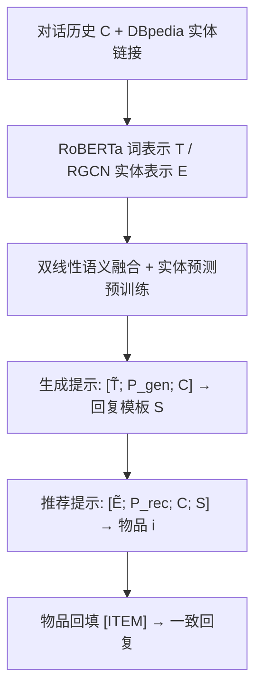
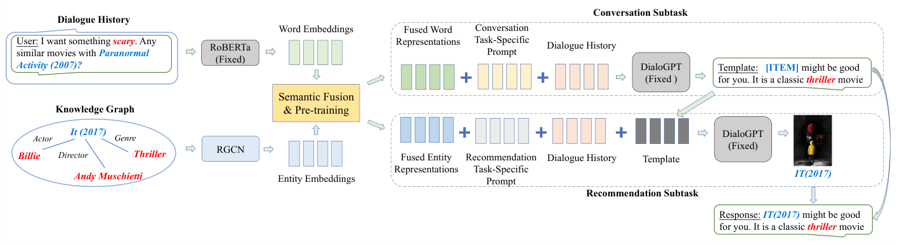

# Towards Unified Conversational Recommender Systems via Knowledge-Enhanced Prompt Learning (基于知识增强提示学习的统一对话推荐系统)

- **会议/期刊**: KDD 2022
- **作者与机构**: Xiaolei Wang, Kun Zhou, Ji-Rong Wen, Wayne Xin Zhao（中国人民大学高瓴人工智能学院 / 北京智源）
- **推荐链路定位**: 端到端生成式（对话内直接完成物品预测 + 回复生成）
- **研究方向**: 对话推荐与智能体仿真 / 大语言模型推荐
- **论文原文**: [https://arxiv.org/abs/2206.09363v1](https://arxiv.org/abs/2206.09363v1)
- **开源代码**: [https://github.com/RUCAIBox/UniCRS](https://github.com/RUCAIBox/UniCRS)

## TL;DR (1分钟核心速览)

对话推荐长期采用「推荐模块 + 对话模块」双架构，知识共享与互信息对齐仍无法消除语义不一致（KGSF 推荐 *Frozen 2* 却在回复里聊 *Pretty Woman*）。本文用**冻结的 DialoGPT + 知识增强软提示**把两个子任务统一为同一 PLM 的条件生成，并把对话模块产出的**回复模板（含 `[ITEM]` 占位符）反灌进推荐提示**。在 ReDial / INSPIRED 的全物品集排序协议下，Recall@10 达 0.224 / 0.250，相对最佳基线提升 **26.6% / 39.7%**，且只用 20% 训练数据即接近全量最佳基线。

## Background & Motivation (背景与核心矛盾)

- **主流范式**: CRS 拆成推荐模块（KBRD/KGSF 用 KG 增强物品语义）与对话模块（Transformer/HRED 生成回复），通过共享 KG 表示、互信息最大化（KGSF）或对比正则（KECRS 类）强行对齐两个语义空间。
- **前人局限**: ① 两模块架构与工作机制本质不同，即使共享知识向量也难以「无缝」关联；② 单向信息流——推荐结果无法被生成模块感知，生成回复也无法参与推荐打分。
- **核心洞察 (Key Insight)**: 两个子任务共享同一段对话语义，其差异只是**输出形式**（物品 vs 句子）；因此语义不一致的根因是架构分裂，而非知识不足，只要统一到同一生成范式即可天然一致。
- **本文切入点**: 冻结 PLM，全部改造量压在「提示」上——用融合知识表示 + 任务软词元 + 对话上下文构造提示，并用模板占位符做跨任务信息桥。

## Method (核心方法设计)

### 1. 整体框架 (Overall Architecture)

输入为一串拼接的对话历史 $C$。先用**冻结的 RoBERTa** 编码词元、**RGCN** 编码经 DBpedia 实体链接得到的实体，经双线性交叉融合得到$\tilde{T}$（词）与$\tilde{E}$（实体），并以「预测回复中出现实体」的自监督任务预训练融合模块。随后进入两阶段提示推理：生成提示产出回复（物品位置填 `[ITEM]` 形成模板$S$），推荐提示把$S$ 拼进上下文并预测物品，最后把物品回填模板得到最终回复。全程 DialoGPT-small（12 层 / 768 维）参数冻结，仅优化融合模块与两组软词元。

<figure class="paper-figure" markdown="span">
  <figcaption>图 1：所提出框架 UniCRS 的概览。灰色块表示其参数冻结，其他参数可调。我们首先进行预训练，以融合词和实体的语义，然后提示 PLM 生成回复模板，并将该模板作为推荐提示的一部分。最后，将推荐物品填入模板，形成完整回复。</figcaption>
</figure>

### 2. 关键设计拆解 (Key Designs)

1. **词-实体双线性语义融合与提示式预训练**：痛点是对白与 KG 两个语义空间存在鸿沟，直接把实体向量当提示会被冻结 PLM「读不懂」。做法是以双线性亲和矩阵做双向交叉更新：$\mathbf{A}=\mathbf{T}^{\top}\mathbf{W}\mathbf{E}$，$\tilde{\mathbf{T}}=\mathbf{T}+\mathbf{E}\mathbf{A}$，$\tilde{\mathbf{E}}=\mathbf{E}+\mathbf{T}\mathbf{A}^{\top}$；再用自监督实体预测把融合空间锚定到 PLM：$\Pr(e\mid\tilde{C}_{pre})=\mathrm{Softmax}(\boldsymbol{h}_u\cdot\boldsymbol{h}_e)$。直觉是让实体表示「说 PLM 的方言」，故 CRS 知识可被冻结模型直接消费。
2. **子任务专属软提示 + 回复模板回流**：生成侧提示为 $\tilde{C}_{gen}=[\tilde{\mathbf{T}};\mathbf{P}_{gen};C]$，推荐侧为$\tilde{C}_{rec}=[\tilde{\mathbf{E}};\mathbf{P}_{rec};C;S]$。两者刻意选用不同知识信号（生成用词表示、推荐用实体表示），因为预测目标是句子 vs 物品；而$S$ 作为**可读的中间产物**把生成结果注入推荐条件，等价于把「将要说的那句话」当作推荐的额外上下文，从机制上消除「推荐 A 却说 B」。
3. **训练目标、负采样与推理开销**：$\mathcal{L}_{gen}$为回复的词级交叉熵；推荐侧不做负采样，直接在**全部$M$个物品**上做二分类 BCE：$\mathcal{L}_{rec}=-\sum_{j}\sum_{i=1}^{M}[y_{j,i}\log \Pr_j(i)+(1-y_{j,i})\log(1-\Pr_j(i))]$，即天然的全库排序监督。软词元长度生成 50 / 推荐 10，batch 8 / 64，lr 预训练 5e-4、子任务 1e-4；可训参数仅为提示与融合层，显存与存储成本远低于全参微调，但推理需两阶段串行前向。

## Experimental Setup & Evaluation Protocol (实验设置与评估协议)

- **数据集与预处理**（沿用 KGSF/CRSLab 标准版本，未额外 5-core 过滤）：

| 数据集 | #Dialogs | #Utterances | #Items | 稀疏度/密度 | 特征/场景说明 |
| :--- | :---: | :---: | :---: | :---: | :--- |
| ReDial | 10,006 | 182,150 | 51,699 | 物品空间极大、长尾严重 | 电影推荐，AMT 众包英文对话 |
| INSPIRED | 1,001 | 35,811 | 1,783 | 小规模、物品集中 | 电影推荐，含策略性引导话术 |

- **数据划分与防穿越 (Splitting Strategy)**: 采用 ReDial/INSPIRED 官方 `Leave-One-Out` 式对话级 train/valid/test 划分（原文未逐条展开，沿用 KGSF/CRSLab 默认切分，未额外做全局时间戳切分）。
- **排名评测协议 (Ranking Protocol)**: 推荐任务为**无偏 Full-Ranking**——损失函数在全部 $M$ 个物品上计算 BCE，评测报 Recall@{1,10,50}，不使用采样负例排序；生成任务报词级 Distinct-{2,3,4}，并由 3 位标注者对 Fluency / Informativeness 打 0–2 分。
- **对比基线与超参设置**: 对比 3 个 CRS 模型（ReDial、KBRD、KGSF）与 4 个 PLM 适配（BERT、GPT-2、BART、DialoGPT）；提示维度 $d=768$与 DialoGPT-small 对齐，RGCN 1 层；显著性用$t$-test，$p<0.05$。

## Key Experimental Results (实验关键数据)

### 1. 主实验对比 (Main Results)

| 模型 | ReDial R@1 | ReDial R@10 | ReDial R@50 | INSPIRED R@1 | INSPIRED R@10 | INSPIRED R@50 |
| :--- | :---: | :---: | :---: | :---: | :---: | :---: |
| ReDial | 0.023 | 0.129 | 0.287 | 0.003 | 0.117 | 0.285 |
| KBRD | 0.033 | 0.175 | 0.343 | 0.058 | 0.146 | 0.207 |
| KGSF | 0.035 | 0.177 | 0.362 | 0.058 | 0.165 | 0.256 |
| BERT | 0.030 | 0.156 | 0.357 | 0.044 | 0.179 | 0.328 |
| BART | 0.034 | 0.174 | 0.377 | 0.037 | 0.132 | 0.247 |
| DialoGPT | 0.030 | 0.173 | 0.361 | 0.024 | 0.125 | 0.247 |
| **UniCRS** | **0.051** | **0.224** | **0.428** | **0.094** | **0.250** | **0.410** |
| **Improv.%** | **+45.7%** | **+26.6%** | **+13.5%** | **+62.1%** | **+39.7%** | **+25.0%** |

对话任务：ReDial 上 Distinct-2/3/4 为 **0.492 / 0.648 / 0.832**（最佳基线 0.476 / 0.559 / 0.521），Dist-4 相对提升 **+59.7%**；INSPIRED 上 **3.039 / 4.657 / 5.635**（最佳基线 2.408 / 3.720 / 4.929）。人工评测 Fluency **1.72**、Informativeness **1.64**，均显著优于 DialoGPT（1.68 / 1.56）与 KGSF（1.49 / 1.39）。

### 2. 消融实验 (Ablation Study)

（原图未给数值，下表为按图 2 / 图 3 坐标读出的近似值，仅供趋势参考）

| 变体 | ReDial R@10 | ReDial R@50 | Dist-4 |
| :--- | :---: | :---: | :---: |
| UniCRS 完整 | ≈0.223 | ≈0.428 | ≈0.832 |
| w/o 融合预训练 (PT) | ≈0.157 | ≈0.366 | ≈0.69 |
| w/o 词信号 | ≈0.191 | ≈0.394 | ≈0.75 |
| w/o 实体信号 | ≈0.201 | ≈0.401 | ≈0.63 |
| w/o 任务软词元 (SP) | ≈0.209 | ≈0.410 | ≈0.79 |
| w/o 回复模板 | ≈0.214 | ≈0.415 | — |

### 3. 关键实验发现 (Key Findings)

1. **模板回流最直接改善头部精度**：R@1 从 0.035 提升到 0.051（+45.7%），而 R@50 仅 +13.5%，说明「生成结果作为推荐条件」主要帮助模型在候选中锁定唯一正确答案，而非扩充长尾覆盖。
2. **融合预训练是性能命脉**：去掉 PT 后 R@10 由 ≈0.223 跌至 ≈0.157（约 −29.6%），降幅远超其他组件，证明 KG 实体必须经自监督实体预测对齐到冻结 PLM 的词空间才可被消费。
3. **两个子任务对知识信号的偏好相反**：推荐侧去实体掉点更明显，生成侧去实体使 Dist-4 由 ≈0.832 跌至 ≈0.63（约 −24%），说明实体是回复信息量的主要来源；此外 20% 训练数据下仍能达到全量最佳基线水平，体现提示微调的低资源鲁棒性。

## Highlights & Limitations (亮点、对比与审稿批判)

- **与代表作对比 (vs. Prior Work)**: KGSF 用双 KG + 互信息最大化对齐两个独立模块，KBRD 用 KG 词偏置，本质仍是「两个模型 + 一条绳子」；BERT/BART/DialoGPT 类适配则全参微调单一 PLM，无法注入结构化知识。UniCRS 的差别是把「一致性」从损失约束变成**架构内生的生成链条**，同时保持 PLM 冻结。
- **可迁移亮点**: ① `[ITEM]` 占位符 + 模板回填可迁移到「生成式召回的语义 ID 占位」与「解释生成—打分一致性」场景；② 融合模块「先自监督对齐到冻结 PLM、再以软提示注入」的两步法，是低资源下注入外部 KG 的低成本模板。
- **审稿级局限批判**: ① 一致性仅靠模板间接约束，Distinct 类指标甚至奖励发散，缺少「推荐—回复一致性」的显式量化指标与人工一致性评分；② 强依赖 DBpedia 实体链接与图谱覆盖，物品冷启动或非维基实体场景（如短视频、本地生活）难以复现收益；③ 两阶段串行推理 + 每轮 768 维 PLM 前向，在线时延与真实对话节流未评估，且数据划分与显著性方差报告不够完整。

## Rating (四维评分)

- **方法创新性 (Novelty)**: ⭐⭐⭐⭐ （首个把 CRS 双子任务统一进提示学习范式的工作，模板占位符回流是简洁而有效的跨任务桥，但融合层用最朴素的单层双线性，理论深度有限）
- **评估协议与实验扎实度 (Protocol & Experiments)**: ⭐⭐⭐⭐ （两数据集 + 全库 Full-Ranking + 自动/人工双评测 + 数据稀缺实验齐全，但消融仅以图形呈现无具体数值，划分细节未展开）
- **写作与数学规范度 (Clarity & Rigor)**: ⭐⭐⭐⭐ （提示构造与训练流程公式清晰、符号统一，但融合模块复杂度与推理开销分析缺失，部分下标偶有笔误）
- **工业落地与复现价值 (Industrial & Practical Value)**: ⭐⭐⭐⭐ （代码开源且并入 CRSLab，仅训少量提示参数、显存友好，适合冷启动场景；但依赖实体链接与两阶段生成，线上时延需额外工程优化）

