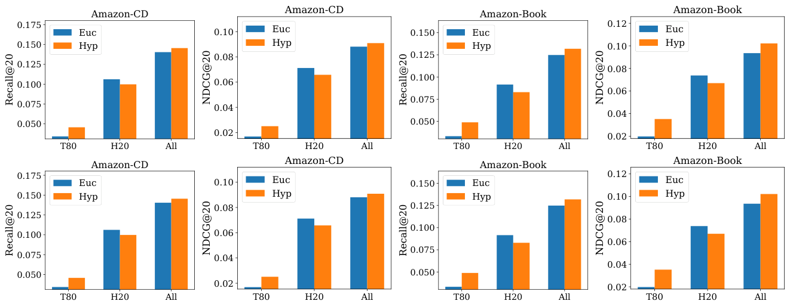
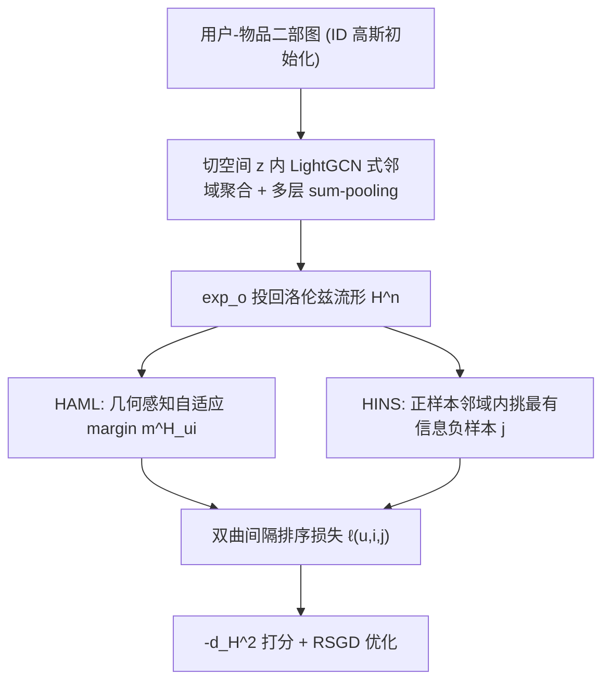
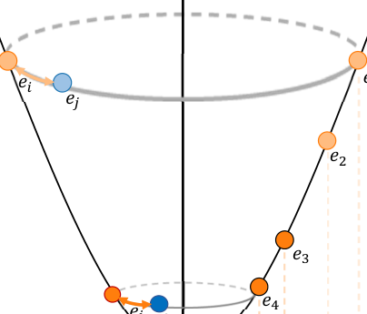

# HICF: Hyperbolic Informative Collaborative Filtering (双曲信息协同过滤)

- **会议/期刊**: KDD 2022 (ACM SIGKDD)
- **作者与机构**: Menglin Yang、Irwin King（香港中文大学），Zhihao Li、Jiahong Liu（哈工大深圳），Min Zhou（华为）
- **推荐链路定位**: 召回（图协同过滤表征学习）
- **研究方向**: 协同过滤与双塔召回 / 图神经网络推荐
- **论文原文**: [https://arxiv.org/abs/2207.09051v1](https://arxiv.org/abs/2207.09051v1)
- **开源代码**: 暂未开源

## TL;DR (1分钟核心速览)

本文首次把 LightGCN 与 HGCF 拆解到「头 20% / 尾 80%」两个物品桶上做定量对照，发现双曲模型整体更优、尾部收益巨大但头部反而略逊于欧氏模型。为此提出 HICF：把双曲间隔排序损失（HMRL）中的常量 margin 换成随节点到原点距离自适应收缩的几何感知 margin（HAML），并在正样本邻域内挑最近负样本（HINS）。在 Amazon-CD/Book、Yelp2020 上按 8:2 划分的采样排序协议下，Recall@10 相对最强基线提升 8.16%–12.16%，NDCG@10 最高提升 12.92%，尾部 Recall@20 相对 HGCF 最高提升 26.69%，同时头部反超 HGCF 达 12.50%。

## Background & Motivation (背景与核心矛盾)

- **主流范式**: 用户-物品二部图 + LightGCN 式邻域聚合，在欧氏空间做内积/距离打分；双曲推荐（HGCF、HyperML、HAE/HVAE）把同一套聚合搬到洛伦兹流形，凭指数增长的容量去拟合幂律分布网络。
- **前人局限**: ①所有双曲工作只报告全量指标，从未回答“哪类物品被双曲模型真正推好了”；②直接把欧氏 margin ranking 损失平移到双曲空间（HMRL），margin 是与几何无关的常数，无法区分靠近原点与靠近边界的节点对。
- **核心洞察 (Key Insight)**: 实验（图 2）显示双曲的收益几乎全部来自尾部——HGCF 在 Amazon-CD 尾部 Recall@20 达 0.0457 远超 LightGCN 的 0.0342，但头部 0.0998 反而低于 LightGCN 的 0.1062；而数据中尾部交互占比 54%（CD）/53%（Book）高于头部，说明“尾部空间大但仍欠拟合、头部被几何稀释”。
- **本文切入点**: 既然损失只有 pull/push 两步，就让这两步都变成几何感知的：pull 端给靠近原点的节点对更大 margin，push 端挑离正样本最近的负样本。

<figure class="paper-figure" markdown="span">
  <figcaption>图2：在 Amazon-CD 和 Amazon-Book 数据集上欧几里得模型与双曲模型的比较。Euc 表示欧几里得模型 LightGCN，Hyp 表示双曲模型 HGCF。</figcaption>
</figure>

## Method (核心方法设计)

### 1. 整体框架 (Overall Architecture)

输入用户-物品二部图，节点 ID 经高斯采样插入第 0 维后由指数映射 $e^0=\exp_o(z^0)$投到曲率$-1$的洛伦兹流形$\mathbb{H}^n$；聚合全部在原点切空间内以 LightGCN 式对称归一化求和完成$z_i^{k}=z_i^{k-1}+\sum_{u\in\mathcal{N}_i}\frac{1}{|\mathcal{N}_i|}z_u^{k-1}$，多层求和后再$\exp_o$投回流形；打分用负双曲距离$p(u,i)=-d_{\mathbb{H}}^2(e_u,e_i)$。训练时 HAML 依据节点对到原点的测地距离动态给出 margin，HINS 在候选池内选最靠近正样本的负例，共同驱动双曲间隔排序损失，最后用 RSGD（黎曼随机梯度下降）优化。

### 2. 关键设计拆解 (Key Designs)

1. **HAML：几何感知的自适应间隔（补头部）**：痛点是把欧氏常数 margin 搬到双曲后，靠近原点（头部枢纽节点）的节点对挤在平坦窄区，固定 margin 不足以把它们拉开，导致头部欠区分。作者改写的算子是
$m^{H}_{ui}=\mathrm{sigmoid}(\delta),\ \delta=\frac{d_{\mathbb{H}}^2(e_u,o)+d_{\mathbb{H}}^2(e_i,o)-d_{\mathbb{H}}^2(e_u,e_i)}{e_{u,0}\,e_{i,0}}$，
分子是“两条测地线之和减直连距离”的三角亏量，随节点远离原点而单调变小，分母用第 0 维坐标归一化。直觉是：近原点区平坦、容量小 → 给大 margin 强行挤压；远原点区弯曲、空间宽敞 → 小 margin 即可分离。替换原损失中的 $m$ 后，损失对每个节点对自校准。

2. **HINS：双曲信息负采样（补尾部）**：均匀负采样与幂律分布不匹配，且“热门物品的负样本”若取到无关冷门物品几乎不产生梯度。作者改为从 $\mathcal{I}\setminus\mathcal{N}_u$抽$n_{neg}$个候选，取双曲距离最近者$j=\arg\min_{\bar j}d_{\mathbb{H}}(e_{\bar j},e_i)$。由于双曲距离在远原点区近似等于范数之和，最近邻天然落在正样本所在“半径层”，等价于按流行度近似采样一个 comparable 的困难负例，对头部和尾部都成立，且无需额外数据或热度统计。

<figure class="paper-figure" markdown="span">
  <figcaption>图3：曲率为 -1 的双曲空间 H2 的 Lorentz 模型。在轴 𝑥0 右侧，有两对节点 {(e1, e2), (e3, e4)}，它们在欧几里得空间中的距离相等，即 𝑑𝐸(e1, e2) = 𝑑𝐸(e3, e4)，但在双曲空间中距离不同。特别地，位于双曲空间原点（HO）附近的节点 (e3, e4) 的距离小于远离 HO 的 (e1, e2) 的距离，即 𝑑H(e3, e4) &lt; 𝑑H(e1, e2)。在 𝑥0 左侧，e𝑖 和 e𝑗 分别是正项和负项，这表明采样一个负项</figcaption>
</figure>

3. **训练目标、负采样与推理效率**：总损失即改造后的间隔排序损失 $\mathcal{L}=\sum_{(u,i,j)}\max\left(d_{\mathbb{H}}^2(e_u,e_i)-d_{\mathbb{H}}^2(e_u,e_j)+m^{H}_{ui},0\right)$，负采样为上述“候选池内最邻近”策略（$n_{neg}$为超参，非 in-batch、非均匀，也非学习式）。推理仅需一次指数映射与一次双曲距离计算，复杂度与 HGCF 同阶；额外开销只体现在训练期为每个正样本计算$n_{neg}$ 次距离。

## Experimental Setup & Evaluation Protocol (实验设置与评估协议)

- **数据集与预处理**: 仅用隐式交互，评分 $\geq 4$ 视为正反馈；头部按 20/80 定律以度数排序切分（H20 / T80）。

| 数据集 | #Users | #Items | #Interactions | 稀疏度 | 头部/尾部交互占比 |
| :--- | :---: | :---: | :---: | :---: | :---: |
| Amazon-CD | 22,947 | 18,395 | 422,301 | 0.10% | H20 46% / T80 54% |
| Amazon-Book | 52,406 | 41,264 | 1,861,118 | 0.09% | H20 47% / T80 53% |
| Yelp2020 | 71,135 | 45,063 | 1,940,014 | 0.05% | H20 62% / T80 37% |

- **数据划分与防穿越**: 随机 `比例划分` 8:2（训练/测试），未做全局时间戳切分，存在隐式反馈时间穿越风险。
- **排名评测协议**: `Sampled Ranking` —— 每个测试正样本仅用 HINS 配 1 个负样本计算 Recall@K / NDCG@K，**不是 Full-Ranking 全库排序**，指标绝对值偏乐观，但同协议下对比公平。
- **对比基线与超参设置**: 双曲侧 HGCF/HVAE/HAE，欧氏侧 MF（WRMF/VAE-CF）、度量学习（TransCF/CML/LRML/SML）、图模型（NGCF/LightGCN），共 11 个基线；$d=50$、500 epochs、曲率固定$\kappa=1$、RSGD + 学习率$\{0.001,0.0015,0.002\}$、权重衰减$\{1\text{e-}4\sim5\text{e-}3\}$；最优与次优差异通过 Wilcoxon 符号秩检验标注显著（*）。

## Key Experimental Results (实验关键数据)

### 1. 主实验对比 (Main Results)

| 数据集 | 指标 | LightGCN | HGCF | HAE | HVAE | HICF (Ours) | Improv. |
| :--- | :--- | :---: | :---: | :---: | :---: | :---: | :---: |
| Amazon-CD | R@10 | 0.0929 | 0.0962 | 0.0666 | 0.0781 | **0.1079*** | +12.16% |
| Amazon-CD | N@10 | 0.0726 | 0.0751 | 0.0565 | 0.0629 | **0.0848*** | +12.92% |
| Amazon-CD | R@20 | 0.1404 | 0.1455 | 0.0963 | 0.1147 | **0.1586*** | +9.00% |
| Amazon-Book | R@10 | 0.0799 | 0.0867 | 0.0634 | 0.0774 | **0.0965*** | +11.30% |
| Amazon-Book | N@10 | 0.0780 | 0.0869 | 0.0709 | 0.0778 | **0.0978*** | +12.54% |
| Amazon-Book | R@20 | 0.1248 | 0.1318 | 0.0912 | 0.1125 | **0.1449*** | +9.94% |
| Yelp2020 | R@10 | 0.0522 | 0.0527 | 0.0360 | 0.0421 | **0.0570*** | +8.16% |
| Yelp2020 | N@20 | 0.0582 | 0.0585 | 0.0409 | 0.0465 | **0.0633*** | +8.21% |

头尾分桶（相对 HGCF 的 $\Delta_H$）：Amazon-CD 尾部 R@20$0.0457\to0.0559$ (+22.32%)、N@5 +25.48%，头部 R@5 +8.43%、N@5 +8.44%；Amazon-Book 头部 R@5 +12.50%、尾部 N@20 +16.73%；Yelp 头部 R@5 达 +10.74% 但尾部小幅回退 −2.08%~−4.65%。

### 2. 消融实验 (Ablation Study)

| 变体 | CD R@20 | CD H20 | CD T80 | Book R@20 | Book H20 | Yelp R@20 |
| :--- | :---: | :---: | :---: | :---: | :---: | :---: |
| HICF (full) | **0.1586** | **0.1027** | 0.0559 | **0.1449** | **0.0898** | **0.0947** |
| w/o HAML | 0.1534 | 0.0968 | **0.0566** | 0.1363 | 0.0844 | 0.0901 |
| w/o HINS | 0.1492 | 0.1021 | 0.0472 | 0.1312 | 0.0813 | 0.0921 |

### 3. 关键实验发现 (Key Findings)

1. **两个模块各有专攻、互补而非冗余**：去掉 HAML 后 Amazon-CD 头部 R@20 从 0.1027 掉到 0.0968（−5.7%）而尾部几乎不变（0.0566），去掉 HINS 后尾部从 0.0559 崩到 0.0472（−15.6%）而头部基本守住（0.1021）——直接印证 HAML 治头部、HINS 治尾部的设计假设。
2. **收益与数据密度正相关**：密度最高的 Amazon-CD（0.10%）NDCG@10 提升 12.92%，最稀疏的 Yelp（0.05%）仅 8.21%；且 Yelp 上 HINS 消融降幅最小（0.0947→0.0921），说明稠密图邻居更多、更值得扩大负样本候选池 $n_{neg}$，稀疏图对信息负采样不敏感。
3. **尾部涨点最猛但存在数据依赖**：Amazon-CD/Book 尾部 R@20 分别涨 22.32%/12.68%，而 Yelp 尾部反降 2.08%，与 Yelp 用户尾部交互仅占 37% 一致；同时 HICF 在尾部已超越欧氏 LightGCN（CD 0.0559 vs 0.0342），头部从“落后”翻转为“反超”，说明原先“双曲牺牲头部换尾部”的 trade-off 并非几何必然。

## Highlights & Limitations (亮点、对比与审稿批判)

- **与代表作对比 (vs. Prior Work)**: 相比 HGCF（把欧氏聚合平移到洛伦兹流形，损失与 margin 全几何无感），HICF 不改骨干、只改损失的两个算子，属“零架构成本”的即插即用增强；相比 LightGCN（尾部 R@20 仅 0.0342，容量受限），它用双曲容量把尾部拉高一个量级；相比 HyperML/HSCML（度量学习但未分离头尾分析），本文首次给出头尾解耦的定量诊断。
- **可迁移亮点**: ①“三角亏量 + 第 0 维归一化”构造自适应 margin 的思路，可直接迁移到任意曲率流形上的对比/排序损失；②“候选池内取最近负例”是免热度统计、免额外编码器的困难负采样替代方案，可用于双塔召回采样器。
- **审稿级局限批判**: ①评测仅对每个正样本配 1 个负样本做 Sampled Ranking，未做 Full-Ranking，指标绝对值与真实线上排序差距大，且 HINS 参与评测构造会与训练策略同源、可能放大自身优势；②曲率固定 $\kappa=1$未学习，且 HINS 每步需$n_{neg}$次双曲距离计算，稠密图上训练开销与超参敏感性（$n_{neg}$ 需逐数据集网格搜索）未给出定量代价分析；③30% 的 Yelp 尾部回退未给出机制解释，仅归因于“用户对尾部兴趣少”。

## Rating (四维评分)

- **方法创新性 (Novelty)**: ⭐⭐⭐⭐ （把 margin 与负采样同时几何化，思路简洁且有明确的双曲几何直觉支撑，但属损失层改良而非新架构）
- **评估协议与实验扎实度 (Protocol & Experiments)**: ⭐⭐⭐ （三数据集 + 11 基线 + Wilcoxon 检验 + 头尾分桶充分，但 1:1 采样排序而非全库排序、无时间切分是硬伤）
- **写作与数学规范度 (Clarity & Rigor)**: ⭐⭐⭐⭐ （洛伦兹模型与 HAML 的推导链条清晰、图文互证到位，缺少对损失收敛性/复杂度的形式化分析）
- **工业落地与复现价值 (Industrial & Practical Value)**: ⭐⭐⭐ （不改骨干、易嵌入现有双曲召回，但未开源、HINS 训练开销与 $n_{neg}$ 调参成本在工业规模下需重新评估）

