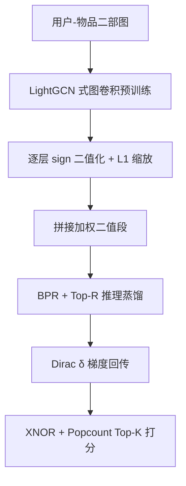
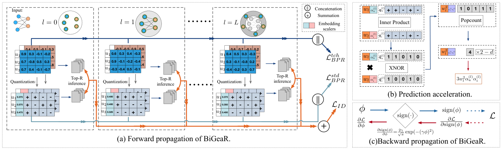

# Learning Binarized Graph Representations with Multi-faceted Quantization Reinforcement for Top-K Recommendation（多面向量化增强的二值图表示学习用于 Top-K 推荐）

- **会议/期刊**: KDD 2022
- **作者与机构**: Yankai Chen, Huifeng Guo, Yingxue Zhang, Chen Ma, Ruiming Tang, Jingjie Li, Irwin King；CUHK、华为诺亚方舟实验室、CityU
- **推荐链路定位**: 召回（端到端二值图召回）
- **研究方向**: 协同过滤与双塔召回 / 图神经网络与知识图谱推荐
- **论文原文**: [https://arxiv.org/abs/2206.02115v1](https://arxiv.org/abs/2206.02115v1)
- **开源代码**: 暂未开源；实验数据/评测脚本参考 [LightGCN-PyTorch](https://github.com/gusye1234/LightGCN-PyTorch)

## TL;DR (1分钟核心速览)

针对 1-bit 量化推荐中特征表达力损失、排序知识丢失和 STE 梯度方向不一致三大痛点，BiGeaR 在 LightGCN 式图卷积上做逐层二值化与 L1 缩放，并用 Top-R 伪正样本蒸馏和 Dirac δ 梯度估计补偿信息。5 个公开数据集按公开比例划分、全库排序（Full-Ranking），Recall@20 较最佳量化基线 HashGNN_s 提升 25.77%–40.12%，恢复 LightGCN 95.29%–100.32%，推理/空间约 8×。

## Background & Motivation (背景与核心矛盾)

- **主流范式**: 全精度图协同过滤（LightGCN 等）以连续嵌入做内积排序；为降低线上内存与算力，HashGNN、CIGAR 等转向 1-bit 哈希/量化。
- **前人局限**: 仅在最终输出做 `sign(·)`，二值码表达力受限；同时忽略全精度与二值嵌入的排序知识差异，Top-K 能力明显下降。
- **梯度问题**: `sign(·)` 不可导，STE 直接令梯度为 1，但 1 的积分是线性函数而非 `sign(·)`，前后向优化方向不一致。
- **核心洞察 (Key Insight)**: 多层图卷积的中途语义比末端单次二值化更丰富；低度、独特多跳邻居的贡献可被逐层量化放大；只需蒸馏教师榜单头部即可保住 Top-K 排序。
- **本文切入点**: 在量化前、中、后三阶段分别加入图层量化、推理蒸馏与 δ 梯度估计，形成端到端二值图推荐框架。

## Method (核心方法设计)

### 1. 整体框架 (Overall Architecture)

BiGeaR 先以 LightGCN 式图卷积预训练全精度嵌入，再在每层并行执行 `sign` 二值化并记录 L1 缩放因子，形成 $L+1$ 组二值段；预测时将各段加权拼接，用 XNOR+Popcount 代替浮点内积。训练端以 BPR 为主损失，叠加层间 Top-R 推理蒸馏，并用 Dirac δ 近似 `sign` 的导数回传；推理端只存二值码与标量缩放，支持 CPU 位运算。整体流程见图 2。

<figure class="paper-figure" markdown="span">
  <figcaption>图2：BiGeaR 先预训练全精度嵌入，然后触发 (1) 图逐层量化、(2) 推理蒸馏和 (3) 精确梯度估计，以学习二值化表示（最佳彩色视图）。</figcaption>
</figure>

### 2. 关键设计拆解 (Key Designs)

1. **图逐层量化（Graph Layer-wise Quantization）**：前人只在最后输出二值化，表达力被一次性压缩；本文在每层维护 $\boldsymbol{q}_u^{(l)}=\mathrm{sign}(\boldsymbol{v}_u^{(l)})$与$\alpha_u^{(l)}=\frac{1}{d}\|\boldsymbol{v}_u^{(l)}\|_1$，保留不同感受野语义。其物理直觉是：多跳邻居中低度、独特节点对$u$的影响被放大，$E_{x\to u}^{(l)}\propto \frac{1}{\sqrt{|\mathcal{N}(x)|}}\Pr(l\text{-step random walk from }u\text{ to }x)$，从而补偿二值化表达力。

2. **自监督推理蒸馏（Inference Distillation）**：Top-K 排序关注相对次序，KLD/MSE 只对齐宏观分布且全库计算贵；本文用全精度教师对每层取 Top-R 伪正样本 $S_{te}^{(l)}(u)$，令二值学生提高其分数：$\mathcal{L}_{ID}(u)=-\frac{1}{R}\sum_{l=0}^L\sum_{k=1}^R w_k\ln\sigma(\hat{s}_{u,S_{te}^{(l)}(u,k)}^{std,(l)})$，$w_k=\lambda_1e^{-\lambda_2k}$ 按排名衰减。这样只蒸馏榜单头部，直接服务 Top-K。

3. **梯度估计、训练目标与推理效率**：STE 把 `sign` 梯度当 1，前后向方向不一致；本文由 $\mathrm{sign}(\phi)=2u(\phi)-1$推得$\frac{\partial\mathrm{sign}(\phi)}{\partial\phi}\approx\frac{2\gamma}{\sqrt{\pi}}e^{-(\gamma\phi)^2}$，用 Dirac δ 的 Gaussian 近似。总损失$\mathcal{L}=\mathcal{L}_{BPR}^{std}+\mathcal{L}_{ID}+\lambda\|\Theta\|_2^2$；BPR 均匀负采样，每个正样本配一个未交互负样本；推理用位运算，仅存二值码与缩放。

## Experimental Setup & Evaluation Protocol (实验设置与评估协议)

- **数据集与预处理**: 沿用公开 LightGCN/NGCF 数据版本；密度差异大，覆盖电影、签到、图像社交、商户点评与图书。

| 数据集 | #Users | #Items | #Interactions | 密度 | 特征/场景说明 |
| :--- | :---: | :---: | :---: | :---: | :--- |
| MovieLens | 6,040 | 3,952 | 1,000,209 | 4.19% | 电影评分，稠密 |
| Gowalla | 29,858 | 40,981 | 1,027,370 | 0.084% | 签到社交 |
| Pinterest | 55,186 | 9,916 | 1,463,556 | 0.267% | 图像社交 |
| Yelp2018 | 31,668 | 38,048 | 1,561,406 | 0.130% | 商户点评 |
| Amazon-Book | 52,643 | 91,599 | 2,984,108 | 0.062% | 图书，稀疏 |

- **数据划分与防穿越 (Splitting Strategy)**: 沿用公开 LightGCN/NGCF 划分，按用户随机比例切分训练/验证/测试；非全局时间戳切分。
- **排名评测协议 (Ranking Protocol)**: 无偏 `Full-Ranking`，对全库未交互物品排序；主表报告 Recall@20 与 NDCG@20，K 另在 {20,40,60,80,100} 上变化。
- **对比基线与超参设置**: 全精度 NGCF/DGCF/LightGCN/NeurCF；量化或哈希 LSH/HashNet/CIGAR/GumbelRec/HashGNN。嵌入维度搜索 {32–1024}，资源分析取 $d=256$；显著性$p<0.05$。

## Key Experimental Results (实验关键数据)

### 1. 主实验对比 (Main Results)

下表为 R@20/N@20（%），加粗为各列全体最优；“Gain”为 BiGeaR 相对最佳量化基线 HashGNN_s 的提升。

| 模型 | ML | Gowalla | Pinterest | Yelp2018 | Amazon-Book |
| :--- | :---: | :---: | :---: | :---: | :---: |
| LightGCN | **26.28/46.04** | **19.02/25.71** | 15.33/16.29 | **6.79/12.17** | **4.84**/8.11 |
| DGCF | 25.28/45.98 | 18.64/25.20 | 15.52/16.51 | 6.37/11.08 | 4.32/7.73 |
| NGCF | 24.69/39.56 | 16.22/24.18 | 14.67/13.92 | 5.89/9.38 | 3.65/6.90 |
| HashGNN_s | 19.87/37.32 | 13.45/19.12 | 12.38/13.63 | 4.86/8.83 | 3.34/5.82 |
| CIGAR | 14.84/24.63 | 11.57/16.77 | 10.34/11.87 | 3.65/7.87 | 3.05/4.98 |
| GumbelRec | 16.62/29.36 | 12.26/17.49 | 10.53/11.86 | 3.85/7.97 | 2.69/4.32 |
| BiGeaR | 25.57/45.56 | 18.36/24.96 | **15.57/16.83** | 6.47/11.60 | 4.68/**8.12** |
| **Gain vs HashGNN_s** | **28.69/22.08** | **36.51/30.54** | **25.77/23.48** | **33.13/31.37** | **40.12/39.52** |

### 2. 消融实验 (Ablation Study)

| 变体 | ML R/N@20 | Gowalla R/N@20 | Amazon R/N@20 | 相对全模型下降 |
| :--- | :---: | :---: | :---: | :---: |
| noID | 24.40/44.06 | 17.85/24.28 | 4.07/7.31 | ML -4.58/-3.29；Amazon -13.03/-9.98 |
| endID | 25.02/44.75 | 18.05/24.73 | 4.44/7.78 | ML -2.15/-1.78；Amazon -5.13/-4.19 |
| KLD | 24.32/44.38 | 17.63/24.07 | 4.13/7.21 | ML -4.89/-2.59；Amazon -11.75/-11.21 |
| BiGeaR | 25.57/45.56 | 18.36/24.96 | 4.68/8.12 | — |

### 3. 关键实验发现 (Key Findings)

1. **量化增益显著且一致**：相对 HashGNN_s，BiGeaR 在五数据集 Recall@20 提升 25.77%–40.12%、NDCG@20 提升 22.08%–39.52%，$p<0.05$；说明三阶段量化增强不是单一正则的边际收益。
2. **蒸馏必须层间且排序感知**：去掉 ID 使 Amazon R@20 降 13.03%，仅末层蒸馏降 5.13%，换 KLD 降 11.75%；KLD 在稠密 MovieLens 也不如末层蒸馏（-4.89% vs -2.15%）。
3. **实用折中成立**：BiGeaR 恢复 LightGCN 95.29%–100.32% Recall、95.32%–101.94% NDCG；MovieLens 推理 3.94ms vs 32.54ms（约8.3×），嵌入表 1.08MB vs 9.79MB（约9.1×），训练仅 5.16+6.22s/epoch vs 4.91s。

## Highlights & Limitations (亮点、对比与审稿批判)

- **与代表作对比 (vs. Prior Work)**: 相较 LightGCN，BiGeaR 端到端 1-bit 但保留 95%–102% 能力；相较 HashGNN，本文不靠混合实值松弛，而用逐层量化+蒸馏+δ 梯度；相较 CIGAR，不需全精度重排，直接在二值框架内预测。
- **可迁移亮点**: 逐层量化+标量缩放可迁移到其他 GCN 召回；Top-R 伪正样本蒸馏适合排序任务；δ 函数梯度估计可替代 STE。
- **审稿级局限批判**: ① 两阶段训练（全精度预训练+量化训练）带来额外 5.16+6.22s/epoch，且 $R$、$\gamma$、$\lambda_2$等超参增加调参成本；② 评估仅为随机比例划分与 Full-Ranking Top-20，缺时间切分/线上 A/B，且$L=4$出现过平滑，需限制$L\le3$。

## Rating (四维评分)

- **方法创新性 (Novelty)**: ⭐⭐⭐⭐ （三阶段量化增强组合有新意，图层量化与特征唯一性放大分析较扎实，但整体仍属组件式改进）
- **评估协议与实验扎实度 (Protocol & Experiments)**: ⭐⭐⭐⭐ （5 个大数据集、全库排序、显著性检验与多组消融完整；缺时间切分与线上验证）
- **写作与数学规范度 (Clarity & Rigor)**: ⭐⭐⭐⭐ （公式链条清晰，复杂度与梯度推导完整；部分符号较密，附录依赖较多）
- **工业落地与复现价值 (Industrial & Practical Value)**: ⭐⭐⭐⭐ （8× 推理/空间收益明确，适合资源受限召回；但两阶段训练与官方代码缺失降低直接复现性）

