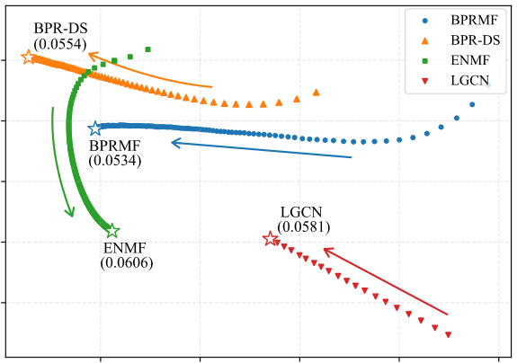
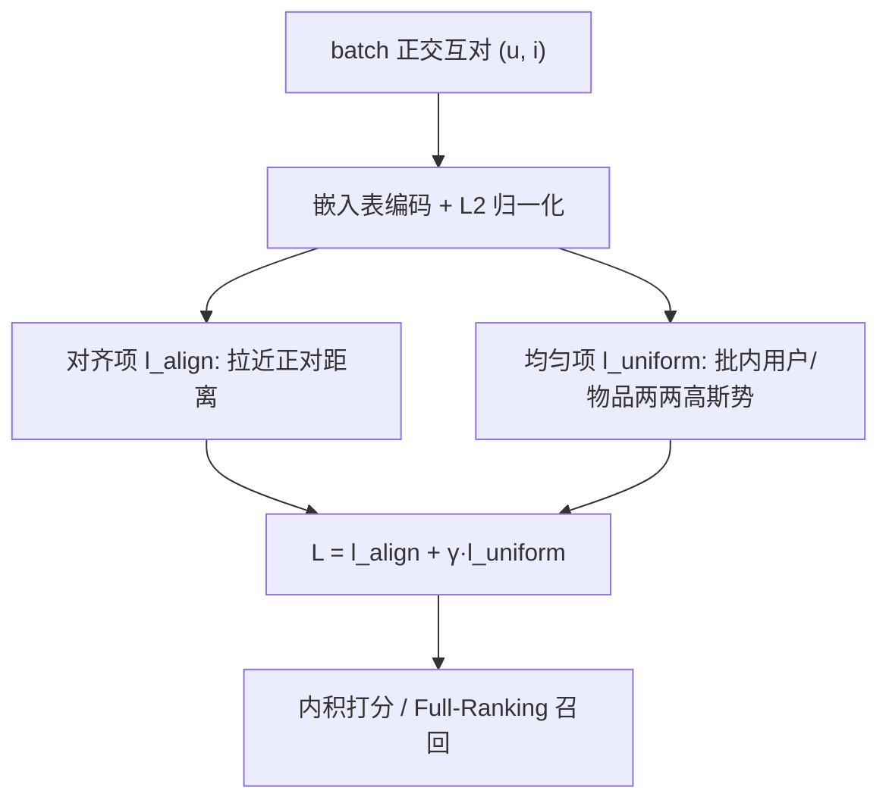
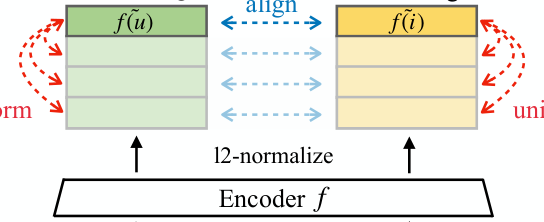

# Towards Representation Alignment and Uniformity in Collaborative Filtering (面向协同过滤中的表征对齐性与均匀性)

- **会议/期刊**: KDD 2022
- **作者与机构**: Chenyang Wang, Yuanqing Yu, Weizhi Ma, Min Zhang*, Chong Chen, Yiqun Liu, Shaoping Ma（清华大学计算机系 BNRist / AIR）
- **推荐链路定位**: 召回（表征学习与损失函数设计，可下沉至任意编码器）
- **研究方向**: 协同过滤 / 自监督对比学习与交互去噪
- **论文原文**: [https://arxiv.org/abs/2206.12811v1](https://arxiv.org/abs/2206.12811v1)
- **开源代码**: [https://github.com/THUwangcy/DirectAU](https://github.com/THUwangcy/DirectAU)

## TL;DR (1分钟核心速览)

本文跳出"堆更强编码器"的内卷路线，转而追问 CF 表征本身应具备什么性质：作者从对比学习的 alignment / uniformity 视角切入，**理论上证明 BPR 损失的全局最优解恰是"完美对齐 + 完美均匀"的编码器**，并实证发现不同 CF 方法只是在这两个维度上各有偏科。据此提出 DirectAU 损失，直接优化正样本对距离与批内超球面散布，**彻底抛弃负采样**。在 Beauty / Gowalla / Yelp2018 上采用 80/10/10 划分与 **Full-Ranking 全库排序**，仅用最朴素的 MF 编码器即全面超越 LGCN、DGCF、ENMF、CLRec 等两年来 SOTA，Yelp2018 上 Recall@10 相对提升 **14.83%**。

## Background & Motivation (背景与核心矛盾)

- **主流范式**: 大多数 CF 方法用一个编码器 $f(\cdot)$把用户/物品映射到共享隐空间，得分取内积$s(u,i)=f(u)^{\top}f(i)$，目标函数几乎默认是成对 BPR 损失——正样本得分只需高于一个随机采样负样本。
- **前人局限**: 其一，DGCF、LGCN 等复杂 GNN 编码器带来的增益其实有限，却付出数倍训练开销，说明"编码器更强"不是瓶颈；其二，BPR 只约束"正 > 负"的**相对序**，从不显式约束表征在空间中的绝对几何结构，容易塌缩或退化，且性能高度依赖负采样数量与策略（随机 vs 动态）这些难调超参。
- **核心洞察 (Key Insight)**: 若把所有表征 $l_2$ 归一化到单位超球面，则好的 CF 表征应同时满足两点——正相关的用户-物品对距离要近（**alignment**），而任意两个表征要尽量散布以保留信息量（**uniformity**）。只优化对齐会退化为"全部映射到同一点"的平凡解，现有损失的负采样本质上就是在防止这一塌缩。
- **本文切入点**: 既然 BPR 的最优解本身就等价于这两个性质，那就绕开负采样这一中间工具，**直接把 alignment 与 uniformity 写成损失来优化**。

<figure class="paper-figure" markdown="span">
  <figcaption>图2：训练过程中不同 CF 方法的 𝑙align-𝑙uniform 图。我们每个训练轮次可视化这两个指标，星号表示收敛点。括号中标注了各模型的 NDCG@20（数值越大越好）。对于 𝑙align 和 𝑙uniform，数值越小越好。</figcaption>
</figure>

## Method (核心方法设计)

### 1. 整体框架 (Overall Architecture)

输入一个 mini-batch 的正交互对 $(u,i)$，由编码器（默认即用户/物品 ID 嵌入表）映射为向量并做$l_2$归一化投影到单位超球面。随后两条分支并行：一条拉近同一正对中$\tilde{f}(u)$与$\tilde{f}(i)$的欧氏距离（对齐项）；另一条在批内分别对用户侧与物品侧两两计算高斯势并取对数（均匀项），由权重$\gamma$ 平衡后联合反向传播。推理阶段直接用归一化表征的内积打分，无需任何负样本构造。

### 2. 关键设计拆解 (Key Designs)

1. **BPR 与对齐-均匀性的等价性定理（理论增量）**：前人只把 BPR 当"排序损失"用，未追问其几何含义。本文将 $s$取余弦相似度并对 BPR 做下界放缩，得到$\mathcal{L}_{BPR}\ge -1+\iint_{\mathbb{S}^{d-1}}\log(e+e^{x^{\top}y})\,\mathrm{d}\sigma(x)\,\mathrm{d}\sigma(y)$，等号成立当且仅当正对表征完全重合（完美对齐）且用户/物品分布为超球面均匀分布$\sigma_{d-1}$（完美均匀）。物理直觉：负采样项实际起着"防塌缩正则"的作用，BPR 隐式地在逼近这一几何目标。

2. **DirectAU 双目标损失（核心算子）**：既然目标已知，就显式写出。对齐项 $\mathcal{L}_{align}=\mathbb{E}_{(u,i)\sim p_{pos}}\|\tilde{f}(u)-\tilde{f}(i)\|^{2}$ 直接压缩正对距离；均匀项将用户与物品**分开**度量（因二者分布差异大，合并统计并不合适）：
$$l_{uniform}=\frac{1}{2}\log\mathbb{E}_{u,u'\sim p_{user}}e^{-2\|\tilde{f}(u)-\tilde{f}(u')\|^{2}}+\frac{1}{2}\log\mathbb{E}_{i,i'\sim p_{item}}e^{-2\|\tilde{f}(i)-\tilde{f}(i')\|^{2}}$$
其中指数核使近邻对贡献主导，$\log$外的期望保证优化平滑。总目标为$\mathcal{L}_{DirectAU}=l_{align}+\gamma\,l_{uniform}$。

3. **训练目标、免负采样与推理效率**：DirectAU 完全**免负采样**——均匀项直接在 in-batch 正样本上计算两两距离，等价于用批内真实分布近似 $p_{user},p_{item}$，天然缓解曝光偏差。超参仅一个$\gamma$（$\gamma$在$\{0.2,0.5,1,2,5,10\}$ 中调），省去了负样本数量与采样策略两个敏感维度。单 epoch 只比 BPRMF 略慢（需算批内两两距离），但因收敛更快（50 epoch vs 59 epoch）总时间相当。

<figure class="paper-figure" markdown="span">
  <figcaption>图3：所提出的 DirectAU 概览。我们直接优化 1）正用户-物品对的表示对齐，以及 2）用户/物品的批内均匀性。</figcaption>
</figure>

## Experimental Setup & Evaluation Protocol (实验设置与评估协议)

- **数据集与预处理**: 三个公开数据集均做去重 + `5-core` 过滤（用户与物品至少 5 条交互）。

| 数据集 | #Users | #Items | #Interactions | 稀疏度/密度 | 特征/场景说明 |
| :--- | :---: | :---: | :---: | :---: | :--- |
| Beauty | 22.4k | 12.1k | 198.5k | 0.07% | Amazon 美妆评论，序列短、每用户仅 8.9 条 |
| Gowalla | 29.9k | 41.0k | 1027.4k | 0.08% | 签到数据（含地理隐式社交信号） |
| Yelp2018 | 31.7k | 38.0k | 1561.4k | 0.13% | 本地商户，交互最稠密（人均 49.3 条） |

- **数据划分与防穿越 (Splitting Strategy)**: 按用户**比例划分** 80%/10%/10% 训练/验证/测试，每用户独立随机切分（非全局时间戳切分，非 Leave-One-Out），5 个随机种子重复取均值。
- **排名评测协议 (Ranking Protocol)**: 无偏 **Full-Ranking 全库排序**——对全物品集打分并剔除训练集中已交互物品后排序，不做 1:99 采样负例，评测严格度高。指标为 Recall@$\{10,20,50\}$与 NDCG@$\{10,20,50\}$。
- **对比基线与超参设置**: 8 个基线覆盖四类：成对排序（BPRMF、BPR-DS 动态负采样）、全数据点式（ENMF）、生成式（RecVAE）、图编码（LGCN、DGCF）、免负采样/对比学习（BUIR、CLRec）。统一用 RecBole 复现，$d=64$，学习率$1e{-3}$，Adam，batch 256（Beauty）/1024（其余），weight decay 在$\{0,1e{-8},1e{-6},1e{-4}\}$调优，显著性用配对$t$检验（$p\le 0.01$，标$\ast\ast$）。

## Key Experimental Results (实验关键数据)

### 1. 主实验对比 (Main Results)

| 数据集 | 指标 | BPRMF | BPR-DS | ENMF | RecVAE | LGCN | DGCF | BUIR | CLRec | DirectAU | Improv. |
| :--- | :--- | :---: | :---: | :---: | :---: | :---: | :---: | :---: | :---: | :---: | :---: |
| Beauty | Recall@20 | 0.1153 | 0.1181 | 0.1282 | 0.1145 | 0.1201 | 0.1283 | 0.1204 | <u>0.1337</u> | **0.1400** | +4.74% |
| Beauty | NDCG@20 | 0.0534 | 0.0554 | 0.0606 | 0.0570 | 0.0581 | 0.0600 | 0.0556 | <u>0.0651</u> | **0.0686** | +5.38% |
| Gowalla | Recall@20 | 0.1263 | 0.1637 | 0.1671 | 0.1771 | 0.1871 | <u>0.1889</u> | 0.1164 | 0.1755 | **0.2014** | +6.63% |
| Gowalla | NDCG@20 | 0.0736 | 0.0961 | 0.0953 | 0.1007 | 0.1097 | <u>0.1099</u> | 0.0676 | 0.1022 | **0.1170** | +6.44% |
| Yelp2018 | Recall@20 | 0.0693 | 0.0864 | 0.0957 | 0.0820 | 0.0833 | 0.0849 | 0.0737 | <u>0.0890</u> | **0.1096** | +14.55% |
| Yelp2018 | NDCG@20 | 0.0428 | 0.0534 | 0.0603 | 0.0504 | 0.0514 | 0.0521 | 0.0448 | <u>0.0551</u> | **0.0691** | +14.53% |

（DirectAU 全部指标均通过 $p\le0.01$配对$t$ 检验；Beauty Recall@10 达 0.1002，相对 CLRec 提升 6.94%。）

### 2. 消融实验 (Ablation Study)

编码器替换（DirectAU 的泛化能力）+ 损失拆分（Fig. 5 定性结论）：

| 配置 | Beauty R@20 | Beauty N@20 | Gowalla R@20 | Gowalla N@20 | 说明 |
| :--- | :---: | :---: | :---: | :---: | :--- |
| BPRMF | 0.1153 | 0.0534 | 0.1263 | 0.0736 | 基线编码器 + BPR |
| BPRMF + DirectAU | **0.1400** | **0.0686** | **0.2014** | **0.1170** | 平均提升约 59.2% |
| LGCN-1 | 0.1211 | 0.0560 | 0.1769 | 0.1033 | 1 层图传播 |
| LGCN-1 + DirectAU | 0.1444 | 0.0700 | 0.2036 | 0.1184 | 增益仍显著 |
| LGCN-2 | 0.1201 | 0.0581 | 0.1871 | 0.1097 | 2 层图传播 |
| LGCN-2 + DirectAU | **0.1455** | **0.0707** | **0.2043** | **0.1191** | 仅 +8.9% |
| w/o $l_{uniform}$（仅对齐） | — | 收敛后显著劣化 | — | — |$l_{align}\to0$ 但均匀性崩塌 |
| w/o $l_{align}$（仅均匀） | — | 更差于仅对齐 | — | — | 对齐不改善，性能停滞 |

效率对比（Yelp2018，同机同 batch=256）：

| 方法 | 每 epoch 时间 | 收敛 epoch | 总训练时间 |
| :--- | :---: | :---: | :---: |
| BPRMF | 29.8s | 59 | 29m |
| ENMF | 24.8s | 89 | 36m |
| LGCN | 228.6s | 107 | 6h48m |
| DirectAU | 37.3s | 50 | 31m |

### 3. 关键实验发现 (Key Findings)

1. **复杂编码器不如好损失**：DGCF/LGCN 这两个 GNN 基线在 Yelp2018 上 Recall@20 仅 0.0849/0.0833，反而被"嵌入表 + DirectAU"（0.1096）拉开 **14.5%** 以上差距；LGCN 总训练耗时 6h48m 是 DirectAU（31m）的 13 倍，说明表征几何约束的收益远高于邻域聚合。
2. **对齐与均匀性缺一不可**：Fig. 5 显示仅优化 $l_{align}$时对齐损失趋 0 但均匀性退化、NDCG@20 长期停滞；仅优化$l_{uniform}$ 时性能甚至更差（随机初始化本身已较均匀，缺乏拉近信号）；两者联合才使 NDCG@20 单调上升至 0.0691，定量验证双目标的互补性。
3. **编码器越弱、DirectAU 增益越大**：Gowalla 上 BPRMF+DirectAU 平均提升 59.2%，而 LGCN-2+DirectAU 仅 8.9%，且后者（0.2043）与前者（0.2014）几乎持平——说明 GNN 编码器的部分收益本就来自隐式改善对齐，DirectAU 把这部分能力"补贴"给了最简单的 MF，实现效果与效率的双赢。

## Highlights & Limitations (亮点、对比与审稿批判)

- **与代表作对比 (vs. Prior Work)**: vs. BUIR（同样免负采样）——BUIR 靠非对称结构和停止梯度只强化对齐，均匀性无监督因而表现最差（Gowalla R@20 仅 0.1164），DirectAU 显式补上均匀项；vs. CLRec——CLRec 用 InfoNCE 处理曝光偏差，仍需负例且依赖温度与负样本采样，DirectAU 用批内两两距离近似真实分布，超参从多个降到 1 个；vs. LGCN/DGCF——它们靠图传播隐式获得对齐，DirectAU 证明可把这一性质写成显式损失并叠加到任意编码器上。
- **可迁移亮点**: ①「均匀性项作为防塌缩正则」这一思路可无痛替换 BPR/InfoNCE 中的负采样，对多模态、跨域、序列推荐等召回层同样适用；② 用 $l_{align}$-$l_{uniform}$ 二维轨迹图诊断任意 CF 模型的训练动态，是一个极便宜的可解释分析工具，可用于调参和模型选型。
- **审稿级局限批判**: ① 均匀项的批内两两距离计算使复杂度随 batch 呈 $O(B^2 d)$，batch=1024 时显存与时间成本上升，大规模工业场景需靠批内子采样或近似核估计缓解；② 实验全部基于**随机比例划分**而非时间切分，未验证时序漂移下的稳健性，也未报告冷启动/长尾分桶结果，对真实线上分布偏移的说服力有限；③ 均匀项权重$\gamma$的最优值随数据集平均交互数漂移（Gowalla/Yelp 偏好更大$\gamma$），且论文未给出选取准则，跨域迁移需重新搜索。

## Rating (四维评分)

- **方法创新性 (Novelty)**: ⭐⭐⭐⭐ （把对比学习的 alignment/uniformity 首次系统引入 CF，并给出 BPR 最优解恰为该几何目标的严格证明，视角新颖且结论优雅；但损失形式本身沿用 Gao et al. 2019 的模板，工程增量大于数学增量）
- **评估协议与实验扎实度 (Protocol & Experiments)**: ⭐⭐⭐⭐ （三数据集 + Full-Ranking 全库排序 + 5 种子 + 配对 $t$ 检验，8 个近两年 SOTA 基线且统一用 RecBole 复现，规范度高；扣分在于缺少时间切分与长尾/冷启动分桶分析）
- **写作与数学规范度 (Clarity & Rigor)**: ⭐⭐⭐⭐ （定理 1 的下界放缩推导清晰、等号条件交代明确，$l_{align}$-$l_{uniform}$ 二维轨迹图极具说服力；但均匀项按用户/物品拆分度量仅给出直觉解释，缺乏理论论证，附录中的 CF 版指标计算也略显简略）
- **工业落地与复现价值 (Industrial & Practical Value)**: ⭐⭐⭐⭐ （代码开源、单超参、免负采样、总训练时间与 BPRMF 相当却性能大幅领先，落地门槛极低；主要短板是 $O(B^2)$ 批内计算在超大批量下的工程扩展性需额外优化）

