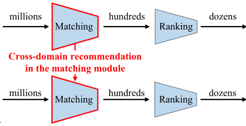
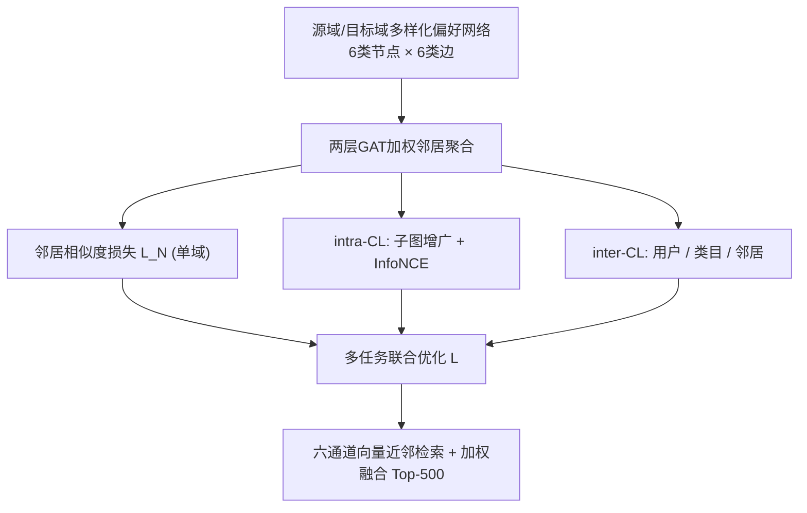
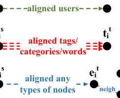

# Contrastive Cross-domain Recommendation in Matching (匹配阶段中的对比跨域推荐)

- **会议/期刊**: KDD 2022 (ACM SIGKDD)
- **作者与机构**: Ruobing Xie, Qi Liu, Liangdong Wang, Shukai Liu, Bo Zhang, Leyu Lin（腾讯微信 WeChat Top Stories）
- **推荐链路定位**: 召回（候选生成 Matching）
- **研究方向**: 跨域与多场景推荐 / 自监督对比学习
- **论文原文**: [https://arxiv.org/abs/2112.00999v2](https://arxiv.org/abs/2112.00999v2)
- **开源代码**: [https://github.com/lqfarmer/CCDR](https://github.com/lqfarmer/CCDR)

## TL;DR (1分钟核心速览)

本文把跨域推荐（CDR）搬到召回阶段，针对百万级候选下数据稀疏与热度偏置被放大的问题，提出 CCDR：以用户组/物品/标签/类目/媒体/词六类节点构建域内多样化偏好图，用邻居相似度损失做无监督聚合训练，并用域内子图对比（intra-CL）与用户、类目、邻居三种域间对比（inter-CL）打通迁移通路。在全库 HIT@N 评测下，严格冷启动域 HIT@500 相比最强基线 SSCDR+ 提升约 55%，线上微信看一看 CTR +14.37%、分享率 +10.40%。

## Background & Motivation (背景与核心矛盾)

- **主流范式**: 跨域推荐以 EMCDR/SSCDR 的"对齐用户嵌入映射"和 CoNet/ICAN 的"跨域特征交叉"为主；召回侧则以双塔 FM/AutoInt/GraphDR 的 embedding 检索为主。
- **前人局限**: 其一，CDR 方法重度依赖**重叠用户**做映射种子，冷启动域用户行为几乎为空时映射失效；其二，CoNet/ICAN 类方法需要在线做复杂 user-item 交互计算，无法满足召回毫秒级效率，且只盯 U-I 边会加剧热度偏置。
- **核心洞察 (Key Insight)**: 冷启动域真正稀缺的是"监督信号"而非"结构信息"——标签、类目、媒体、词这些**跨域共享的语义/分类锚点**天然可作桥梁；同时对比学习可把稀疏交互转成自监督训练信号，从而给长尾节点提供训练机会。
- **本文切入点**: 用一张覆盖六类节点的异质偏好图承载多样信息，再用 intra-CL 缓解域内稀疏+偏置、用 inter-CL 把跨域迁移从"仅用户对齐"扩展为"用户+类目+邻居"多通路。

<figure class="paper-figure" markdown="span">
  <figcaption>图1：匹配中的一个 CDR 示例。</figcaption>
</figure>

## Method (核心方法设计)

### 1. 整体框架 (Overall Architecture)

源域与目标域各自构建一个"多样化偏好网络"（节点：用户组、物品、标签、类目、媒体、词；边：U-I、I-I、T-I、C-I、M-I、W-I 六类加权无向边，权重反映交互强度与互信息）。节点经两层 GAT 加权邻居采样聚合得到统一空间的嵌入，由邻居相似度损失驱动单域训练；目标域再叠加子图增广的 intra-CL，跨域侧叠加用户/类目/邻居三种 inter-CL，四类损失在多任务框架下联合优化。线上则用同一批嵌入走六通道向量近邻检索并按加权分合并输出 Top-500。

### 2. 关键设计拆解 (Key Designs)

1. **多样化偏好网络 + 邻居相似度损失（把"边"变成监督信号）**：痛点是用 MF 只用 U-I 边，冷启动物品只有个位数交互学不出表征。做法是把所有异质边统一视作无监督约束，让节点与其邻居的相似度高于随机负样本：

$\mathcal{L}_{N}=-\sum_{e_i}\sum_{e_k\in N_{e_i}}\sum_{e_j\notin N_{e_i}}\left(-\log\sigma(\boldsymbol{e}_i^{\top}\boldsymbol{e}_j)+\log\sigma(\boldsymbol{e}_i^{\top}\boldsymbol{e}_k)\right)$

直觉：当只保留 U-I 边时该损失退化为 MF，多加的 I-I（会话相邻）、T-I/C-I（粗细粒度类目）、M-I、W-I 等于给长尾物品"补特征"，同时天然对齐了后续六通道检索所用的相似度。

2. **intra-CL：子图增广的域内自监督（治稀疏与热度偏置）**：同一节点两次采样不同邻居子集得 $\boldsymbol{e}_i$与$\boldsymbol{e}'_i$ 作正对，batch 内随机采样负例（不取全 batch，兼顾效率并部分抑制热门节点主导）：

$\mathcal{L}_{intra}=-\sum_{B}\sum_{e_i\in B}\log\frac{\exp(\mathrm{sim}(\boldsymbol{e}_i,\boldsymbol{e}'_i)/\tau)}{\sum_{e'_j\in S_{B_i}}\exp(\mathrm{sim}(\boldsymbol{e}_i,\boldsymbol{e}'_j)/\tau)}$

这相当于动态的节点/边 dropout，把低度节点的聚合结果拉向稳定，使长尾节点也获得训练梯度。

3. **三种 inter-CL：把迁移从"用户对齐"扩到"类目+邻居"**：$\mathcal{L}_{inter}=\mathcal{L}_{inter}^{u}+\mathcal{L}_{inter}^{t}+\mathcal{L}_{inter}^{n}$。用户侧要求$\mathrm{sim}(\boldsymbol{u}_i^s,\boldsymbol{u}_i^t)>\mathrm{sim}(\boldsymbol{u}_i^s,\boldsymbol{u}_j^t)$；类目侧对同名的 tag/category/word 施加同构约束；邻居侧最关键——对每个对齐节点$e_i\in E_A$，把其在目标域的**一跳邻居**当作正例：

$\mathcal{L}_{inter}^{n}=-\sum_{e_i\in E_A}\sum_{e_k\in N^{t}_{e_i}}\log\frac{\exp(\mathrm{sim}(\boldsymbol{e}^s_i,\boldsymbol{e}^t_k)/\tau)}{\sum_{e_j\notin N^{t}_{e_i}}\exp(\mathrm{sim}(\boldsymbol{e}^s_i,\boldsymbol{e}^t_j)/\tau)}$由此形成$tag^s_i\!\to\!tag^t_i\!\to\!item^t_j$ 的多跳路径，使无显式对齐的物品也能吸收源域成熟表征，这是严格冷启动域收益的主来源。

4. **训练目标、负采样与推理开销**：$\mathcal{L}=\lambda_1\mathcal{L}_N^s+\lambda_2\mathcal{L}_N^t+\lambda_3\mathcal{L}_{intra}+\lambda_4\mathcal{L}_{inter}$，网格搜索得$\lambda_1=\lambda_2=1.0,\lambda_3=1.5,\lambda_4=0.6$；邻居相似度与 CL 均用随机负采样（各 10 个，batch 4096，$\tau=1$），无 hard negative、无需额外标注。线上复杂度$O(\log(600n)+600n)$（$n$ 为行为序列长度），近邻索引离线预计算。

<figure class="paper-figure" markdown="span">
  <figcaption>图3：跨不同领域的三个 inter-CL 任务。</figcaption>
</figure>

## Experimental Setup & Evaluation Protocol (实验设置与评估协议)

- **数据集与预处理**: 自建 CDR-427M（微信看一看，脱敏），无 5-core 过滤，保留全量行为以模拟真实长尾：

| 数据集 | #Users | #Items | #Edges | 训练/测试交互 | 特征/场景说明 |
| :--- | :---: | :---: | :---: | :---: | :--- |
| 源域 (sufficient) | 63.1M | 2.04M | 175M | 406M / — | 主场景，行为充足 |
| few-shot 目标域 | 2.38M | 0.39M | 29.8M | 10.8M / 4.99M | 用户仅数次行为 |
| strict cold-start 域 | 2.23M | 0.57M | 15.0M | 0 / 5.48M | 训练集用户行为全部丢弃 |

  辅助信息：187K tags、356 categories、56K medias、207K words；用户按性别-年龄-地域聚成用户组节点。
- **数据划分与防穿越 (Splitting Strategy)**: `全局时间戳切分`（chronological order），严格冷启动域额外做"清空训练期用户行为"的冷启动划分。
- **排名评测协议 (Ranking Protocol)**: 无偏 `Full-Ranking`——从全库候选中取 Top-$N$，报告 HIT@50/100/200/500；另用 item coverage 衡量多样性。作者明确指出 HIT@N 比 AUC/NDCG 更契合召回目标。
- **对比基线与超参设置**: 基线含经典召回 FM、AutoInt、GraphDR+；跨域 EMCDR+、SSCDR+、ICAN（多域 SOTA）；以及两种强增强 Sub-graph CL、Cross-domain KD。所有图模型共享同一单域骨干与在线策略，嵌入输入 128 维、输出 100 维，两层采样 25/10 邻居，batch 4096、负例 10、$\tau=1$，显著性$t$-test$p<0.01$。

## Key Experimental Results (实验关键数据)

### 1. 主实验对比 (Main Results)

| Model | few-shot HIT@50 | @200 | @500 | strict HIT@50 | @200 | @500 |
| :--- | :---: | :---: | :---: | :---: | :---: | :---: |
| FM | 0.0101 | 0.0293 | 0.0551 | 0.0048 | 0.0145 | 0.0299 |
| AutoInt | 0.0125 | 0.0370 | 0.0705 | 0.0058 | 0.0173 | 0.0356 |
| GraphDR+ | 0.0132 | 0.0402 | 0.0780 | 0.0087 | 0.0266 | 0.0543 |
| EMCDR+ | 0.0137 | 0.0414 | 0.0801 | 0.0091 | 0.0274 | 0.0561 |
| SSCDR+ | 0.0146 | 0.0448 | 0.0879 | 0.0104 | 0.0312 | 0.0637 |
| ICAN | 0.0163 | 0.0502 | 0.0994 | 0.0074 | 0.0226 | 0.0464 |
| Cross-domain KD | 0.0169 | 0.0530 | 0.1058 | 0.0131 | 0.0387 | 0.0780 |
| **CCDR (inter+intra)** | **0.0225** | **0.0715** | **0.1442** | **0.0161** | **0.0487** | **0.0987** |
| **Improv.% vs 最强基线** | **+37.9%** | **+34.9%** | **+36.3%** | **+22.9%** | **+25.8%** | **+26.6%** |

（线上 A/B，8 天，同骨干对照：CCDR 全量版 CTR **+14.368%**、时长 **+6.623%**、分享率 **+10.401%**；仅 inter-CL 版 +3.375%/+4.354%/+7.947%。）

### 2. 消融实验 (Ablation Study)

| 变体 | few-shot @50 | @500 | strict @50 | @500 |
| :--- | :---: | :---: | :---: | :---: |
| CCDR 全量 | **0.0225** | **0.1442** | **0.0161** | **0.0987** |
| w/o intra-CL | 0.0213 | 0.1327 | 0.0154 | 0.0931 |
| w/o inter-CL | 0.0174 | 0.1099 | 0.0118 | 0.0732 |
| w/o $\mathcal{L}_{inter}^{u}$ | 0.0211 | 0.1376 | N/A | N/A |
| w/o $\mathcal{L}_{inter}^{t}$ | 0.0219 | 0.1403 | 0.0149 | 0.0901 |
| w/o $\mathcal{L}_{inter}^{n}$ | 0.0221 | 0.1411 | 0.0157 | 0.0948 |

### 3. 关键实验发现 (Key Findings)

1. **inter-CL 是跨域主力，intra-CL 是"行为越多越值钱"的乘数**：去掉 inter-CL 严格冷启动 HIT@500 从 0.0987 掉到 0.0732（−25.8%），而去掉 intra-CL 只掉到 0.0931（−5.7%）；线上则相反，intra-CL 把 CTR 从 +3.375% 推到 +14.368%，说明自监督需要一个有行为的目标域才能放大。
2. **迁移通路与冷启动程度强相关**：few-shot 域中去掉用户侧 CL 掉幅最大（0.1442→0.1376），严格冷启动域中用户侧不可用（N/A），此时类目侧 CL 掉幅最大（0.0987→0.0901），验证"锚点越稀疏越依赖 taxonomy/邻居多跳桥"。
3. **对比学习显著优于知识蒸馏与嵌入映射，且顺带提升多样性**：同等骨干下 Cross-domain KD 严格冷启动 HIT@500 仅 0.0780（CCDR 0.0987），相对 SSCDR+ 提升 55%；同时 item coverage 比最佳 GraphDR+ 高 4.2%/6.0%，证明 CL 的均衡负采样确实缓解了热度偏置。

## Highlights & Limitations (亮点、对比与审稿批判)

- **与代表作对比 (vs. Prior Work)**: 相比 EMCDR+/SSCDR+ 只依赖对齐用户做 $f:\mathcal{U}^s\to\mathcal{U}^t$ 映射，CCDR 把迁移锚点扩到类目与邻居，冷启动域无重叠用户时仍可用；相比 ICAN 的跨域特征交叉（需在线交互、严格冷启动下退化到 0.0464），CCDR 保持纯 embedding 检索，效率与效果兼得；相比 Sub-graph CL（即 SGL 式域内自监督），本文证明**域间**对比才是 CDR 增量的主体。
- **可迁移亮点**: ① 邻居相似度损失把所有边类型统一成"图上的 BPR"，可作为任意异质图召回的低成本预训练目标；② 用"对齐节点的目标域一跳邻居作正例"构造跨域正样本，可无损移植到跨语言/跨 App 迁移。
- **审稿级局限批判**: ① 数据集私有（CDR-427M），隐含维表与通道权重全部依赖微信场景，跨机构复现只能验证方法骨架；② 通道加权 $s_i=\sum_k s_i^k$为等权求和，论文坦言靠人工调，缺少自适应门控与理论分析；③ 六通道各取 Top-100 再融合带来 600 次近邻查询的内存/延迟开销，文中未给出与单通道的延迟对比；④$\lambda_3,\lambda_4$明显敏感（$0.2\to2$ 时 HIT@500 波动约 ±7%），超参迁移成本不低。

## Rating (四维评分)

- **方法创新性 (Novelty)**: ⭐⭐⭐⭐ （首次将 CL 同时用于 CDR 的表征学习与知识迁移，"邻居作跨域正例"的设计简洁但有效，缺理论支撑）
- **评估协议与实验扎实度 (Protocol & Experiments)**: ⭐⭐⭐⭐⭐ （427M 真实数据、few-shot 与 strict 双冷启动设置、全库 HIT@N + 覆盖率 + 8 天线上 A/B + 完整消融与超参分析）
- **写作与数学规范度 (Clarity & Rigor)**: ⭐⭐⭐⭐ （损失定义与在线公式清晰、动机与实验一一对应，但符号重复使用 $e_i$ 指代不同粒度节点、缺复杂度与通道权重的推导）
- **工业落地与复现价值 (Industrial & Practical Value)**: ⭐⭐⭐⭐⭐ （已上线微信看一看 6 个月，代码开源，多通道检索与离线索引预计算方案可直接复用）

