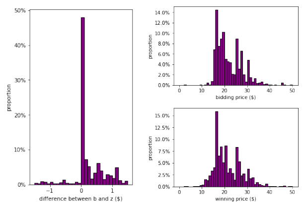
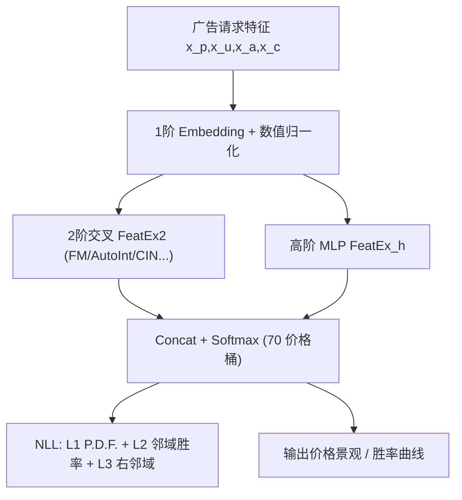
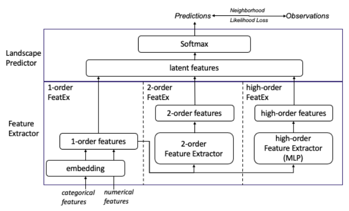

# Arbitrary Distribution Modeling with Censorship in Real-Time Bidding Advertising (RTB 广告中含删失的任意分布建模)

- **会议/期刊**: KDD 2022
- **作者与机构**: Xu Li, Michelle Ma Zhang (Northwestern University), Youjun Tong, Zhenya Wang — FreeWheel (Comcast)
- **推荐链路定位**: 精排前的出价预估 / Inventory Planning 离线+在线打分
- **研究方向**: CTR/CVR 预估与特征交叉 / 去偏与工业系统
- **论文原文**: [https://arxiv.org/abs/2110.13587v1](https://arxiv.org/abs/2110.13587v1)
- **开源代码**: 暂未开源（论文称 GitHub 有实现，未给出可访问链接）

## TL;DR (1分钟核心速览)

DSP 在 RTB 中需要**中标价 $z$的整条概率分布**（而非点估计）来做预算规划，但既有工作要么强设 Gaussian/Log-Normal/Gamma 形式导致拟合失真，要么如 DLF 用 LSTM 逐桶建模导致上百时间步、离线训练 >1400s/epoch。本文提出 **NLL（邻域似然损失）**——用"出价$b$必落在中标价$z$邻域内"这一经验事实，把 P.D.F./C.D.F. 的优化范围从"$[0,z]$/$[b,+\infty)$"收紧为左右邻域，并配 **ADM**（可插拔 CTR 特征交叉 + Softmax 分桶）框架。在生产数据上 MAE 由 DLF 的 0.51 降至 0.36（−29.4%），iPinYou/YOYI 的 ANLP 分别降 14.1%/21.0%，线上推理约 3ms，满足 10ms SLA。

## Background & Motivation (背景与核心矛盾)

- **主流范式**: 二价拍卖下 DSP 只能观测到"赢了的中标价"；输掉的竞价仅知 $z>b$，即**右删失 (Censorship)**。主流做法是用赢标样本拟合 P.D.F.、用输标样本拟合 C.D.F.（等价于胜率），联合优化对数似然。
- **前人局限一（假设过强）**: Gaussian/Log-Normal/Gamma 等参数化模型把整条价格景观压成少数参数；但不同广告位、不同流量维度的价格分布形态差异极大，单一形式无法通用，CLM/MIX 在生产集 MAE 高达 0.57/0.55。
- **前人局限二（无假设但不高效）**: DLF 用 LSTM 沿价格桶做条件概率链式分解，虽摆脱先验，但为保证精度必须把价格切成数百个细桶，序列长度爆炸，离线训练 >1400s/epoch，且与广告系统毫秒级响应冲突。
- **核心洞察 (Key Insight)**: 统计发现 **58% 以上的竞价中 $|b-z|<0.1$美元、93% 以上$|b-z|\le 1$美元**（价格量级为数十美元），即$b$几乎总落在$z$的小邻域内。因此"输标样本只知道$z>b$"这一模糊约束可以被锐化为"$z$落在$b$ 的**右邻域**内"，而无需求解整个右半轴。
- **本文切入点**: 不改网络结构、只改损失函数——用邻域约束重写似然，把建模复杂度从"序列"搬回"离线损失"，在线只留一个 MLP + Softmax。

<figure class="paper-figure" markdown="span">
  <figcaption>图3：𝑏、𝑧及其差值的分布。</figcaption>
</figure>

## Method (核心方法设计)

### 1. 整体框架 (Overall Architecture)

价格区间取单位时长对数单价的 $[-3.0,4.0]$（覆盖 99.8% 样本），以 0.1 为步长离散为$N=70$个桶，任务转化为 70 类分类。输入$\boldsymbol{x}=\{\boldsymbol{x}_p,\boldsymbol{x}_u,\boldsymbol{x}_a,\boldsymbol{x}_c\}$（媒体/用户/广告/上下文）先经 Feature Extractor 得到一阶向量$\boldsymbol{x}^1$（Embedding 拼接 Min-Max 归一化数值特征），再由可插拔的二阶交叉模块（FM/AFM/DCN-Mix/CIN/AutoInt/NFM/CF）与 3 层减半 MLP 分别抽取$\boldsymbol{x}^2$与$\boldsymbol{x}^h$，拼接后 Softmax 输出 70 维分布$\boldsymbol{pr}_k$；训练端由 NLL 的三项损失联合驱动。

<figure class="paper-figure" markdown="span">
  <figcaption>图5：Arbitrary Distribution Modeling 框架的结构。</figcaption>
</figure>

### 2. 关键设计拆解 (Key Designs)

1. **邻域似然损失 NLL（核心增量）**：传统做法把胜率项 $\int_{0}^{z}pr_z(p)dp$的左界设为 0，等于对极低价格也一并抬概率；输标项则把$[b,+\infty)$整段抬高，使极高价同样被"鼓励"。NLL 定义邻域$U^-(z,\delta)=(z-\delta,z]$、$U^+(z,\delta)=[z,z+\delta)$，三项损失为

$$\mathcal{L}_1=-\sum_{(x_k,z_k)\in\mathcal{D}_{win}}\log pr_{x_k}(i_{z_k})$$

$$\mathcal{L}_2=-\sum_{(x_k,z_k)\in\mathcal{D}_{win}}\log\!\!\sum_{i=i_{p_{l,win}}}^{i_{p_{r,win}}}\!\!pr_i(i|x_k)$$

$$\mathcal{L}_3=-\sum_{(x_k,b_k)\in\mathcal{D}_{lose}}\log\!\!\sum_{i=i_{b_k}+1}^{i_{p_{r,lose}}}\!\!pr_i(i|x_k)$$

   其中赢标邻域以 $z_k$为中心、半宽$r_l\delta_{win}$与$r_r\delta_{win}$（$\delta_{win}=|b_k-z_k|$，$r_l=r_r=1$，即**逐样本自适应宽度**）；输标邻域右界$p_{r,lose}=b_k+\delta_{lose}$（$\delta_{lose}=40$ 桶）。物理直觉：模型不再为"不可能中标的价格"浪费概率质量，梯度集中在真实可竞争区间，故 MAE 显著下降而概率校准不退化。

2. **ADM 的两段式解耦结构**：把"特征刻画"与"分布拟合"分离——$\boldsymbol{pr}_k=\mathrm{Softmax}([\boldsymbol{x}_k^1,\boldsymbol{x}_k^2,\boldsymbol{x}_k^h])$。作者强调二阶交叉在 RTB 中本质是**协同过滤信号**（"NBA 视频页的男性青少年"对 Nike 广告的价值高于同页面老年人），但一阶特征的线性组合无法表达，故引入 CTR 领域的交叉算子；同时把复杂度全部留在离线，在线仅一次前向。

3. **训练目标、负采样与推理效率**：总损失 $\mathcal{L}_{NLL}=\alpha\mathcal{L}_1+(1-\alpha)(\beta\mathcal{L}_2+(1-\beta)\mathcal{L}_3)$，$\alpha=0.2,\beta=0.8$——$\alpha$大有利于 ANLP（与$\mathcal{L}_1$同构），$\beta$大有利于 MAE（$\mathcal{L}_2$含真值$z$）。无负采样概念（全量 70 类 Softmax，分母即全部价格桶）；离线训练较 DLF 节省最多 85% 时间，在线 P99 < 5ms、均值约 3ms。

## Experimental Setup & Evaluation Protocol (实验设置与评估协议)

- **数据集与预处理**:

| 数据集 | 规模 | 价格桶 | 特征/场景说明 |
| :--- | :---: | :---: | :--- |
| iPinYou | 9 个广告主（1458–3476） | 70 | 公开集，**不含输标真实中标价**，需丢弃输标并伪造出价模拟删失 |
| YOYI | 公开集 | 70 | 同上，用于验证跨数据集泛化 |
| Production | 训练 2100 万次竞价/日，验证/测试各 1 万 | 70 | 自有 Ad Exchange，**可观测输标真实中标价**，但仅用于评估不参与训练 |

- **数据划分与防穿越**: 生产集采用**严格时间切分**——当日全部竞价训练，次日随机采样 1 万条测试（约为日流量 0.46‰），避免同日泄漏。
- **排名评测协议**: 非候选排序任务；以 **MAE**（取分布最高概率桶为点预测）、**ANLP**（负对数似然）、**C-Index**（等价 AUC，用胜率 $wr(z_k)$ 作置信度衡量赢/输排序）三项评估分布质量，另加业务指标 **中标数 / 中标价值（均价）** 做历史数据回放 (replay)。
- **对比基线与超参**: RDM、AVG、FRQ 三个朴素基线；CLM（一阶+Normal 先验）、MIX（Normal 混合）代表参数化概率模型；DLF（LSTM 链式分解）为 SOTA 无假设基线。Embedding 维度按基数平方根取，MLP 3 层逐层减半，ReLU 激活；所有基线在 8×AWS c5.18xlarge 上网格搜索调优。

## Key Experimental Results (实验关键数据)

### 1. 主实验对比 (Main Results)

**公开集（Table 1/2，iPinYou 9 广告主均值 + YOYI）**

| 模型 | iPinYou ANLP↓ | iPinYou C-Index↑ | YOYI ANLP↓ | YOYI C-Index↑ |
| :--- | :---: | :---: | :---: | :---: |
| DLF (SOTA) | 4.774 | **0.911** | 4.453 | 0.924 |
| ADM (NLL) | **4.100** | 0.906 | **3.520** | **0.944** |
| Improv. | **−14.1%** | −0.5% | **−21.0%** | +2.2% |

**生产集（Table 3，业务指标 + 算法指标）**

| 模型 | MAE↓ | ANLP↓ | C-Index↑ | 中标数↑ | 中标价值 |
| :--- | :---: | :---: | :---: | :---: | :---: |
| Dataset（原策略） | **0.26** | — | — | 3795 | **1.03** |
| RDM | 0.53 | — | — | 5638 | 0.80 |
| AVG | 0.43 | — | — | 5302 | 0.67 |
| FRQ | 0.52 | — | — | 4991 | 0.77 |
| CLM | 0.57 | **3.65** | 0.81 | 7458 | 0.86 |
| MIX | 0.55 | 3.70 | 0.79 | 7565 | 0.88 |
| DLF | 0.51 | 3.85 | **0.92** | 8006 | 0.96 |
| DLF + NLL | 0.42 | 3.95 | **0.92** | **8155** | 0.96 |
| ADM (NLL) | **0.36** | 3.66 | 0.90 | 8035 | 0.96 |

ADM 相对 DLF：MAE **0.51 → 0.36（−29.4%）**，相对所有非 NLL 模型 MAE 至少改善 16%；中标数 8006 → 8035（略优），且 DLF+NLL 进一步拿到最多的 8155 次中标。

### 2. 消融实验 (Ablation Study)

**A. NLL 跨结构迁移（Table 3）**：同一 DLF 骨架换上 NLL，MAE 0.51→0.42、中标数 8006→8155，证明 NLL 是**结构无关的通用目标函数**，而非依附于 ADM 的调参技巧。

**B. 二阶交叉算子替换（Table 4，均为 ADM+NLL）**

| $\mathrm{FeatEx}_2$ | MAE↓ | ANLP↓ | C-Index↑ | 中标数↑ |
| :--- | :---: | :---: | :---: | :---: |
| W/O（无二阶） | 0.36 | 3.66 | 0.90 | 8035 |
| InnerProd | 0.35 | 4.63 | 0.87 | 7860 |
| FM | 0.37 | 4.70 | 0.88 | 7969 |
| AFM | 0.33 | 4.64 | 0.87 | 7806 |
| DCN-Mix | 0.33 | 3.66 | 0.91 | 8021 |
| CIN | 0.33 | 3.71 | 0.91 | 8041 |
| AutoInt | **0.32** | 3.62 | **0.91** | 8092 |
| NFM | 0.34 | 3.73 | 0.90 | 8101 |
| CF | 0.34 | **3.60** | 0.90 | **8131** |

**C. 超参敏感度**：$\delta_{lose}$从最小桶扫到 70（全价格域），MAE 单调变差，而 ANLP/C-Index 在**中间值（40）** 附近最佳——说明最优邻域宽度应贴合真实$|b-z|$的分布尺度；$\alpha,\beta$ 的二维热力图显示二者分别主导 ANLP 与 MAE，可按业务目标调节。

### 3. 关键实验发现 (Key Findings)

1. **"收紧优化区间"比"换更强网络"更有效**：仅把 LSTM 的似然换成 NLL（DLF+NLL），MAE 就降 17.6%；而 ADM 在**无任何二阶/高阶交叉**的极简结构下即达 0.36，反超全部复杂基线，说明删失场景的瓶颈在似然定义而非表示能力。
2. **概率建模与回归精度存在真实 trade-off，且 NLL 缓解了它**：CLM 的 ANLP 最优（3.65）却 MAE 最差（0.57），DLF 反之（C-Index 0.92 / MAE 0.51）；NLL 让 ADM 同时取得 3.66 的 ANLP 与 0.36 的 MAE，两端均逼近各自最优，归因于"不为极端价格浪费概率质量"的梯度裁剪效应。
3. **二阶交叉并非普适增益，输出张量形状是关键**：InnerProd/FM/AFM 的输出为单元素张量，ANLP 从 3.66 恶化到 4.63–4.70，业务中标数也下降；而输出向量型的 AutoInt/CIN/DCN-Mix 保持 3.62–3.71 的 ANLP 并把 MAE 压到 0.32–0.33。生产回放中 ADM 赢得参与竞价中 63.55%、较原策略多赢 21.45%，Recall 75%，但胜出部分的均价 0.93 低于原策略 1.06，暴露"多赢"与"赢高价"之间的策略取舍。

## Highlights & Limitations (亮点、对比与审稿批判)

- **与代表作对比 (vs. Prior Work)**: 相对 CLM/MIX 这类**参数化先验**模型，本文彻底去掉分布形式假设，MAE 由 0.55–0.57 降到 0.36；相对 DLF 这类**无假设但序列化**模型，本文用 70 类一次 Softmax 取代 70 步 LSTM 递归，精度更优且训练时间最多省 85%、在线 3ms，把"无假设"从学术可行推进到工业可用。
- **可迁移亮点**: (1) "用观测差 $\delta_{win}=|b_k-z_k|$逐样本自适应设定邻域宽度"的思路可直接迁移到**延迟反馈 CVR、删失回归、区间标签学习**等场景；(2) 把 CTR 交叉模块当作可插拔$\mathrm{FeatEx}_2$ 做横向对比的实验范式，值得作为特征交叉选型的标准消融模板。
- **审稿级局限批判**: (1) **公开集实验存在数据伪造**——iPinYou/YOYI 缺输标真实中标价，作者用伪造出价模拟删失，而论文自己已证明赢标/输标的中标价分布不同，故公开集结论的说服力弱于生产集，且生产集不可复现；(2) **业务评估口径偏窄**——"中标价值"仅用均价近似，未接入 CTR/OCR 等真实 KPI（作者在结论中亦承认），且回放显示 ADM 均价 0.93 低于原策略 1.06，说明"多赢 21.45%"可能以牺牲高价值流量为代价；(3) $\delta_{lose}=40$桶、$\alpha=0.2$、$\beta=0.8$ 三个超参需按数据集重调，跨场景迁移成本不低。

## Rating (四维评分)

- **方法创新性 (Novelty)**: ⭐⭐⭐⭐ （不改结构只改似然的"邻域锐化"思路简洁且有经验分布支撑，但本质是对 DLF 类 C.D.F. 目标的区间裁剪，理论深度有限）
- **评估协议与实验扎实度 (Protocol & Experiments)**: ⭐⭐⭐⭐ （同时给出 MAE/ANLP/C-Index 与业务回放指标、跨结构迁移与 8 种交叉算子横向对比很完整，扣分在公开集数据伪造与生产集不可复现）
- **写作与数学规范度 (Clarity & Rigor)**: ⭐⭐⭐⭐ （三项损失与邻域边界定义清晰、离散化近似交代明确，但部分符号如 $i_{p_{l,win}}$ 排版混乱，缺少 NLL 的梯度/复杂度形式化分析）
- **工业落地与复现价值 (Industrial & Practical Value)**: ⭐⭐⭐⭐⭐ （21M/日真实流量验证、3ms 推理满足 10ms SLA、训练省 85% 时间、含 TensorFlow Serving + K8s 全链路架构，工程参考价值极高）

