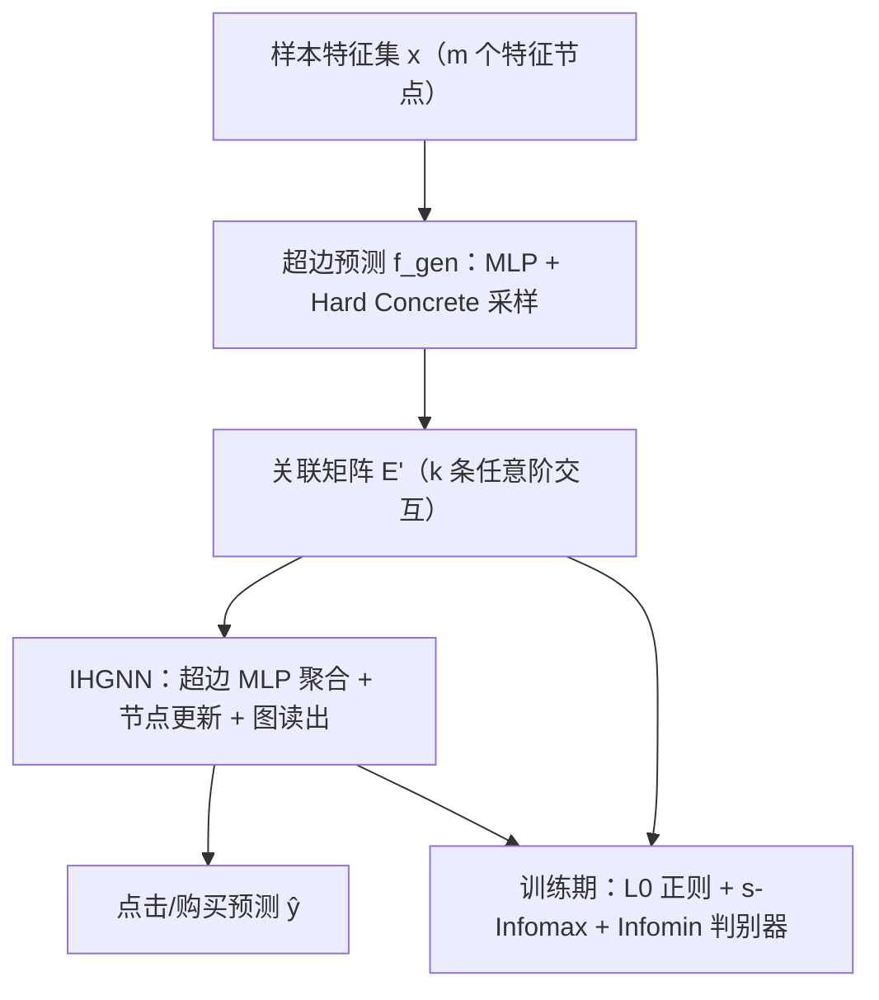

# Detecting Arbitrary Order Beneficial Feature Interactions for Recommender Systems (面向推荐系统的任意阶有益特征交互检测)

- **会议/期刊**: KDD 2022
- **作者与机构**: Yixin Su, Yunxiang Zhao, Sarah Erfani, Junhao Gan, Rui Zhang（墨尔本大学、北京生物制品研究所等）
- **推荐链路定位**: 精排（特征交叉层 / CTR 预估）
- **研究方向**: CTR/CVR 预估与特征交叉 / 自监督对比与交互去噪
- **论文原文**: [https://arxiv.org/abs/2206.13764v1](https://arxiv.org/abs/2206.13764v1)
- **开源代码**: [HIRS_Hypergraph_Infomax_Recommender_System](https://github.com/ruizhang-ai/HIRS_Hypergraph_Infomax_Recommender_System)

## TL;DR (1分钟核心速览)

高阶特征交互数目随阶数指数爆炸（$O(2^m)$），已有方法（xDeepFM/AutoFIS/L0-SIGN）只能在"枚举全部候选"的前提下筛出至多 4 阶的有益交互，既贵又会漏掉更高阶的强信号。HIRS 把每个样本表示成超图、把"有益交互"直接当作待预测的超边：先用超边预测网络一次生成$k$条任意阶交互，再用超图分类做预测，并以 s-Infomax（充分性/低冗余）与 Infomin（解耦）两个判别器加$L_0$稀疏正则约束生成质量。在 70/15/15 随机划分、Recall@10 指标下，MovieLens-1M 相对最强基线 AFN 提升 **4.98%**，Book-Crossing 提升 **5.19%**，训练复杂度由$O(2^m d)$降到$O(mkd)$。

## Background & Motivation (背景与核心矛盾)

- **主流范式**: FM/NFM/DeepFM 做二阶或隐式高阶交叉；xDeepFM/DCNv2 用受限阶数显式建模；AutoFIS/L0-SIGN 在候选集中"检测"有益交互以剔除噪声交互。
- **前人局限一**: 所有检测类方法都必须先枚举全部候选交互才能判断"哪个有益"，候选数随阶数指数增长，因此工程上只能把阶数截断到 4 阶以内。
- **前人局限二**: MLP 类隐式高阶建模虽然"理论上能表达任意阶"，但实际学习效率低、不可解释；纯 $L_0$ 稀疏又会退化成"一条超边吞掉所有特征 + 其余超边全空"的坍缩解。
- **核心洞察 (Key Insight)**: 有益交互在全体交互中极度稀疏，因此"生成"比"枚举后筛选"更划算；只要施加正确的信息论约束（充分、低冗余、解耦），生成器就能被引导到有益子集上。
- **本文切入点**: 用超图（一条超边可连任意多节点）天然承载任意阶交互，把交互检测改写为**超边邻接矩阵预测**，把预测改写为**超图分类**，训练期再加两个互信息判别器与 $L_0$ 正则。

## Method (核心方法设计)

### 1. 整体框架 (Overall Architecture)

每个样本 $(\boldsymbol{x},y)$建成超图$G_H\langle V,\varnothing\rangle$：节点是样本中出现的所有特征-值对$V=\boldsymbol{x}$，超边集初始为空。训练时先由$f_{gen}$一次性预测$k$条超边构成关联矩阵$\boldsymbol{E}'\in\{0,1\}^{m\times k}$（即$k$条任意阶交互），IHGNN 在该超图上做"超边聚合→节点更新→图级读出"得到预测$\hat{y}$。同时在训练分支上，用 s-Infomax 最大化每条超边表示与同标签超图表示$\boldsymbol{c}^+$的互信息、用 Infomin 最小化不同超边表示之间的互信息，配合$L_0$正则控制超边稀疏度。推理时两个判别器与$L_0$全部丢弃，只剩$f_{gen}$ + IHGNN，链路极轻。

### 2. 关键设计拆解 (Key Designs)

**1) 可微超边生成（Hard Concrete 松弛）**：交互生成本质是 $m\times k$的二值决策，Bernoulli 采样不可导。作者对每个节点构造$\boldsymbol{u}_i=\mathrm{MLP}([\boldsymbol{V}^e_i,\sum_{j\neq i}\boldsymbol{V}^e_j])$（拼接"自身 + 其余节点摘要"以感知上下文），再用 hard concrete 分布把$\boldsymbol{u}_i$松弛到$[0,1]$：
$\boldsymbol{E}'_{ij}=\min(1,\max(0,\,s_{ij}(\delta-\gamma)+\gamma)),\ s_{ij}=\sigma\big((\log z-\log(1-z)+\log u_{ij})/\tau\big)$其中$\gamma=-0.1,\delta=1.1,\tau=0.66$。前向近似 0/1、反向有梯度，使得"哪条超边连哪些节点"可以被端到端学习，这是能直接生成而非枚举的关键算子。

**2) 三性质与双判别器（s-Infomax / Infomin）**：仅靠 $L_0$会坍缩，作者从信息论定义有益交互应满足：充分性$I((\boldsymbol{h}_1,\dots,\boldsymbol{h}_k);y)=I(\boldsymbol{x};y)$、低冗余$\sum_i H(\boldsymbol{h}_i|y)=0$、解耦$\sum_{i\neq j}I(\boldsymbol{h}_i;\boldsymbol{h}_j;y)=0$。由于$\boldsymbol{x}\to\{\boldsymbol{h}_i\}\to y$ 构成马尔可夫链，目标可松弛为
$\max\ \sum_{i=1}^{k}I(\boldsymbol{h}_i;y)-\sigma\sum_{i\neq j}I(\boldsymbol{h}_i;\boldsymbol{h}_j)$实现上用 DIM 的 GAN 式判别器：s-Infomax 以$(\boldsymbol{h}_i,\boldsymbol{c}^+)$（同标签超图表示）为正样本对、$(\boldsymbol{h}_i,\boldsymbol{c}^-)$为负样本对，把二值标签扩成连续高维空间以提供足够监督信号；Infomin 则以$(\boldsymbol{h}_i,\boldsymbol{h}_j),i\neq j$为联合分布、$(\boldsymbol{h}_i,\boldsymbol{h}_i)$为边缘分布，并加 dropout$f_a$ 防止判别器"直接比对两向量是否相同"而作弊。直觉上，前者逼每条交互都"对标签有用"，后者逼不同交互"各管一摊"，从而避免一条超边吞掉全部信息。

**3) IHGNN 与训练目标、复杂度**：超边表示用 MLP 而非线性求和 $\boldsymbol{h}_j=f_E(\mathrm{sum}(\{\boldsymbol{V}^g_i|\boldsymbol{E}'_{ij}=1\}))$，因为统计意义上的高阶交互必须经非线性才能被正确表达（附录 B 有理论说明；消融 w/o NM 验证）。总损失为
$\mathcal{R}=\frac{1}{N}\sum_n\big[\mathcal{L}(f_r(G_H^n),y_n)+\lambda_1\|\boldsymbol{E}'_n\|_0+\lambda_2\mathcal{L}_{D_\theta}+\lambda_3\mathcal{L}_{D_\omega}\big]$其中$\lambda_1=0.02,\lambda_2=1,\lambda_3=0.1$，超边数$k=40$、维度$d=64$。全流程复杂度$O(mkd)$，远低于枚举式的$O(2^m d)$与堆叠式$O(m^3 d)$；训练期为省算力，每个节点对联合/边缘分布各只采一个样本，属轻量对比学习、无需负采样池。

## Experimental Setup & Evaluation Protocol (实验设置与评估协议)

| 数据集 | #Users | #Items | #Interactions | 稀疏度/密度 | 特征/场景说明 |
| :--- | :---: | :---: | :---: | :---: | :--- |
| MovieLens 1M | 5,950 | 3,514 | 1,149,238 | 密度约 5.5% | 6,974 维特征，无 tag |
| Book-Crossing | 4,873 | 53,168 | 1,050,834 | 密度约 0.4% | 43,244 维特征，极稀疏图书域 |
| MovieLens 25M | 162,541 | 62,423 | 31,147,118 | 密度约 0.3% | 226,122 维特征，含 tag |

- **数据划分与防穿越**: 采用 `比例划分`（训练/验证/测试 = 70%/15%/15%，随机划分），隐式反馈二分类标签 $y\in\{0,1\}$。
- **排名评测协议**: 报告 Recall@10/20 与 NDCG@10/20，结果取 10 次运行平均；论文未显式说明是 `Full-Ranking` 还是 `Sampled Ranking`（亦未给负采样比例），这是评测描述上的可复现性缺口。
- **对比基线与超参**: 11 个基线覆盖 FM/AFM/NFM（低阶）、Fi-GNN/L0-SIGN（图 + 可解释交互）、AutoInt/DeepFM/xDeepFM/DCNv2（高阶显式）、AutoFIS/AFN（有益交互筛选）；嵌入维度 $d=64$、超边数$k=40$、Adam 优化，显著性用 Wilcoxon signed-rank 检验，$p<0.05$（多数为$p=0.005$）。

## Key Experimental Results (实验关键数据)

### 1. 主实验对比 (Main Results)

| 模型（HO/BD） | ML-1M R@10 | ML-1M N@20 | Book R@10 | Book N@20 | ML-25M R@10 | ML-25M N@20 |
| :--- | :---: | :---: | :---: | :---: | :---: | :---: |
| FM | 0.8527 | 0.8845 | 0.7802 | 0.8539 | 0.8331 | 0.8791 |
| NFM | 0.8979 | 0.9084 | 0.8625 | 0.8843 | 0.8604 | 0.8903 |
| Fi-GNN | 0.9060 | 0.9226 | 0.8818 | 0.8861 | 0.8692 | 0.8905 |
| L0-SIGN (√/—) | 0.9092 | 0.9268 | 0.8817 | 0.8914 | 0.8729 | 0.8915 |
| DeepFM (√/√) | 0.8975 | 0.9128 | 0.8765 | 0.8800 | 0.8667 | 0.8883 |
| xDeepFM (√/√) | 0.9049 | 0.9114 | 0.8791 | 0.8826 | 0.8673 | 0.8902 |
| AutoFIS (√/√) | 0.9028 | 0.9208 | 0.8804 | 0.8887 | 0.8702 | 0.8922 |
| AFN (√/√) | 0.9032 | 0.9232 | 0.8821 | 0.8917 | 0.8743 | 0.8938 |
| **HIRS (√/√)** | **0.9545** | **0.9500** | **0.9279** | **0.9211** | **0.9223** | **0.9011** |
| **Improv.** | **+4.98%** | **+2.50%** | **+5.19%** | **+3.30%** | **+5.49%** | **+0.81%** |

HO=能否高阶，BD=能否检测有益交互。HIRS 在 12 个指标上全面领先，ML-25M 的 NDCG 增益（+0.81%/+1.26%）明显小于 Recall，说明大数据集上收益主要来自"找回更多正例"而非排序位置精细化。

### 2. 消融实验 (Ablation Study)

| 变体 | 生成交互阶数分布 | ML-1M R@10 | Book R@10 | 结论 |
| :--- | :--- | :---: | :---: | :--- |
| HIRS (full) | 集中在 2–6 阶 | 0.9545 | 0.9279 | 主模型 |
| w/o s-Infomax & Infomin | 大量 0 阶空边 + 少数 12–14 阶巨边 | 明显下降 | 明显下降 | 无 MI 约束即坍缩 |
| w/o $L_0$ 正则 | 整体阶数偏高（混杂） | 下降 | 下降 | 需稀疏约束拆开混叠交互 |
| w/o HP（超边固定全 1） | 退化为单一全连通边 | 最差档 | 最差档 | 交互生成模块不可省 |
| w/o NM（$f_E$ 去非线性） | 同 full | 下降 | 下降 | 高阶交互必须非线性建模 |
| w/o HP + w/o NM | — | 全局最差 | 全局最差 | 等价线性映射 |

（图 5/图 6 仅给曲线未列数值，此处以趋势描述；关键权重 $\lambda_1,\lambda_2,\lambda_3$与$k$均在$k=40$ 附近出现饱和最优点。）

### 3. 关键实验发现 (Key Findings)

1. **"生成"胜过"枚举"且更便宜**：HIRS 只用 $k=40$条超边就超过必须枚举候选项的 AutoFIS/AFN（ML-1M R@10 从 0.9032→0.9545），复杂度从$O(2^m d)$降至$O(mkd)$，验证了稀疏性假设下"直接生成"的性价比。
2. **两个 MI 判别器缺一即崩**：去掉 s-Infomax/Infomin 后生成分布退化为"多数空边 + 少数 12–14 阶巨边"，说明 $L_0$ 单独只控制边数、不控制边的语义分工，充分性/解耦约束才是防止坍缩的核心。
3. **高阶与检测能力需同时具备**：具备 HO 或 BD 单一能力的模型（xDeepFM、L0-SIGN）均弱于同时具备者，且无 HP 的变体性能跌至最差档，证明"交互是否被正确切分"比"交互阶数上限"更决定精度。

## Highlights & Limitations (亮点、对比与审稿批判)

- **与代表作对比 (vs. Prior Work)**: 与 L0-SIGN/Fi-GNN 相比，HIRS 把"图边（2 节点）"升级为"超边（任意节点）"，从而不再受二阶限制；与 xDeepFM/AutoFIS 相比，它不是在候选池里"打分筛选"，而是让网络"生成候选"，把组合爆炸问题从算法层面绕开；与 MLP 类隐式高阶相比，其交互是显式、可可视化（图 9 案例）的。
- **可迁移亮点**: (i) hard concrete + $L_0$ 的"可微稀疏超边/掩码生成"可迁移到特征选择、序列兴趣解耦、多任务专家路由；(ii) 用"同标签/异标签表示"构造正负样本对来做有监督 Infomax，是把对比学习接到二分类标签上的低成本技巧。
- **审稿级局限批判**: (i) 评测协议未交代是 Full-Ranking 还是采样排序、也未给负采样比例，Recall 高达 0.95 量级提示候选集可能较小，跨论文比较需谨慎；(ii) 训练期需为每个样本、每条超边各跑两个判别器与 $L_0$的 hard-concrete 采样，实际 GPU 耗时与显存未见报告，超参$\lambda_1,\lambda_2,\lambda_3$ 三者在 4 个数量级上敏感（图 8），工程调参成本不低。

## Rating (四维评分)

- **方法创新性 (Novelty)**: ⭐⭐⭐⭐ （首个把"有益交互检测"重构为超边生成 + 有监督 Infomax/Infomin 三性质约束的工作，视角新颖且有 Proposition 1 的近似等价性支撑）
- **评估协议与实验扎实度 (Protocol & Experiments)**: ⭐⭐⭐ （三数据集、11 基线、10 次运行 + Wilcoxon 检验较规范，但划分/排序协议描述缺失、消融仅以曲线呈现未给数值）
- **写作与数学规范度 (Clarity & Rigor)**: ⭐⭐⭐⭐ （三性质→松弛目标→GAN 式实现的推导链条清晰，复杂度分析完整；$L_0$ 松弛与 hard concrete 的细节留白略多）
- **工业落地与复现价值 (Industrial & Practical Value)**: ⭐⭐⭐⭐ （推理期只保留 $f_{gen}$+IHGNN、复杂度$O(mkd)$且代码已开源，易嵌入现有精排；但训练三重判别器与$k$、$\lambda$ 的敏感调参是落地门槛）

