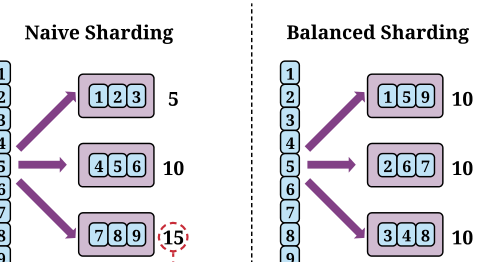
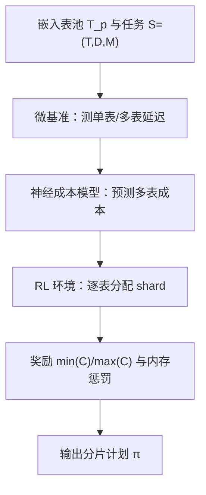
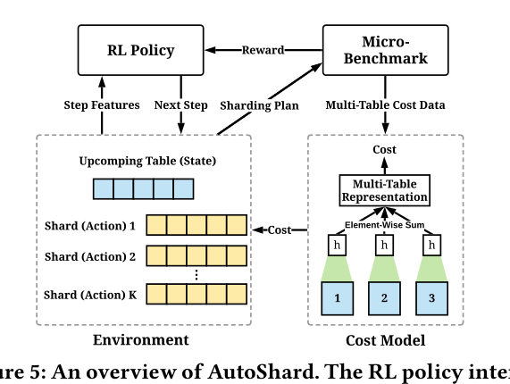

# AutoShard: Automated Embedding Table Sharding for Recommender Systems (面向推荐系统的嵌入表自动分片)

- **会议/期刊**: KDD 2022
- **作者与机构**: Daochen Zha 等，Rice University & Meta Platforms
- **推荐链路定位**: 训练系统/分布式训练（嵌入表分片），非召回/精排/重排
- **研究方向**: 工业架构与系统 / 强化学习优化
- **论文原文**: [https://arxiv.org/abs/2208.06399v1](https://arxiv.org/abs/2208.06399v1)
- **开源代码**: [https://github.com/daochenzha/autoshard](https://github.com/daochenzha/autoshard)

## TL;DR (1分钟核心速览)

工业推荐模型的嵌入表极大，分布式训练中朴素分片会造成 GPU 负载失衡。本文提出 AutoShard：先用微基准与神经成本模型预测多表嵌入算子延迟，再用深度 RL 将“逐表分配 shard”建模为 MDP。在 MetaSyn/MetaProd 上，全量模型取得 88.6% 平衡度与 1.712× 相对随机分片加速，且可零微调迁移到 800 张表。

## Background & Motivation (背景与核心矛盾)

- **主流范式**: DLRM 类模型采用“MLP 数据并行 + 嵌入表模型并行”，将嵌入表切到多张 GPU，再通过 all-to-all 交换查表结果。
- **前人局限**: 启发式分片只按表大小、维度或 pooling factor 贪心分配；但多表成本并非单表成本之和，GPU 并行与算子融合会显著改变实际 kernel time。
- **核心矛盾二**: 分片本质是带内存约束的 NP-hard 划分问题；随机搜索虽可优化，但 1000 次采样在 MetaSyn/MetaProd 上分别耗时 9,783s/14,599s，生产不可用。
- **核心洞察 (Key Insight)**: 单表成本主要受维度、hash size、pooling factor 与 index 分布影响；多表成本通常小于单表成本之和，因此必须直接建模“多表联合成本”。
- **本文切入点**: 用微基准采集真实延迟训练神经成本模型，再用 RL 逐步决定每张表去哪个 shard，以最小化最慢 shard 的延迟。

<figure class="paper-figure" markdown="span">
  <figcaption>图 1：一个说明性分片问题：将 9 张嵌入表通过朴素分片和均衡分片分配到 3 个设备。蓝色块是嵌入表，其数字表示按操作执行时间度量的成本。紫色块是分片，由于并行性，其成本通常小于分片内表成本之和（例如，5 &lt; 1+2+3 且 10 &lt; 4+5+6）。最慢的分片会成为瓶颈，因为其他分片必须等待其完成。优化此任务中的朴素分片可实现 1.5X 加速（即 15/10 = 1.5）。</figcaption>
</figure>

## Method (核心方法设计)

### 1. 整体框架 (Overall Architecture)

AutoShard 由四部分组成：微基准测量嵌入算子真实延迟；神经成本模型根据表特征直接预测多表 kernel time；RL 环境将分片拆成“每步分配一张表”的序列决策；策略网络输出 shard ID。训练时成本模型与策略共享表表示并联合优化；推理时仅需前向传播，单 CPU 核可在秒级完成数百张表分片。

<figure class="paper-figure" markdown="span">
  <figcaption>图 5：AutoShard 概览。强化学习策略与环境交互并逐个分配嵌入表。基于生成的分片，微基准测试测量嵌入表算子的实际延迟，并产生奖励以更新强化学习策略。成本模型基于从微基准测试收集的数据近似多表成本。估计成本将用于增强强化学习训练中的动作表示。那些 1% 的索引是热索引。图 4 中间展示了池化因子以及访问中的影响。</figcaption>
</figure>

### 2. 关键设计拆解 (Key Designs)

1. **神经多表成本模型（替代单表求和）**：单表成本之和会高估多表成本，因为 GPU 可并行批处理多个表。模型对每张表用共享 MLP 生成表表示，再对表表示求和得到定长多表表示，最后经 MLP 回归延迟；损失为 $\mathcal{L}_{cost}=(y-f(X))^2$。求和聚合比 max/mean 更稳，且能适配可变表数。
2. **MDP 与奖励设计（把 NP-hard 分片序列化）**：每步只分配一张表，动作空间从“全组合”降为 shard 数 $K$。状态含当前表特征与剩余表比例；若满足内存约束，奖励为$r=\min(C)/\max(C)$，鼓励各 shard 延迟均衡；若超内存，则用$r=-\max_k((\hat{M}_k-M_k)/M_k)$ 惩罚最严重超限。
3. **策略网络与训练目标**：两层 LSTM 编码历史状态，动作表示由成本模型的多表表示与预测成本拼接，经共享 MLP 打分后 Softmax 输出 shard 概率；价值头估计状态值。采用 IMPALA/V-trace 训练，目标为 $\min_\pi \max_k C_k$s.t.$\hat{M}_k\le M_k$。成本模型与策略共享表特征 MLP，RL 采集的数据也复用于成本模型训练。

## Experimental Setup & Evaluation Protocol (实验设置与评估协议)

- **数据集与预处理**: 非标准推荐排序数据集，而是嵌入表池；无 `5-core` 过滤。MetaSyn 开源合成，MetaProd 为 Meta 生产表池（细节保密）。

| 数据集 | #Tables | Batch Size | Hash Size (Max/Mean/Min) | Pooling Factor (Max/Mean/Min) | 维度/说明 |
| :--- | :---: | :---: | :---: | :---: | :--- |
| MetaSyn | 856 | 65,536 | 12,543,670 / 4,107,458 / 1 | 193 / 15 / 0 | 维度随机取 {16,32}，可复现 |
| MetaProd | 同量级 | 65,536 | 同量级 | 同量级 | 维度更大，生产环境 |

- **数据划分与防穿越 (Splitting Strategy)**: 从表池随机采样 90 个训练任务、10 个测试任务；每个任务为 80 张表分到 8 个设备。迁移实验将表池对半切，构造不同“未见表比例”任务；规模实验直接迁移到最多 800 张表/80 设备，不再微调。
- **排名评测协议 (Ranking Protocol)**: 不适用 Full-Ranking/Sampled Ranking。指标为真实 GPU 延迟下的 `Degree of Balance = min(C)/max(C)` 与 `Speedup = max(C_random)/max(C)`，均由微基准实测，而非采样打分。
- **对比基线与超参设置**: 基线为 rand、size-greedy、dim-greedy、lookup-greedy，以及 random search。RL 超参 $B_1=8,B_2=512,I=20,T=100$；2080Ti/V100；5 个随机种子取均值±方差，未报告显著性检验。

## Key Experimental Results (实验关键数据)

### 1. 主实验对比 (Main Results)

原文图 8 以柱状图报告，未给逐项精确数值；下表汇总可核对趋势，AutoShard 精确值取自同设置消融全量版本，避免臆造基线数字。

| 方法 | 类型 | MetaSyn 平衡度 | MetaSyn Speedup | MetaProd 结论 |
| :--- | :--- | :---: | :---: | :--- |
| Rand | 随机 | 图 8 最低 | 1.0×（基准） | 最低 |
| Size-greedy | 启发式 | 低于 AutoShard | < AutoShard | 低于 AutoShard |
| Dim-greedy | 启发式 | 低于 AutoShard | < AutoShard | 低于 AutoShard |
| Lookup-greedy | 最强启发式 | 低于 AutoShard | < AutoShard | 低于 AutoShard |
| Random Search-1000 | 黑盒搜索 | 仍低于 AutoShard；耗时 9,783s/14,599s | 低于 AutoShard | 不实用 |
| **AutoShard** | **成本模型+RL** | **88.6%±1.2%** | **1.712±0.027** | **一致最优** |

### 2. 消融实验 (Ablation Study)

| 变体 | Degree of Balance | Speedup |
| :--- | :---: | :---: |
| w/o cost modeling | 61.3%±12.9% | 1.420±0.203 |
| w/o dimension feature | 87.6%±1.5% | 1.706±0.056 |
| w/o hash size feature | 87.8%±0.9% | 1.702±0.047 |
| w/o pooling factor feature | 45.9%±1.9% | 1.271±0.035 |
| w/o size feature | 87.0%±1.1% | 1.683±0.049 |
| w/o distribution features | 84.3%±1.3% | 1.688±0.035 |
| **Full AutoShard** | **88.6%±1.2%** | **1.712±0.027** |

### 3. 关键实验发现 (Key Findings)

- **成本模型是主贡献**：移除成本模型后平衡度从 88.6% 跌到 61.3%，Speedup 从 1.712 降到 1.420；说明 RL 若只吃原始特征，难以感知真实多表延迟。
- **pooling factor 与 index 分布最关键**：去掉 pooling factor 后仅 45.9%/1.271×，去掉分布特征为 84.3%/1.688×；这验证了“查表工作量”比单纯表大小更能解释延迟。
- **迁移与效率可生产化**：80 表训练的策略零微调迁移到 800 表/80 GPU；未见表比例 0.0–0.8 时仍保持 ≥80% 平衡与 ≥1.6× 加速，全未见表时 >70% 与约 1.6×；训练约 150 样本/454s 达 80% 平衡，推理数百表仅秒级。

## Highlights & Limitations (亮点、对比与审稿批判)

- **与代表作对比 (vs. Prior Work)**: 相比 size/dim/lookup-greedy，AutoShard 显式建模多表并行成本与 index 分布；相比 random search，它把搜索变成一次策略前向，避免数小时 GPU 搜索；相比 tiered-memory 工作，本文聚焦 GPU 内表分片，二者正交。
- **可迁移亮点**: “共享表表示 + 成本模型作为动作特征”可迁移到其他资源分配问题；逐步分配表的 MDP 设计天然支持表数扩展，表数增加只需增加步数。
- **审稿级局限批判**: ① 成本模型依赖微基准与具体硬件，换 GPU 架构需重新采集/校准；② 奖励只优化延迟均衡，未显式建模 all-to-all 通信、能耗与端到端吞吐；③ MetaProd 不公开，主实验图缺精确数值，复现与显著性检验弱于标准推荐 benchmark。

## Rating (四维评分)

- **方法创新性 (Novelty)**: ⭐⭐⭐⭐ （首个端到端学习式嵌入表分片框架，成本模型+RL 的组合有明确系统创新）
- **评估协议与实验扎实度 (Protocol & Experiments)**: ⭐⭐⭐ （用真实 GPU 延迟与 5 seed 评估，含迁移和规模实验；但主图缺精确表、无显著性检验）
- **写作与数学规范度 (Clarity & Rigor)**: ⭐⭐⭐⭐ （MDP、奖励与成本模型定义清楚，系统背景完整；部分公式排版有瑕疵）
- **工业落地与复现价值 (Industrial & Practical Value)**: ⭐⭐⭐⭐⭐ （Meta 已部署，开源原型，秒级推理，对大规模嵌入表训练有直接工程价值）

