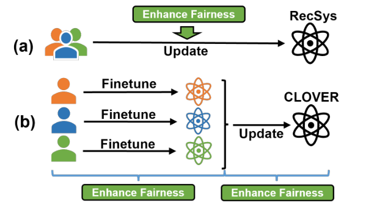
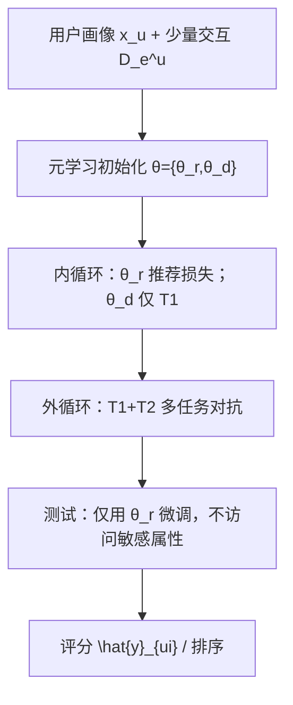
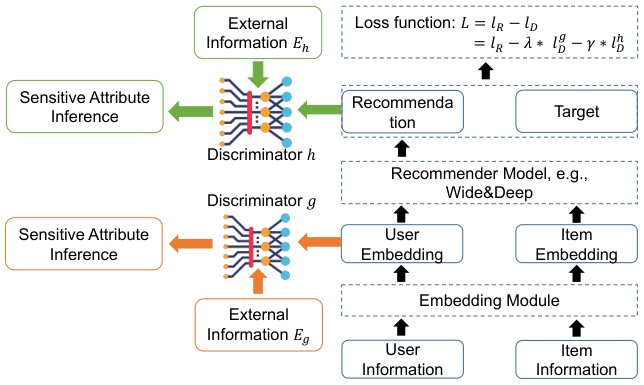

# Comprehensive Fair Meta-learned Recommender System (综合公平的元学习推荐系统)

- **会议/期刊**: KDD 2022 (SIGKDD)
- **作者与机构**: Tianxin Wei, Jingrui He; University of Illinois at Urbana-Champaign
- **推荐链路定位**: 冷启动用户偏好估计与排序（召回后、精排前）
- **研究方向**: 去偏公平、可信隐私与工业架构 / 冷启动与长尾推荐
- **论文原文**: [论文原文链接](https://arxiv.org/abs/2206.04789v1)
- **开源代码**: 暂未开源

## TL;DR (1分钟核心速览)

针对元学习冷启动推荐只追求快速适配、忽视个体/反事实/组公平，且公平正则无法在内循环单用户数据上计算的问题，CLOVER 将三类公平统一为表征级与预测级多任务对抗，并嵌入内/外循环。在 ML-1M/BookCrossing/ML-100K 的用户冷启动划分与最后10条查询协议上，ML-1M AUC 1.000→0.632、CF 0.264→0.044，MAE 0.743→0.731。

## Background & Motivation (背景与核心矛盾)

- **主流范式**: MAML 式元学习推荐：学习全局初始化 $\theta$，内循环用用户少量交互$D_e^u$快速适配$\theta_u$，外循环用查询集$D_q^u$更新$\theta$，MELU/MetaCS/MAMO 为代表。
- **前人局限**: ①公平正则需跨用户组信息，内循环仅单用户数据，无法计算；②既有公平推荐多针对单一公平或非冷启动，未处理双层元训练与未知攻击者。
- **核心洞察**: 三类公平可统一为“敏感属性 $a_u$与表征/预测条件独立”；若表征级对抗收敛，$a_u\to e_u\to\hat y_{ui}$且$I(a_u;e_u)=0$，则$I(a_u;\hat y_{ui})=0$，反事实公平随之成立。
- **本文切入点**: 表征级+预测级多任务对抗嵌入元学习，外循环全优化、内循环只更新判别器 $T_1$，测试不访问新用户敏感属性。

<figure class="paper-figure" markdown="span">
  <figcaption>图1：冷启动公平推荐系统与现有公平推荐系统的区别。</figcaption>
</figure>
*图1：冷启动公平推荐与既有公平推荐的关键差异（需同时约束内/外循环）。*

## Method (核心方法设计)

### 1. 整体框架 (Overall Architecture)

CLOVER 以 MELU 等元学习推荐为骨干：用户画像/物品内容经嵌入得到 $e_u,e_i$，推荐器输出$\hat y_{ui}$；判别器$g$以$e_u$与历史评分$E_g$推断敏感属性，判别器$h$以真实/预测评分$y_{ui},\hat y_{ui}$与物品嵌入$E_h$推断敏感属性。训练时内循环对每个用户先按$l_R$更新推荐参数，仅按$T_1$更新判别器；外循环联合优化$T_1,T_2$与推荐损失。测试时只用元初始化$\theta_r$ 在支持集微调，不更新判别器、不需敏感属性。

<figure class="paper-figure" markdown="span">
  <figcaption>图3：所提出的 CLOVER 的网络结构。</figcaption>
</figure>
*图3：CLOVER 的网络结构（表征级判别器 g 与预测级判别器 h）。*

### 2. 关键设计拆解 (Key Designs)

1. **表征级对抗：个体+反事实公平**：痛点是个体公平要求用户表征不暴露敏感属性；$g$以$e_u$与历史评分$E_g$预测$a_u$，推荐器最小化$l_D^g=-\frac{1}{N}\sum_{u=1}^N\sum_{c=1}^C a_u^c\log g(e_u,E_g)_c$。外部评分使推荐器无法“完全骗过”判别器，从而强化条件独立，并经由马尔可夫链推出反事实公平。
2. **预测级对抗：组公平**：组公平要求不同敏感组预测表现一致；$h$以$y_{ui},\hat y_{ui}$与物品嵌入$E_h$预测$a_u$，损失$l_D^h=-\frac{1}{N}\sum_{u=1}^N\sum_{c=1}^C a_u^c\log h(y_{ui},\hat y_{ui},E_h)_c$。若判别器无法从真实/预测评分推断组别，则组间评分分布对齐。
3. **元学习任务编排与总损失**：总目标 $\mathcal{L}=l_R-\lambda l_D^g-\gamma l_D^h$。内循环只保留$T_1$（判别器更新），去掉$T_2$（推荐器骗判别器）以稳定快速适配、降低训练开销，并避免部署时使用新用户敏感属性；外循环同时优化$T_1,T_2$。推理阶段仅微调推荐器，无额外判别器开销。

## Experimental Setup & Evaluation Protocol (实验设置与评估协议)

- **数据集与预处理**: 沿用 MELU 用户冷启动设置，未报告 5-core 过滤：

| 数据集 | #Users | #Items | #Interactions | 稀疏度 | 敏感属性/说明 |
| :--- | :---: | :---: | :---: | :---: | :--- |
| ML-1M | 6,040 | 3,706 | 1,000,209 | 95.5316% | gender |
| BookCrossing | 278,858 | 271,379 | 1,149,780 | 99.9985% | age |
| ML-100K | 943 | 1,682 | 100,000 | 93.6953% | gender |

- **数据划分与防穿越 (Splitting Strategy)**: 用户按 7:1:2 划分为训练/验证/测试；每用户以有限且不固定的历史交互作 $D_e^u$，最后 10 条交互作查询集$D_q^u$，测试新用户冷启动。
- **排名评测协议 (Ranking Protocol)**: 非 Full-Ranking；基于每用户最后 10 条查询交互计算 MAE/NDCG，AUC/CF/GF 为公平指标；显式评分预测，无负采样。
- **对比基线与超参设置**: PPR、Wide&Deep、DropoutNet、NLBA、MELU，以及 MELU+BS/Reg/IPW/MACR；5 次独立运行均值±方差，正文未报告显著性检验，嵌入维度与 $\lambda,\gamma$ 详见附录。

## Key Experimental Results (实验关键数据)

### 1. 主实验对比 (Main Results)

ML-1M 用户冷启动结果（5 次平均）：

| 方法 | MAE↓ | NDCG↑ | AUC↓ | CF↓ | GF↓ |
| :--- | :---: | :---: | :---: | :---: | :---: |
| PPR | 0.943 | 0.672 | 0.932 | 0.187 | 0.052 |
| Wide&Deep | 0.815 | 0.691 | 0.945 | 0.214 | 0.055 |
| DropoutNet | 0.813 | 0.702 | 0.965 | 0.204 | 0.063 |
| NLBA | 0.795 | 0.701 | 0.971 | 0.254 | 0.056 |
| MELU | 0.743 | 0.755 | 1.000 | 0.264 | 0.054 |
| MELU+Reg | 0.762 | 0.748 | 0.894 | 0.145 | 0.048 |
| MELU+MACR | 0.744 | 0.750 | 0.878 | 0.116 | 0.051 |
| **CLOVER** | **0.731** (↓1.6%) | **0.756** (↑0.1%) | **0.632** (↓28.0%) | **0.044** (↓62.1%) | **0.040** (↓16.7%) |

跨数据集上，BookCrossing：MELU→CLOVER 的 MAE 1.332→1.352（略损），AUC 1.000→0.546，CF 0.259→0.027，GF 0.103→0.089；ML-100K：MAE 0.892→0.880，AUC 0.974→0.562，CF 0.157→0.032，GF 0.048→0.036。

### 2. 消融实验 (Ablation Study)

ML-1M 上任务编排与损失消融：

| 变体 | MAE↓ | NDCG↑ | AUC↓ | CF↓ | GF↓ |
| :--- | :---: | :---: | :---: | :---: | :---: |
| MELU | 0.743 | 0.755 | 1.000 | 0.264 | 0.054 |
| CLOVER w/o（内循环无 T1/T2） | 0.739 | 0.754 | 1.000 | 0.332 | 0.056 |
| CLOVER $T_2$（内循环仅 T2） | 0.761 | 0.741 | 1.000 | 0.247 | 0.062 |
| CLOVER $T_1\&T_2$（内循环双任务） | 0.749 | 0.751 | 0.792 | 0.105 | 0.051 |
| w/o $E_h$ | 0.735 | 0.758 | 0.667 | 0.051 | 0.044 |
| w/o $l_D^h$ | 0.730 | 0.754 | 0.687 | 0.067 | 0.055 |
| w/o $E_g$ | 0.736 | 0.752 | 0.725 | 0.056 | 0.049 |
| w/o $l_D^g$ | 0.738 | 0.754 | 0.914 | 0.198 | 0.043 |
| **CLOVER** | **0.731** | **0.756** | **0.632** | **0.044** | **0.040** |

### 3. 关键实验发现 (Key Findings)

1. **元学习精度与公平强冲突**：MELU 取得最佳精度基线（MAE 0.743、NDCG 0.755），但公平最差（AUC 1.000、CF 0.264）；CLOVER 将 AUC 降至 0.632、CF 降至 0.044，同时 MAE 反降 1.6%，说明对抗训练可正则化推荐器。
2. **内循环只保留 T1 最优**：去掉 T1/T2 后 AUC 仍 1.000、CF 0.332；内循环加入 T2 使 MAE 恶化至 0.761、NDCG 0.741，且 AUC 未降；T1&T2 虽降 AUC 至 0.792，但 CF 0.105，仍逊于 CLOVER 的 0.632/0.044。
3. **两级对抗分工明确**：去掉 $l_D^g$使 AUC 0.632→0.914、CF 0.044→0.198，说明表征级对抗主要承担个体/反事实公平；去掉$l_D^h$使 GF 0.040→0.055，说明预测级对抗补足组公平；外部信息$E_g/E_h$ 进一步降低 CF/GF。

## Highlights & Limitations (亮点、对比与审稿批判)

- **与代表作对比 (vs. Prior Work)**: MELU 只优化冷启动精度，未考虑公平；MELU+Reg/MACR 以正则或单类公平约束为主，且无法利用内循环单用户数据；CLOVER 是首个面向元学习冷启动的“综合公平”框架，并可迁移到 MetaCS、MAMO。
- **可迁移亮点**: “外循环全对抗、内循环仅 T1”兼顾稳定性、效率与部署隐私；在判别器中注入外部评分/物品嵌入，可把公平约束变成更严格的条件独立检验。
- **审稿级局限批判**: 敏感属性仅考虑二元值，未覆盖多类与交叉公平；NDCG 基于每用户最后 10 条查询，非全库排序且未报告显著性检验；对抗训练对 $\lambda,\gamma$ 较敏感且训练开销高于普通元学习，代码未开源。

## Rating (四维评分)

- **方法创新性 (Novelty)**: ⭐⭐⭐⭐ （首次将个体/反事实/组公平统一为表征级+预测级对抗并嵌入元学习冷启动，问题切入新颖）
- **评估协议与实验扎实度 (Protocol & Experiments)**: ⭐⭐⭐ （三个真实数据集、5 次独立运行与消融较完整，但非全库排序、无显著性检验且基线有限）
- **写作与数学规范度 (Clarity & Rigor)**: ⭐⭐⭐⭐ （三类公平定义、命题与算法流程清晰，但仅覆盖二元敏感属性，理论假设较强）
- **工业落地与复现价值 (Industrial & Practical Value)**: ⭐⭐⭐ （部署阶段无需敏感属性且模型无关，但对抗训练调参成本高、无开源实现）

