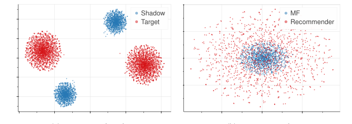
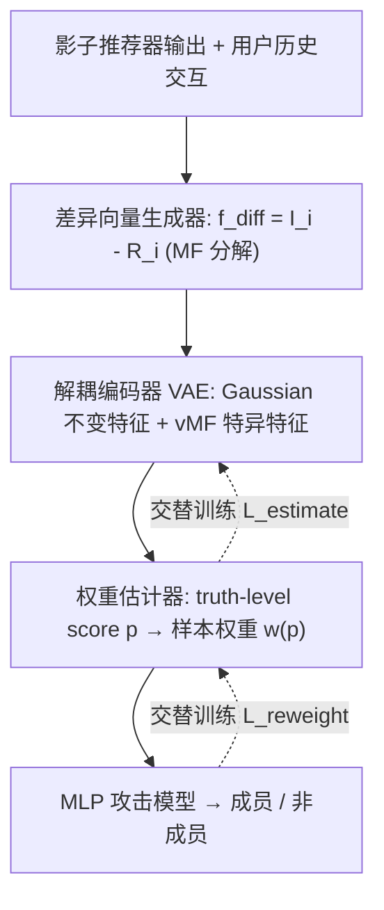
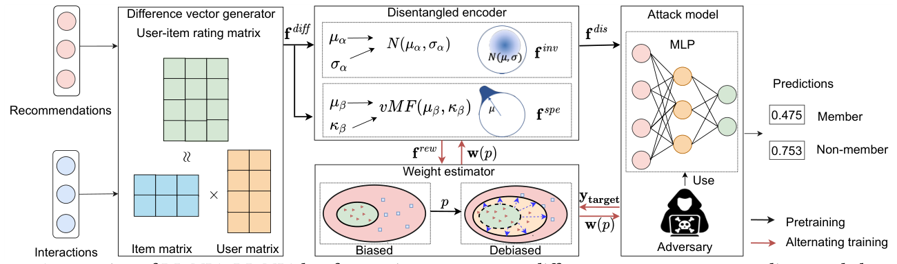

# Debiasing Learning for Membership Inference Attacks Against Recommender Systems (面向推荐系统成员推断攻击的去偏学习)

- **会议/期刊**: KDD 2022 (ACM SIGKDD)
- **作者与机构**: Zihan Wang, Na Huang, Pengjie Ren, Zhumin Chen, Zhaochun Ren（山东大学）；Fei Sun（阿里巴巴）；Hengliang Luo（美团）；Maarten de Rijke（阿姆斯特丹大学）
- **推荐链路定位**: 推荐系统隐私审计（黑盒攻击侧，不改进推荐质量本身）
- **研究方向**: 去偏公平、可信隐私与工业架构 / 协同过滤与双塔召回（差异向量基于 MF 分解）
- **论文原文**: [https://arxiv.org/abs/2206.12401v2](https://arxiv.org/abs/2206.12401v2)
- **开源代码**: 暂未开源

## TL;DR (1分钟核心速览)

推荐系统的成员推断攻击（MIA）依赖“影子推荐器”生成攻击训练数据，但影子与目标推荐器不一致会带来两类偏差：攻击训练数据分布偏移、差异向量因目标隐状态不可观测而估计失准。本文提出 DL-MIA：先用 Gaussian + vMF 双先验 VAE 把差异向量解耦为“推荐器不变 / 推荐器特异”特征，再为每条样本学习 truth-level score 并以交替训练重加权，同时去除两类偏差。在 MovieLens-1M 与 Amazon 两数据集、ItemBase/LFM/NCF 与 GRU4Rec/Caser/BERT4Rec 六种推荐器上，AUC 由基线普遍 <0.7 提升至 80% 以上设置 >0.8（如 ML→AI 0.608→0.980，AG→MG 0.711→0.999）。

## Background & Motivation (背景与核心矛盾)

- **主流范式**: Zhang et al. 的范式是——建立影子推荐器模拟目标推荐器，用 MF 分解用户-物品评分矩阵，把“用户历史交互物品表征均值”与“推荐列表表征均值”之差作为差异向量，再训一个 MLP 攻击器判成员/非成员；攻击者仅有黑盒 top-N 输出可观。
- **前人局限一（训练数据有偏）**: 影子推荐器可用完全不同的算法与数据集构造，t-SNE 上影子（蓝）与目标（红）的特征分布几乎不重叠，跨算法设置下 AUC 塌缩到 0.5 附近。
- **前人局限二（估计有偏）**: 目标推荐器的用户/物品隐状态不可观测，只能用 MF 近似，MF 生成的差异向量与真实隐状态差异向量分布严重背离，使“相似度即成员性”的判别信号被噪声淹没。
- **核心洞察 (Key Insight)**: 差异向量可视为“跨推荐器共享的成员性差距（不变部分）+ 由具体模型决定的偏移（特异部分）”的叠加；同时每条差异向量的可信度并不相同，应做样本级加权。
- **本文切入点**: 解耦 + 重加权 + 交替训练，一次性把两类偏差纳入同一个可训练框架。

<figure class="paper-figure" markdown="span">
  <figcaption>图1：训练数据与估计偏差的可视化结果。(a) 由影子推荐器（蓝色）与目标推荐器（红色）生成的 MIA 数据集之间的偏差。(b) 使用 MF（蓝色）生成的差异向量与推荐器中的隐藏状态（红色）之间的偏差。</figcaption>
</figure>

## Method (核心方法设计)

### 1. 整体框架 (Overall Architecture)

DL-MIA 沿用“影子推荐器 → 差异向量 → MLP 攻击器”的黑盒链路，在中间插入两个去偏模块。输入侧：在影子数据集上训练 $\mathcal{M}_{shadow}$，对用户$i$取交互物品向量均值$\mathbf{I}_{i}$与推荐物品向量均值$\mathbf{R}_{i}$，得到$\mathbf{f}_{diff,i}=\mathbf{I}_{i}-\mathbf{R}_{i}$；该向量先经 VAE 解耦编码器拆成$\mathbf{f}_{inv}$（Gaussian 先验）与$\mathbf{f}_{spe}$（vMF 先验）并拼接为$\mathbf{f}_{dis}$；权重估计器为每条$\mathbf{f}_{dis}$学 truth-level score$p$，经线性层转为样本权重$w(p)$得到$\mathbf{f}_{rew}$；最后由 2 隐层 MLP 输出成员概率并以 BCE 训练。训练分两阶段：先联合预训练编码器与攻击器 200 epoch，再每 10 epoch 在$\mathcal{L}_{reweight}$与$\mathcal{L}_{estimate}$ 间交替，共 100 epoch；推理只需向目标推荐器请求一次 top-100 列表。

<figure class="paper-figure" markdown="span">
  <figcaption>图2：DL-MIA 概览。DL-MIA 包含四个主要组件：差异向量生成器、解耦编码器、权重估计器和攻击模型。</figcaption>
</figure>

### 2. 关键设计拆解 (Key Designs)

1. **双先验 VAE 解耦编码器（剥掉推荐器特有偏移）**：为消除影子/目标分布 shift，假设差异向量由两个独立隐变量生成，$p_\theta(\mathbf{f}_{diff},\mathbf{f}_{inv},\mathbf{f}_{spe})=p_\theta(\mathbf{f}_{inv})p_\theta(\mathbf{f}_{spe})p_\theta(\mathbf{f}_{diff}\mid \mathbf{f}_{inv},\mathbf{f}_{spe})$，后验因式分解为$q_\phi(\mathbf{f}_{inv}\mid\mathbf{f}_{diff})q_\phi(\mathbf{f}_{spe}\mid\mathbf{f}_{diff})$，优化
   $\mathcal{L}_{ELBO}=\mathbb{E}\big[\log p_\theta(\mathbf{f}_{diff}\mid\mathbf{f}_{inv},\mathbf{f}_{spe})\big]-\mathrm{KL}\big(q_\phi(\mathbf{f}_{inv}\mid\mathbf{f}_{diff})\,\|\,p_\theta(\mathbf{f}_{inv})\big)-\mathrm{KL}\big(q_\phi(\mathbf{f}_{spe}\mid\mathbf{f}_{diff})\,\|\,p_\theta(\mathbf{f}_{spe})\big)$。
   不变特征用对角 $\mathcal{N}(\boldsymbol{\mu}_\beta,\mathrm{diag}(\boldsymbol{\sigma}_\beta))$对标准正态（KL 闭式）；特异特征用$\mathrm{vMF}(\boldsymbol{\mu}_\alpha,\kappa_\alpha)$对均匀先验$\mathrm{vMF}(\cdot,0)$（KL 为含 Bessel$I_v$的闭式）。直觉：vMF 只约束球面方向、对模长不敏感，因此模型特异性的尺度偏移被均匀先验“压平”而不携带信息；Gaussian 保留幅值，使跨模型一致的成员性差距得以保留。重构项取$\mathcal{N}\big(f([\mathbf{f}_{inv};\mathbf{f}_{spe}]),\mathbf{I}\big)$，$f(\cdot)$ 为 3 隐层 MLP。
2. **truth-level score 与交替训练（压制差异向量估计误差）**：定义 $p=\delta(\mathcal{A}(\mathbf{f}'),y^{*})/\delta(\mathcal{A}(\mathbf{f}_{dis}),y^{*})$（$\delta$为 BCE，$\mathbf{f}'$为真值差异向量），由去偏等式$p\cdot\delta(\mathcal{A}(\mathbf{f}_{dis}),y^{*})=\delta(\mathcal{A}(\mathbf{f}'),y^{*})$ 构造约束
   $\mathcal{L}_{estimate}=\sum_{j}\lambda_j\sum_{i=1}^{N_j}\big(p_{i,j}\cdot\delta(\mathcal{A}(\mathbf{f}_{dis}^{i,j}),y^{*,i,j})-\delta(\mathcal{A}(\mathbf{f}'^{i,j}),y^{*,i,j})\big)^2,\ \lambda_j=1/N_j,\ j\in\{shadow,target\}$。
   由于 $\mathbf{f}'$与$y^{*}_{target}$不可见，采用交替策略：固定$p$最小化重加权损失$\mathcal{L}_{reweight}=\mathcal{L}'_{BCE}+\mathcal{L}'_{ELBO}$（权重由$w(p)=\mathrm{Linear}(p)$给出）更新编码器与攻击器；再以攻击器在目标侧的输出$\mathbf{f}_{rew}$与$\hat{y}_{target}$近似$\mathbf{f}'$、$y^{*}_{target}$，回代最小化$\mathcal{L}_{estimate}$精修$p$。直觉：$p$ 即“该差异向量的标签可信度”，误差大的伪样本被自动降权，避免错误估计污染攻击器。
3. **训练目标、负采样与推理开销**：最终目标为 $\mathcal{L}_{reweight}$与$\mathcal{L}_{estimate}$ 的交替优化，无需负采样（成员/非成员由 target/shadow 子集随机对半划分自然构造）；推理成本约等于一次 MF 分解加两次 MLP 前向，攻击侧仅需一次 top-100 请求，但训练需 200+100 epoch 两阶段交替。

## Experimental Setup & Evaluation Protocol (实验设置与评估协议)

- **数据集与预处理**: 通用推荐器场景剔除交互数 <20 的用户；序列推荐器场景采用 `5-core`（用户与物品交互均 ≥5）。

| 数据集 | #Users | #Items | #Interactions | 稀疏度 | 特征/场景说明 |
| :--- | :---: | :---: | :---: | :---: | :--- |
| MovieLens-1M | 6,040 | 3,706 | 1,000,209 | 4.47% | 通用推荐器（ItemBase / LFM / NCF） |
| Amazon Digital Music | 840,372 | 456,992 | 1,584,082 | 0.0004% | 通用推荐器；单物品交互用户极稀疏 |
| Amazon Beauty | 1,210,271 | 249,274 | 2,023,070 | 0.0007% | 序列推荐器（GRU4Rec / Caser / BERT4Rec） |

- **数据划分与防穿越**: 采用 **成员/非成员随机划分** 而非时间切分——每个数据集切为互斥的 shadow 集、target 集与差异向量生成集（后者保证覆盖全部物品），target 与 shadow 再各自随机对半分为成员/非成员。
- **排名评测协议**: 采用 **AUC**（二分类排序能力，非 Full-Ranking 全库排序）；攻击者黑盒，仅观测成员用户的 top-100 推荐，非成员用户按前作设定被投喂最流行物品；AUC=0.5 等价随机猜测。未报告低 FPR 下的 TPR。
- **对比基线与超参设置**: 仅 `Biased`（Zhang et al.，唯一可直接迁移的 rec-MIA 基线），另设 β-VAE / FactorVAE 两个编码器变体；攻击器 MLP 隐层 32/8，ReLU + softmax；编码器 Adam ($\eta=10^{-3}$)，攻击器 SGD ($\eta=0.01$, momentum 0.7)。设置编码如 `MLAI` = 影子(MovieLens+LFM) → 目标(Amazon+ItemBase)。

## Key Experimental Results (实验关键数据)

### 1. 主实验对比 (Main Results)

| 设置（影子→目标） | 类型 / 生成器 | Biased AUC | DL-MIA AUC | Improv.% |
| :--- | :--- | :---: | :---: | :---: |
| ML→AI | 通用 / MF | 0.608 | **0.980** | +61.2% |
| MI→MN | 通用 / MF | 0.706 | **0.959** | +35.8% |
| ML→MI | 通用 / MF | 0.931 | **0.997** | +7.1% |
| MN→ML | 通用 / MF | 0.914 | **0.987** | +8.0% |
| MI→MN | 通用 / BERT | 0.575 | **0.830** | +44.3% |
| ML→MI | 通用 / BERT | 0.505 | **0.971** | +92.3% |
| AG→MG | 序列 / MF | 0.711 | **0.999** | +40.5% |
| MG→AG | 序列 / MF | 0.908 | **0.986** | +8.6% |
| MG→MC | 序列 / MF | 0.922 | **0.992** | +7.6% |
| AG→MC | 序列 / MF | 0.704 | **0.999** | +41.9% |
| AG→MG | 序列 / BERT | 0.517 | **0.873** | +68.9% |

### 2. 消融实验 (Ablation Study)

| 变体 | AIMI | ALML | AIML | AGMG | MGAG | MGMC |
| :--- | :---: | :---: | :---: | :---: | :---: | :---: |
| Biased（无解耦、无重加权） | 0.525 | 0.510 | 0.524 | 0.711 | 0.908 | 0.922 |
| -Reweight（仅解耦编码器） | 0.553 | 0.518 | 0.531 | 0.723 | 0.915 | 0.936 |
| **DL-MIA（解耦 + 重加权）** | **0.999** | **0.995** | **0.993** | **0.999** | **0.986** | **0.992** |
| DL-MIA ($\beta$-VAE) | 0.920 | 0.993 | 0.995 | 0.999 | 0.983 | 0.993 |
| DL-MIA (FactorVAE) | 0.999 | 0.987 | 0.999 | 0.999 | 0.982 | 0.994 |

### 3. 关键实验发现 (Key Findings)

1. **主导增益来自重加权而非解耦**：仅启用解耦编码器（`-Reweight`）相对 Biased 只提升 0.003–0.028（AIML 0.524→0.531，MGMC 0.922→0.936）；接上权重估计器后直接跳到 0.99+（AGMG 0.723→0.999）。这说明真正的瓶颈是“差异向量估计误差”而非分布 shift，与图 1(b) 中 MF 差异向量和真实隐状态严重背离的观察一致。
2. **跨算法错配是性能分水岭**：同算法/同数据集设置下（MI→MI 0.998、MG→AG 0.908）两法差距有限；一旦影子与目标算法/数据集错配，Biased 塌到 0.505–0.575（近随机），DL-MIA 仍保持 0.830–0.971（+44%～+92%），证明解耦确实抽出了推荐器不变特征，攻击不再依赖“猜中目标算法”。
3. **防御下风险未归零**：接入 Popularity Randomization 后双方 AUC 均下降，但 DL-MIA 在所有设置上仍高于 Biased（图 4），说明其增益源于估计精度提升而非放大过拟合信号；同时也意味着“给非成员推荐热门物品”这一对策不足以对冲去偏后的攻击。此外换成 BERT 语义生成器后 DL-MIA 依然有效（AG→MG 0.873 vs 0.517），说明框架对差异向量生成器可插拔。

## Highlights & Limitations (亮点、对比与审稿批判)

- **与代表作对比 (vs. Prior Work)**: 相较 Zhang et al. [53] 的单阶段经验式攻击，本文把“影子-目标落差”从隐含假设变成显式建模的可去偏变量；相较通用 MIA（Shokri / Salem 系列需模型结构或置信度分数），本文严格限定黑盒 top-N 可观测，威胁模型更贴近真实工业接口；相较 β-VAE / FactorVAE 等通用解耦变体，本文用 vMF 均匀先验专门承载“只保留方向”的特异特征，因而更契合推荐器偏移的方向性。
- **可迁移亮点**: (i) “Gaussian 不变 + vMF 特异”的双先验解耦可直接搬到跨域/多场景推荐（CDR）的域不变表征学习；(ii) truth-level score 式的样本可信度重加权 + 交替估计，可迁移到隐式反馈假阳性去噪与伪标签训练。
- **审稿级局限批判**: (i) 假设攻击者可获得与目标分布部分重叠的 shadow 数据并能反复请求 top-100，且成员/非成员为随机划分（非时间切分），真实工业时序场景下的攻击可行性可能被高估；(ii) 训练需 200 epoch 预训练 + 100 epoch 交替、VAE 与多个闭式 KL（Bessel 函数），开销远高于单阶段基线，且未开源、交替周期 10 epoch 等超参敏感性未做分析；(iii) 仅用 AUC 评价，缺少 TPR@FPR=1% 等低误报率下的实用指标与方差/显著性检验，隐私风险结论偏乐观。

## Rating (四维评分)

- **方法创新性 (Novelty)**: ⭐⭐⭐⭐ （首次将去偏学习引入推荐系统 MIA，双先验解耦与 truth-level 重加权组合有新意，但两个组件在域适应/去偏文献中均为成熟套件，属组合式创新）
- **评估协议与实验扎实度 (Protocol & Experiments)**: ⭐⭐⭐ （覆盖 6 种推荐器 × 多组影子-目标组合并含防御实验，但仅 1 个基线、数据集仅 3 个、无显著性检验与低 FPR 指标）
- **写作与数学规范度 (Clarity & Rigor)**: ⭐⭐⭐⭐ （两类偏差的动机可视化与 ELBO、vMF KL 闭式推导清晰，但 truth-level score 定义涉及不可观测量、依赖交替近似的论证略绕）
- **工业落地与复现价值 (Industrial & Practical Value)**: ⭐⭐⭐ （黑盒 top-100 威胁模型对隐私审计有直接价值，但两阶段交替训练成本高、无开源代码，难以直接嵌入工业压测流水线）

