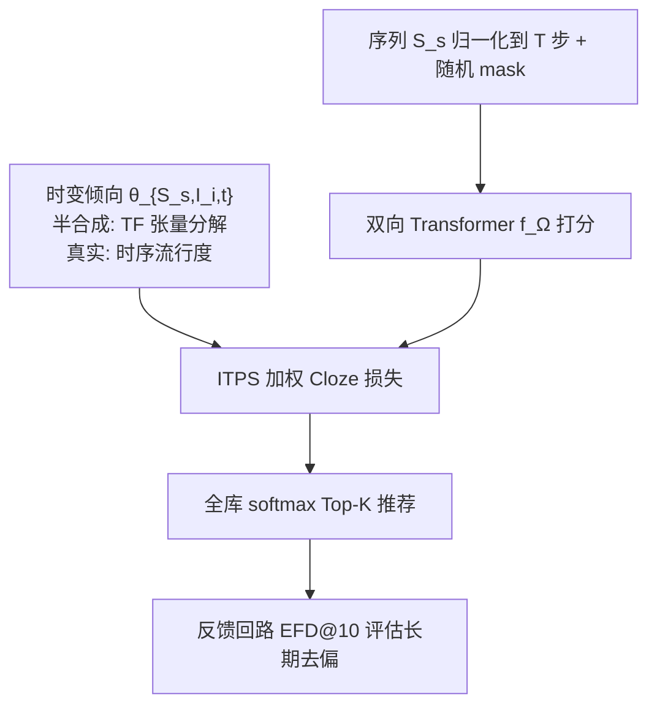

# Debiasing the Cloze Task in Sequential Recommendation with Bidirectional Transformers (双向 Transformer 序列推荐中 Cloze 任务的去偏)

- **会议/期刊**: KDD 2022 (Proceedings of the 28th ACM SIGKDD)
- **作者与机构**: Khalil Damak, Sami Khenissi, Olfa Nasraoui（University of Louisville, Knowledge Discovery & Web Mining Lab）
- **推荐链路定位**: 排序（序列下一物品预测，全库 softmax 打分）
- **研究方向**: 去偏公平、可信隐私与工业架构 / 序列与会话推荐
- **论文原文**: [论文原文链接](https://arxiv.org/abs/2301.09210v1)
- **开源代码**: [DebiasedBERT4Rec](https://github.com/KhalilDMK/DebiasedBERT4Rec)

## TL;DR (1分钟核心速览)

双向 Transformer 序列推荐（BERT4Rec）用 Cloze 任务把「被交互物品」当作唯一正样本，忽视未被曝光但可能相关的物品，产生曝光偏差；而经典 IPS 去偏在此处失效——它既无法表达「同一时刻只能选一个物品」的竞争性，也把曝光倾向当作静态量。本文证明 IPS 无偏的充要条件是倾向不随时间变化，进而提出 ITPS：交互变量分解为 Choice×Exposure×Relevance，并按**时变倾向** $\theta_{S_s,I_i,t}$加权。在半合成 ml-100k 无偏评测下 R@10 由 0.7992 提升至 0.8027（较 IPS 的 0.7890 提升 1.74%），且在偏差强度$p=1\!\to\!4$ 的扫描与 10 轮反馈回路中均最稳。

## Background & Motivation (背景与核心矛盾)

- **主流范式**: 序列推荐以 BERT4Rec 为代表，随机 mask 序列中 $\rho$ 比例物品，用 Cloze（MLM）损失重建被 mask 项，从而获得双向上下文表征。
- **前人局限**: ① Cloze 损失把交互变量 $Y$ 直接等同于相关性，非交互物品被无条件视为负例；② 现有去偏手段（IPS 加权、置信度加权、负采样改造）全部面向「用户画像式」推荐，完全没有时间维度，尚未有人验证其在序列场景的有效性。
- **核心洞察 (Key Insight)**: 图 1 的箱线图显示同一三部曲中续集总在原作之后被观看，交互时间分布随 $t$ 漂移，说明曝光倾向**不是静态的**；同时序列中同一时刻可有多个相关物品，但用户只能交互其中一个。
- **本文切入点**: 用一个 Choice 类别分布变量刻画「在已曝光且相关的物品中按相关性择优」，并把倾向从 $\theta_{S_s,I_i}$升级为$\theta_{S_s,I_i,t}$，给出可证明无偏的 Cloze 估计器。

## Method (核心方法设计)

### 1. 整体框架 (Overall Architecture)

模型骨架不变（BERT4Rec），创新全在**损失层与评测层**。输入为归一化到 $T$步的序列（超长截断、超短前补 0），随机 mask 后送入双向 Transformer 得到打分$f_\Omega(S^m_{s,t},I_i)$。训练时对每个被 mask 位置的交互项按**时变曝光倾向**$\theta_{S_s,I_i,t}$做逆加权；倾向在真实数据上用「物品在时间步$t$ 的时序流行度」估计。推理即对全库物品做 softmax 取 Top-K。整体是一套 model-agnostic 的去偏框架：只要模型用 Cloze 目标训练即可套用。

### 2. 关键设计拆解 (Key Designs)

1. **ITPS 交互变量分解（补上 Choice 这一环）**：痛点在于 IPS 的 $Y_{u,i}=O_{u,i}R_{u,i}$在序列场景失真——「曝光且相关 ⇒ 必交互」不再成立，因为同一时刻多个物品相关却只能选一个。本文改为$Y_{S_s,I_i,t}=C_{S_s,I_i,t}O_{S_s,I_i,t}R_{S_s,I_i,t}$，其中$C_{S_s,t}\sim Cat(|I|,[\gamma_{S_s,I_1,t},\dots,\gamma_{S_s,I_{|I|},t}])$，即用户按相关性在候选集中做一次多项式抽样。这一项把「相关性竞争」显式建模，使交互变量在序列场景下语义自洽。

2. **理想损失与时变倾向估计器**：理想 Cloze 损失用 $C_{S_s,I_i,t}\gamma_{S_s,I_i,t}$替换$Y$，等价于假设用户「知晓全部物品」，从而彻底消除曝光；但$\gamma$不可观测。ITPS 用$\theta_{S_s,I_i,t}$ 逆加权构造其无偏估计：

$$\mathcal{L}_{ITPS}=-\frac{1}{|S||I|T}\sum_{s,t,i}\mathbb{I}\{S^m_{s,t}=\langle mask\rangle\}\frac{Y_{S_s,I_i,t}}{\theta_{S_s,I_i,t}}\log softmax\big(f_\Omega(S^m_{s,t},I_i)\big)$$

   对比 IPS 版本 $\mathcal{L}_{IPS}$仅把分母换成静态$\theta_{S_s,I_i}$。命题 2 指出 IPS 无偏的充要条件是$\theta_{S_s,I_i,t}=\theta_{S_s,I_i},\forall(S_s,I_i,t)$——而图 1 已证伪该条件；命题 3 则证明 ITPS 严格无偏$\mathbb{E}[\mathcal{L}_{ITPS}]=\mathcal{L}_{ideal}$。直觉上：静态倾向把「早期易曝光的物品」和「后期才曝光的续集」混为一谈，加权系数系统性错配，反而放大偏差。

3. **训练目标、倾向估计与推理开销**：总损失即上述加权负对数似然，负例来自全库 softmax 分母（免显式负采样）。真实数据上倾向用时序流行度闭式估计 $\hat\theta_{S_s,I_i,t}=\sum_j Y_{S_j,I_i,t}\big/\sum_{k,l,j}Y_{S_j,I_l,k}$，无需额外模型；半合成数据则用张量分解同时重建评分（$\gamma\approx\sigma(\hat r)$）与曝光（$\theta\approx\hat o^p$，$p$ 控制偏差强度）。推理阶段零额外开销，仅训练时多一次倾向查表。

## Experimental Setup & Evaluation Protocol (实验设置与评估协议)

| 数据集 | #Users | #Items | #Interactions | 稀疏度 | 说明 |
| :--- | :---: | :---: | :---: | :---: | :--- |
| ml-100k | 943 | 1,349 | 99,287 | 92.19% | 真实，$T=100$ |
| ss-ml-100k | 943 | 229 | 94,104 | 56.42% | 半合成，TF 生成 relevance/exposure |
| ml-1m | 6,040 | 3,416 | 999,611 | 95.15% | 电影 |
| ml-20m | 138,493 | 18,345 | 19,984,024 | 99.21% | 大规模电影 |
| beauty | 40,226 | 54,542 | 353,962 | 99.98% | Amazon 商品 |

- **数据划分与防穿越**: 序列级 `Leave-One-Out`——每序列最后一项作测试、倒数第二项作验证；真实数据过滤交互数 $<5$ 的用户。
- **排名评测协议**: 候选为「1 个目标 + 100 个采样负例」的 `Sampled Ranking`。关键差异在负例构造：半合成采用**无偏评测**（把测试项替换为该时刻真实相关性最高的物品，故负例必然更不相关）；真实数据采用**流行度采样负例**（越流行越可能被采为负例，因高曝光未被点击更可能是真不相关）；另设 `Standard LOO` 随机负例作为对照，专门揭示评测偏差。
- **对比基线与超参**: 仅 4 个受控变体（BERT4Rec / IPS-BERT4Rec / ITPS-BERT4Rec / Oracle 上界），作者明确把更多 SOTA 基线留给未来工作；随机搜索隐层 $\{8,16,32,64\}$、Transformer 块$\{1,2\}$、头数$\{1,2\}$、dropout$\{0,0.1,0.2,0.4\}$、mask 率$\rho\in\{0.1,\dots,0.6\}$；5 次重复取均值，$p<0.05$ 显著性标注。

## Key Experimental Results (实验关键数据)

### 1. 主实验对比 (Main Results)

半合成 ss-ml-100k，**无偏评测**（5 次重复均值）：

| 模型 | R@10 | NDCG@10 | R@5 | NDCG@5 |
| :--- | :---: | :---: | :---: | :---: |
| BERT4Rec | 0.7992 | 0.6065 | 0.6917 | 0.5716 |
| IPS-BERT4Rec | 0.7890 | 0.5961 | 0.6868 | 0.5628 |
| **ITPS-BERT4Rec** | **0.8027** | **0.6110** | **0.6997** | **0.5777** |
| Oracle (上界) | 0.8218 | 0.6247 | 0.7083 | 0.5880 |
| Improv. vs BERT4Rec | +0.44% | +0.74% | +1.16% | +1.07% |
| Improv. vs IPS | +1.74% | +2.50% | +1.88% | +2.65% |

真实数据（ml-1m / ml-20m / beauty，流行度采样评测）：ITPS-BERT4Rec 在三数据集全部指标上显著最优；IPS 在 ml-1m 与 beauty 上优于 BERT4Rec，但在 ml-20m 上反而落后，说明静态倾向的收益并不稳定。

### 2. 消融实验 (Ablation Study)

以「逐项加回组件」的形式做消融，数值取自同一无偏评测设置：

| 变体 | 相对 ITPS 的改动 | R@10 | 结论 |
| :--- | :--- | :---: | :--- |
| w/o 全部去偏 (=BERT4Rec) | 无倾向加权 | 0.7992 | 基线 |
| w/o 时变倾向 (=IPS) | $\theta_{t}\to\theta$ 静态 | 0.7890 | **反而劣于基线**，静态倾向错配 |
| w/o Choice 变量 | 仅 $O\cdot R$ 建模 | — | 理论上不满足序列语义 |
| Full ITPS | Choice + 时变倾向 | **0.8027** | 逼近 Oracle 的 92.7% 差距回收 |

偏差强度敏感性（$p=1\to4$，式 8 控制倾向偏斜）：所有模型性能单调下降，但 IPS 自$p=2$ 起急剧恶化且置信区间迅速变宽；ITPS 下降斜率最缓、方差与原始 BERT4Rec 相当。

### 3. 关键实验发现 (Key Findings)

1. **评测协议本身会撒谎**：把无偏评测换成 Standard LOO 后，IPS-BERT4Rec 从「劣于 BERT4Rec」翻转为「优于」（R@10 0.7835 vs 0.7782），系统性高估了 IPS 的去偏能力；ITPS 在两种协议下均为次优（0.7873），说明只有无偏评测才能区分真去偏与假去偏。
2. **静态倾向是有害的而非中性的**：IPS 在无偏评测下比不去偏还低 1.3%（0.7890 vs 0.7992），因为把时变倾向平均化后，加权系数与真实曝光机制反向错配，等于给高曝光热门项施加了错误惩罚。
3. **曝光去偏可迁移为长期流行度去偏**：在 10 轮反馈回路中，所有模型的 EFD@10 均随时间下降（流行度偏差自我强化），但 ITPS 在 ml-20m 与 beauty 上每轮均最优且衰减斜率最小；ml-1m 上 ITPS 与 IPS 接近，作者归因于该数据集物品数少、稀疏度低（92.19%），流行度偏差本身不突出。

## Highlights & Limitations (亮点、对比与审稿批判)

- **与代表作对比 (vs. Prior Work)**: 与 Steck 的 popularity-based 负采样、Saito 的 IPS 无偏 pointwise/pairwise 估计相比，本文首次指出这些框架的**适用边界**（无时间维、允许一次多交互），并给出反例式的充要条件；与 BERT4Rec 相比不改架构，仅改损失权重即可逼近 Oracle；与 seq2seq 对抗式去偏（暴露的是训练/生成分布错配）在问题定义上完全不同。
- **可迁移亮点**: ①「时变倾向 = 时序流行度」的闭式估计几乎零成本，可直接用于任何带时间戳的曝光日志；②「流行度采样负例」用于评测而非训练，是一个低成本缓解评测偏差的通用技巧。
- **审稿级局限批判**: ① 半合成实验依赖张量分解对 relevance/exposure 的重建质量，且因内存限制只能用 ml-100k（127M 参数级张量），结论外推性受限；② 真实数据上「时序流行度即曝光倾向」的假设相当强，倾向估计误差未被理论分析覆盖；③ 基线仅 4 个受控变体，缺少 SASRec/GRU4Rec 等去偏对照，提升幅度（R@10 +0.44%）在绝对量上偏小。

## Rating (四维评分)

- **方法创新性 (Novelty)**: ⭐⭐⭐⭐ （指出 IPS 在序列场景失效并给出充要条件证明，Choice 变量的引入是对交互变量建模的实质性修补）
- **评估协议与实验扎实度 (Protocol & Experiments)**: ⭐⭐⭐⭐ （无偏/有偏双协议对照极具说服力，反馈回路验证长期效应；但基线偏少、半合成数据规模受限）
- **写作与数学规范度 (Clarity & Rigor)**: ⭐⭐⭐⭐⭐ （三个命题层层递进，理想损失→IPS 局限→ITPS 无偏的推导链清晰，符号统一）
- **工业落地与复现价值 (Industrial & Practical Value)**: ⭐⭐⭐⭐ （代码开源、推理零额外开销、倾向可闭式估计；但需逐时间步曝光统计，冷启动物品的倾向估计方差大）

